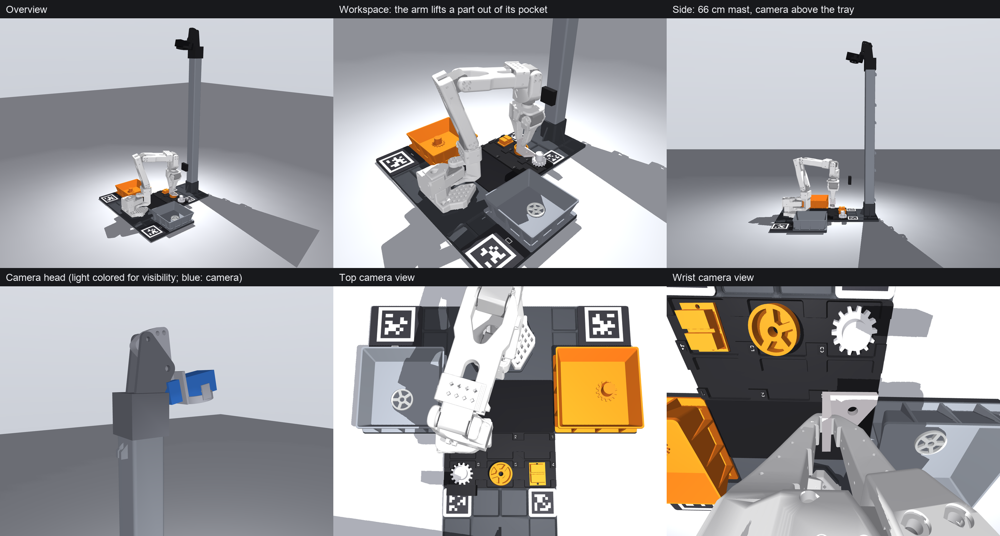

<p align="center">English · <a href="README.tr.md">Türkçe</a></p>

<p align="center">
  
</p>

<h1 align="center">so101-flywheel</h1>

<p align="center"><b>SO-101 zero to hero: build a cell, record demonstrations, train a VLA, run it, improve it.</b><br>
Plain <a href="https://github.com/huggingface/lerobot">LeRobot</a> commands on an end-of-line quality control task, with a step-by-step guide in English and Turkish.</p>

<p align="center">
  <a href="https://github.com/TheRobotStudio/SO-ARM100"></a>
  <a href="https://github.com/huggingface/lerobot"></a>
  <a href="https://huggingface.co/docs/lerobot/smolvla"></a>
  <a href="https://github.com/google-deepmind/mujoco"></a>
  <a href="https://github.com/fport/so101-flywheel/actions/workflows/ci.yml"></a>
  <a href="https://www.python.org/"></a>
  <a href="LICENSE"></a>
</p>

<p align="center">
  <a href="https://zero2hero.getporti.com"><b>Guide</b></a> ·
  <a href="docs/guide/en/record.md">Recording</a> ·
  <a href="docs/guide/en/data-quality.md">Data quality</a> ·
  <a href="docs/guide/en/train.md">Training</a> ·
  <a href="hardware/README.md">Print files</a> ·
  <a href="docs/sim.md">Simulation</a>
</p>

## Start

```bash
uv sync --extra robot
scripts/teleop.sh                           # leader drives follower
scripts/cams.sh                             # both cameras in the browser, to aim them
uv run flywheel-inspect                     # top camera reads the tray: a bin per pocket
scripts/record.sh 1 ok                      # 10 episodes of "put the part from pocket 1 in the OK bin"
scripts/status.sh                           # what is recorded, which block is next
scripts/train.sh                            # fine-tune SmolVLA on a rented GPU
scripts/rollout.sh 1 ok                     # the policy moves the arm
```

Your ports, camera indices and Hugging Face user go in `scripts/env.local.sh` (template at the top of [`scripts/env.sh`](scripts/env.sh)). Each script prints the `lerobot-*` command it runs.

## Why

A tray holds six 3D-printed parts: rims, gears, brake pads and brackets, some with a missing hole or a broken
corner. The top camera looks once and decides OK or REJECT per pocket; the arm is then told, one part at a time,
"put the part from pocket 3 in the REJECT bin". Deciding and moving are separate, so each can be tested and fixed
alone. The policy only has to follow a sentence, and the sentence is the only thing in the data that predicts the
target.

## What is here

| | |
| --- | --- |
| 📖 **Guide** | Eight steps from an empty desk to a scored policy, in [English](docs/guide/en/index.md) and [Turkish](docs/guide/tr/index.md) |
| 🦾 **Scripts** | Thin wrappers around `lerobot-teleoperate`, `-record`, `-train`, `-rollout`; no custom recorder |
| 🔎 **Inspection** | `flywheel-inspect`: AprilTags → six pocket crops → measured holes, spokes, teeth, corners → a bin per pocket |
| 🖨️ **Hardware** | One `params.yaml` drives the parametric CAD and the sim; numbered print plates for a Bambu X2D |
| 🧪 **Simulation** | MuJoCo copy of the cell with a scripted expert, for sim-to-real experiments |

## More

```
docs/guide/   the guide, Markdown, en/ and tr/ (rendered to zero2hero.getporti.com by site/build.py)
scripts/      env.sh (rig settings), teleop, calibrate, record, status, review, train, rollout
src/flywheel/ qc (inspection), sim (MuJoCo), hardware (CAD), status
tests/        pytest
hardware/     params.yaml, print/ (plates), calibration/
```

Tests: `uv run pytest`.

## License

MIT, see [LICENSE](LICENSE). The SO-101 model under `src/flywheel/sim/assets/so101/` belongs to TheRobotStudio
and is licensed Apache-2.0 ([NOTICE](src/flywheel/sim/assets/so101/NOTICE.md)).
