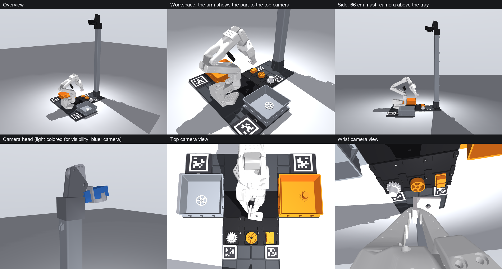

<p align="center">English · <a href="README.tr.md">Türkçe</a></p>

<p align="center">
  
</p>

<h1 align="center">so101-flywheel</h1>

<p align="center"><b>A self-improving data flywheel for the SO-101 arm, on an end-of-line quality control task.</b><br>
Record, verify, correct, retrain. Simulated in MuJoCo, printed on a Bambu X2D, trained with <a href="https://github.com/huggingface/lerobot">LeRobot</a>.</p>

<p align="center">
  <a href="https://github.com/TheRobotStudio/SO-ARM100"></a>
  <a href="https://github.com/huggingface/lerobot"></a>
  <a href="https://github.com/google-deepmind/mujoco"></a>
  <a href="https://www.python.org/"></a>
  <a href="https://flywheel.getporti.com"></a>
  <a href="LICENSE"></a>
</p>

<p align="center">
  <a href="docs/PRD.md">PRD</a> ·
  <a href="docs/experiment-design.md">Experiment design</a> ·
  <a href="docs/sim.md">Simulation</a> ·
  <a href="hardware/README.md">Print files</a> ·
  <a href="docs/report/so101-flywheel-architecture.md">Architecture</a> ·
  <a href="https://flywheel.getporti.com">Progress</a>
</p>

## What

The arm records every attempt at a task, a VLM verifier judges success, failed attempts become new data through
human correction, and the policy goes through retrain → eval → deploy. The first reference task is end-of-line
quality control at an automotive supplier: the arm shows wheel rims, gears, brake pads and brackets to a camera;
sound parts that match the work order go to the OK bin, defective parts and wrong variants go to the reject bin.

| | |
| --- | --- |
| 🧪 **Simulation** | MuJoCo scene of the cell, scripted expert, balanced recording and held-out eval plans |
| 🖨️ **Hardware** | one `params.yaml` drives the sim and the parametric CAD; 18 numbered print plates |
| 🦾 **Real arm** | leader → follower teleop, plan-driven recorder with spoken prompts, crash recovery |
| 📈 **Training** | ACT on the recorded dataset, pushed privately to the Hugging Face Hub |

## Status

Phase 0. The repo has the MuJoCo scene of the reference task, a scripted episode that validates it, the print files
built from the same dimensions, teleop and the recorder. The verifier, review UI and training loop are not here yet.

## Start

```bash
cd python
uv sync
uv run flywheel-sim view
```

### Real arm: teleop

The robot dependencies live in the `robot` extra (not part of the sim install):

```bash
cd python
uv sync --extra robot
uv run flywheel-robot teleop                     # Ctrl+C to quit
uv run flywheel-robot teleop --top 1 --wrist 0   # with cameras, opens Rerun
```

Calibration lives in `hardware/calibration/{follower,leader}.json`. To recalibrate:
`uv run flywheel-robot calibrate follower|leader|both`; answer the first prompt with `c` + Enter. The previous file
is backed up under `hardware/calibration/old/`. Ports are fixed in the command; pass `--follower-port` /
`--leader-port` if yours differ. Before starting, plug in the follower's 12 V adapter and hold the leader near the
follower's pose: on connect the follower moves straight to the leader's pose.

### Real arm: recording

A recording plan (`plans/record-W-seed0`) has three levels; the numbers are the same in the terminal, the plan
file and the site:

| Level | What | Count |
| --- | --- | --- |
| Episode | One part: pick, show to the camera, drop into a bin | 1–120 |
| Tray | Six parts laid out on the tray; the tray is empty after 6 episodes | 1–20 |
| Session | One `record --session N` run: 5 trays, 30 episodes, 30 different parts | 1–4 |

The recorder shows the next tray, pocket and bin on screen and says them out loud; the operator steps through with
→ or Enter (start → shown to the camera → dropped); ← redoes the episode, Esc quits. As in `lerobot-record`
the keys are global, so they work while the Rerun window has focus. Each frame's task text follows its phase, and ACT's command goes into
`observation.environment_state`. The arm is driven at 60 Hz like `lerobot-teleoperate`; every second tick goes into
the 30 fps dataset. When a session ends `check` runs (joint ranges, follower tracking, command channel against the
plan, videos) and only then is the dataset pushed privately to the Hugging Face Hub (`--no-push` skips it).

```bash
cd python
uv run flywheel-robot sessions                    # session status, part list of the next one
uv run flywheel-robot record --session 1          # top camera 1, wrist 0; opens the Rerun panel (--no-display to skip)
uv run flywheel-robot record --session 1 --fake   # dry run without hardware
uv run flywheel-robot check                       # check the dataset by hand (--repo-id fport/so101-qc-test)
```

The dataset is written to `outputs/datasets/so101-qc` and backed up to `so101-qc.snapshot` after every tray. If a
recording does not close cleanly (crash, power loss), the next run rolls back to the last tray backup and carries on.
`so101-qc/flywheel/episodes.jsonl` maps each episode to its plan row.

### Training (ACT v0)

```bash
cd python
uv run lerobot-train \
  --dataset.repo_id=fport/so101-qc --dataset.video_backend=pyav \
  --policy.type=act --policy.device=mps \
  --policy.repo_id=fport/so101-qc-act-v0 --policy.private=true \
  --output_dir=outputs/train/act-v0 --job_name=act-v0 \
  --wandb.enable=false
```

`pyav`: Homebrew's FFmpeg 9 does not load with torchcodec. On a GPU machine use `--policy.device=cuda`.

## Layout

```
docs/        PRD, print plan, experiment design, sim notes, architecture report
plans/       balanced recording and eval plans
hardware/    params.yaml (single source of dimensions), print/ (numbered print plates), calibration/
python/      flywheel.sim (MuJoCo), flywheel.hardware (parametric CAD), flywheel.robot (teleop, recording)
site/        progress tracker (flywheel.getporti.com, Cloudflare Workers)
```

## License

MIT, see [LICENSE](LICENSE). The SO-101 model under `python/flywheel/sim/assets/so101/` belongs to TheRobotStudio
and is licensed Apache-2.0 ([NOTICE](python/flywheel/sim/assets/so101/NOTICE.md)).
