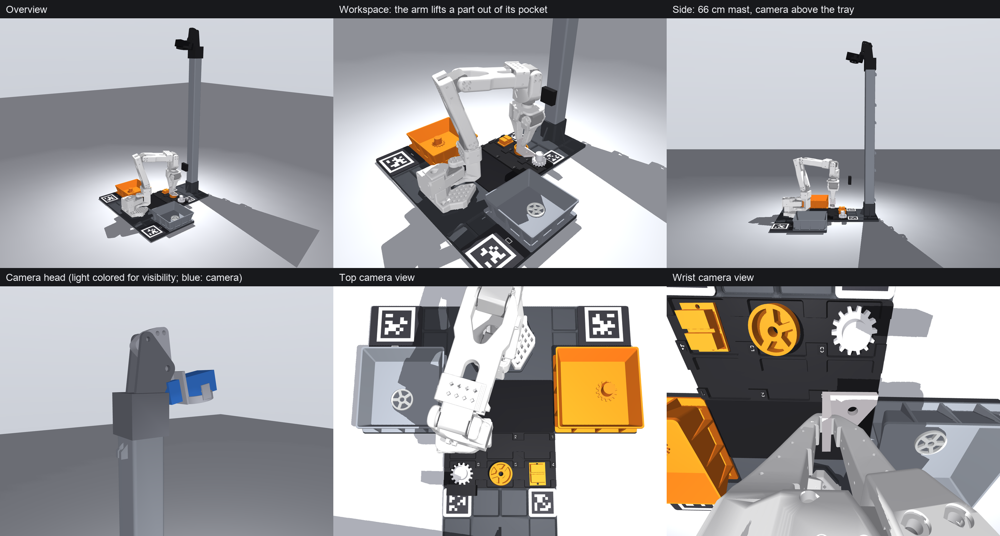

<p align="center"><a href="README.md">English</a> · Türkçe</p>

<p align="center">
  
</p>

<h1 align="center">so101-flywheel</h1>

<p align="center"><b>SO-101 sıfırdan zirveye: hücreyi kur, gösterim kaydet, VLA eğit, çalıştır, geliştir.</b><br>
Hat sonu kalite kontrol görevi üzerinde düz <a href="https://github.com/huggingface/lerobot">LeRobot</a> komutları ve adım adım, Türkçe ve İngilizce bir rehber.</p>

<p align="center">
  <a href="https://github.com/TheRobotStudio/SO-ARM100"></a>
  <a href="https://github.com/huggingface/lerobot"></a>
  <a href="https://huggingface.co/docs/lerobot/smolvla"></a>
  <a href="https://github.com/google-deepmind/mujoco"></a>
  <a href="https://www.python.org/"></a>
  <a href="LICENSE"></a>
</p>

<p align="center">
  <a href="https://zero2hero.getporti.com/tr/"><b>Rehber</b></a> ·
  <a href="docs/guide/tr/record.md">Kayıt</a> ·
  <a href="docs/guide/tr/data-quality.md">Veri kalitesi</a> ·
  <a href="docs/guide/tr/train.md">Eğitim</a> ·
  <a href="hardware/README.md">Baskı dosyaları</a> ·
  <a href="docs/sim.md">Simülasyon</a>
</p>

## Başla

```bash
uv sync --extra robot
scripts/teleop.sh --cams                    # leader follower'ı sürer, iki kamera Rerun'da
uv run flywheel-inspect                     # üst kamera tepsiyi okur: her cebe bir kasa
scripts/record.sh 1 ok                      # "put the part from pocket 1 in the OK bin" için 10 episode
scripts/status.sh                           # ne kaydedildi, sıradaki blok hangisi
scripts/train.sh                            # SmolVLA'yı kiralık GPU'da fine-tune et
scripts/rollout.sh 1 ok                     # policy kolu hareket ettirir
```

Portların, kamera indekslerin ve Hugging Face kullanıcın `scripts/env.local.sh` dosyasına yazılır (şablon [`scripts/env.sh`](scripts/env.sh) başında). Her script çalıştırdığı `lerobot-*` komutunu ekrana yazar.

## Neden

Tepside altı adet 3D baskı parça var: jant, dişli, balata ve braket; bazılarında delik eksik ya da köşe kırık.
Üst kamera bir kez bakar ve her cep için OK ya da REJECT der; kola sonra parça parça şu söylenir:
"put the part from pocket 3 in the REJECT bin". Karar vermek ile hareket etmek ayrıdır, böylece her biri tek başına
test edilip düzeltilebilir. Policy yalnızca bir cümleye uyar ve veride hedefi belirleyen tek şey o cümledir.

## İçinde ne var

| | |
| --- | --- |
| 📖 **Rehber** | Boş masadan puanlanmış bir policy'ye sekiz adım, [Türkçe](docs/guide/tr/index.md) ve [İngilizce](docs/guide/en/index.md) |
| 🦾 **Scriptler** | `lerobot-teleoperate`, `-record`, `-train`, `-rollout` üzerine ince sarmalayıcılar; özel kaydedici yok |
| 🔎 **Muayene** | `flywheel-inspect`: AprilTag → altı cep kesiti → ölçülen delik, kol, diş, köşe → her cebe bir kasa |
| 🖨️ **Donanım** | Tek `params.yaml` hem parametrik CAD'i hem simülasyonu üretir; Bambu X2D için numaralı baskı tablaları |
| 🧪 **Simülasyon** | Hücrenin MuJoCo kopyası ve scripted uzman, sim-to-real denemeleri için |

## Daha fazlası

```
docs/guide/   rehber, Markdown, en/ ve tr/ (site/build.py ile zero2hero.getporti.com'a dönüşür)
scripts/      env.sh (düzenek ayarları), teleop, calibrate, record, status, review, train, rollout
src/flywheel/ qc (muayene), sim (MuJoCo), hardware (CAD), status
tests/        pytest
hardware/     params.yaml, print/ (tablalar), calibration/
```

Testler: `uv run pytest`.

## Lisans

MIT, bkz. [LICENSE](LICENSE). `src/flywheel/sim/assets/so101/` altındaki SO-101 modeli TheRobotStudio'ya aittir
ve Apache-2.0 lisanslıdır ([NOTICE](src/flywheel/sim/assets/so101/NOTICE.md)).
