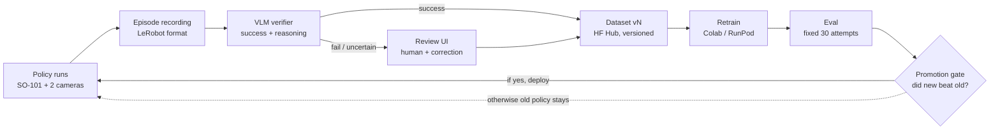

# SO-101 Self-Improving Data Flywheel — PRD

2026-10-11 · Furkan

## Summary

The SO-101 arm records every attempt at a task. A VLM verifier judges success, failed attempts become new data through human correction, and the policy automatically goes through a retrain → eval → deploy loop. The goal is to build an open-source, end-to-end data flywheel in 6 weeks and show a measurable success increase over at least 3 iterations.

**Problem.** The LeRobot ecosystem has tools for data collection and training, but the part that closes the loop is mostly done by hand. Finding which attempt failed and why, adding correction data, versioning the dataset and proving the new policy is actually better are all manual work. As a result, policies are usually trained once and left alone, and improvement is not measured.

**Solution.** Task-agnostic flywheel infrastructure. The first reference task is quality control, i.e. sorting out defective parts. The infrastructure should plug into another LeRobot task by changing a `task.yaml`.

## Goals and success metrics

The project counts as successful when it shows that the success rate increases measurably from the v0 policy to v3, and that this increase is achieved with little human effort.

**Goals**

- **G1:** The record → verifier → review → dataset → retrain → eval → deploy loop runs automatically; the human's only job is review and, when needed, a correction demo.
- **G2:** The VLM verifier's accuracy is measured against human labels and reported.
- **G3:** A success rate increase across at least 3 policy iterations is shown with a confidence interval.
- **G4:** The infrastructure is task-agnostic; a new task needs only a `task.yaml` and demo data.

**Non-goals (not in v1)**

- Training a VLA model from scratch; existing policies (ACT, SmolVLA) are fine-tuned.
- Online RL (HIL-SERL), multiple robots / fleet management.
- Unsupervised 24/7 operation; autonomous batches are supervised.
- Commercial product, safety certification.

**Metrics (target values are proposals, updated after the Phase 1 baseline)**

| Metric | Target | How it is measured |
| --- | --- | --- |
| Task success rate | +20 points from v0 to v3 | Fixed eval protocol, ≥ 30 attempts per policy, Wilson CI |
| Verifier-human agreement | ≥ 90% | 100+ hand-labelled episodes, confusion matrix |
| Verifier false positive | ≤ 5% | Rate of counting a failure as a success (dirty data risk) |
| Iteration time | ≤ 1 day | Data threshold → new policy deployed, including training |
| Human effort / iteration | ≤ 30 min | Time spent in the review UI + correction demos |
| Iteration cost | Tracked | GPU hours + VLM API calls |

## Users and scenarios

The primary user is the developer-operator who builds and runs the system. Secondary users are SO-101/LeRobot users who will adapt the repo to their own task, and technical readers who will read the results from the dashboard and video.

| User | Need |
| --- | --- |
| Operator (developer) | Review failed attempts quickly, improve the policy with little effort |
| SO-101 / LeRobot user | A ready-made loop they can plug into their own task via config |
| Technical reader / recruiter | Measured results: success curve, verifier reliability, architecture decisions |

**Scenarios**

1. **Supervised batch:** The arm makes 50 attempts. The verifier scores all of them; 8 failed and 3 uncertain attempts land in the review queue.
2. **Review from a phone:** The operator watches the failed clip, reads the verifier's reasoning and picks one of three options: confirm the label, correct the label, or request a correction demo.
3. **Correction demo:** 5 recovery demos for the same failure type are recorded with the leader arm and added to a new dataset version.
4. **Retrain and gate:** Once the new-episode threshold is reached, training starts. If the new policy beats the old one in eval it is deployed; otherwise the old policy stays and a report is produced.
5. **New task:** The user writes a `task.yaml` (cameras, target regions, success criterion, failure_type list), records demos, and the same loop runs.

## Reference task: quality control

The arm picks a part from the tray, shows it to the camera, and drops it into the **OK** bin if it is sound or the **REJECT** bin if it is defective. Because the success criterion is clear, the verifier is easy to test: is the part in the correct bin, and inside the bin?

**Physical setup**

- Marked positions on the table: input tray, OK bin, reject bin. All are printed on the X2D and fixed to the table.
- 2 cameras: top (scene) and wrist. The camera mounts are printed too; a fixed position is essential for eval repeatability.
- Fixed lighting: a desk lamp. Natural light changes are flagged as a separate failure source.

**Part set**

- 4 part types: wheel rim, gear, brake pad, mounting bracket (end-of-line inspection at an automotive supplier). Sizes are chosen to fit the gripper's opening.
- Two variants (white and orange finish) and two structural defects: missing hole, broken. The defects exist in both colours. The third defect is "wrong variant" and depends on the work order: when the order is white, a sound orange part is REJECT. Rationale: [experiment design](experiment-design.md).
- 60 training parts (15 per type) and 16 held-out parts (4 per type).

**Separating decision from execution (v1 decision)**

- **Inspection:** A separate image classifier predicts the part's attributes (type, variant, missing hole, broken); the OK/REJECT decision comes from a rule that compares these attributes with the work order.
- **Manipulation:** A language-conditioned policy ("put the part in the OK bin") executes the decision.
- This separation lets the verifier tell where an error came from: misclassification, or a manipulation error?

**Failure taxonomy (initial)**

| failure_type | Description |
| --- | --- |
| grasp_fail | The part was never grasped |
| drop | Dropped during transport |
| wrong_bin | The decision was correct, but the part went into the wrong bin |
| misclassification | The inspection decision was wrong |
| out_of_bin | Fell on the bin's edge or bounced out |
| timeout | Not finished in time |

All parts to print and the print order: [Print plan](print-plan.md)

## System architecture

The verifier is the heart of the loop: it scores every attempt, sends successes straight to the dataset, and routes failed and uncertain ones to a human. The dashboard reads every step of the loop from the same DB.

*flywheel loop · 8 steps, 1 gate*

| Component | Responsibility | Input → Output |
| --- | --- | --- |
| Runner | Runs the policy on the arm, enforces safety limits | policy_version + task.yaml → motion |
| Recorder | Records the attempt | Camera + joint data → LeRobot episode |
| Verifier | Judges success and failure type | Episode frames → `{success, failure_type, reason, confidence}` |
| Review UI | Human approval, correction and recovery demos | Failed/uncertain queue → human label + new episode |
| Dataset builder | Filters, merges and versions the data | Labelled episodes → HF dataset vN |
| Trainer | Trains the policy | Dataset vN → policy vN + model card |
| Eval runner | Measures with a fixed protocol | Policy vN → success rate + CI |
| Gate | Decides deploy or rollback | New and old eval results → active policy |
| Dashboard | Shows progress | DB → curve, failure distribution, agreement, cost |

## Functional requirements

Everything below is in MVP scope (P0). Only FR-8 (mobile review) and the cost part of FR-16 are P1, done if time allows.

| ID | Module | Requirement |
| --- | --- | --- |
| FR-1 | Recorder | Record every attempt in LeRobot dataset format: cameras, joint states, actions, task string |
| FR-2 | Recorder | Episode metadata: time, policy_version, task_config_hash, eval or batch |
| FR-3 | Verifier | Produce `{success, failure_type, reason, confidence}` JSON with a VLM from the frames at the end of the episode |
| FR-4 | Verifier | If confidence is below the threshold, the episode lands in the human queue as "uncertain" |
| FR-5 | Verifier | The verifier prompt comes from `task.yaml` and is versioned; every label records which prompt version produced it |
| FR-6 | Review UI | Queue of failed and uncertain episodes: video, verifier reasoning, failure_type |
| FR-7 | Review UI | Actions: confirm label, correct label, exclude episode, request correction demo |
| FR-8 | Review UI | Usable from a phone (over Tailscale) |
| FR-9 | Dataset | Build a new dataset version from successful and correction episodes, push it to HF Hub, write a change summary to the dataset card |
| FR-10 | Dataset | Verifier label and human label are stored in separate fields |
| FR-11 | Training | Retrain is triggered when the new-episode threshold is reached, or manually |
| FR-12 | Training | Every policy records in its model card which dataset version and hyperparameters it was trained with |
| FR-13 | Eval | Fixed eval protocol: same part set, fixed start positions, ≥ 30 attempts |
| FR-14 | Eval | Promotion gate: the new policy is deployed if it beats the old one by a threshold margin, otherwise rollback |
| FR-15 | Ops | Automatic stop after N consecutive failures in autonomous batch mode |
| FR-16 | Dashboard | Success rate per policy version (Wilson CI), failure_type distribution, verifier-human agreement, iteration cost |

## Non-functional requirements and safety

Physical safety and reproducibility come before every other requirement: the arm must stay safe even with a bad policy, and every result must be reproducible.

- **Physical safety:** Joint limits and a Cartesian workspace box (bounding box) are enforced in software. Servo torque/current limits are set. An e-stop is available both in the UI and physically within reach. Autonomous batches run only under supervision.
- **Hardware health:** Servo temperature is monitored. There is a per-batch attempt limit, and a cool-down break is taken if a threshold is exceeded.
- **Reproducibility:** Dataset, policy, verifier prompt and task config are all versioned. Every eval result is tied to these versions.
- **Decoupled operation:** The verifier runs after the episode ends and never blocks the control loop.
- **Cost:** The number of VLM calls per episode is capped (for example 3-4 frames). A local VLM option is kept open.
- **Privacy:** The cameras see only the table. If the dataset is published, no home interior gets into the frame.
- **Observability:** Every batch, training run and eval carries a run_id; logs are structured.
- **Portability:** Nothing task-specific is hard-coded; it all lives in `task.yaml`.

## Tech stack and alternatives

The system is split into two halves. The Python side talks to the robot and the models (LeRobot, training, verifier). The TS side talks to the human (API, review UI, dashboard). The two communicate over HTTP and a job queue. This split shows ownership of both the ML and the product side, separately, within the same repo.

| Layer | Default | Alternatives |
| --- | --- | --- |
| Robot control and recording | LeRobot (Python) | ROS 2 + rosbag |
| Manipulation policy | ACT (baseline), SmolVLA (language-conditioned) | pi0.5, Diffusion Policy |
| Inspection | Small CNN / ViT fine-tune (HF Transformers) | YOLO classifier, VLM zero-shot |
| Verifier VLM | Claude vision API, structured output | Gemini, GPT; local Qwen-VL family + vLLM |
| Training compute | Colab | RunPod, Vast.ai, local GPU |
| Experiment tracking | Weights & Biases | MLflow, HF model card only |
| Job queue | BullMQ + Redis | Python RQ / Celery, Temporal, Prefect |
| API | Hono + Bun | FastAPI, Next.js route handlers |
| DB | SQLite + Drizzle | Postgres, Cloudflare D1 |
| Video / artifact storage | Local disk + HF Hub | Cloudflare R2, S3 |
| Review UI and dashboard | Next.js | Vite + React, Gradio / Streamlit (quick prototype) |
| Remote access | Tailscale | Cloudflare Tunnel |

Since the queue will also trigger Python workers, there are two options. With BullMQ, Python workers can pull jobs over HTTP. If a single language is preferred, everything stays in Python with Celery/RQ. This decision is made in Phase 0.

## Risks and open questions

The biggest risk is the verifier counting a failed attempt as a success. Dirty data then enters the dataset and the loop degrades the policy instead of improving it.

| Risk | Impact | Mitigation |
| --- | --- | --- |
| Verifier false positive | Dirty data, policy gets worse | Confidence threshold, human audit of a random sample every iteration, agreement metric on the dashboard |
| Success rate does not increase (plateau) | The project's main claim weakens | Targeted correction demos by failure_type; ACT vs SmolVLA comparison |
| Eval noise | Improvement that is not real | Fixed protocol, ≥ 30 attempts, reporting with Wilson CI |
| Environment drift (light, camera shift) | Policies become incomparable | Fixed printed mounts, fixed lighting, flagging drift as a separate failure_type |
| Servo wear / overheating | Hardware failure, batch interruption | Temperature monitoring, batch limit, spare servo |
| Scope creep | 6 weeks overrun | Everything outside P0 goes to the v2 list |

**Open questions**

- [ ] API or local VLM for the verifier? (balance of cost, latency and privacy)
- [ ] Should inspection stay a separate model, or be folded into an end-to-end policy in v2?
- [ ] Job queue: BullMQ, or all Python (Celery/RQ)?
- [ ] Will the datasets and policies be public on HF?
- [ ] Is a physical e-stop button needed, or is a software e-stop enough?
- [ ] Repo name and license (Apache-2.0 / MIT)

## Roadmap and tasks

6 weeks and 6 phases in total. Each phase ends with an exit criterion; the next phase does not start until the current phase's criterion is met.

### Phase 0 — Setup (week 1, first half)

- [ ] Repo skeleton: `python/` (robot, training, verifier) + `web/` (API, UI); license, README
- [ ] `task.yaml` schema: cameras, target regions, success criterion prompt, failure_type list
- [ ] Print the tray, OK/reject bins and camera mounts on the X2D; fix them to the table and mark the positions
- [ ] Print the QC part set: 4 types × (sound + 3 defects), about 60 parts
- [ ] Safety: joint and workspace limits, torque limit, e-stop
- [ ] Queue decision (BullMQ or Python)

Exit criterion: The arm can do the task via teleop, and the setup is fixed and repeatable.

### Phase 1 — Baseline (weeks 1-2)

- [ ] Record 50-80 demos via teleop (task strings: "put in the OK bin" / "put in the REJECT bin")
- [ ] Train the inspection classifier and measure its accuracy on the test set
- [ ] Train ACT v0 on Colab, push to HF Hub
- [ ] Eval protocol v1: fixed list of start positions, 30 attempts, eval script
- [ ] Measure the v0 baseline success rate and update the metric targets

Exit criterion: A measured v0 baseline exists.

### Phase 2 — VLM verifier (weeks 2-3)

- [ ] Frame selection: last frame + bin ROIs + grasp moment
- [ ] Verifier: `{success, failure_type, reason, confidence}` with structured output
- [ ] Hand-label 100+ episodes (independently of the verifier)
- [ ] Verifier-human agreement, confusion matrix, false positive rate
- [ ] Prompt iteration and setting the thresholds of the "uncertain" band

Exit criterion: Agreement ≥ 90%, false positive ≤ 5% (or a target updated with justification).

### Phase 3 — Review UI and dataset versioning (weeks 3-4)

- [ ] DB schema: episodes, labels (verifier/human separate), runs, policies, datasets
- [ ] API: episode list, label update, correction request
- [ ] Review UI: queue, video player, reasoning, action buttons
- [ ] Correction flow: "record recovery" from the UI → recording with the leader arm → linked to the failed episode
- [ ] Dataset builder: filter + merge → new HF version, automatic dataset card

Exit criterion: The flow from a failed episode to a new dataset version works end to end.

### Phase 4 — Retrain → eval → deploy loop (weeks 4-5)

- [ ] Retrain trigger (episode threshold or manual)
- [ ] Training job (Colab/RunPod) + W&B + model card
- [ ] Eval runner: 30 attempts, verifier scoring + human spot-check
- [ ] Promotion gate and rollback
- [ ] Supervised autonomous batch mode, stop on consecutive failures

Exit criterion: A full iteration completes with the human only doing review.

### Phase 5 — Dashboard, iterations and publishing (weeks 5-6)

- [ ] Dashboard: success rate curve (Wilson CI), failure_type distribution, verifier agreement, cost
- [ ] Run 3 iterations: v1, v2, v3
- [ ] Run the same loop with SmolVLA and compare with ACT
- [ ] README: architecture, "what I chose and why", trade-offs, guide to adapting to another task

Exit criterion: v0 → v3 success curve, public repo, dataset and policy versions on HF.

### v2 (out of scope, for later)

- Online improvement with HIL-SERL
- MCP server: running the loop from Claude Code ("summarize the last batch's failures, start a retrain")
- Dynamic pick from a conveyor belt
- Multi-task support

## Publishing and portfolio plan

Every phase produces a publishable output. The final story should fit in one sentence: "My robot learns from its own mistakes; in 3 iterations its success rate went from X to Y."

| Channel | What is shared | When |
| --- | --- | --- |
| so101.getporti.com | Post series: setup, baseline, verifier, review UI, loop, results | End of each phase |
| LinkedIn | Short video + a single chart; success curve in the final post | End of phases 1, 2, 5 |
| GitHub | Repo + README ("what I learned / what I chose and why / trade-offs") | Public from Phase 0 |
| Hugging Face | Versioned datasets, policies, model cards | Every iteration |
| Blog post | "How much can we trust a VLM verifier?" (agreement and confusion matrix) | End of Phase 2 |

One line for CVs and applications: *Built an open-source self-improving data flywheel for a low-cost robot arm: VLM-based success verification, human-in-the-loop correction, automated retrain/eval/deploy, and measured policy improvement across iterations.*
