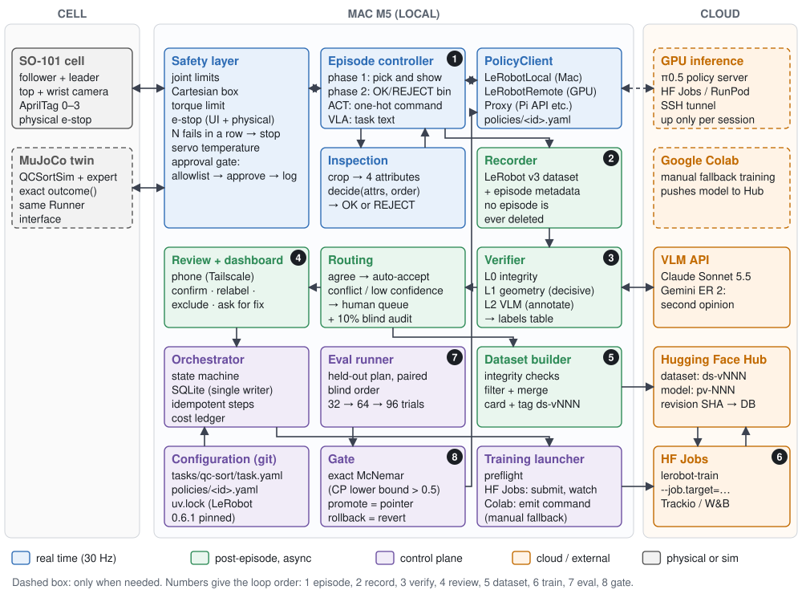
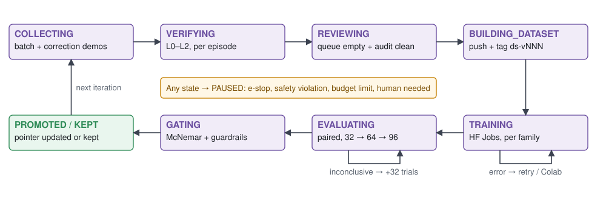

<!-- title-page-start -->

# SO-101 Data Flywheel: Architecture and Roadmap

**Version 2 · 15 October 2026**\
**Project:** SO-101 Self-Improving Data Flywheel (`so101-flywheel`)\
**Owner:** Furkan (solo developer)

This document replaces the 82-page research report ([v1](v1/so101-flywheel-report.md)). Its purpose is to make
decisions: first the right pipeline and structure, then current tools and models tried on top of it. Every number comes
from a single set of assumptions. Numbers whose source could not be verified are marked **assumption**. Proposals
Furkan has not yet approved are marked **proposal, Furkan to approve**.

Source date: 15 October 2026. The reference release for LeRobot is **v0.6.1**; the `main` branch is cited only where
explicitly stated.

<!-- title-page-end -->

<!-- pagebreak -->

## Executive summary

**What we are building.** The arm picks up a part, shows it to the top camera, a classifier reads the part's
attributes, a rule decides OK or REJECT, and the policy places the part in that bin. Every trial is recorded. Success is
decided by a **geometric check**: is the part, in the top camera, inside the bin region located via AprilTags? A VLM
only writes the failure type and the rationale. Disagreements or low confidence go to a human. Labeled data becomes a
new dataset version, the policy is retrained on HF Jobs, measured paired on the same held-out plan, and deployed only if
it statistically beats the previous one.

**The architecture in one sentence.** A single Python orchestrator on a Mac M5 drives every step of the loop
idempotently, with a state machine in SQLite. Heavy training runs on HF Jobs. A policy that cannot run on the Mac
(π0.5) is called from a server on a rented GPU through an SSH tunnel. Every policy is a `policies/<id>.yaml` entry;
adding a new model is a matter of configuration, not code.

**Order.** The loop first closes end to end in the MuJoCo twin: three iterations in sim, without typing commands by
hand. Only the Runner adapter and recalibration carry over to the real arm. Printing and teleop recording proceed in
parallel meanwhile.

**What this version settles (resolving the contradictions in v1).**

| Topic | In v1 | In this document |
| --- | --- | --- |
| Iteration cost | $10–20, $10–35, $10–35 | **~$16 (range $9–24)** for ACT + SmolVLA; **+$25 (range $18–35)** if π0.5 is added ([§3.3](#33-single-cost-model)) |
| Training time | Episode length 20 or 30 s | Fixed-step recipe; time independent of data size: ACT 3.6–7.1 h, SmolVLA ~4 h, π0.5 6–12 h |
| Verifier cost | $0.3–5 / iteration, k=1 or 3 | Single call (k=1), **$0.007** per episode (Sonnet 5.5); ~$2 per iteration |
| Eval trial count | 30, 32, 64, 96 | Gate: **32 → 64 → 96** sequential, paired. Headline claim: **96 fixed**, preregistered ([§4](#4-evaluation-protocol)) |
| ACT parameter count | 52M or 80M | **~52M** LeRobot default (1 decoder layer); **~80M** original paper (7 decoder layers) |
| "Snyder et al." citation | 2503.10966 or 2603.13616? | Both are Snyder et al.: **STEP = 2503.10966** (RSS 2025), **Beyond Binary Success = 2603.13616** (2026) |
| RunPod / Colab price | Conflicting, third-party | The RunPod page shows two prices; the higher one is used. Colab's per-GPU consumption is not official and stays out of the plan |
| Scripted expert | 120/120 or 360/360 | 120/120 per plan; 360/360 across two work orders and three runs; held-out 64/64 ([sim.md](../sim.md)) |

**Three blockers found during verification.** (1) LeRobot 0.6.1 requires `opencv-python-headless<4.14`
([pyproject.toml@v0.6.1](https://github.com/huggingface/lerobot/blob/v0.6.1/pyproject.toml)), the repo has `>=5.0.0.93`;
since we only use `cv2.aruco`, the pin drops to 4.13. (2) In v0.6.1, `lerobot-record` and `lerobot-rollout` take a single
task text per episode, while the dataset format stores a task per frame. We write the recording and rollout loop
ourselves on top of the LeRobot APIs ([§2.1](#21-runner-and-recorder)). (3) ACT takes the command from the
`observation.environment_state` channel, unnormalized; SmolVLA and π0.5 do not read this field.

**Budget.** v0 + 3 iterations, including sim trials and the π0.5 arm, total cloud cost **~$230 (range $150–335)**.
Arm time is ~5 hours per iteration; the largest item is eval.

<!-- pagebreak -->

## Decision list

#### Decisions made

Owner Furkan; valid as of 15 October 2026.

| # | Decision | Where it lands in this document |
| --- | --- | --- |
| C1 | Two-stage task text per episode: "pick the part and show it to the camera" → "put the part in the OK/REJECT bin". The command is only known after inspection | Per-frame task; custom Recorder and Runner ([§2.1](#21-runner-and-recorder)) |
| C2 | ACT takes the bin command as an extra one-hot input; SmolVLA takes text; π0.5 is the third policy, via LeRobot | `observation.environment_state` ([§1.3](#13-data-contracts)), [§3](#3-models) |
| C3 | Mac M5: recording, inference client, sim, local verifier and UI. Training on HF Jobs (automatic), Colab as manual fallback. A remote inference server on a cloud GPU for any policy that cannot run on the Mac | [§2.7](#27-training-launcher), [§2.8](#28-policyclient-and-remote-inference) |
| C4 | Verifier: the geometric signal is authoritative, the VLM writes failure_type and rationale, disagreement or low confidence goes to a human, agreement is always reported against a majority-class baseline, blind audit every iteration | [§2.4](#24-verifier) |
| C5 | Gate: paired comparison on the same held-out plan; promotion with a conservative bound (Clopper–Pearson lower bound / paired test), Wilson CI for display; if no decision, eval is extended | [§4](#4-evaluation-protocol) |

#### Proposals

All: proposal, Furkan to approve.

| # | Proposal | Rationale | Deadline |
| --- | --- | --- | --- |
| R1 | Orchestrator entirely Python + SQLite; no BullMQ/Redis. The web UI writes only the review tables to the DB | All heavy steps are in Python; one robot, one operator; the DB schema becomes the single contract between two languages | 18 Oct |
| R2 | LeRobot pinned `==0.6.1`; `opencv-python-headless` pin `>=4.9,<4.14`; `main` only in a separate server environment, pinned to a commit | Conflicts and version drift | 18 Oct |
| R3 | strands-robots is neither a dependency nor a fork; four patterns are copied with Apache-2.0 attribution | v1 rewrite due 24 November, no compatibility layer; `opencv<5` conflict | 18 Oct |
| R4 | Fixed-step training recipes: ACT 100k steps / BS 8; SmolVLA 20k / BS 64; π0.5 10k / BS 32, full fine-tune | Cost and comparison stay the same every iteration | 25 Oct |
| R5 | Review UI and dashboard in Next.js (`web/`), from the phone via Tailscale | PRD default; Furkan's web stack | 1 Nov |
| R6 | Dataset tags `ds-NNN`, model tags `pv-NNN`; the DB always stores the commit SHA | LeRobot mistakes version-looking revisions like "v1.0" for a format version ([§1.5](#15-storage-and-versioning)) | 25 Oct |
| R7 | No DAgger takeover in v1; correction = teleop demo starting from the failure state | v0.6.1 rollout cannot switch tasks and does not produce ACT's command input | 1 Nov |
| R8 | Condition for moving to the real arm: 3 iterations run in sim without manual commands (M6) | Catch bugs where they are cheap | 8 Nov |
| R9 | Project license Apache-2.0 | The copied strands code is Apache-2.0; LeRobot is Apache-2.0 too | 18 Oct |

#### Open decisions

Furkan to decide.

| # | Question | Options and impact | Deadline |
| --- | --- | --- | --- |
| Q1 | Should the light variant be gray or white? | **Gray:** current plan and files are ready; but a gray part in the gray OK bin has low contrast, the weakest case for the geometric check. **White:** high contrast on the black liner and gray bin; the color in `params.yaml` and the plan files are regenerated, print plates 11, 12 and 14 are printed in white. We recommend white | 18 Oct (before 11–14 are printed) |
| Q2 | Open the publication track (2×2 counterfactual-command study, RSS 2027 Stage 1, deadline 4 Dec 2026)? | If yes: +60 congruent-command teleop episodes (W2), ~256 extra real trials, ~45 A100-hours, preregistration; D7/D8 postponed ([Appendix C](#appendix-c-publication-proposal-summary)) | 25 Oct (before recording starts) |
| Q3 | Apply to the Pi API waitlist? | Free; the plan does not depend on it. If accepted, it becomes a fourth arm via the Proxy backend | 25 Oct |
| Q4 | Dataset and models public on HF? | Public: strong for content and publication; no home-interior imagery may be in frame | 1 Nov (first real push) |
| Q5 | Physical e-stop button | We recommend yes, before the first autonomous run; a software e-stop alone is not enough | 8 Nov |

<!-- pagebreak -->

## Contents

- [Executive summary](#executive-summary)
- [Decision list](#decision-list)
- [1. Target architecture](#1-target-architecture)
  - [1.1 End-to-end view](#11-end-to-end-view)
  - [1.2 Components](#12-components)
  - [1.3 Data contracts](#13-data-contracts)
  - [1.4 State machine of an iteration](#14-state-machine-of-an-iteration)
  - [1.5 Storage and versioning](#15-storage-and-versioning)
  - [1.6 Idempotency and error handling](#16-idempotency-and-error-handling)
  - [1.7 Safety](#17-safety)
  - [1.8 Observability and cost tracking](#18-observability-and-cost-tracking)
  - [1.9 Proposed repo layout](#19-proposed-repo-layout)
- [2. Component choices](#2-component-choices)
  - [2.1 Runner and Recorder](#21-runner-and-recorder)
  - [2.2 Simulation (MuJoCo twin)](#22-simulation-mujoco-twin)
  - [2.3 Inspection](#23-inspection)
  - [2.4 Verifier](#24-verifier)
  - [2.5 Review UI and dashboard](#25-review-ui-and-dashboard)
  - [2.6 Dataset builder and versioning](#26-dataset-builder-and-versioning)
  - [2.7 Training launcher](#27-training-launcher)
  - [2.8 PolicyClient and remote inference](#28-policyclient-and-remote-inference)
  - [2.9 Eval runner and gate](#29-eval-runner-and-gate)
  - [2.10 Orchestrator](#210-orchestrator)
  - [2.11 Observability](#211-observability)
  - [2.12 Four patterns taken from strands-robots](#212-four-patterns-taken-from-strands-robots)
- [3. Models](#3-models)
  - [3.1 Which model, which role](#31-which-model-which-role)
  - [3.2 Policy-specific details](#32-policy-specific-details)
  - [3.3 Single cost model](#33-single-cost-model)
  - [3.4 PolicyClient design](#34-policyclient-design)
- [4. Evaluation protocol](#4-evaluation-protocol)
  - [4.1 Trial and success definition](#41-trial-and-success-definition)
  - [4.2 Routine gate (per iteration, per family)](#42-routine-gate-per-iteration-per-family)
  - [4.3 Headline claim (v0 → v3, cross-family comparison, publication)](#43-headline-claim-v0--v3-cross-family-comparison-publication)
  - [4.4 Verifier acceptance and monitoring protocol](#44-verifier-acceptance-and-monitoring-protocol)
- [5. Roadmap](#5-roadmap)
  - [5.1 Build order](#51-build-order)
  - [5.2 Weekly plan (from 15 October 2026)](#52-weekly-plan-from-15-october-2026)
- [6. Experiments](#6-experiments)
  - [6.1 P0: the experiments that carry the project's claim](#61-p0-the-experiments-that-carry-the-projects-claim)
  - [6.2 P1: the experiments that deepen the claim](#62-p1-the-experiments-that-deepen-the-claim)
- [7. Risks](#7-risks)
- [Appendices](#appendices)
  - [Appendix A. Content plan summary](#appendix-a-content-plan-summary)
  - [Appendix B. Learning roadmap](#appendix-b-learning-roadmap)
  - [Appendix C. Publication proposal summary](#appendix-c-publication-proposal-summary)
  - [Appendix D. References](#appendix-d-references)


<!-- pagebreak -->

## 1. Target architecture

### 1.1 End-to-end view



*Figure 1. Target architecture. The real-time loop (blue) runs at 30 Hz on the Mac and never waits on a cloud call; the
only exception is remote policies such as π0.5. Post-episode work (green) does not block the control loop. The control
plane (purple) is the state machine in SQLite.*

Three principles shape the design:

1. **Single writer, single source of truth.** State lives only in SQLite and only the Python orchestrator writes it.
   The web UI writes only human decisions (`review_events`, human `labels` rows, correction requests).
2. **Every step can be rerun.** Every step follows the "check first, then act" rule and carries a deterministic
   key. If the Mac restarts, the loop resumes where it left off.
3. **Decisions live in configuration, not code.** Everything task-specific is in `task.yaml`, everything policy-specific
   in `policies/<id>.yaml` (PRD goal G4).

### 1.2 Components

| Component | Responsibility | Input | Output | Where |
| --- | --- | --- | --- | --- |
| Safety layer | Clips every action before it reaches the robot; e-stop, consecutive-failure and temperature monitoring; approval gate for autonomous runs | Action, joint state, temperature | Safe action or stop | Mac |
| Episode controller (Runner) | Runs the two-phase episode: at the end of phase 1 triggers inspection, gets the decision, switches the task text and one-hot command | Plan row, active policy, work order | Frames, actions, phase boundary | Mac (real) or MuJoCo |
| Inspection | Predicts 4 attributes from the top-camera crop; gives OK/REJECT via the `decide()` rule | Crop, work order | Attributes, decision, confidence | Mac |
| PolicyClient | Calls the policy independent of backend (local, remote, proxy) | Observation, instruction | Action chunk | Mac (+ GPU server) |
| Recorder | Writes the episode in LeRobot v3 format with per-frame task text; produces a sidecar metadata file | Frames, metadata | Dataset episode + `episode.json` | Mac |
| Verifier | L0 integrity, L1 geometry (authoritative success), L2 VLM (failure_type, rationale) | Episode frames, bin ROIs | `labels` rows | Mac + VLM API |
| Routing | Auto-accept, human queue or blind audit decision | Labels | Queue state | Mac |
| Review UI + dashboard | Human labels, correction requests, metric dashboards | Queue, videos | `review_events`, human label | Mac, from the phone |
| Dataset builder | Integrity checks, filter, merge, card, push to Hub and tag | Accepted episodes | `ds-NNN` | Mac → Hub |
| Training launcher | Preflight, HF Jobs job, monitoring, model card, cost entry; generates the command for Colab | `ds-NNN`, policy entry | `pv-NNN` | Mac → HF Jobs |
| Eval runner | Runs the held-out plan paired and in blind order, 32 → 64 → 96 | Candidate and active policy | `eval_trials` | Mac + arm/sim |
| Gate | Promote, keep or extend decision; active policy pointer | Paired results | `gate_decisions` | Mac |
| Orchestrator | State machine, job queue, retries, budget limit | All tables | Next step | Mac (launchd) |

### 1.3 Data contracts

Four files hold the system together. Each has a `schema_version` field. The reader rejects an unknown version (strands
pattern, [§2.12](#212-four-patterns-taken-from-strands-robots)).

**`tasks/qc-sort/task.yaml`**: the task definition. A new task needs only this file and demo data.

```yaml
schema_version: 1
id: qc-sort
fps: 30
robot: {type: so101_follower, semantics: so101-degrees-gripper-percent-v1}
cameras:
  top:   {width: 640, height: 480}
  wrist: {width: 640, height: 480}
phases:                       # C1: two-stage task text
  - id: pick_show
    task: "pick the part and show it to the camera"
    command: [0, 0]           # observation.environment_state for ACT
    ends_when: {inspection_pose: true, still_s: 0.5, max_s: 15}
  - id: place
    task: "put the part in the {bin} bin"      # {bin} ∈ OK, REJECT
    command: {OK: [1, 0], REJECT: [0, 1]}
    max_s: 15
decision:
  rule: flywheel.sim.parts.decide             # attributes + work order → OK/REJECT
  orders: [G, T]
bins:                         # table-plane coordinates derived from the AprilTags (mm)
  OK:     {polygon_from: params.yaml#bins.ok}
  REJECT: {polygon_from: params.yaml#bins.reject}
success:                      # L1 geometry, authoritative
  settle_s: 1.0
  min_inside_ratio: 0.95
  min_margin_mm: 5
failure_types: [grasp_fail, drop, wrong_bin, out_of_bin, misclassification,
                timeout, infra, invalid]
verifier:
  prompt: tasks/qc-sort/prompts/verifier-v1.md
  frames: [inspect, release, final]
  crops: [ok_bin, reject_bin]
  vlm: {primary: claude-sonnet-5-5, second_opinion: gemini-robotics-er-2-preview}
  audit_rate: 0.10
eval:
  plans: [plans/eval-heldout-G-seed0.json,      # G0 → T0 → G1
          plans/eval-heldout-T-seed0.json,
          plans/eval-heldout-G-seed1.json]
  looks: [32, 64, 96]
  alpha_one_sided: 0.05
safety: {max_consecutive_failures: 3, servo_temp_c: 60, batch_limit: 50, cooldown_min: 10}
```

**`policies/<id>.yaml`**: the policy entry. The gate decides only within the same `family`.

```yaml
schema_version: 1
id: act-qc
family: act
backend: lerobot-local        # lerobot-local | lerobot-remote | proxy
model_repo: fport/act-qc
conditioning: onehot          # onehot (observation.environment_state) | text
inputs: {cameras: [top, wrist], state_dim: 6, env_state_dim: 2}
action: {semantics: so101-degrees-gripper-percent-v1, chunk: 100, n_action_steps: 100, fps: 30}
train:
  flavor: l4x1
  args: {policy.type: act, steps: 100000, batch_size: 8}
  timeout: 10h
serve: null                   # remote: {flavor: l4x1, transport: grpc, tunnel: ssh}
license: apache-2.0
```

**Episode metadata** (`episode.json`, same content in the `episodes` table). The LeRobot dataset carries the frames and
the per-frame task text; this file carries the rest of the experiment.

```json
{
  "schema_version": 1,
  "episode_id": "r20261102T1432/0007",
  "mode": "demo | batch | eval | correction",
  "source": "real | sim",
  "plan": {"file": "plans/eval-heldout-G-seed0.json", "tray": 3, "pocket": 2, "pick": 1},
  "part": {"id": "J-T-06", "type": "J", "variant": "T",
           "missing_hole": false, "broken": true, "heldout": true},
  "order": "G",
  "decision": {"rule_bin": "REJECT", "commanded_bin": "REJECT", "congruent": true,
               "inspection": {"pred": {"type": "J", "variant": "T", "missing_hole": false,
                                       "broken": true}, "conf": 0.97}},
  "phases": [{"id": "pick_show", "from_frame": 0}, {"id": "place", "from_frame": 312}],
  "policy": {"id": "act-qc", "revision": "<sha>", "backend": "lerobot-local"},
  "versions": {"git": "<sha>", "lerobot": "0.6.1", "task_yaml": "<hash>",
               "params_yaml": "<hash>", "calibration": "<hash>"},
  "env": {"tag_drift_mm": 0.8, "servo_temp_max_c": 48},
  "timing": {"start": "2026-11-02T14:32:05+03:00", "duration_s": 24.1,
             "infer_p50_ms": 31, "infer_p95_ms": 55},
  "parent_episode_id": null,
  "operator": "furkan"
}
```

**Verifier output** (one row in the `labels` table; each source is a separate row, FR-10).

```json
{
  "schema_version": 1,
  "episode_id": "r20261102T1432/0007",
  "source": "geometry | vlm | human | sim_oracle",
  "success": true,
  "final_location": "OK | REJECT | rim | table | gripper | unknown",
  "failure_type": null,
  "reason": "Part is inside the REJECT bin polygon, 14 mm from the edge.",
  "confidence": 0.98,
  "evidence": {"frames": [312, 640, 702], "inside_ratio": 0.99, "margin_mm": 14},
  "disputes_verdict": false,
  "model_id": "claude-sonnet-5-5", "prompt_version": "verifier-v1@<hash>",
  "cost_usd": 0.007, "latency_ms": 2100,
  "created_at": "2026-11-02T14:32:40+03:00"
}
```

The final-label rule is fixed: `human` > `sim_oracle` (sim only) > `geometry` > `vlm`. The VLM never sets the
`success` field; when it contradicts the geometry it writes `disputes_verdict: true` and the episode goes to a human.

**SQLite tables.** `episodes`, `labels`, `review_events`, `datasets`, `policies`, `eval_trials`,
`gate_decisions`, `jobs`, `costs`. The schema is defined in one place, `flywheel/core/db.py`, and changes through
versioned migrations.

### 1.4 State machine of an iteration



*Figure 2. The states of an iteration. Every transition has a condition; the orchestrator does not advance until it is
met.*

| Transition | Condition |
| --- | --- |
| COLLECTING → VERIFYING | The plan's batch and correction rows are recorded |
| VERIFYING → REVIEWING | L0–L2 labels written for all episodes |
| REVIEWING → BUILDING_DATASET | Queue empty; no FP in the blind audit (if any, that batch's auto-accepts go back to a human) |
| BUILDING_DATASET → TRAINING | Integrity checks passed; `ds-NNN` on the Hub, SHA in the DB |
| TRAINING → EVALUATING | Model on the Hub for each family; preflight and "is it learning" checks passed |
| EVALUATING → GATING | The sequential protocol reached a decision or hit 96 trials ([§4](#4-evaluation-protocol)) |
| GATING → PROMOTED / KEPT | Decision written to `gate_decisions`; on promotion the active pointer changed |
| Any state → PAUSED | E-stop, safety violation, budget limit, `invalid` episode or human needed |

The states of an episode: `recorded → verified (auto_accept | needs_review | audit) → reviewed (confirmed | relabeled |
excluded | correction_requested) → in_dataset (ds-NNN)`. No episode is ever deleted. An excluded episode does not enter
the dataset but stays in the DB with its label.

### 1.5 Storage and versioning

| Object | Where | Identity | Note |
| --- | --- | --- | --- |
| Raw episodes | Mac, `~/.cache/huggingface/lerobot/fport/so101-qc-raw` | `episode_id` | The review UI plays videos from here. Weekly backup to a private Hub repo |
| Curated dataset | Hub, `fport/so101-qc` (`fport/so101-qc-sim` for sim) | Tag `ds-NNN` + commit SHA | The training job loads by SHA: `--dataset.revision=<sha>` |
| Policy | Hub, one repo per family: `fport/act-qc`, `fport/smolvla-qc`, `fport/pi05-qc` | Tag `pv-NNN` + commit SHA | The Runner loads by SHA only |
| Active policy | SQLite, `policies.status = active` | One row per family | Deploy = pointer change; rollback = reverting the pointer |
| Configuration | Git | Commit SHA, file hash | Every episode and eval row carries these hashes |
| Training curves | Trackio or W&B | Run name = `pv-NNN` | Loop metrics live not here but on our own dashboard |

Two verified LeRobot details determine the naming:

- `LeRobotDataset(repo_id, revision=...)` accepts a branch, tag or commit. But if the revision looks like a PEP 440
  version (`v1.0`), LeRobot takes it for a dataset format version and resolves it another way
  ([lerobot_dataset.py@v0.6.1](https://github.com/huggingface/lerobot/blob/v0.6.1/src/lerobot/datasets/lerobot_dataset.py),
  [utils.py@v0.6.1](https://github.com/huggingface/lerobot/blob/v0.6.1/src/lerobot/datasets/utils.py)). So tags have the
  form `ds-003` and training is done by SHA.
- `push_to_hub(tag_version=True)` deletes and recreates the `v3.0` tag every time; it does not write a custom git tag
  (same file). We set our own tag with `huggingface_hub.create_tag`.

**Version pinning.** In the Mac environment `lerobot==0.6.1` is pinned in `uv.lock`. The training job must use the
same version: `lerobot-train --job.target` uses the `huggingface/lerobot-gpu:latest` image by default
([configs/default.py@v0.6.1](https://github.com/huggingface/lerobot/blob/v0.6.1/src/lerobot/configs/default.py)); that
is not pinned. We propose launching training with `huggingface_hub.run_uv_job`, passing the dependency as
`lerobot[...]==0.6.1` ([HF Jobs guide](https://huggingface.co/docs/huggingface_hub/guides/jobs)). If `main` is needed
for remote inference, it is pinned to a specific commit in a separate environment; it does not touch the recording
environment on the Mac.

### 1.6 Idempotency and error handling

| Rule | Implementation |
| --- | --- |
| Deterministic identity | `episode_id = {run_id}/{idx:04d}`; dataset content = hash of the sorted `episode_id` list; `train_key = hash(ds_sha, policy_id, train_args)`; `eval_key = hash(policy_sha, plan, look)` |
| Check first | If `ds-NNN` exists on the Hub, the push is skipped; if `pv-NNN` exists in the model repo, training is skipped; if a row exists in `eval_trials`, the trial is skipped |
| Atomic writes | Files are written under a temporary name and moved with `os.replace` (strands pattern) |
| External jobs | HF Jobs `attempts=2`, explicit `timeout`, `train_key` as a label ([run_job](https://huggingface.co/docs/huggingface_hub/guides/jobs)); `lerobot-train` does not return the job ID, it only prints it ([jobs/hf.py@v0.6.1](https://github.com/huggingface/lerobot/blob/v0.6.1/src/lerobot/jobs/hf.py)), so we call `run_job` directly |
| An error is never a success | On a verifier or API error the episode becomes `needs_review` |
| Chaos test (M6) | Kill and restart the orchestrator in every state; cancel the HF Job midway; inject errors into the VLM; call push twice |

### 1.7 Safety

| Layer | What | Why |
| --- | --- | --- |
| Action clipping | Joint limits; Cartesian workspace box via FK (`flywheel/sim/ik.py: fk`); maximum joint change per step | Even a wrong policy must stay safe (PRD NFR) |
| Torque and temperature | Servo torque limit; temperature threshold; at most 50 episodes per batch and a 10 min cooldown | In AutoEval, motor heating shifted the results ([arXiv 2503.24278](https://arxiv.org/abs/2503.24278)) |
| E-stop | In the UI and a physical button (Q5). The stop command passes through no approval. After an e-stop, state counts as `unknown` until the first successful command | The strands rule "resume is a request, not evidence" ([`_command_gate.py`](https://github.com/strands-labs/robots/blob/main/strands_robots/_command_gate.py)) |
| Approval gate | Starting an autonomous batch, eval or correction: allowlist → human approval (phone) → audit row | No unsupervised motion (PRD non-goal) |
| Automatic stop | 3 consecutive failures, an `invalid` episode, AprilTag drift > 3 mm | FR-15; camera drift invalidates the eval |

### 1.8 Observability and cost tracking

- **Structured logs.** Every line is JSON and carries the `run_id`, `iteration`, `episode_id`, `job_id` fields.
- **Cost ledger (`costs`).** For HF Jobs, duration × flavor price (prices from the `hf jobs hardware` output,
  [jobs-configuration](https://huggingface.co/docs/hub/jobs-configuration)); for the VLM, the token counts in the API
  response × price; the minutes the remote inference server stays up. If the per-iteration budget limit is exceeded,
  the orchestrator moves to PAUSED.
- **Human time.** `review_events` stores the duration of every action. Physical reset (filling the tray, emptying the
  bins) is measured in a separate row; otherwise the "≤30 min of human effort" metric would be misleading.
- **Dashboard.** Success curve per family (Wilson CI), paired 2×2 table and gate decision, the four metrics (experiment
  design), verifier agreement (baseline, κ, FPR upper bound), failure_type distribution, cost, human minutes, servo
  temperature.
- **Training curves.** W&B free tier or Trackio; in LeRobot it is a single flag, `--wandb.enable=true`.

### 1.9 Proposed repo layout

The existing `python/flywheel/sim` and `python/flywheel/hardware` stay where they are. New code goes under the same
package, split by responsibility. `wilson()` in `sim/cli.py` moves to `evals/stats.py`.

```text
tasks/qc-sort/task.yaml            # task contract (+ prompts/)
policies/act-qc.yaml               # policy entries
policies/smolvla-qc.yaml
policies/pi05-qc.yaml
plans/                             # existing: recording and held-out plans
python/flywheel/
  core/         config.py (task/policy schema), db.py (SQLite + migration), ids.py, log.py, cost.py
  sim/          existing + lerobot_writer.py (SimRecorder), runner.py (SimRunner), faults.py
  robot/        runner.py (RealRunner), recorder.py (teleop), safety.py, tags.py (AprilTag)
  inspection/   model.py, train.py (decide() from sim/parts.py)
  verify/       integrity.py, geometry.py, vlm.py, route.py, agreement.py
  data/         builder.py, checks.py, card.py, hub.py
  policies/     registry.py, client.py (PolicyClient + LeRobotLocal/Remote/Proxy), serve.py
  train/        launcher.py (HF Jobs), preflight.py, colab.py, modelcard.py
  evals/        runner.py, stats.py (Wilson, Clopper–Pearson, McNemar), gate.py
  orchestrator/ machine.py, jobs.py, cli.py   (flywheel run | resume | status | pause)
  hardware/     existing (parametric CAD)
web/                               # Next.js: review UI + dashboard (R5)
NOTICE                             # strands-robots attribution (Apache-2.0)
```

<!-- pagebreak -->

## 2. Component choices

Every table answers the same five questions: what was chosen, why, against what, what is ready, what we will write. In
the "Ready" row the reference for LeRobot is **v0.6.1** ([release history](https://pypi.org/project/lerobot/#history)).

### 2.1 Runner and Recorder

| | |
| --- | --- |
| **Choice** | **Our own two-phase loop** on top of LeRobot 0.6.1's robot, teleop, policy and dataset APIs (`robot/runner.py`, `robot/recorder.py`, `sim/runner.py` in sim) |
| **Why** | C1 needs per-frame task text. The dataset format supports it: `add_frame` takes a `task` on every frame and `save_episode` writes a per-frame `task_index` ([dataset_writer.py@v0.6.1](https://github.com/huggingface/lerobot/blob/v0.6.1/src/lerobot/datasets/dataset_writer.py)). But `lerobot-record` takes a single `--dataset.single_task` per episode ([lerobot_record.py@v0.6.1](https://github.com/huggingface/lerobot/blob/v0.6.1/src/lerobot/scripts/lerobot_record.py)) and `lerobot-rollout` stores the task once at the start of the episode ([rollout/inference/sync.py@v0.6.1](https://github.com/huggingface/lerobot/blob/v0.6.1/src/lerobot/rollout/inference/sync.py)). Also, the robot does not produce ACT's command input (`observation.environment_state`); we have to add it to the loop |
| **Alternatives** | (a) `lerobot-record` + `modify_tasks` afterwards: only changes per episode, does not know the phase boundary. (b) The `/subtask` command in LeRobot `main` ([inference.mdx, main](https://github.com/huggingface/lerobot/blob/main/docs/source/inference.mdx)): not in a release. (c) Two separate episodes (pick-and-show, place): robot state breaks at the episode boundary, the policy cannot learn the phase transition |
| **Ready** | LeRobot: `so101_follower`, leader teleop, camera reading, the `LeRobotDataset` writer, hardware encoding with VideoToolbox ([v0.6.0 notes](https://huggingface.co/blog/lerobot-release-v060)). Repo: `QCSortSim`, scripted expert, `inspection_crop`, `decide()`, balanced plans |
| **We will write** | Phase transition: 0.5 s stillness in the inspection pose → crop → `decide()` → task text and one-hot switch → on VLAs `policy.reset()` flushes the action queue (otherwise the transition lags by up to 50 frames, ~1.7 s; [modeling_smolvla.py@v0.6.1](https://github.com/huggingface/lerobot/blob/v0.6.1/src/lerobot/policies/smolvla/modeling_smolvla.py)). During teleop recording the command is announced to the operator on screen and by voice. Same interface in sim: `run_episode(plan_row, policy) -> episode` |

### 2.2 Simulation (MuJoCo twin)

| | |
| --- | --- |
| **Choice** | The existing `flywheel.sim` (MuJoCo 3.12, official SO-101 MJCF); the loop's first customer |
| **Why** | Exact labels (`outcome()`), scripted expert (120/120 per plan; 360/360 across two work orders and three runs; held-out 64/64, [sim.md](../sim.md)), zero arm time. Logic bugs in the loop (idempotency, gate, queue) are found cheaply in sim |
| **Alternatives** | Isaac Lab / LeIsaac (does not run on the Mac), ManiSkill3 (GPU parallelism needs NVIDIA), strands-robots sim (does not have our QC scene) |
| **Ready** | Scene, 76-part catalog, plans, scripted expert, `inspection_crop` |
| **We will write** | `SimRecorder` (LeRobot v3 instead of npz+mp4; "Phase 1 work" in sim.md), fault injection (grasp offset → `grasp_fail`, early release → `drop`, bin offset → `out_of_bin`, wrong bin → `wrong_bin`, classifier noise → `misclassification`), a "bot reviewer" (answers the review queue with oracle labels), scripted correction demo. Upgrading to MuJoCo 3.16 is optional ([PyPI](https://pypi.org/project/mujoco/)) |

### 2.3 Inspection

| | |
| --- | --- |
| **Choice** | Small CNN (ResNet-18 or similar), 4 heads: type, variant, missing hole, broken; the decision comes from the `decide()` rule |
| **Why** | No retraining when the work order changes; on a wrong decision you can see which attribute was misread ([experiment-design.md](../experiment-design.md)) |
| **Alternatives** | End-to-end OK/REJECT classifier (open to shortcuts); zero-shot VLM attribute prediction (slow, must be measured: E6) |
| **Ready** | `inspection_crop`, `Part.attributes()`, `decide()` |
| **We will write** | Training script (Mac MPS is enough; small model), validation on held-out parts, below the confidence threshold "inspection uncertain" → episode goes to a human |

### 2.4 Verifier

| | |
| --- | --- |
| **Choice** | Three layers. **L0** integrity (frame counts, missing camera, empty task). **L1** geometry, authoritative: table homography from the AprilTags, bin polygons from `params.yaml`, difference mask against an empty-bin reference image; "95% of the part inside the commanded bin polygon and ≥5 mm from the edge" → success. **L2** VLM: `failure_type`, rationale, quality note; Claude Sonnet 5.5 primary, Gemini Robotics-ER 2 as second opinion only on disagreement |
| **Why** | VLM judges tend to say "success" under uncertainty; the best detector stays at 0.77 balanced accuracy ([FailBench, arXiv 2609.03611](https://arxiv.org/abs/2609.03611)). In a language-conditioned policy, false positives poison the data ([SOAR, arXiv 2407.20635](https://arxiv.org/abs/2407.20635)). Our success criterion is the question "which bin is the part in"; in a fixed scene geometry answers it cheaply and with high precision. A gray part in the gray bin is the hardest case (Q1) |
| **Alternatives** | A single VLM judge (FP risk); the Robometer-4B reward model ([LeRobot docs](https://huggingface.co/docs/lerobot/en/robometer); GPU recommended, could not verify that it runs on MPS); k=3 self-consistency (triples the cost, unnecessary when geometry exists); local Qwen-VL + `mlx-vlm` ([repo](https://github.com/Blaizzy/mlx-vlm)) if privacy is needed |
| **Ready** | The priority and `disputes_verdict` pattern in strands-robots `episode_labels.py`, `measure_agreement` ([repo](https://github.com/strands-labs/robots)); OpenCV `cv2.aruco` 36h11 (already used in the repo). Prices: Sonnet 5.5 $2 / $10, Haiku 5.5 $0.10 / $0.50 (per 1M tokens; batch 50% off) ([Anthropic pricing](https://platform.claude.com/docs/en/about-claude/pricing)); ER 2 $1 / $5, from 1 January 2027 $2 / $10 ([Gemini pricing](https://ai.google.dev/gemini-api/docs/pricing)) |
| **We will write** | `verify/geometry.py` (homography, mask, polygon test, edge distance), `verify/vlm.py` (structured output, prompt version, frame selection: inspection, release, final frame + two bin crops), `verify/route.py`, `verify/agreement.py` (agreement, majority baseline, Cohen κ, Clopper–Pearson upper bound on FPR). Two lessons for the prompt: the quality note is independent of the outcome; the final frame is the state before the action (strands `JUDGE_SYSTEM_PROMPT`) |

**Routing rule.**

| Case | Result |
| --- | --- |
| L1 success, margin ≥ 5 mm, L2 does not contradict success | Auto-accept; a random 10% (at least 5) go to blind audit |
| L1 success but margin < 5 mm, or L2 contradicts | Human queue (`disputes_verdict`) |
| L1 failure | Human queue, with L2's `failure_type` suggestion; identical types can be approved in bulk |
| L0 error, API error, `invalid` | Priority human queue; the episode does not count as a success |

**Acceptance test** (before the verifier switches to automatic mode): on the real gold set, the one-sided 95%
Clopper–Pearson upper bound on FPR ≤ 5%. That means, for example, 0 FP in 60 failures or at most 1 FP in 100 failures.
Because L1 looks at a single final frame, failure examples can be produced without running the robot, by placing parts
by hand and photographing them: on the rim, in the wrong bin, on the table, in the gripper. 100 configurations take
about half an hour.

### 2.5 Review UI and dashboard

| | |
| --- | --- |
| **Choice** | Next.js app (`web/`), on the Mac, from the phone via Tailscale (R5) |
| **Why** | Loop-specific actions (confirm, relabel, exclude, request correction) do not exist in off-the-shelf tools; same app as the dashboard |
| **Alternatives** | Gradio/Streamlit (fast but weak on the phone; usable for the calibration notebook); Label Studio ([template](https://labelstud.io/templates/video_classification); temporary, for gold-set labeling); strands dashboard (fleet-focused, labels read-only) |
| **Ready** | Rerun opens LeRobot v3 directly ([loader](https://rerun.io/docs/howto/logging-and-ingestion/lerobot)); for inspecting a failed episode with joint curves |
| **We will write** | Queue (priority: error → disagreement → failure → audit), card (two camera loops, 3 key frames, rationale, failure_type chip), blind audit mode (verifier label hidden), time tracking, dashboards ([§1.8](#18-observability-and-cost-tracking)) |

### 2.6 Dataset builder and versioning

| | |
| --- | --- |
| **Choice** | `data/builder.py`: integrity checks → filter → merge with `lerobot-edit-dataset` → card → push → `create_tag("ds-NNN")` → SHA to the DB |
| **Why** | Hub revisions make a separate versioning tool unnecessary; training is reproducible by SHA |
| **Alternatives** | DVC (separate tool, no gain); a separate repo per version (needless copies) |
| **Ready** | `lerobot-edit-dataset`: `delete_episodes`, `split`, `merge`, `remove_feature`, `modify_tasks`, `recompute_stats`, `info` ([lerobot_edit_dataset.py@v0.6.1](https://github.com/huggingface/lerobot/blob/v0.6.1/src/lerobot/scripts/lerobot_edit_dataset.py)); `merge` requires identical features. strands `verify_dataset` checks (pattern 4) |
| **We will write** | Checks: episode count in parquet = expected (the "mega-episode" trap), video frame count = parquet frame count, `action`/`observation.state` columns are not dead, per-frame task text consistent with the two phases, `observation.environment_state` consistent with the phase, no held-out part in any training episode. Card: source distribution (demo / autonomous / correction), failure_type counts, prompt version, audit result. For π0.5, `q01/q99` via `recompute_stats` ([pi05.mdx](https://github.com/huggingface/lerobot/blob/main/docs/source/pi05.mdx)) |

### 2.7 Training launcher

| | |
| --- | --- |
| **Choice** | HF Jobs, from Python with `huggingface_hub.run_uv_job` / `run_job`; `attempts=2`, explicit `timeout`, `labels={"train_key": ...}`; monitoring via `inspect_job` / `fetch_job_logs` ([HF Jobs guide](https://huggingface.co/docs/huggingface_hub/guides/jobs)). Colab as manual fallback |
| **Why** | Per-minute billing, only for Starting/Running time; any account with a positive credit balance can use it, PRO not required ([jobs-pricing](https://huggingface.co/docs/hub/jobs-pricing)). The Python API returns the job ID; `lerobot-train --job.target` only prints the ID to the screen ([jobs/hf.py@v0.6.1](https://github.com/huggingface/lerobot/blob/v0.6.1/src/lerobot/jobs/hf.py)) |
| **Alternatives** | `lerobot-train --job.target` (least code; good for manual runs; default timeout 2 days); Modal, RunPod (no LeRobot integration); Mac MPS (for ACT, 6–14 h on 45k frames on M1–M3 Max, [hardware guide](https://huggingface.co/docs/lerobot/hardware_guide); only a 200-step smoke test); Colab (consumer Colab has no headless execution API, [Colab MCP announcement](https://developers.googleblog.com/en/announcing-the-colab-mcp-server-connect-any-ai-agent-to-google-colab/)) |
| **Ready** | HF Jobs prices: `t4-small` $0.40, `l4x1` $0.80, `a10g-small` $1.00, `a10g-large` $1.50, `a100-large` $2.50, `h200` $5.00 /h ([jobs-pricing](https://huggingface.co/docs/hub/jobs-pricing)). Webhooks and scheduled jobs exist ([jobs-webhooks](https://huggingface.co/docs/hub/jobs-webhooks), [jobs-schedule](https://huggingface.co/docs/hub/jobs-schedule)), but since eval happens on the real arm, the control center stays on the Mac. strands `TrainSpec.validate()` and the "RUNNING ≠ learning" idea |
| **We will write** | Preflight (dataset SHA reachable, features match the policy entry, `scheduler_decay_steps ≈ steps`), monitoring (cancel if the loss does not drop in the first 2,000 steps), model card (dataset SHA, arguments, GPU-hours, $), cost row; for Colab, a ready command and a "continue once the model reaches the Hub" wait |

Note: the pricing page bills per minute, the `huggingface_hub` guide says per second. The cost model uses per-minute
billing (the difference is negligible).

### 2.8 PolicyClient and remote inference

| | |
| --- | --- |
| **Choice** | One interface, three backends: `LeRobotLocal` (Mac, ACT and SmolVLA), `LeRobotRemote` (v0.6.1 gRPC async server, on an HF Jobs GPU, via SSH tunnel), `Proxy` (non-LeRobot stacks). The safety layer sits outside the interface and is the same for every backend |
| **Why** | The v0.6.1 async server supports the `act`, `smolvla`, `pi0`, `pi05`, `groot` policies and `so101_follower` ([constants.py@v0.6.1](https://github.com/huggingface/lerobot/blob/v0.6.1/src/lerobot/async_inference/constants.py)) and receives the task with every observation. HF Jobs documents SSH and `-L` port forwarding; `--expose` is documented only for HTTP(S) ([jobs-configuration](https://huggingface.co/docs/hub/jobs-configuration)) |
| **Alternatives** | The Zenoh `lerobot-policy-server` in `main` ([PR #4937](https://github.com/huggingface/lerobot/pull/4937)): supports instruction changes, has schema checks and stale-action rejection; but it is not in a release and has no hardware sign-off for π0.5 ([remote_inference README](https://github.com/huggingface/lerobot/blob/main/src/lerobot/remote_inference/README.md)). A RunPod pod (open TCP port, closer region): fallback. HF Inference Endpoints: use as a LeRobot server could not be verified |
| **Ready** | `python -m lerobot.async_inference.policy_server` and `robot_client` ([async.mdx@v0.6.1](https://github.com/huggingface/lerobot/blob/v0.6.1/docs/source/async.mdx)) |
| **We will write** | Server lifecycle (`run_job(ssh=True, timeout=...)`, health check, warm-up, `cancel_job` at the end of the session); our own gRPC client: when the task changes the observation must be flagged `must_go`, otherwise the server compares only the joints and skips it as "same observation" ([policy_server.py@v0.6.1](https://github.com/huggingface/lerobot/blob/v0.6.1/src/lerobot/async_inference/policy_server.py)); latency measurement (p50/p95) into the episode metadata; a dropped connection is `failure_type=infra` |

### 2.9 Eval runner and gate

| | |
| --- | --- |
| **Choice** | Plan-based paired eval, blind order, sequential looks 32 → 64 → 96; decision by exact McNemar ([§4](#4-evaluation-protocol)) |
| **Why** | With two independent samples of 32 we often cannot see even a true +20-point difference; pairing and sequential extension increase power ([STEP, arXiv 2503.10966](https://arxiv.org/abs/2503.10966); [Beyond Binary Success, arXiv 2603.13616](https://arxiv.org/abs/2603.13616)) |
| **Alternatives** | Fixed 30 trials + Wilson CI (the PRD's first version; insufficient power); STEP's full sequential test (fewer trials, but more complex to implement; v2) |
| **Ready** | `plans/eval-heldout-{G,T}-seed0.json`; `wilson()`; strands `success_interval` (Wilson + Clopper–Pearson) |
| **We will write** | `evals/stats.py` (Wilson, Clopper–Pearson, exact McNemar, paired bootstrap), `evals/gate.py` (pure function, with Monte Carlo tests), `evals/runner.py` (shuffles the policy order, hides the policy name during labeling), a third plan `eval-heldout-G-seed1` (`flywheel-sim plan --heldout --seed 1`) |

### 2.10 Orchestrator

| | |
| --- | --- |
| **Choice** | Python, SQLite `jobs` table, a simple poll loop, kept alive by launchd (R1) |
| **Why** | The heavy steps are already in Python; one robot and one operator; BullMQ + Redis adds a second contract between two languages |
| **Alternatives** | BullMQ + Redis (PRD default), RQ/Huey, Prefect, Dagster, Temporal (overkill at this scale); making an LLM agent the orchestrator (not deterministic; could be an MCP interface in v2) |
| **Ready** | State machine and table draft in the v1 report; the strands approval-gate pattern (`_command_gate.py`) |
| **We will write** | `orchestrator/machine.py` (transition conditions, [§1.4](#14-state-machine-of-an-iteration)), `jobs.py` (idempotency key, attempt count), `cli.py` (`flywheel run | resume | status | pause`), budget limit, phone notifications (e.g. [ntfy](https://ntfy.sh)) |

### 2.11 Observability

| | |
| --- | --- |
| **Choice** | JSON logs + SQLite `costs` + our own dashboard; training curves on W&B free tier or Trackio |
| **Why** | Loop metrics (success, agreement, human minutes, cost) do not belong in a training tracker |
| **Alternatives** | Grafana (separate service, overkill), MLflow (extra server for the model registry) |
| **Ready** | `--wandb.enable=true` in LeRobot; Trackio is wandb-compatible ([docs](https://huggingface.co/docs/trackio/en/index)) |
| **We will write** | `core/log.py`, `core/cost.py`, dashboard queries |

### 2.12 Four patterns taken from strands-robots

[strands-labs/robots](https://github.com/strands-labs/robots) (Apache-2.0, v0.5.3) covers the robot side well but lacks
the flywheel side of the loop (verifier decision, review, versioning, gate). The v1 rewrite that started on 13 October
2026 targets 24 November, has no compatibility layer, and training, teleop and eval are not part of v1.0
([#4749](https://github.com/strands-labs/robots/issues/4749), [#3818](https://github.com/strands-labs/robots/issues/3818)).
It also requires `opencv-python-headless<5`. Hence not a dependency or a fork, but copying patterns (R3). Copied files
get the source path and commit (`a332387`) at the top, and attribution is added to `NOTICE`.

| # | Pattern | Source file | Where it goes here |
| --- | --- | --- | --- |
| 1 | The deterministic signal is authoritative, the judge only annotates; disagreement is `disputes_verdict`. Atomic writes, `schema_version`, a fixed label vocabulary | `strands_robots/episode_labels.py` | `verify/route.py`, `labels` schema; vocabulary from `task.yaml` |
| 2 | Reporting agreement against a constant-answer (majority-class) baseline; listing disagreements by name | `episode_labels.py: measure_agreement` | `verify/agreement.py`, dashboard, "episodes where the verifier was wrong" view |
| 3 | Wilson for display, Clopper–Pearson for decisions; a rate always comes with its interval | `simulation/policy_runner.py: success_interval` | `evals/stats.py`, `evals/gate.py` |
| 4 | Dataset integrity: episode count, frame-count consistency, dead columns, low-std warning | `verify_dataset.py` | `data/checks.py` |

Additional reference (not copied, used as a template): the approval-gate order allowlist → approval → audit, and the
rule "stop verbs do not pass through the gate" (`_command_gate.py`).

<!-- pagebreak -->

## 3. Models

### 3.1 Which model, which role

| Model | Role | Status (15 October 2026) | Where it runs | Source |
| --- | --- | --- | --- | --- |
| **ACT** | Baseline policy; command as `observation.environment_state` one-hot | The policy LeRobot recommends first. ~52M parameters in the default configuration (1 decoder layer); the original paper has ~80M with 7 decoder layers | Training `l4x1`; inference Mac | [act.mdx](https://github.com/huggingface/lerobot/blob/v0.6.1/docs/source/act.mdx), [configuration_act.py@v0.6.1](https://github.com/huggingface/lerobot/blob/v0.6.1/src/lerobot/policies/act/configuration_act.py), [arXiv 2304.13705](https://arxiv.org/abs/2304.13705) |
| **SmolVLA** | Language-conditioned policy; command in the task text | 450M, Apache-2.0; no new model release. A freezing bug was fixed in v0.6.1; results trained with older versions may be affected | Training `a100-large`; inference Mac | [smolvla.mdx](https://huggingface.co/docs/lerobot/smolvla), [arXiv 2506.01844](https://arxiv.org/abs/2506.01844) |
| **π0.5** | Third policy (C2) | PI's newest open-weight model; `pi05` in LeRobot. The weight license is bound by the Gemma terms; the PaliGemma tokenizer is gated. 56% average on an independent SO-101 benchmark (ACT 34%, SmolVLA 33%); 10% on color sorting | Training `a100-large`; inference GPU server | [pi05.mdx](https://github.com/huggingface/lerobot/blob/main/docs/source/pi05.mdx), [openpi](https://github.com/Physical-Intelligence/openpi), [arXiv 2606.08881](https://arxiv.org/abs/2606.08881) |
| **MolmoAct2** | Zero-shot baseline ("without seeing a single demo") | Apache-2.0, 5.4B; ready SO-100/101 checkpoint, in LeRobot since v0.6.0; not in the v0.6.1 gRPC list | A100-80GB-class GPU (**assumption**) | [molmoact2.mdx](https://github.com/huggingface/lerobot/blob/main/docs/source/molmoact2.mdx), [arXiv 2605.02881](https://arxiv.org/abs/2605.02881) |
| GR00T N1.7 | Optional fourth arm | 3B, NVIDIA Open Model License (commercial use allowed); LeRobot `groot`, an SO-101 example exists; fine-tune needs 40 GB+ | `a100-large` | [groot.mdx](https://github.com/huggingface/lerobot/blob/main/docs/source/groot.mdx), [model card](https://huggingface.co/nvidia/GR00T-N1.7-3B) |
| FLUX 3 Action | Not now | 7B, ready SO-101 checkpoint; only in LeRobot `main`; no RTC/async and no remote inference; FLUX Kommunity license | Needs a CUDA machine attached to the robot | [flux3.mdx](https://github.com/huggingface/lerobot/blob/main/docs/source/flux3.mdx), [HF blog](https://huggingface.co/blog/black-forest-labs/flux-3-action) |
| Pi API (beta) | Not now; application is Q3 | 13 October 2026: hosted fine-tune + inference; waitlist, company-focused; model name, price and SO-101 support not announced | PI cloud (Proxy backend) | [pi.website/blog/api-beta](https://www.pi.website/blog/api-beta) |
| π0.7 | Unusable | No weights | — | [pi.website/blog/pi07](https://www.pi.website/blog/pi07) |
| Gemini Robotics-ER 2 | Verifier second opinion (not a policy) | `gemini-robotics-er-2-preview`; free tier available | API | [robotics-overview](https://ai.google.dev/gemini-api/docs/robotics-overview) |

**Why π0.5, why not FLUX 3.** π0.5 is both in the stable release and in v0.6.1's remote inference list, and can run
from the Mac by connecting to a remote server. FLUX 3 Action is newer and has a ready SO-101 checkpoint, but its serving
path, license and hardware validation do not fit this architecture. It will be reconsidered once a CUDA machine can be
attached to the arm.

### 3.2 Policy-specific details

- **ACT and the command.** ACT takes `observation.environment_state` as a separate encoder token; since ENV is not in the
  configuration's normalization table, this input is not normalized (IDENTITY)
  ([modeling_act.py@v0.6.1](https://github.com/huggingface/lerobot/blob/v0.6.1/src/lerobot/policies/act/modeling_act.py)).
  `[0, 0]` in phase 1, `[1, 0]` (OK) or `[0, 1]` (REJECT) in phase 2. The same dataset is also read by SmolVLA and
  π0.5; these models use only the images and `observation.state` (inferred from the source code, to be verified in the
  first training run). The alternative, "append the one-hot to `observation.state`", normalizes the command together
  with the joint statistics; not preferred.
- **ACT chunk.** Default `chunk_size = n_action_steps = 100` (3.3 s). `policy.reset()` is called at the phase
  transition so that ACT produces a new chunk on the first frame of phase 2.
- **SmolVLA.** Fine-tuned from `lerobot/smolvla_base`; the docs recommend starting with ~50 episodes, 25 episodes were
  not enough ([smolvla.mdx](https://huggingface.co/docs/lerobot/smolvla)). Our v0 dataset has 120 episodes.
- **π0.5.** Requires STATE/ACTION quantile normalization: if `meta/stats.json` lacks `q01/q99`, run `recompute_stats`
  ([pi05.mdx](https://github.com/huggingface/lerobot/blob/main/docs/source/pi05.mdx)). Relative actions and MEM are off
  to keep the comparison clean. Full fine-tune instead of LoRA: in an industry report, full FT reached 76%, LoRA r64
  33–45% ([Dream Machines](https://dream-machines.eu/blog/pi05-fine-tuning)).
- **Equal strategy.** In every iteration all three families are trained with the same strategy: either always from the
  base model or always from the previous checkpoint. Proposal: from base (the result then depends only on the dataset).

### 3.3 Single cost model

**Assumptions** (once, for the whole document):

| Assumption | Value | Basis |
| --- | --- | --- |
| Episode length | **25 s** (assumption) | Teleop is slower than the scripted episode in sim (sample video 8.5 s); measured and updated on the first recording day |
| Frame rate | 30 fps → 750 frames/episode | `task.yaml`, `sim/env.py: FPS = 30` |
| Dataset | v0: 120 episodes (90k frames); +50 episodes per iteration; v3: ~270 episodes (~200k frames) (assumption) | Recording plan of 120 episodes (60 congruent + 60 counterfactual commands) |
| Recipe | Fixed steps (R4): ACT 100k steps, BS 8 (LeRobot default, [train.py@v0.6.1](https://github.com/huggingface/lerobot/blob/v0.6.1/src/lerobot/configs/train.py)); SmolVLA 20k, BS 64; π0.5 10k, BS 32 | With fixed steps, time and cost are independent of dataset size; the epoch count is high at v0, low at v3 |
| Speed anchors | ACT L4/A10G: 45k frames × 5 epochs in 1–2 h; π0.5 A100-40: the same job with BS 4 in 4–8 h (±50%) | [Hardware guide](https://huggingface.co/docs/lerobot/hardware_guide) |
| | SmolVLA: 20k steps on a single A100 in ~4 h | [smolvla.mdx](https://huggingface.co/docs/lerobot/smolvla) |
| GPU price | HF Jobs `l4x1` $0.80, `a100-large` $2.50 /h, per-minute | [jobs-pricing](https://huggingface.co/docs/hub/jobs-pricing) |
| Verifier input | Per episode 2 full frames (640×480, 414 tokens) + 2 bin crops (320×240, 108 tokens) + ~1,200 text tokens ≈ 2,250 input, ~250 output tokens; single call (k=1) | Claude image token rule ⌈w/28⌉×⌈h/28⌉ ([vision](https://platform.claude.com/docs/en/build-with-claude/vision)) |
| Remote inference | 1.5–3 h of `l4x1` per session (96 trials × ~1.5 min + warm-up); 2 sessions per iteration (batch, eval) | π0.5 inference needs >8 GB ([openpi](https://github.com/Physical-Intelligence/openpi)) |

**One training run.**

| Policy | Flavor | Samples | Time | Cost |
| --- | --- | --- | --- | --- |
| ACT | `l4x1` | 800k (100k × 8) | 3.6–7.1 h | $2.9–5.7 (mid $4.3) |
| SmolVLA | `a100-large` | 1.28M (20k × 64) | ~4 h (2–6) | $10 ($5–15) |
| π0.5 | `a100-large` | 320k (10k × 32) | 6–12 h (mid 8.5) | $15–30 (mid $21) |

ACT time: 225k samples processed in 1–2 hours → 31–62 samples per second → 800k samples in 3.6–7.1 hours. π0.5: 225k
samples in 4–8 hours → 7.8–15.6 samples per second → 320k samples in 5.7–11.4 hours (rounded to 6–12). The table is
recomputed with the `update_s` measured in the first 300-step smoke test.

**Verifier.** With Sonnet 5.5, per episode 2,250 × $2/1M + 250 × $10/1M ≈ **$0.007**; with Haiku 5.5 ≈ $0.0004. About
300 episodes are verified per iteration (50 batch + 30 correction + eval for two families) → **~$2** (range $1–3). ER 2
is called only on disagreements, negligible.

**Per iteration and total.**

| Item | Per iteration | Project total (v0 + 3 iterations) |
| --- | --- | --- |
| ACT training | $4.3 ($2.9–5.7) | $17 ($12–23) |
| SmolVLA training | $10 ($5–15) | $40 ($20–60) |
| Verifier | $2 ($1–3) | $8 ($4–12) |
| **ACT + SmolVLA subtotal** | **~$16 ($9–24)** | **~$65 ($36–95)** |
| π0.5 training | $21 ($15–30) | $85 ($60–120) |
| π0.5 inference server | $3.5 ($2.5–5) | $14 ($10–20) |
| **π0.5 subtotal** | **~$25 ($18–35)** | **~$100 ($70–140)** |
| Sim training runs (ACT ~8, SmolVLA ~2 runs) | — | ~$54 ($33–76) |
| Smoke tests, MolmoAct2 zero-shot session, verifier calibration | — | ~$14 ($8–22) |
| **Grand total** | | **~$230 ($150–335)** |

**Time.** Trainings run in parallel; the longest job is SmolVLA (~4 h) or π0.5 (6–12 h, overnight). With ACT + SmolVLA
the ≤ 1 day per iteration goal holds; with π0.5 added, an iteration grows to 1.5 days with overnight training.

**Arm and human time (per iteration, assumption: ~1.5 min per trial, including tray filling).** Batch of 50 episodes
~75 min; correction demos, 30 episodes ~45 min; eval, two families × ~60 trials on average ~3 h (~4.5 h with π0.5).
Review ~15 min. Eval is the largest item of arm time; the sequential protocol ([§4](#4-evaluation-protocol)) brings it
down from 96 to ~50–70 trials on average.

**Alternative prices.** The RunPod page (8 October 2026 update) shows two prices for the same GPU: community/secure in
the structured data (e.g. A100 PCIe 80GB $1.19 / $1.59), and a higher single price on the visible card ($1.79);
per-second billing ([pricing](https://www.runpod.io/pricing), [docs](https://docs.runpod.io/pods/pricing)). Planning
uses the visible card price. Colab is priced in compute units; hourly CU consumption per GPU is not officially published
([FAQ](https://research.google.com/colaboratory/faq.html)), so it stays out of the cost model. Colab is only a manual
fallback.

### 3.4 PolicyClient design

Goal: adding a new policy should be a `policies/<id>.yaml` file, not a code change (with a small adapter if needed).
The Runner and the eval runner see only this interface.

```python
class PolicyClient(Protocol):
    def describe(self) -> PolicySpec: ...      # entry + revision SHA + input/output schema
    def start(self) -> None: ...               # local: load; remote: server + tunnel + warm-up
    def reset(self, instruction: str, command: list[int]) -> None: ...  # episode start, phase transition
    def predict_chunk(self, obs: Observation) -> ActionChunk: ...  # cameras + state (+ env_state)
    def health(self) -> Health: ...            # latency p50/p95, queue, connection
    def close(self) -> None: ...               # remote: cancel_job, minutes → cost ledger
```

| Backend | Policies | How | Phase transition |
| --- | --- | --- | --- |
| `LeRobotLocal` | ACT, SmolVLA | `from_pretrained(repo, revision=sha)`, MPS or CPU on the Mac | `reset()` flushes the action queue; the new task text or one-hot is read on the next call |
| `LeRobotRemote` | π0.5 (GR00T optional) | v0.6.1 gRPC server on HF Jobs (`ssh=True`), `ssh -L` from the Mac | When the task changes the observation is flagged `must_go`; queued actions are dropped |
| `Proxy` | Non-LeRobot (Pi API, openpi websocket, Isaac-GR00T ZMQ) | A thin wrapper like LeRobot's out-of-tree policy plugin ([bring_your_own_policies.mdx](https://github.com/huggingface/lerobot/blob/main/docs/source/bring_your_own_policies.mdx)) | Depends on the backend |

**Latency budget (remote).** A chunk of 50 at 30 fps lasts 1.67 s. Round trip = RTT + encoding + inference. An industry
report gives ~140 ms per chunk for π0.5 (hardware not stated, [Dream Machines](https://dream-machines.eu/blog/pi05-fine-tuning)).
The RTT between Turkey and the HF Jobs region could not be verified; it is measured in the first session. A round trip
under 0.5 s fits comfortably; if it does not fit, a RunPod pod in a nearby region is the fallback. The safety layer
stays on the Mac in every case; if the connection drops, the arm stops and the episode is marked `infra`, not blamed on
the policy.

**Relation to the gate.** The gate decides only within the same `family` (vN against the active version). Cross-family
comparison is a separate report: same held-out plan, four metrics, Wilson CI, success/$ and success/GPU-hour.

<!-- pagebreak -->

## 4. Evaluation protocol

This section replaces all the trial counts in v1 (30, 32, 64, 96). There is one protocol with two uses: the routine
gate and the headline claim.

### 4.1 Trial and success definition

| Term | Definition |
| --- | --- |
| Trial | One row of the held-out plan: part, pocket, pick order, work order, command. Per plan, 16 held-out parts × 2 commands = 32 trials; half have a counterfactual command (`congruent = false`) |
| Plans | `eval-heldout-G-seed0` (32), `eval-heldout-T-seed0` (32), `eval-heldout-G-seed1` (32, to be generated). The order is always the same: G0 → T0 → G1 |
| Pairing | Candidate and active policy run the same row, with the same tray layout, back to back. Which one runs first is random per row (blind order); the policy name stays hidden until labeling is done |
| Success | L1 geometric success for the commanded bin ([§2.4](#24-verifier)); in eval **every label is human-confirmed** (a single tap on the phone). In a counterfactual-command trial, success = following the command |
| End-to-end success | When the inspection decision is also correct. The policy gate decides on manipulation + command following; inspection is measured with its own metric |
| `failure_type` | `grasp_fail` (could not grasp), `drop` (dropped while carrying), `wrong_bin` (the other bin), `out_of_bin` (on the rim or outside), `misclassification` (wrong inspection decision; only in the end-to-end metric), `timeout` (phase time exceeded), `infra` (server, network, camera dropout) |
| `invalid` | Setup error: part in the wrong pocket, tray incomplete, calibration drift. Does not count as a trial; the same row is rerun; the count is reported |
| `infra` | Counts as a failure but is reported separately; if there are more than 3 in a session, the eval stops and is repeated |

**The four reported metrics** ([experiment-design.md](../experiment-design.md)): attribute accuracy (inspection, on
held-out parts), command-following rate (counterfactual-command trials), manipulation success (congruent-command trials),
end-to-end success. Every rate comes with its Wilson 95% CI and n.

### 4.2 Routine gate (per iteration, per family)

In paired trials only the discordant pairs carry information: **b** = only the candidate succeeded, **c** = only the
active succeeded.

```text
looks: n = 32, 64, 96 (plans G0, T0, G1)
at each look:
  PROMOTE : one-sided exact McNemar p ≤ 0.05
            (equivalently: one-sided 95% Clopper–Pearson lower bound for b/(b+c) > 0.5)
            AND safety violations = 0
            AND on the counterfactual-command subset c' − b' < 3 (command following did not regress)
  KEEP    : b < c                               (candidate looks worse, stop)
  EXTEND  : otherwise → next 32 trials
if no decision at n = 96: KEEP, the result is recorded as "inconclusive"; the candidate stays in the registry
```

**Operating characteristics** (Monte Carlo, 20,000 repetitions; assumption: active policy at 50%, discordant-pair rate
20–40%):

| True difference (candidate − active) | Promotion probability | Average trials |
| --- | --- | --- |
| −10 points | ~0% | ~40 |
| 0 (equal) | 5–7% | ~62 |
| +10 points | 46–69% | ~70 |
| +15 points | 75–96% | ~61 |
| +20 points | 93–100% | ~49 |

The simulation does not include the safety and command-following guardrails; the guardrails can only lower the
promotion probability. Interpretation: a worse policy practically never gets promoted; an equal policy has a ~6% chance
of promotion (harmless); a +15-point improvement is usually caught. The average trial count is between half and two
thirds of a fixed 96. This table is the unit test of `evals/gate.py`.

### 4.3 Headline claim (v0 → v3, cross-family comparison, publication)

| Rule | Value |
| --- | --- |
| Trial count | **96, fixed**, no early stopping (G0 + T0 + G1); counterfactual-command subset 48 |
| Preregistration | Hypothesis, primary metric, test and n are frozen with a git tag (`prereg-vN`) before the eval starts |
| Test | Paired, two-sided exact McNemar, α = 0.05 |
| Intervals | Wilson 95% CI for each policy; paired bootstrap 95% CI for the paired difference (10,000 samples); Clopper–Pearson in the 0/n or n/n edge case |
| Power | ~95% for +20 points, ~73% for +15, ~36% for +10 (Monte Carlo, assuming a 30% discordant-pair rate) |
| Reporting | Four metrics, failure_type distribution, `invalid` and `infra` counts, eval order and times (to separate drift from the policy effect) |

Result: the PRD's "v0 → v3 +20 points" claim is defensible with 96 paired trials. +10-point differences are not claimed
as a headline.

**Example intervals** (our own calculation, z = 1.96):

| Observation | Wilson 95% | Clopper–Pearson 95% |
| --- | --- | --- |
| 16/32 | 33.6–66.4% | 31.9–68.1% |
| 26/32 | 64.7–91.1% | 63.6–92.8% |
| 48/96 | 40.2–59.8% | 39.6–60.4% |
| 67/96 | 60.0–78.1% | 59.6–78.7% |

### 4.4 Verifier acceptance and monitoring protocol

| Criterion | Threshold | Note |
| --- | --- | --- |
| FPR (actually failed, called "success") | One-sided 95% Clopper–Pearson upper bound ≤ 5% | 0/60 → 4.9%; 1/100 → 4.7%; 2/150 → 4.1% |
| Agreement | Higher than the majority-class baseline and reported together with Cohen κ | A judge that always says "success" also gets high agreement |
| failure_type | Confusion matrix; L2's contribution reported separately | L2 sets only the type, not success |
| Blind audit | 10% of auto-accepts per iteration, at least 5 | A single FP: that batch's accepts go back to a human, the threshold is recalibrated |
| Gold set | Sim: 300 episodes with injected faults (prompt development). Real: ≥150 episodes, ≥60 of them failures (staged photos included) | Thresholds are chosen on the real set |

<!-- pagebreak -->

## 5. Roadmap

### 5.1 Build order

The loop closes in sim first. Only the Runner adapter, the safety layer and verifier calibration carry over to the real
arm. Every milestone has a done criterion; we do not move on until it is met.

| # | Milestone | Content | Effort | Done criterion |
| --- | --- | --- | --- | --- |
| M0 | Skeleton | `core/` (task.yaml and policy schemas, SQLite + migration, IDs, logging), `evals/stats.py`, LeRobot 0.6.1 + opencv pin, `NOTICE` | 1 day | `uv sync` works with LeRobot; `flywheel db init`; statistics tests match scipy/statsmodels exactly |
| M1 | Sim → LeRobot | `SimRecorder`: two-phase task text, `environment_state` one-hot, `episode.json`; fault injection; `fport/so101-qc-sim` `ds-000` (private) | 2 days | 120 episodes on the Hub; the phase transition is visible in the visualizer; `data/checks.py` passes |
| M1b | Real teleop recording | `robot/recorder.py`: leader → follower, command on screen and by voice at the phase transition; written in the same format | 1 day | 5 trial episodes recorded on the real arm, same schema as the sim episodes |
| M2 | Training launcher | `train/launcher.py` (`run_uv_job`, preflight, monitoring, model card, cost row); 200-step smoke test on the Mac | 1.5 days | One command → `fport/act-qc` `pv-000` (sim) → `costs` row |
| M3 | Sim eval + gate | `SimRunner`, `PolicyClient(LeRobotLocal)`, `evals/runner.py`, `evals/gate.py` | 1.5 days | ACT sim v0 measured with 32 → 96; the gate's Monte Carlo test reproduces the §4.2 table |
| M4 | Verifier v0 | Geometry (same AprilTags in the sim renders), VLM annotation, routing, agreement report; sim gold set of 300 episodes | 2 days | Agreement report: baseline, κ, FPR upper bound, failure_type confusion matrix |
| M5 | Review UI + builder | Next.js queue and 4 actions, blind audit, time tracking; `data/builder.py` | 2.5 days | A failed episode → review → `ds-001` end to end |
| M6 | Orchestrator | State machine, idempotency, chaos tests, bot reviewer | 1.5 days | **3 iterations in sim without typing commands by hand** (R8) |
| M7 | Move to the real arm | `RealRunner`, safety layer, AprilTag drift check, geometry calibration, real gold set | 2.5 days | Safety checklist; real FPR upper bound ≤ 5%; v0 real eval |
| M8 | π0.5 arm | `LeRobotRemote` (gRPC + SSH tunnel), server lifecycle, π0.5 v0 training | 1.5 days | A 32-trial session; round-trip p95 measured |
| M9 | Dashboard + report | Dashboards, static snapshot, headline eval | 1.5 days | v0 → v3 curve, 96 paired trials, Wilson CI |

Total ~19 developer days (M1b, M8 and the two-phase task were added to the 13–16 days in v1).

### 5.2 Weekly plan (from 15 October 2026)

| Week | Dates | Software (sim first) | Hardware and recording | End-of-week criterion |
| --- | --- | --- | --- | --- |
| W0 | 15–18 Oct | M0. Decisions: Q1, R1–R3, R9 | Remaining prints; print plates 11, 12, 14 depending on Q1 | `uv sync` and tests green; gray/white decision made |
| W1 | 19–25 Oct | M1, M2: sim dataset `ds-000`, sim ACT `pv-000` on HF Jobs | Cell assembly, calibration, measuring camera angle and pose → `params.yaml`; sticking on the AprilTags; M1b | Sim ACT trained; 5 trial episodes on the real arm; Q2 decision (25 Oct) |
| W2 | 26 Oct–1 Nov | M3, M4 | **Teleop recording: 120 episodes** (`record-G-seed0`, 2–3 sessions); staged failure photos (100 configurations); +60 episodes if Q2 is yes. 29 October is a holiday | Real `ds-000` on the Hub; sim gate and verifier reports |
| W3 | 2–8 Nov | M5, M6: **the sim loop closes** | Real v0 trainings (ACT, SmolVLA) on HF Jobs; real gold-set labeling | 3 iterations in sim without manual commands (R8 gate) |
| W4 | 9–15 Nov | M7; M8 starts | Physical e-stop (Q5); real v0 headline eval (96 paired, per family); **iteration 1** | The real loop has turned once; v0 baseline measured |
| W5 | 16–22 Nov | M8 finishes; M9 starts | Iteration 2; π0.5 v0 eval; (if Q2 is yes) the 2×2 evals | Gate decisions on the dashboard; π0.5 v0 measured |
| W6 | 23–29 Nov | M9 | Iteration 3; **final headline eval** (v0 and v3, 96 paired) | "From X to Y in 3 iterations" result, with CI |
| W7 | 30 Nov–4 Dec | Writing | — | If Q2 is yes, RSS 2027 Stage 1 (4 Dec AoE) |

**Where printing and recording fit.** Printing finishes in W0–W1; the only blocker is Q1 (gray/white). Recording starts
in W2 and depends on three things: the two-phase recording tool (M1b), the fixed camera and AprilTags, and the ACT
command-channel decision (C2, made). The recording plan files already exist; if white is chosen in Q1, they are
regenerated with `flywheel-sim plan`. The arm does not sit idle while the software advances in sim: the recording and
gold-set work in W2–W3 runs in parallel with the sim work.

**Critical path.** M7 (move to the real arm) is in W4. If it slips, E5–E8 (P1 experiments) and the π0.5 arm are
postponed first; the v0 and v3 headline evals are not postponed.

## 6. Experiments

Only P0 and P1. The rest are in [Appendix C](#appendix-c-publication-proposal-summary) and the v1 report (D5a, D7, D8,
φ sweep).

### 6.1 P0: the experiments that carry the project's claim

**E1. Color shortcut (sim, W1–W2).** The same inspection model is trained once on "orange = REJECT" data and once on
factorial data; it is tested on the "orange, sound, work order orange" group. Criterion: worst-group accuracy and the
color-flip rate (the same part is rendered in two colors). Expectation: the first collapses, the second holds. A few
hours on the Mac ([Sagawa et al., arXiv 1911.08731](https://arxiv.org/abs/1911.08731)).

**E2. Verifier reliability (sim W2, real W3–W4).** L1 geometry, L2 VLM and their combination against human labels.
Criterion: FPR upper bound, agreement against the majority baseline, κ, separate accuracy on counterfactual-command
episodes (the VLM may apply its own defect judgment instead of the command). Cost a few dollars; the bottleneck is
labeling time.

**E3. Policy comparison and command following (real, W4–W5).** ACT (one-hot), SmolVLA (text) and π0.5 on the same 120
episodes and the same 96-trial plan. Criterion: the four metrics; especially command following on counterfactual-command
trials. Control: unconditioned ACT (50% expected on balanced data; a deviation means operator leakage). On an
independent SO-101 benchmark, color sorting is 0–10% for all models ([arXiv 2606.08881](https://arxiv.org/abs/2606.08881)).

**E4. Flywheel curve (real, W4–W6).** v0 → v3, with routine gates; 96 paired trials for the headline. Criterion:
success (Wilson), paired difference, human minutes and $ per iteration. Since it is uncontrolled, it cannot be separated
from "more data"; E5 makes that separation in sim.

### 6.2 P1: the experiments that deepen the claim

**E5. Targeted correction vs. random demos (sim, W3).** The same K = 10/20/40 extra episodes, targeted at the
failure_type found by the verifier in one arm, random from the plan in the other; 3 seeds. In reality the power is not
enough (~0.4 at 32–64 trials); in sim it is noise-free ([DISEIL, arXiv 2609.08123](https://arxiv.org/abs/2609.08123) is
close work).

**E6. Inspection: attributes + rule, and resolution (sim W1, real W2).** A grid from 320×240 to 1280×720, 16 held-out
parts, top and wrist cameras. A 3 mm hole is ~4 px across 480 rows (rough estimate). The result determines the
recording resolution, so it runs before recording.

**E7. Can sim eval be a proxy (W5).** Sim and real success of ≥6 checkpoints; Pearson r and rank agreement. If strong,
the gate's first screening is done in sim ([SIMPLER, arXiv 2405.05941](https://arxiv.org/abs/2405.05941)).

**E8. MolmoAct2 zero-shot (W5, single session).** The ready SO-100/101 checkpoint on the held-out plan without
fine-tuning. The question "what does it do without seeing a single demo?"; ~$5. Since its remote path is not verified,
it is skipped if it fails.

## 7. Risks

| Risk | Likelihood | Impact | Mitigation |
| --- | --- | --- | --- |
| The geometric check misses a gray part in the gray bin | Medium | False success → dirty data | White in Q1; margin threshold; this case is measured separately in the gold set |
| VLM false positive | Medium | Dirty data | The VLM does not decide success; disagreement goes to a human; blind audit |
| The phase transition does not trigger or triggers early | Medium | Wrong task text, corrupt episode | Stillness + pose region + time limit; the L0 check validates the phase boundary |
| Our own loop breaks with a LeRobot update | Medium | Recording stops | 0.6.1 pinned; upgrades are tested in the sim loop first |
| π0.5 remote latency (RTT) | Medium | Stuttering motion, `infra` | Measured in the first session; RunPod fallback in a nearby region; the arm stops via the safety layer on the Mac |
| The gRPC server skips the task change | High (known) | Phase 2 runs with the old task | `must_go` on task change; unit test in sim |
| Eval noise, drift | Medium | Wrong promotion | Paired design, blind order, AprilTag drift check, eval order is logged |
| Plateau (no improvement) | Medium | The main claim weakens | Corrections targeted at failure_type; a plateau is reported too |
| Not enough arm time | Medium | Iteration slips | The sequential gate lowers the average trial count; P1 experiments are postponed |
| Servo heating | Medium | Batch interruption, drift | Batch limit, cooldown break, temperature dashboard |
| HF Jobs / API outage, cost overrun | Low | Delay, bill | `attempts`, `timeout`, per-iteration budget limit; Colab manual fallback |
| Scope creep | High | 6 weeks exceeded | Everything outside P0 is on an ordered list; no publication work if Q2 is no |

<!-- pagebreak -->

## Appendices

### Appendix A. Content plan summary

**Positioning.** On the Turkish-language side there is almost no content that shows a robot *learning*; the only
Turkish SO-101 + imitation learning video that could be found has ~300 views
([video](https://www.youtube.com/watch?v=CuwkQVvLMb0)). Globally, comparison videos get search traffic even on small
channels ([ACT vs SmolVLA](https://www.youtube.com/watch?v=nWNIsJBwbvU)). LeRobot v0.6.0 presents itself as "closing the
robot learning loop" ([blog](https://huggingface.co/blog/lerobot-release-v060)); the project's thesis matches this
agenda. The promise is the same in every video: "This robot learns from its own mistakes; I measure success every
round; if it doesn't work, I'll show that too."

**Long series (10 episodes, each tied to a milestone).**

| # | Title idea | Milestone |
| --- | --- | --- |
| S0 | I'm Teaching My Robot to Learn from Its Own Mistakes | Project start (trailer) |
| S1 | I Didn't Draw a Single Part by Hand: I Designed the Robot Cell in Code | Printing and assembly |
| S2 | I Printed 76 Parts So the AI Wouldn't Memorize | Experiment design, E1 |
| S3 | I Taught the Robot by Hand: 120 Demos, 2 Phases, 2 Cameras | Teleop recording |
| S4 | Simulation First: The Loop Ran on Its Own | M6 (sim loop) |
| S5 | Can AI Be the Referee? | E2 (verifier) |
| S6 | I Fix My Robot's Mistakes from My Phone | Review UI |
| S7 | The First Real Iteration: v0 → v1 | M7, iteration 1 |
| S8 | ACT, SmolVLA or π0.5? Same Data, Three Brains | E3 |
| S9 | After 6 Weeks: Did My Robot Really Improve? | Final headline eval (+ English cut) |

**Top 10 short videos.** (1) "This robot will learn from its own mistakes in 6 weeks." (2) "Is this gear sound? Answer:
it depends." (color = variant). (3) "What I did so the AI couldn't cheat." (4) "I built it in simulation first, then
for real." (split screen, same part ID). (5) "How does a robot learn? In 60 seconds." (6) "AI referee: was this trial a
success?" (7) "If the referee is wrong, the robot gets worse. Why?" (8) "I fix my robot's mistake from my phone."
(9) "Same data, three brains." (10) "What did one iteration cost?" (GPU + API + human minutes).

**Schedule (with the new roadmap).** Filming runs one week ahead of publishing; the schedule is tied to milestones, not
dates.

| Week | To film | Publish |
| --- | --- | --- |
| W0–W1 | Print timelapses, assembly, calibration, sim screens | S0; shorts 1, 2 |
| W2 | Teleop recording, phase transition, staged failures | S1; shorts 3, 4 |
| W3 | Sim loop dashboard, bot reviewer | S2; short 5 |
| W4 | Real v0 eval, verifier examples, phone review | S3, S4; shorts 6, 7 |
| W5 | Iterations 1–2, π0.5 session | S5, S6; short 8 |
| W6+ | Final eval, cost cards | S7–S9 (one per week); shorts 9, 10 |

Rules: every rate on screen is shown as "12 of 30 trials (40%, 95% CI: 25–57)"; teleop and autonomous episodes are
labeled on screen; every number in a video is generated from an eval file in the repo.

### Appendix B. Learning roadmap

**Order of concepts** (one week before they are needed).

| # | Concept | When | Best resource |
| --- | --- | --- | --- |
| 1 | FK/IK | W0 | [ECE 4560 SO-101 assignments](https://maegantucker.com/ECE4560/assignment6-so101/), [Modern Robotics](https://hades.mech.northwestern.edu/index.php/Modern_Robotics) |
| 2 | Camera calibration, AprilTag, homography | W0–W1 | [First Principles of CV](https://fpcv.cs.columbia.edu/), [OpenCV calibration](https://docs.opencv.org/4.x/dc/dbb/tutorial_py_calibration.html) |
| 3 | LeRobotDataset v3 (per-frame task) | W1 | [Dataset v3 docs](https://huggingface.co/docs/lerobot/lerobot-dataset-v3) |
| 4 | BC, compounding error, DAgger | W1 | [CS224R Lecture 2](https://cs224r.stanford.edu/slides/02_cs224r_imitation_2026.pdf), [DAgger](https://arxiv.org/abs/1011.0686) |
| 5 | Shortcut learning | W1 | [Geirhos et al.](https://arxiv.org/abs/2004.07780), [Xing et al.](https://arxiv.org/abs/2508.06426) |
| 6 | Action chunking, ACT | W2 | [ACT](https://arxiv.org/abs/2304.13705) |
| 7 | Eval statistics: Wilson, Clopper–Pearson, McNemar, sequential tests | W2 | [Kress-Gazit et al.](https://arxiv.org/abs/2409.09491), [STEP](https://arxiv.org/abs/2503.10966) |
| 8 | VLM-as-judge, calibration | W2 | [Du et al.](https://arxiv.org/abs/2303.07280), [FailBench](https://arxiv.org/abs/2609.03611) |
| 9 | Diffusion / flow matching | W3 | [Diffusion Policy](https://arxiv.org/abs/2303.04137) |
| 10 | VLAs and fine-tuning | W3–W4 | [SmolVLA](https://arxiv.org/abs/2506.01844), [π0](https://arxiv.org/abs/2410.24164), [π0.5](https://arxiv.org/abs/2504.16054) |
| 11 | MLOps: versioning, registry, gate | W3 | [Made With ML](https://madewithml.com/), [HF Hub revisions](https://huggingface.co/docs/huggingface_hub/guides/repository) |
| 12 | Sim-to-real | W5 | [SIMPLER](https://arxiv.org/abs/2405.05941) |

**Reading list (first 10, in order).** [Robot Learning: A Tutorial](https://arxiv.org/abs/2510.12403) ·
[ACT](https://arxiv.org/abs/2304.13705) · [Robot Learning as an Empirical Science](https://arxiv.org/abs/2409.09491) ·
[Shortcut Learning in Generalist Robot Policies](https://arxiv.org/abs/2508.06426) ·
[SmolVLA](https://arxiv.org/abs/2506.01844) · [FailBench](https://arxiv.org/abs/2609.03611) ·
[STEP](https://arxiv.org/abs/2503.10966) · [RaC](https://arxiv.org/abs/2509.07953) · [π0.5](https://arxiv.org/abs/2504.16054) ·
[AutoEval](https://arxiv.org/abs/2503.24278).

**Glossary.**

| Term | Explanation |
| --- | --- |
| Policy | The decision function from observation (camera + joints) to action |
| Episode | The recording of one trial from start to finish |
| Phase | The part of an episode in which the task text stays fixed; here "pick and show" and "put in the bin" |
| Teleop (leader/follower) | A human moving the leader arm and driving the follower in sync |
| Behaviour cloning | Copying the expert with supervised learning on demo pairs |
| DAgger / intervention | Collecting expert corrections in the states the policy visits |
| Action chunk | k consecutive actions predicted in one go |
| Environment state | An extra input field in LeRobot; here ACT's one-hot command |
| VLM / VLA | Vision + language model / a robot model with an action head added to one |
| Verifier | The component that labels an episode's success and failure type |
| Geometric check | Measuring from the image whether the part is inside the bin polygon |
| Blind audit | A human labeling without seeing the verifier's label |
| False positive (FP) | Counting a failure as a success; the source of dirty data |
| Majority baseline | The agreement of a judge that always says the most frequent class |
| Cohen κ | Inter-rater agreement corrected for chance agreement |
| Wilson CI | A binomial confidence interval that is reliable at small n |
| Clopper–Pearson | An exact (conservative) binomial confidence interval |
| McNemar test | A test for paired binary outcomes; looks only at discordant pairs |
| Sequential test | A test that adapts the trial count to the data and allows early stopping |
| Held-out | Parts never seen in training |
| Counterfactual-command trial | A trial where the command is deliberately the opposite of the rule; measures command following |
| Shortcut learning | Learning a coincidental cue instead of the real feature |
| Gate | The decision that promotes or rejects a new policy |
| Idempotent | A step that gives the same result when run again |
| Sim-to-real gap | The differences that make what works in sim break in reality |

### Appendix C. Publication proposal summary

**The decision depends on Q2.** Proposal: a narrowed version of candidate (a) from the v1 report.

| Field | Summary |
| --- | --- |
| Working title | *Follow the Command, Not the Part: Counterfactual-Command Demonstrations Expose and Remove Visual Shortcuts in Low-Cost VLA Policies* |
| Claim | In a task where the correct bin depends not on appearance but on an external variable (the work order), do physically collected counterfactual-command demos close the visual shortcut; can a cheap probe measure this; does a prediction preregistered in the twin hold in reality |
| Novelty (honest) | Moderate and incremental. Language ignoring and counterfactual data have already been published ([LIBERO-Plus](https://arxiv.org/abs/2510.13626), [LIBERO-CF](https://arxiv.org/abs/2602.17659), [CAST](https://arxiv.org/abs/2508.13446), [CRAFT](https://arxiv.org/abs/2610.00524)). What we add: physical counterfactual-command actions, a size-matched 2×2 on a real SO-101, preregistration in the twin, an open printable cell |
| Experiments | X1 sim dose-response (ρ ∈ {0; 0.25; 0.5}, 12 trainings); X2 real 2×2 ({mixed-120, balanced-120} × {SmolVLA, ACT-cmd}, 64 trials per policy, 256 total); X3 shortcut by attribute (color or structural); X4 probe cost (bootstrap); X5 verifier mirror test |
| Extra cost | +60 congruent-command teleop episodes (~2 h), ~2 days of arm time, ~45 A100-hours (~$110 with `a100-large`), ~1 week of writing; D7/D8 postponed |
| Venue | RSS 2027 Stage 1 extended abstract, **4 December 2026 AoE**, 5+1 pages, preliminary results accepted ([CFP](https://roboticsconference.org/information/cfp/)); arXiv before that. Fallback: ICRA 2027 workshops, IROS 2027 (1 March 2027) |
| Rejected | A benchmark on its own (weak next to VLA-REPLICA and ArmnetBench); a verifier agreement table (not a contribution next to FailBench; the φ sweep could be a separate note); targeted vs. random correction (DISEIL is too close, insufficient power) |
| To log from day one | Episode metadata ([§1.3](#13-data-contracts)) already covers it: part attributes, `congruent`, plan and seed, policy SHA, version hashes, drift, blind human label, preregistration tag |

### Appendix D. References

**LeRobot (v0.6.1 and main)**
- Releases: [PyPI](https://pypi.org/project/lerobot/#history) · [v0.6.0 blog](https://huggingface.co/blog/lerobot-release-v060) · [pyproject.toml@v0.6.1](https://github.com/huggingface/lerobot/blob/v0.6.1/pyproject.toml)
- Source (v0.6.1): [dataset_writer.py](https://github.com/huggingface/lerobot/blob/v0.6.1/src/lerobot/datasets/dataset_writer.py) · [lerobot_dataset.py](https://github.com/huggingface/lerobot/blob/v0.6.1/src/lerobot/datasets/lerobot_dataset.py) · [utils.py](https://github.com/huggingface/lerobot/blob/v0.6.1/src/lerobot/datasets/utils.py) · [lerobot_record.py](https://github.com/huggingface/lerobot/blob/v0.6.1/src/lerobot/scripts/lerobot_record.py) · [rollout/inference/sync.py](https://github.com/huggingface/lerobot/blob/v0.6.1/src/lerobot/rollout/inference/sync.py) · [lerobot_edit_dataset.py](https://github.com/huggingface/lerobot/blob/v0.6.1/src/lerobot/scripts/lerobot_edit_dataset.py) · [configuration_act.py](https://github.com/huggingface/lerobot/blob/v0.6.1/src/lerobot/policies/act/configuration_act.py) · [modeling_act.py](https://github.com/huggingface/lerobot/blob/v0.6.1/src/lerobot/policies/act/modeling_act.py) · [modeling_smolvla.py](https://github.com/huggingface/lerobot/blob/v0.6.1/src/lerobot/policies/smolvla/modeling_smolvla.py) · [configs/train.py](https://github.com/huggingface/lerobot/blob/v0.6.1/src/lerobot/configs/train.py) · [configs/default.py](https://github.com/huggingface/lerobot/blob/v0.6.1/src/lerobot/configs/default.py) · [jobs/hf.py](https://github.com/huggingface/lerobot/blob/v0.6.1/src/lerobot/jobs/hf.py) · [async constants.py](https://github.com/huggingface/lerobot/blob/v0.6.1/src/lerobot/async_inference/constants.py) · [policy_server.py](https://github.com/huggingface/lerobot/blob/v0.6.1/src/lerobot/async_inference/policy_server.py) · [async.mdx](https://github.com/huggingface/lerobot/blob/v0.6.1/docs/source/async.mdx) · [act.mdx](https://github.com/huggingface/lerobot/blob/v0.6.1/docs/source/act.mdx)
- Docs: [hardware guide](https://huggingface.co/docs/lerobot/hardware_guide) · [SmolVLA](https://huggingface.co/docs/lerobot/smolvla) · [Dataset v3](https://huggingface.co/docs/lerobot/lerobot-dataset-v3) · [Robometer](https://huggingface.co/docs/lerobot/en/robometer)
- main: [pi05.mdx](https://github.com/huggingface/lerobot/blob/main/docs/source/pi05.mdx) · [groot.mdx](https://github.com/huggingface/lerobot/blob/main/docs/source/groot.mdx) · [molmoact2.mdx](https://github.com/huggingface/lerobot/blob/main/docs/source/molmoact2.mdx) · [flux3.mdx](https://github.com/huggingface/lerobot/blob/main/docs/source/flux3.mdx) · [inference.mdx](https://github.com/huggingface/lerobot/blob/main/docs/source/inference.mdx) · [bring_your_own_policies.mdx](https://github.com/huggingface/lerobot/blob/main/docs/source/bring_your_own_policies.mdx) · [remote_inference README](https://github.com/huggingface/lerobot/blob/main/src/lerobot/remote_inference/README.md) · [PR #4937](https://github.com/huggingface/lerobot/pull/4937)

**Hugging Face Hub and Jobs**
- [jobs-pricing](https://huggingface.co/docs/hub/jobs-pricing) · [jobs-configuration](https://huggingface.co/docs/hub/jobs-configuration) · [jobs-webhooks](https://huggingface.co/docs/hub/jobs-webhooks) · [jobs-schedule](https://huggingface.co/docs/hub/jobs-schedule) · [huggingface_hub Jobs guide](https://huggingface.co/docs/huggingface_hub/guides/jobs) · [Trackio](https://huggingface.co/docs/trackio/en/index)

**Compute and API pricing**
- [RunPod pricing](https://www.runpod.io/pricing) · [RunPod pod billing](https://docs.runpod.io/pods/pricing) · [Colab FAQ](https://research.google.com/colaboratory/faq.html) · [Colab MCP](https://developers.googleblog.com/en/announcing-the-colab-mcp-server-connect-any-ai-agent-to-google-colab/) · [Anthropic pricing](https://platform.claude.com/docs/en/about-claude/pricing) · [Claude vision](https://platform.claude.com/docs/en/build-with-claude/vision) · [Gemini pricing](https://ai.google.dev/gemini-api/docs/pricing) · [Gemini Robotics](https://ai.google.dev/gemini-api/docs/robotics-overview)

**Models**
- [ACT, arXiv 2304.13705](https://arxiv.org/abs/2304.13705) · [SmolVLA, arXiv 2506.01844](https://arxiv.org/abs/2506.01844) · [π0, arXiv 2410.24164](https://arxiv.org/abs/2410.24164) · [π0.5, arXiv 2504.16054](https://arxiv.org/abs/2504.16054) · [openpi](https://github.com/Physical-Intelligence/openpi) · [Pi API beta](https://www.pi.website/blog/api-beta) · [π0.7](https://www.pi.website/blog/pi07) · [MolmoAct2, arXiv 2605.02881](https://arxiv.org/abs/2605.02881) · [GR00T N1.7 model card](https://huggingface.co/nvidia/GR00T-N1.7-3B) · [FLUX 3 Action](https://huggingface.co/blog/black-forest-labs/flux-3-action) · [Dream Machines π0.5 report](https://dream-machines.eu/blog/pi05-fine-tuning) · [SO-101 VLA benchmark, arXiv 2606.08881](https://arxiv.org/abs/2606.08881)

**Verifier and flywheel literature**
- [FailBench, arXiv 2609.03611](https://arxiv.org/abs/2609.03611) · [SOAR, arXiv 2407.20635](https://arxiv.org/abs/2407.20635) · [VLMs as Success Detectors, arXiv 2303.07280](https://arxiv.org/abs/2303.07280) · [AutoEval, arXiv 2503.24278](https://arxiv.org/abs/2503.24278) · [RaC, arXiv 2509.07953](https://arxiv.org/abs/2509.07953) · [HG-DAgger, arXiv 1810.02890](https://arxiv.org/abs/1810.02890) · [DAgger, arXiv 1011.0686](https://arxiv.org/abs/1011.0686) · [DISEIL, arXiv 2609.08123](https://arxiv.org/abs/2609.08123) · [Robometer, arXiv 2603.02115](https://arxiv.org/abs/2603.02115)

**Evaluation statistics**
- [STEP, Snyder et al., arXiv 2503.10966](https://arxiv.org/abs/2503.10966) · [Beyond Binary Success, Snyder et al., arXiv 2603.13616](https://arxiv.org/abs/2603.13616) · [Kress-Gazit et al., arXiv 2409.09491](https://arxiv.org/abs/2409.09491) · [Brown, Cai, DasGupta 2001](https://projecteuclid.org/euclid.ss/1009213286)

**Shortcuts and sim-to-real**
- [Sagawa et al., arXiv 1911.08731](https://arxiv.org/abs/1911.08731) · [Xing et al., arXiv 2508.06426](https://arxiv.org/abs/2508.06426) · [Geirhos et al., arXiv 2004.07780](https://arxiv.org/abs/2004.07780) · [LIBERO-Plus, arXiv 2510.13626](https://arxiv.org/abs/2510.13626) · [LIBERO-CF, arXiv 2602.17659](https://arxiv.org/abs/2602.17659) · [CAST, arXiv 2508.13446](https://arxiv.org/abs/2508.13446) · [CRAFT, arXiv 2610.00524](https://arxiv.org/abs/2610.00524) · [SIMPLER, arXiv 2405.05941](https://arxiv.org/abs/2405.05941)

**strands-robots**
- [Repo](https://github.com/strands-labs/robots) · [v1 plan #4749](https://github.com/strands-labs/robots/issues/4749) · [#3818](https://github.com/strands-labs/robots/issues/3818) · [Strands Labs announcement](https://aws.amazon.com/blogs/opensource/introducing-strands-labs-get-hands-on-today-with-state-of-the-art-experimental-approaches-to-agentic-development)

**Tools**
- [Rerun LeRobot loader](https://rerun.io/docs/howto/logging-and-ingestion/lerobot) · [mlx-vlm](https://github.com/Blaizzy/mlx-vlm) · [Label Studio template](https://labelstud.io/templates/video_classification) · [MuJoCo (PyPI)](https://pypi.org/project/mujoco/) · [ntfy](https://ntfy.sh)

**Venues and learning**
- [RSS 2027 CFP](https://roboticsconference.org/information/cfp/) · [Robot Learning: A Tutorial, arXiv 2510.12403](https://arxiv.org/abs/2510.12403) · [Diffusion Policy, arXiv 2303.04137](https://arxiv.org/abs/2303.04137) · [CS224R](https://cs224r.stanford.edu) · [Made With ML](https://madewithml.com/)

**In this project:** [PRD](../PRD.md) · [experiment design](../experiment-design.md) · [sim](../sim.md) · [print guide](../../hardware/README.md) · [v1 report](v1/so101-flywheel-report.md)
