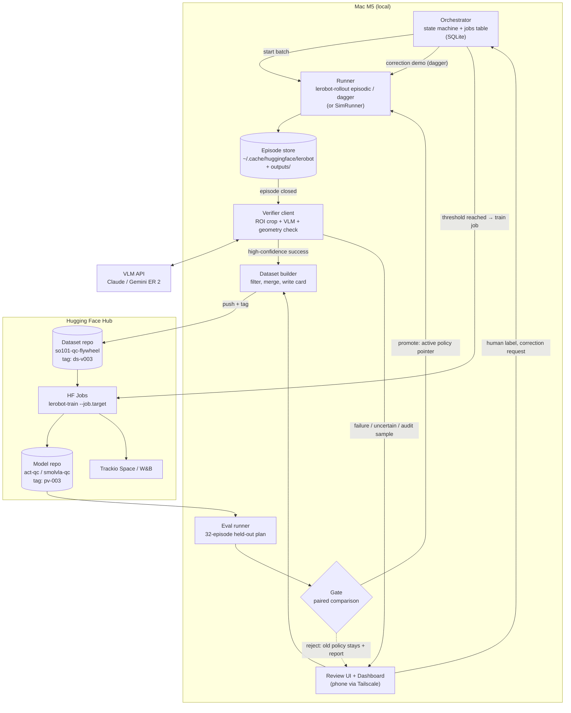
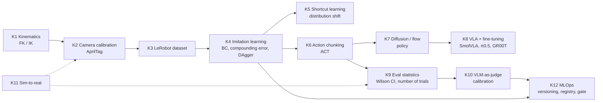

<!-- title-page-start -->

# SO-101 Data Flywheel: Research and Roadmap Report

**Date:** 15 October 2026\
**Project:** SO-101 Self-Improving Data Flywheel (`so101-flywheel`)

**Project context.** The SO-101 arm records a task on every attempt. A VLM verifier judges success, failed attempts
become new data through human correction, and the policy goes through a retrain → eval → deploy loop. The first reference
task is end-of-line quality control for an automotive supplier: the arm shows wheel rims, gears, brake pads and brackets
to a camera; sound parts that match the work order go to the OK bin, defective parts and wrong variants go to the REJECT
bin. The goal is to build an open-source, end-to-end data flywheel in 6 weeks and show a measurable success increase over
at least 3 iterations (`README.md`, `docs/PRD.md`).

<!-- title-page-end -->

<!-- pagebreak -->

## Executive summary

This report combines six research tracks that support the project's next steps as the SO-101 quality control cell is being completed: the tool ecosystem, building the automated loop, experiments this data allows, a Turkish content plan, a learning roadmap, and a publishable contribution. The sections were written by independent agents with their sources checked; information that could not be verified is marked "could not be verified".

**Decisions to make before recording starts**

1. Instruction timing: in the real system the OK/REJECT decision is only known after the part is shown to the camera. Episodes should be recorded with a two-stage task text ("pick up the part and show it", then "put it in the OK/REJECT bin").
2. ACT takes no language input: the target bin should be given to ACT as an extra input (one-hot); otherwise ACT and SmolVLA cannot be compared.
3. Test size: a 32-trial held-out test is too small to claim "success increased". 64 trials with two work orders, 96 in the final comparison, and a paired analysis are recommended.
4. Compute: the Mac M5 handles recording, inference, simulation, local evaluation and the UI; training runs on Hugging Face Jobs (can be triggered automatically), with Colab as a manually run fallback.
5. Evaluation model: two judges (Claude + Gemini Robotics-ER 2 or a local model), a human on disagreement; only high-confidence successes are auto-accepted, with a blind audit every round.
6. The color of the gray parts (metal gray or white) determines the part codes in the recording plan.

**Publication recommendation:** A size-matched 2×2 experiment on the real arm (balanced or confounded data × SmolVLA or ACT) showing that counter-instruction demonstrations expose and remove the visual shortcut in small VLA and ACT models, plus a dose-response curve in sim. Novelty is moderate and should be presented honestly as such. The best target is RSS 2027 (4 December 2026) with an arXiv preprint before it; the cost is about 2 extra days of arm time and postponing some secondary experiments.

**What to record from day one:** raw data for every episode, seeds and configurations, policy version, evaluation model outputs and human labels ([see the list in section 6](#66-what-to-log-from-day-one-so-the-paper-is-possible)).

<!-- pagebreak -->

## Contents

*Where sections give different numbers for the same thing, a **Merge note** explaining the difference was added; the sections' own text was not changed.*

- [Executive summary](#executive-summary)
- [1. Tool ecosystem](#1-tool-ecosystem)
  - [Summary](#summary)
  - [1.1 Robot learning frameworks and model families](#11-robot-learning-frameworks-and-model-families)
  - [1.2 Data, datasets and visualization](#12-data-datasets-and-visualization)
  - [1.3 Training and compute](#13-training-and-compute)
  - [1.4 Experiment tracking and dashboards](#14-experiment-tracking-and-dashboards)
  - [1.5 VLM-as-verifier / judge options](#15-vlm-as-verifier--judge-options)
  - [1.6 Review/labeling UIs and orchestration](#16-reviewlabeling-uis-and-orchestration)
  - [1.7 Simulation and evaluation tools](#17-simulation-and-evaluation-tools)
  - [1.8 Recommended stack for this project](#18-recommended-stack-for-this-project)
  - [1.9 Missing from the project but should be added](#19-missing-from-the-project-but-should-be-added)
- [2. The automated loop: how we build it](#2-the-automated-loop-how-we-build-it)
  - [Summary (TL;DR)](#summary-tldr)
  - [2.1 Prior work: who built it and how, what it teaches us](#21-prior-work-who-built-it-and-how-what-it-teaches-us)
  - [2.2 Architecture for this project](#22-architecture-for-this-project)
  - [2.3 Dashboard](#23-dashboard)
  - [2.4 Verifier calibration and review UX](#24-verifier-calibration-and-review-ux)
  - [2.5 Cost and time estimate per iteration](#25-cost-and-time-estimate-per-iteration)
  - [2.6 Risks and de-risking with the MuJoCo twin](#26-risks-and-de-risking-with-the-mujoco-twin)
  - [Sources](#sources)
- [3. What we can test with this data](#3-what-we-can-test-with-this-data)
  - [3.0 First, two design findings and the statistical reality](#30-first-two-design-findings-and-the-statistical-reality)
  - [3.1 Priority table](#31-priority-table)
  - [D1. Shortcut learning: color = defect data vs balanced data](#d1-shortcut-learning-color--defect-data-vs-balanced-data)
  - [D2. ACT vs SmolVLA: manipulation success and instruction following](#d2-act-vs-smolvla-manipulation-success-and-instruction-following)
  - [D3. VLM verifier: how much can we trust it against human labels?](#d3-vlm-verifier-how-much-can-we-trust-it-against-human-labels)
  - [D4. Inspection: features + rules vs end-to-end decision; held-out and resolution](#d4-inspection-features--rules-vs-end-to-end-decision-held-out-and-resolution)
  - [D5. Data scaling, and targeted corrections vs random demos](#d5-data-scaling-and-targeted-corrections-vs-random-demos)
  - [D6. Sim vs real: can sim eval be a proxy, does co-training help?](#d6-sim-vs-real-can-sim-eval-be-a-proxy-does-co-training-help)
  - [D7. Robustness probes: lighting, shift, bin swap](#d7-robustness-probes-lighting-shift-bin-swap)
  - [D8. New part type: realistic brake disc (5th type)](#d8-new-part-type-realistic-brake-disc-5th-type)
  - [D9. (Optional) π0.5 or GR00T](#d9-optional-π05-or-gr00t)
  - [3.2 Common caveats](#32-common-caveats)
  - [3.3 Six-week plan](#33-six-week-plan)
  - [Sources](#sources-1)
- [4. Content plan: YouTube, Reels, Shorts](#4-content-plan-youtube-reels-shorts)
  - [Short summary](#short-summary)
  - [4.1 Landscape: what gets watched?](#41-landscape-what-gets-watched)
  - [4.2 Positioning](#42-positioning)
  - [4.3 Long-form video series (10 episodes)](#43-long-form-video-series-10-episodes)
  - [4.4 Short video ideas (30)](#44-short-video-ideas-30)
  - [4.5 Production notes](#45-production-notes)
  - [4.6 Six-week publishing calendar](#46-six-week-publishing-calendar)
  - [Sources](#sources-2)
- [5. Learning roadmap](#5-learning-roadmap)
  - [5.1 Concept map (in project order)](#51-concept-map-in-project-order)
  - [5.2 Concepts: explanation, best resource, exercise](#52-concepts-explanation-best-resource-exercise)
  - [5.3 Reading list (2023-2026, in reading order)](#53-reading-list-2023-2026-in-reading-order)
  - [5.4 Courses and tutorials (with recency check)](#54-courses-and-tutorials-with-recency-check)
  - [5.5 Six-week study plan (≈ 3-5 hours per week)](#55-six-week-study-plan--3-5-hours-per-week)
  - [5.6 Glossary (39 terms)](#56-glossary-39-terms)
- [6. Publishable contribution: arXiv / workshop](#6-publishable-contribution-arxiv--workshop)
  - [Summary (TL;DR)](#summary-tldr-1)
  - [6.1 Related work survey (2023–2026)](#61-related-work-survey-20232026)
  - [6.2 Candidate contributions](#62-candidate-contributions)
  - [6.3 Recommendation](#63-recommendation)
  - [6.4 Weekly plan (aligned with PRD phases)](#64-weekly-plan-aligned-with-prd-phases)
  - [6.5 Risks and plan B](#65-risks-and-plan-b)
  - [6.6 What to log from day one (so the paper is possible)](#66-what-to-log-from-day-one-so-the-paper-is-possible)
  - [Sources](#sources-3)

<!-- pagebreak -->

## 1. Tool ecosystem

*As of: 15 October 2026. GitHub star counts were taken from the GitHub API on the same day, package versions from PyPI. Prices were read from the providers' own pages; where a page does not state something explicitly, it is marked **could not be verified**.*

### Summary

- **LeRobot now provides most of the loop by itself.** The latest stable release is **v0.6.1** (3 August 2026). v0.6.0 brought: `lerobot-rollout` (recording with DAgger-style human intervention), one-command training on HF Jobs via `--job.target`, a reward/success model API (Robometer, TOPReward, SARM) and dataset annotation with a VLM. This project's "correction demo → retrain" step is already available in LeRobot ([PyPI](https://pypi.org/project/lerobot/#history), [v0.6.0 blog](https://huggingface.co/blog/lerobot-release-v060)).
- **The Mac M5 is not a training machine.** LeRobot's own hardware guide gives ~6–14 hours for ACT on 50 episodes on Apple Silicon Max chips. The same job takes ~1–2 hours on a single L4/A10G ([hardware guide](https://huggingface.co/docs/lerobot/hardware_guide)). The Mac should be used for recording, inference, MuJoCo, the local VLM and the dashboard. Training should happen on a rented GPU.
- **The most practical compute option is HF Jobs.** It is billed per minute (L4 $0.80/h, A10G-large $1.50/h, A100-80GB $2.50/h). It is wired directly into LeRobot and can be triggered by a webhook on a dataset push ([Jobs pricing](https://huggingface.co/docs/hub/jobs-pricing), [webhooks](https://huggingface.co/docs/hub/jobs-webhooks)). This covers the PRD's "retrain when the threshold is reached" requirement almost for free.
- **There are two new developments on the verifier side.** Gemini Robotics ER 2 (30 July 2026) explicitly targets success detection from video ([Google](https://blog.google/innovation-and-ai/models-and-research/google-deepmind/gemini-robotics-er-2/)). FailBench (September 2026) shows that VLM judges **tend to say "success"** in ambiguous cases ([arXiv 2609.03611](https://arxiv.org/abs/2609.03611)). That is exactly the PRD's biggest risk: verifier false positives.
- **Core of the recommended stack:** LeRobot 0.6.x (ACT → SmolVLA), HF Hub (versioned datasets), HF Jobs (training), Claude and Gemini ER 2 (verifier, used together) and local Robometer (second opinion). Add Trackio/W&B, a custom review UI and the existing MuJoCo twin.

---

### 1.1 Robot learning frameworks and model families

#### LeRobot (Hugging Face)

**What:** A PyTorch library centered on SO-100/101 that bundles recording, dataset format, training, evaluation and deployment into one package.
**Why it is trending:** 28,175 GitHub stars and daily commits as of 15 October 2026. Since 2025-10 a release has come out roughly every month: 0.4.0 (23 October 2025), 0.4.3 (22 January 2026), 0.5.0 (9 March), 0.5.1 (7 April), 0.6.0 (6 July), 0.6.1 (3 August) ([PyPI](https://pypi.org/project/lerobot/#history), [releases](https://github.com/huggingface/lerobot/releases)).
**Relevance:** high. **Mac M5 + rented GPU:** suitable. Recording and inference run on the Mac, training on HF Jobs via `--job.target`.

Features that matter for this project:

| Feature | Version | Impact on the project |
| --- | --- | --- |
| **Dataset v3.0**: multi-episode Parquet/MP4 files, episode resolution via metadata, streaming from the Hub with `StreamingLeRobotDataset`, v2.1 → v3 converter | ≥ 0.4.0 | For keeping dataset vN versions on the Hub and training without downloading ([docs](https://huggingface.co/docs/lerobot/lerobot-dataset-v3)) |
| **Async inference**: policy server and robot client over gRPC. The next chunk is computed while the robot executes the current one | since 0.3.x; `async.mdx` in 0.6.1 | Makes it possible to run SmolVLA on a GPU machine and drive the arm from the Mac ([docs](https://huggingface.co/docs/lerobot/async)) |
| **Remote inference (Zenoh)**: new engine replacing async | `main` only (13 October 2026, [PR #4937](https://github.com/huggingface/lerobot/pull/4937)), **not in a release yet** | Likely to arrive with 0.7. For now the gRPC path in 0.6.1 should be used ([docs](https://github.com/huggingface/lerobot/blob/main/docs/source/remote_inference.mdx)) |
| **Real-Time Chunking (RTC)** | 0.5.0 | Smooth motion for SmolVLA/π0-class models on low-power hardware |
| **`lerobot-rollout`**: `base`, `sentry`, `highlight`, `episodic`, `dagger` strategies | 0.6.0 | In `dagger` mode, when the policy makes a mistake the SO-101 leader takes over and the correction is marked frame by frame with an `intervention` flag ([v0.6.0 blog](https://huggingface.co/blog/lerobot-release-v060), [HIL guide](https://github.com/huggingface/lerobot/blob/v0.6.1/docs/source/hil_data_collection.mdx)). A ready-made version of the PRD's "correction demo" flow |
| **HIL-SERL**: online RL with human intervention and a reward classifier | since 0.2.x; RL API rewritten in 0.6.0 (`sac` → `gaussian_actor`) | Out of v1 scope in the PRD. The guide requires an NVIDIA GPU ([hilserl](https://huggingface.co/docs/lerobot/hilserl)) |
| **Reward models** (`lerobot.rewards`): HIL-SERL classifier, SARM, Robometer, TOPReward | 0.6.0 | A local, free "second verifier" (see 1.5) |
| **`lerobot-annotate`**: subtask, plan and VQA annotation with Qwen-VL | 0.6.0 | Can help with failure taxonomy annotation ([docs](https://github.com/huggingface/lerobot/blob/v0.6.1/docs/source/annotation_pipeline.mdx)) |
| **`lerobot-edit-dataset`**: delete episodes, split, merge, add/remove features | 0.4.x | Provides the dataset builder's "filter + merge" step out of the box ([docs](https://github.com/huggingface/lerobot/blob/v0.6.1/docs/source/using_dataset_tools.mdx)) |
| **Hardware video encoding**: `vcodec=auto`; NVENC, **VideoToolbox**, VAAPI, QSV | 0.6.0 | Lowers CPU load during recording on the M5 |
| **LeLab**: web GUI for SO-101. Calibration, teleop, recording, HF Jobs training | in the 0.6.x docs | Useful for a quick start, but has no review/labeling ([docs](https://github.com/huggingface/lerobot/blob/v0.6.1/docs/source/lelab.mdx)) |
| **MPS support**: `--policy.device=mps` | yes | The docs only say "Apple Silicon acceleration". No list of which policies work and no benchmarks ([torch_accelerators](https://github.com/huggingface/lerobot/blob/v0.6.1/docs/source/torch_accelerators.mdx)) |

> Note: 0.6.1 contains a breaking change (`lerobot.types` → `lerobot.lerobot_types`). Also, since 0.6.0 the base install does not include training dependencies; extras are required. Since the repo uses `uv.lock`, the version should be pinned.

#### Policy and VLA models

| Model | What / when | Training compute | SO-101 fine-tuning documented? | Apple Silicon | Relevance |
| --- | --- | --- | --- | --- | --- |
| **ACT** | Action Chunking Transformer, 2023, ~52M parameters ([repo](https://github.com/tonyzhaozh/act), 2,273★) | ~2–6 GB at BS 8. For 50 episodes/5 epochs ~30–60 min on a 4090, ~1–2 h on L4/A10G ([HF guide](https://huggingface.co/docs/lerobot/hardware_guide)) | Yes, LeRobot's main SO-101 example. Community report: ~4 h on a 3080, in-dist. success 60% → 90% going from 50 to ~150 episodes ([blog](https://huggingface.co/blog/sherryxychen/train-act-on-so-101)) | Training works on MPS but is slow: ~6–14 h on M1–M3 Max ([guide](https://huggingface.co/docs/lerobot/hardware_guide)), >13 h on M1 Max ([issue #3191](https://github.com/huggingface/lerobot/issues/3191)). Inference is comfortable on the Mac | **high** (baseline) |
| **Diffusion Policy** | 2023, Stanford ([repo](https://github.com/real-stanford/diffusion_policy), 4,639★). In LeRobot as `diffusion` and, since 0.5.1, `multi_task_dit` | ~8–14 GB. ~2–4 h on a 4090 (50 episodes) | Generic LeRobot flow exists, no official SO-101-specific guide | Training is not practical | medium (alternative in the PRD) |
| **SmolVLA** | HF, June 2025, 450M, language-conditioned ([paper](https://huggingface.co/papers/2506.01844)) | ~10–16 GB. ~3–6 h on L4/A10G at BS 4, ~1–2 h on A100 (50 episodes). Official note: 20k steps ≈ ~4 h on A100 ([docs](https://huggingface.co/docs/lerobot/smolvla)) | Yes. ~50 episodes recommended, 25 episodes found insufficient. Pretraining data is SO-100/101 community datasets | Training on MPS is "very slow" ([phospho](https://docs.phospho.ai/learn/train-smolvla)). Inference: the community port **mlx-smolvla** produces a 50-step chunk on an M5 Pro in ~111 ms with MLX and ~205 ms with PyTorch-MPS. Experimental, with no task-success claims ([forum](https://discuss.huggingface.co/t/mlx-smolvla-smolvla-checkpoint-execution-and-validation-on-apple-silicon/179927)) | **high** (language-conditioned policy) |
| **π0 / π0-FAST / π0.5 (openpi)** | Physical Intelligence; π0.5 weights and PyTorch support September 2025 ([repo](https://github.com/Physical-Intelligence/openpi), 14,231★). In LeRobot as `pi0`, `pi0_fast`, `pi05` | ~24–40 GB. 50 episodes ~4–8 h on A100-40GB. pi05 5k steps in 3 h 41 min on 4×H100 ([guide](https://huggingface.co/docs/lerobot/hardware_guide)). openpi: LoRA >22.5 GB, full FT >70 GB | Generic flow via LeRobot. No official SO-101-specific recipe found | No | medium (PRD alternative; 3–5× the cost) |
| **π\*0.6 / π0.7** | π\*0.6 (November 2025) is an RL recipe that learns from experience ([pi.website](https://www.pi.website/)) | — | **No open weights** (could not be verified; only community reimplementations exist) | — | low (interesting as an idea: same theme as the flywheel) |
| **NVIDIA GR00T N1.7** | 3B, Cosmos-Reason2-2B backbone. Early Access 17 April 2026, the repo now says GA ([repo](https://github.com/NVIDIA/Isaac-GR00T), 8,203★). Replaced N1.5 in LeRobot 0.6.0 | ≥40 GB fine-tune, ≥16 GB inference (NVIDIA-based) | **Yes**, HF and NVIDIA's SO-101 + Isaac Teleop guide from July 2026: 50 episodes, `new_embodiment`, 20k steps ([blog](https://huggingface.co/blog/nvidia/nvidia-isaac-teleop-and-gr00t17-in-lerobot)). Requires access to the gated Cosmos weights | No | low–medium |
| **MolmoAct2 (Ai2)** | 5 May 2026, fully open ([repo](https://github.com/allenai/molmoact2), 807★) | Inference ~12 GB in bf16, LoRA fits in 24 GB ([v0.6.0 blog](https://huggingface.co/blog/lerobot-release-v060)) | **Has a zero-shot SO-100/101 checkpoint** ([allenai/MolmoAct2-SO100_101](https://huggingface.co/allenai/MolmoAct2-SO100_101)). LeRobot has a calibration-corrected version. Ai2's own claim: 56.7% zero-shot on SO-100/101. A calibration frame mismatch has been reported ([PR #1207](https://github.com/open-edge-platform/physical-ai-studio/pull/1207)) | No | medium (as an extra comparison line) |
| **OpenVLA / OpenVLA-OFT** | 7B; OFT February 2025 ([openvla](https://github.com/openvla/openvla) 7,158★, [oft](https://github.com/moojink/openvla-oft) 1,425★; last push September 2025) | ~70 GB+ class even with LoRA (secondary source). Requires the RLDS format | No official path for SO-101/LeRobot found | No | low (momentum has faded) |
| **X-VLA, EO-1, EVO1, VLA-JEPA, FastWAM, LingBot-VA** | VLA and world-model policies added to LeRobot between late 2025 and 2026 ([v0.6.0 blog](https://huggingface.co/blog/lerobot-release-v060)) | Most are in the 24–40 GB class. EVO1 is the smallest at 0.77B | Generic LeRobot flow | No | low (for v1) |
| **Gemini Robotics (VLA) / On-Device** | Google DeepMind. On-Device June 2025, claims adaptation with 50–100 demos ([DeepMind](https://deepmind.google/blog/gemini-robotics-on-device-brings-ai-to-local-robotic-devices/)) | — | **Trusted testers only**. SO-101 support could not be verified | — | low |
| **Gemini Robotics-ER 2** | Embodied reasoning VLM. Not a policy; a verifier/planner. 30 July 2026, `gemini-robotics-er-2-preview` | API | — | API | **high** (verifier, see 1.5) |

**Comment:** The PRD's choice to start with ACT and continue with SmolVLA matches the path the low-cost arm community actually takes. ACT gives cheap, fast iteration. SmolVLA provides the language conditioning needed for counter-instruction experiments that measure whether the policy actually listens to "put it in the OK/reject bin". π0.5 and GR00T N1.7 raise per-iteration cost 3–5× and are unnecessary for v1 on a 6-week schedule. MolmoAct2's zero-shot SO-101 checkpoint is a free extra comparison line: it answers "what does a model that has never seen a demo do?" before v0.

---

### 1.2 Data, datasets and visualization

| Tool | Purpose | Evidence of trend | Relevance | Mac + rented GPU |
| --- | --- | --- | --- | --- |
| **Hugging Face Hub (dataset repos)** | The natural home of LeRobot datasets. Git-based revisions, tags and branches, private repo support (private dataset support was added in 0.6.1) | LeRobot's default. HF Jobs and webhooks hook into Hub events ([webhooks](https://huggingface.co/docs/hub/jobs-webhooks)) | **high**: dataset vN = a tag/revision on the Hub | Suitable |
| **LeRobot dataset visualizer** | Browse a Hub dataset episode by episode in the browser (video and joint plots) | Official Space: [lerobot/visualize_dataset](https://huggingface.co/spaces/lerobot/visualize_dataset). No v3 feature list found (could not be verified) | medium: quick visual check. Does not replace a review UI | Browser |
| **Rerun** | Multimodal (video, time series, 3D) logger and viewer. **Built-in loader that opens LeRobot datasets directly** (v2.1 and v3) | 11,595★, `rerun-sdk` 0.39.0 (12 October 2026). $17M seed round, March 2025 ([TechCrunch](https://techcrunch.com/2025/03/20/reruns-open-source-ai-platform-for-robots-drones-and-cars-revs-up-with-17m-seed)). A LeRobot dependency ([loader](https://rerun.io/docs/howto/logging-and-ingestion/lerobot)) | **high**: for inspecting a failed episode together with its joint curves | Runs natively on the Mac |
| **Foxglove** | ROS and robotics visualization. LeRobot 0.6.0 added `--display_mode=foxglove` | Official integration in LeRobot ([v0.6.0 blog](https://huggingface.co/blog/lerobot-release-v060)) | low: Rerun is enough | Runs on the Mac |
| **`lerobot-edit-dataset`** | Delete episodes, merge, split | Part of LeRobot core | **high**: the engine of the dataset builder | Runs on the Mac CPU |
| **DVC** | Large file and data versioning alongside Git | 15,919★, but the latest release is 3.67.1 (31 March 2026). Low momentum | low: HF Hub revisions do the same job | — |

**Recommendation:** No separate tool is needed for dataset versioning. Each iteration should be a **tag** on the Hub (`v0`, `v1`…). The dataset card should list "episodes added/removed, verifier prompt version". Verifier and human labels (FR-10) should be carried as separate Parquet columns or a side table. LeRobot 0.6.0's "language annotations" fields can also be used for this.

---

### 1.3 Training and compute

#### Price of one GPU-hour (October 2026, on-demand, single GPU)

| Provider | T4 | L4 (24 GB) | A10G/A10 (24 GB) | RTX 4090 (24 GB) | A100 | H100 | Source / note |
| --- | --- | --- | --- | --- | --- | --- | --- |
| **HF Jobs** | $0.40 (small) | $0.80 | $1.00 (small) / $1.50 (large) | — | $2.50 (80 GB) | — (H200 $5.00) | [jobs-pricing](https://huggingface.co/docs/hub/jobs-pricing). Per-minute billing, requires a credit balance. Default Jobs timeout is 30 min; `lerobot-train` sets its own default to 48 h |
| **Google Colab** (Pay As You Go / Pro) | ~$0.12–0.20 | ~$0.17–0.50 | — | — | ~$0.54–1.50 (40 GB) | Not on consumer Colab | 100 CU ≈ $9.99. **CU/hour rates are not official**, and third-party measurements disagree ([Thunder](https://www.thundercompute.com/blog/colab-alternatives-for-cheap-deep-learning-in-2025)). No specific GPU is guaranteed, session lengths are limited. **Could not be verified** |
| **Colab Enterprise** | — | — | — | — | — | ~$11.76 (Iowa, 21 September 2026) | Third-party reading ([Thunder](https://www.thundercompute.com/blog/colab-alternatives-for-cheap-deep-learning-in-2025)), official page: [cloud.google.com/colab/pricing](https://cloud.google.com/colab/pricing) |
| **RunPod** | — | $0.44 (community) / $0.49 (secure) | — | $0.34 / $0.74 | A100-80 PCIe $1.19 / $1.59 | H100 PCIe $1.99 / $2.89 | [runpod.io/pricing](https://www.runpod.io/pricing). The visible table on the page shows different numbers from the structured data; confirm in the console |
| **Modal** | $0.59 | $0.80 | $1.10 | — | $2.10 (40) / $2.50 (80) | $3.95 | [modal.com/pricing](https://modal.com/pricing). Per-second billing, $30/month free credit on the Starter plan |
| **Lambda** | — | — | $1.29 | — | $1.99 (40 GB) | $3.29 (PCIe) / $4.29 (SXM) | [lambda.ai/pricing](https://lambda.ai/pricing) |
| **Vast.ai** | — | — | — | ~$0.20–0.53 (marketplace; from $0.309 in an August 2026 snapshot) | varies | varies | [computeprices](https://computeprices.com/providers/vast/gpus/rtx4090). Prices vary by host, and reliability depends on the host |

**HF ZeroGPU** is not for training but for **inference in Gradio Spaces**. Half or full RTX Pro 6000 Blackwell (48/96 GB), 60 s per call by default. Daily quota is 5 min on free and 40 min on PRO ($9/month); overage is $1/10 min ([docs](https://huggingface.co/docs/hub/spaces-zerogpu)). Suitable for publishing the local Qwen-VL verifier as a demo. The quota is too tight to use inside the loop.

**HF Inference Endpoints** (L4 $0.80, A100 $2.50, H100 $4.50/h, [pricing](https://huggingface.co/pricing)) could host SmolVLA as an always-on policy server. However, LeRobot's remote/async inference docs only cover a self-hosted server. Running it on an Endpoint **could not be verified**.

#### The reality of training on Apple Silicon (M5)

- The single Apple row in the LeRobot guide: **ACT, M1/M2/M3 Max, BS 4, 50 episodes: ~6–14 hours** ([hardware guide](https://huggingface.co/docs/lerobot/hardware_guide)). The same job takes ~30–60 min on a 4090. **No** published LeRobot benchmark for the (non-Max) M5 was found. Whether the new accelerators in the M5 GPU help PyTorch-MPS training also **could not be verified**.
- Community reports point the same way: SO-101 ACT at 50k steps was projected at ~37 hours on a MacBook but finished in ~2 hours and a few dollars in the cloud. On an M1 Max, ACT took >13 hours and `num_workers` had no effect ([issue #3191](https://github.com/huggingface/lerobot/issues/3191)).
- There is no measured throughput for training SmolVLA on MPS. Third-party guides say "possible but very slow" ([phospho](https://docs.phospho.ai/learn/train-smolvla)).
- **What makes sense on the Mac:** data recording (VideoToolbox encoding), ACT and SmolVLA inference (without an async server), smoke tests of a few hundred steps (`--steps=200`), the MuJoCo twin, the local VLM verifier (`mlx-vlm`), and the dashboard and review UI.

#### Rough cost per iteration for this project (estimate)

Assumption: ~120 episodes × ~30 s × 30 fps ≈ 108k frames, i.e. ~2.4× the guide's 45k-frame scenario. The guide's "5 epoch" anchors were scaled linearly.

| Policy | Hardware | Estimated time | HF Jobs cost |
| --- | --- | --- | --- |
| ACT | L4 ($0.80/h) | ~2.5–5 h | ~$2–4 |
| ACT | A10G-large ($1.50/h) | ~2.5–5 h | ~$4–8 |
| SmolVLA | A100-80GB ($2.50/h), BS 16 | ~2.5–5 h | ~$6–12 |
| π0.5 (optional) | A100-80GB | ~10–20 h | ~$25–50 |

These are estimates and can be off by ±50% (the guide's own warning). Measure `update_s` and `dataloading_s` from a trial run of a few hundred steps and recompute. For short runs, do not forget to set `--policy.scheduler_decay_steps ≈ --steps` ([guide](https://huggingface.co/docs/lerobot/hardware_guide)).

> **Merge note:** Section 2.5 gives shorter times for the same training runs (ACT on 120 episodes, 1.6–3.2 h on A10G-large). The difference comes from the assumption: here an episode is ~30 s (≈108k frames), in 2.5 it is ~20 s (≈72k frames). Both are scaled linearly from the same hardware guide; both should be updated once the real episode length is measured.

---

### 1.4 Experiment tracking and dashboards

| Tool | Purpose | Evidence of trend | Relevance | Mac + rented GPU |
| --- | --- | --- | --- | --- |
| **Weights & Biases** | Training curves, artifacts, video logging. `lerobot-train --wandb.enable=true` | LeRobot's **only official tracker** (`wandb>=0.24,<0.28` in 0.6.1). The product is now under CoreWeave. Free plan: 5 GB/month storage, 5 seats. Pro starts at $60/month ([pricing](https://coreweave.com/forge-pricing)) | **high** (PRD default). The free plan is enough | Cloud, from anywhere |
| **Trackio** | HF's lightweight, free, wandb-compatible tracker (`import trackio as wandb`). Dashboard on local SQLite or an HF Space | 1,722★, `trackio` 0.42.0 (9 October 2026), released July 2025 ([docs](https://huggingface.co/docs/trackio/en/index)). LeRobot integration is an **open PR** ([#4320](https://github.com/huggingface/lerobot/pull/4320), not merged) | medium–high: no account, free. Ideal for logging eval and gate metrics from your own code | Local on the Mac, shared on an HF Space |
| **MLflow** | Self-hosted tracking and model registry | 28,384★, 3.17.1 (13 October 2026) | low–medium: the model registry idea is useful for the gate, but it means an extra server | Runs on the Mac |
| **TensorBoard** | Classic training curves | Mature, low momentum | low | — |
| **Grafana** | Time series and ops dashboards | Common for robotics ops | low: only later, for servo temperature and batch telemetry | — |
| **Gradio / Streamlit** | Fast UIs and dashboards in Python | Gradio 6.30.0 (8 October 2026; Trackio's dashboard is also Gradio), Streamlit 1.66.0 (14 October 2026) | medium: a fast-prototype alternative in the PRD. A verifier–human agreement dashboard for Phase 2 takes a few hours | Runs on the Mac, can be moved to a Space |

**Recommendation:** W&B free for training curves (works with a single flag in LeRobot). **Product metrics** (success rate with Wilson CI, failure_type distribution, verifier agreement, cost) should stay in your own DB and Next.js dashboard as in the PRD. These are loop metrics, not training metrics. If the Trackio PR gets merged, it can replace W&B.

---

### 1.5 VLM-as-verifier / judge options

#### The evidence that changed this area: FailBench (September 2026)

FailBench tests 13 VLM-based failure detectors on 2,197 manipulation trials from 14 sources ([arXiv 2609.03611](https://arxiv.org/abs/2609.03611)). Findings:

- The best model reaches 0.77 mean balanced accuracy. According to the search summary this model is Gemini 3 Flash ([PDF](https://arxiv.org/pdf/2609.03611)); the abstract page does not name the model, so the name could not be verified.
- On contact-rich assembly tasks accuracy drops below ~0.60, i.e. close to chance.
- Faced with ambiguous evidence there is a **systematic bias toward "success"**, and it does not go away when reasoning effort is increased. This is the main source of false positives.
- **Cropping** the region that determines the outcome improves the best model by +2.4 points without any training.
- Models fine-tuned for failure detection lag behind general VLMs.

**Takeaway for the project:** This task is of the "which bin is the part in?" kind, where the outcome is read from the object's motion and final position. It falls into the class FailBench found close to saturation, which is good news. The PRD's "last frame + bin ROIs" plan is exactly the cropping FailBench recommends. Still, because of the **success bias**, the "uncertain" band should be kept wide and random human audits should be done every iteration (already in the PRD).

#### Options

| Option | What | Price (per 1M tokens, input / output) | Relevance | Mac + rented GPU |
| --- | --- | --- | --- | --- |
| **Claude** (Anthropic API) | Image input, structured output (`output_config.format`). Batch API at 50% off. Current models: Haiku 5.5, Sonnet 5.5, Opus 5.5 | Haiku 5.5 **$0.10 / $0.50**, Sonnet 5.5 **$2 / $10**, Opus 5.5 **$4 / $20** (Anthropic model table, 6 October 2026; [pricing](https://www.anthropic.com/pricing#api)) | **high** (PRD default) | API |
| **Gemini Robotics-ER 2** | **Progress and success detection** from robot video. 91.3% at finding the key moment of a task, 57.4% at progress classification (Google's own numbers). `gemini-robotics-er-2-preview` and a streaming variant. ER 1.6 was deprecated on 31 August 2026 ([blog](https://blog.google/innovation-and-ai/models-and-research/google-deepmind/gemini-robotics-er-2/), [docs](https://ai.google.dev/gemini-api/docs/robotics-overview)) | **$1.00 / $5.00**, batch $0.50 / $2.50. **There is a free tier**, but free usage may be used to improve Google products. **The price doubles on 1 January 2027** ($2 / $10) ([pricing](https://ai.google.dev/gemini-api/docs/pricing)) | **high**: the only commercial "success detector" trained for robotics. Behavior may change since it is a preview | API |
| **Gemini 3.x Flash / Flash-Lite** | General VLM | 3.8 Flash $0.75 / $3.75, 3.5 Flash-Lite $0.30 / $2.50 ([pricing](https://ai.google.dev/gemini-api/docs/pricing)) | medium | API |
| **OpenAI GPT** | General VLM | gpt-6-luna $0.10 / $0.50, gpt-5.6-terra $2 / $12, gpt-6-sol $2 / $10. Batch 50% ([pricing](https://developers.openai.com/api/docs/pricing)) | medium: as a third judge for a majority vote | API |
| **Qwen-VL family (local)** | Open weights. Qwen3-VL (4B/8B/30B-A3B), Qwen3.5 (native multimodal, 0.8B–27B), Qwen3.6-27B (LeRobot annotation default) | Free; hardware cost applies | **medium–high**: the PRD's "local VLM option" | **Runs on the Mac with `mlx-vlm`** (5,621★, 0.7.8, 13 October 2026). Example: `mlx-community/Qwen3.5-4B-MLX-4bit` ~2.9 GB ([card](https://huggingface.co/mlx-community/Qwen3.5-4B-MLX-4bit)). vLLM + rented GPU for larger models |
| **Robometer-4B** (robotics reward model) | Qwen3-VL-4B + progress, success and preference heads. Gives per-frame progress and success probability from video, no task-specific training needed. RSS 2026. In LeRobot as `reward_model.type=robometer`, inference only ([docs](https://huggingface.co/docs/lerobot/en/robometer)) | Free | **high**: plugs into the loop as a second opinion. If Claude and Robometer disagree, the episode goes to the "uncertain" queue | The docs recommend a GPU. Running on MPS **could not be verified** |
| **TOPReward** | Uses the log-probability of the "instruction correct" token from a frozen Qwen3-VL-8B as the reward. Zero-shot, ~16 GB weights ([docs](https://github.com/huggingface/lerobot/blob/v0.6.1/docs/source/topreward.mdx)) | Free | medium | GPU recommended |
| **SARM / HIL-SERL reward classifier** | Progress or success classifier trained on task data | Free | medium: once 100+ human labels accumulate, the cheapest way to train your own small success classifier | Training on GPU |

**Cost scale (estimate):** ~3–6k tokens per episode with 4 frames and a short JSON response. For ~150–200 episodes per iteration: < $0.10 with Haiku 5.5 or gpt-6-luna, ~$1–3 with Sonnet 5.5 or Gemini ER 2. Verifier cost is negligible next to GPU cost. The real cost is human review time.

> **Merge note:** Section 2.5 gives ~$5 per iteration for Sonnet 5.5. The difference comes from scope: that calculation queries each episode k=3 times (self-consistency) and assumes ~4k input tokens; the ~$1–3 here is for a single call (k=1).

**Recommendation:** Make Claude Sonnet 5.5 the primary verifier: structured output, versioned prompt. Measure Gemini Robotics-ER 2 side by side on the same set of 100+ human labels (FR-2 metric); ER 2 also accepts video. Run Robometer-4B in batch on HF Jobs as a cheap second opinion. Decision rule: if the two judges disagree or confidence is below the threshold, the episode goes to a human. This setup protects the PRD's "false positive ≤ 5%" target more robustly than a single judge.

---

### 1.6 Review/labeling UIs and orchestration

#### Review and labeling

| Tool | Purpose | Evidence of trend | Relevance | Fit |
| --- | --- | --- | --- | --- |
| **Custom UI (Next.js, PRD plan)** | Queue, video, verifier rationale, "approve / correct / exclude / request demo" actions | — | **high**: loop-specific actions ("record recovery" → `lerobot-rollout --strategy.type=dagger`) do not exist in off-the-shelf tools | Runs on the Mac, reachable from the phone via Tailscale |
| **Label Studio** | General-purpose labeling. Has video classification and video timeline segmentation templates ([template](https://labelstud.io/templates/video_classification)) | 28,461★, 1.23.2 (29 September 2026) | medium: can be used for the Phase 2 job of **100+ hand labels independent of the verifier** before the custom UI is done | Docker or pip, runs on the Mac |
| **Argilla** | Human feedback UI in the HF ecosystem | 5,152★, but **the latest PyPI release is 2.8.0, March 2025** ([PyPI](https://pypi.org/project/argilla/)). Momentum appears to have stopped | low | — |
| **Gradio** | Prototype review screen in a few hours | See 1.4 | medium: as a quick v0 before the Next.js UI | Mac or Space |

#### Orchestration

| Tool | Purpose | Evidence of trend | Relevance | Fit |
| --- | --- | --- | --- | --- |
| **HF Jobs: webhook + scheduled jobs** | Trigger a training job when a push lands on the dataset repo. Scheduling via cron ([webhooks](https://huggingface.co/docs/hub/jobs-webhooks), [schedule](https://huggingface.co/docs/hub/jobs-schedule)) | New HF feature | **high**: a serverless path for "retrain when the threshold is reached" (FR-11) | Cloud |
| **BullMQ + Redis** (PRD default) | Job queue on the TS side | Mature | **high**: already planned. Python workers pull jobs over HTTP | Runs on the Mac |
| **Python RQ / Celery** | Single-language queue | Mature | medium: if a single language is preferred | Mac |
| **Prefect** | Turns Python functions into flows with a decorator | 24,020★, 3.8.8 (6 October 2026). **Announced an agreement to acquire Dagster Labs on 13 July 2026** ([Dagster blog](https://dagster.io/blog/prefect-is-acquiring-dagster)). Closing status could not be verified | low–medium: overkill at this scale | Mac |
| **Dagster** | Asset-based orchestration (dataset vN and policy vN as assets). Lineage | 16,278★, 1.13.26 (9 October 2026) | low–medium: lineage is attractive, but setup overhead is high | Mac |
| **Temporal** | Durable, long-running workflows | 23,707★ | low: overkill for a 6-week project | — |

**Recommendation:** Keep BullMQ from the PRD (or RQ for a single language). Starting training from your own queue with `hf jobs`, or hooking it to a Hub webhook, is enough. Prefect, Dagster and Temporal add complexity at this scale without any gain.

---

### 1.7 Simulation and evaluation tools

| Tool | Purpose | Evidence of trend | SO-101 availability | Relevance | Mac M5 |
| --- | --- | --- | --- | --- | --- |
| **MuJoCo** | The project's existing digital twin | 15,684★. **3.16.0, 14 October 2026** (repo pinned to `mujoco==3.12.0`) | Official MJCF: [SO-ARM100/Simulation/SO101](https://github.com/TheRobotStudio/SO-ARM100/tree/main/Simulation/SO101) and [mujoco_menagerie/robotstudio_so101](https://github.com/google-deepmind/mujoco_menagerie) | **high** (already in place) | Native |
| **MJX / MuJoCo Warp / MuJoCo Playground** | Parallel MuJoCo on GPU (JAX or NVIDIA Warp). Playground offers ready-made RL environments | `mujoco-mjx` and `mujoco-warp` 3.16.0. Playground 2,250★, `playground` 0.2.0 (March 2026) | Can be derived from the Menagerie model | low: no RL is done, CPU MuJoCo is enough for scripted batches | MJX runs on the Mac with CPU/JAX. Warp requires NVIDIA |
| **LeRobot sim environments and EnvHub** | Benchmarks via `lerobot-eval` (LIBERO, Meta-World, RoboCasa365 and RoboTwin 2.0 in 0.6.0, etc.). `lerobot_env_*` plugin packages register themselves | 0.6.0 | **Official SO-101 EnvConfig is at the PR stage** ([#4492](https://github.com/huggingface/lerobot/pull/4492), open). Community plugin: [so101-sim2real](https://github.com/isaka1022/so101-sim2real) | medium: if you turn your own twin into a `lerobot_env_*` plugin, the same eval protocol runs in sim via `lerobot-eval` | Runs on the Mac |
| **LeIsaac** (LightwheelAI) | SO-101 tasks in Isaac Lab and sim teleop with the leader, LeRobot EnvHub integration ([docs](https://github.com/huggingface/lerobot/blob/v0.6.1/docs/source/envhub_leisaac.mdx)) | Official LeRobot docs | Yes | low | **No**: requires CUDA and NVIDIA |
| **Isaac Sim / Isaac Lab** | NVIDIA's photorealistic simulator. GR00T ecosystem | IsaacLab 8,347★. Isaac Sim 6.1.0 (September 2026), Linux and Windows | Community: [isaac_so_arm101](https://github.com/MuammerBay/isaac_so_arm101) | low | **Does not run on the Mac**. Only a macOS streaming client exists ([download](https://docs.isaacsim.omniverse.nvidia.com/6.1.0/installation/download.html)) |
| **ManiSkill3** | GPU-parallel simulation. Zero-shot RGB sim2real work for SO-100/101 (lerobot-sim2real, Squint: 8 SO-101 tasks, 73/80 on real) | 3,418★, 3.0.1 (April 2026) ([sim2real](https://maniskill.readthedocs.io/en/latest/user_guide/tutorials/sim2real/index.html), [Squint](https://arxiv.org/pdf/2602.21203)) | Yes | low: RL and sim2real are not the project's focus | Limited (GPU parallelism requires NVIDIA) |

**Recommendation:** The MuJoCo twin is the right choice and in line with the trend. Most of the community's SO-101 sim work is in MuJoCo. Two small steps would help. First, upgrade `mujoco` to 3.16 (checking for breakage with the tests). Second, wrap `flywheel.sim` as a `lerobot_env_*` plugin. That way the same `lerobot-eval` and rollout commands carry over between sim and real, and the verifier can be calibrated in sim against episodes with exact labels (the "next experiment" in the experiment design).

---

### 1.8 Recommended stack for this project

| Layer | Recommendation | Why | Where it runs | Cost |
| --- | --- | --- | --- | --- |
| Robot control and recording | **LeRobot 0.6.1** (pinned), `vcodec=auto` | De facto standard for SO-101, dataset v3 | Mac M5 | 0 |
| Correction demo | **`lerobot-rollout --strategy.type=dagger`** + SO-101 leader | Intervention is flagged frame by frame, PRD scenario 3 comes ready-made | Mac M5 | 0 |
| Policy (baseline) | **ACT** | Cheap, fast, the best documented on SO-101 | Training on HF Jobs L4, inference on the Mac | ~$2–4/iter. |
| Policy (language-conditioned) | **SmolVLA** (`lerobot/smolvla_base`) | Language conditioning for counter-instruction experiments. 450M, inference ~2 GB | Training on HF Jobs A100, inference on the Mac or an async server | ~$6–12/iter. |
| Extra comparison (optional) | **MolmoAct2-SO100_101** zero-shot | A "no demos seen" line, at no cost | Rented GPU (~12 GB) | a few $ |
| Dataset and versioning | **HF Hub** (private → public), a tag per iteration, `lerobot-edit-dataset` | No extra tool needed, wired into Jobs and webhooks | Hub | 0 (PRO $9/month optional) |
| Visualization | **Rerun** + LeRobot visualizer Space | Opens LeRobot v3 directly | Mac | 0 |
| Training compute | **HF Jobs** (`--job.target`). RunPod or Vast (4090) as a fallback | Per-minute billing, integrated with LeRobot, webhook | Cloud | see 1.3 |
| Training tracking | **W&B free** (Trackio once the Trackio PR is merged) | A single flag in LeRobot | Cloud | 0 |
| Verifier (primary) | **Claude Sonnet 5.5**, structured output, ROI cropping | PRD default, versioned prompt | API | <$3/iter. |
| Verifier (second opinion) | **Gemini Robotics-ER 2** and/or **Robometer-4B** | Robotics-specific success detection. Disagreement rule against FailBench's success bias | API / HF Jobs | <$3/iter. |
| Local VLM (privacy or offline) | **Qwen3-VL / Qwen3.5 + `mlx-vlm`** | The PRD's local option, runs on the Mac | Mac M5 | 0 |
| Review UI | **Custom Next.js** (Label Studio or Gradio temporarily in Phase 2) | Loop-specific actions | Mac + Tailscale | 0 |
| Queue and orchestration | **BullMQ + Redis** (or RQ) + HF Jobs webhook | Sufficient and simple at this scale | Mac + cloud | 0 |
| Product dashboard | **Next.js + SQLite** (Wilson CI, failure distribution, agreement, cost) | Loop metrics do not belong in a training tracker | Mac | 0 |
| Simulation | **MuJoCo 3.16** + official SO-101 MJCF, `lerobot_env_*` plugin | Existing twin. Native on the Mac | Mac M5 | 0 |

With this setup, the total cloud cost per iteration is an estimated **~$10–20**. This can easily be reported under the PRD's "iteration cost is tracked" metric.

> **Merge note:** Section 2.5 gives ~$10–35 per iteration. The difference comes from scope: the estimate here assumes a single ~120-episode dataset and an L4 for ACT; 2.5 also accounts for the dataset growing from 120 to 300 episodes, an A10G-large for ACT, and verifier calls with k=3 self-consistency.

---

### 1.9 Missing from the project but should be added

1. **`lerobot-rollout` DAgger mode.** Use this instead of writing the PRD's "correction demo" step from scratch. The `intervention` flag also gives a ready-made metric showing which frames came from the human ([v0.6.0 blog](https://huggingface.co/blog/lerobot-release-v060)).
2. **Retrain triggering with HF Jobs + Hub webhook.** Train with `--job.target=l4x1` or `a100-large`; the job starts automatically when a dataset tag is pushed. Removes Colab's session and GPU uncertainty ([jobs-webhooks](https://huggingface.co/docs/hub/jobs-webhooks)).
3. **A second judge and a disagreement rule.** Gemini Robotics-ER 2 (measure it before the 1 January 2027 price increase) and/or Robometer-4B. FailBench's success bias finding shows that a single-judge design is the weakest point ([arXiv 2609.03611](https://arxiv.org/abs/2609.03611)).
4. **Rerun.** For inspecting failed episodes on a single timeline with joint curves and both cameras. Opens LeRobot v3 datasets directly ([loader](https://rerun.io/docs/howto/logging-and-ingestion/lerobot)).
5. **Local Qwen verifier with `mlx-vlm`.** The PRD's open question ("API or local?") can be tried for free on the Mac M5. It should be compared with Claude on the same set of 100+ labels.
6. **MolmoAct2 zero-shot baseline.** A "before v0" point from a single eval run. Watch out for the calibration frame mismatch ([PR #1207](https://github.com/open-edge-platform/physical-ai-studio/pull/1207)).
7. **Turn the sim twin into a `lerobot_env_*` plugin, and MuJoCo 3.16.** So the eval protocol runs with the same command in sim and real, and the verifier can be calibrated against sim episodes with exact labels.
8. **(Optional) Trackio.** Once the LeRobot PR ([#4320](https://github.com/huggingface/lerobot/pull/4320)) is merged, no W&B account is needed. Eval and gate metrics can already be logged to Trackio now.

#### Could not be verified

- Google Colab's compute unit consumption per GPU and current Pro/Pro+ prices (no official table, third-party measurements conflict).
- ACT and SmolVLA training time on the (non-Max) Apple M5. The effect of the M5 GPU accelerators on PyTorch-MPS training.
- Whether Robometer and TOPReward run on MPS.
- Using HF Inference Endpoints as a LeRobot async/remote policy server.
- The open-weight status of π\*0.6 and π0.7, and Gemini Robotics On-Device's SO-101 support.
- The name of the best model in FailBench (secondary source only) and the closing of the Prefect–Dagster acquisition.
- New v3-specific features of the LeRobot dataset visualizer Space.

<!-- pagebreak -->

## 2. The automated loop: how we build it

> Scope: building the SO-101 quality control flywheel (record → verifier → review → dataset → retrain → eval → gate → deploy) as a production-style pipeline. Repo context: `docs/PRD.md`, `docs/experiment-design.md`, `docs/sim.md`, `python/flywheel/sim`. Date: 2026-10-15. Claims that could not be verified are marked **could not be verified**.

### Summary (TL;DR)

- **LeRobot v0.6 gives us half of this project out of the box.** The release from July 2026 has `lerobot-rollout` strategies (`episodic`, `sentry`, `dagger`), correction recording with an `intervention` flag, reward/success models under `lerobot.rewards` (HIL-SERL classifier, SARM, Robometer, TOPReward), and training on Hugging Face Jobs with a single flag via `lerobot-train --job.target=<flavor>` ([v0.6.0 blog](https://huggingface.co/blog/lerobot-release-v060), [il_robots](https://huggingface.co/docs/lerobot/il_robots)). What actually needs to be written is the orchestrator that connects these pieces, verifier calibration, the review UI and the gate.
- **Recommended path for training is HF Jobs, with Colab as the fallback.** The HF Jobs Python API (`run_job`, `wait_for_job`, `attempts`, `timeout`, webhook triggering) allows full automation; billing is per minute. A100 80GB is $2.50 per hour, A10G-small $1.00, L4 $0.80 ([HF Jobs pricing](https://huggingface.co/docs/hub/en/jobs-pricing)). Consumer Colab has no official execution API, so it cannot be wired into the loop automatically, but it is the cheapest option when triggered by hand.
- **Estimated cost per iteration is $10–35**: ACT + SmolVLA training on HF Jobs, verifier calls a few dollars. Wall-clock time stays under 1 day. The human effort target (≤30 min) only holds if the physical tray filling/reset time is not counted. This must be reported openly (§2.5).
- **The verifier's biggest risk is false positives, and the literature confirms it.** SOAR's VLM detector has recall 1.0 but precision 0.63 ([SOAR](https://arxiv.org/html/2407.20635v2)). On FailBench the best detector stays at 0.77 balanced accuracy and shows a systematic tendency to say "success" in ambiguous cases ([FailBench](https://arxiv.org/abs/2609.03611)). Fix: an asymmetric threshold, auto-accept only "success" decisions, multi-signal confidence (VLM + ROI/geometry check + Robometer if needed), and a blind audit sample every iteration.
- **End to end in sim first.** Because `QCSortSim.outcome()` in the MuJoCo twin produces exact labels, verifier agreement, gate logic and orchestrator idempotency can be tested without touching the real arm. The scripted expert can serve as the DAgger "teacher" in sim. The recommended build order takes about 13–16 developer days: first the sim flywheel runs 3 iterations, then `RealRunner` is swapped in for `SimRunner`.

---

### 2.1 Prior work: who built it and how, what it teaches us

| Work | Loop | Success/reward signal | Takeaway for this project |
| --- | --- | --- | --- |
| **DAgger / HG-DAgger** (Ross 2011; Kelly et al. 2018) | Policy runs, human takes control when needed, correction is added to the data | Human | The correction should be given *while the human holds control*, i.e. it should be "human-gated". This is required for label quality and safety ([HG-DAgger](https://arxiv.org/pdf/1810.02890)). LeRobot's `dagger` strategy implements this protocol ([HIL data collection](https://huggingface.co/docs/lerobot/en/hil_data_collection)). |
| **RaC** (Hu, Kumar et al. 2025) | Splits HG-DAgger into "recovery" (return to a good state) and "correction" (finish the subtask) | Human | The authors report beating SOTA with 10× less data collection time, and that success grows linearly with the number of recoveries the policy exhibits ([RaC](https://arxiv.org/pdf/2509.07953)). For `drop`/`grasp_fail`, record recovery + correction instead of a full demo. |
| **SOAR** (Zhou et al. 2024) | VLM proposes tasks, robot attempts autonomously, VLM labels success, retraining on the successes | CogVLM, last frame + task | 30,582 trajectories on 5 WidowX arms, ~120 robot-hours, average success from 28% to 57%. Detector: 78.9% accuracy on 546 hand-labeled samples, precision 0.63, recall 1.0. The authors themselves state that language-conditioned BC is hurt by false positives ([SOAR](https://arxiv.org/html/2407.20635v2)). **Our policy is language-conditioned, so FPs are straight poison.** |
| **RoboCat** (DeepMind 2023) | Fine-tuned "spin-off" policies generate ~10k extra demos per task, the main model is retrained on them | Per-task success | The first known large example of improving on self-generated data. Success on unseen tasks, 36% at first, more than doubled with more diverse data ([DeepMind blog](https://deepmind.google/discover/blog/robocat-a-self-improving-robotic-agent/), [arXiv](https://arxiv.org/pdf/2306.11706)). |
| **HIL-SERL** (Luo et al. 2024) and the LeRobot implementation | Few demos → reward classifier → SAC actor/learner, human intervenes with a gamepad or leader arm | Image-based binary classifier (ResNet-10, ROI crop, 128×128) | The LeRobot docs require an NVIDIA GPU and recommend short 5–10 s tasks; intervention with the SO-101 leader is supported ([LeRobot HIL-SERL](https://huggingface.co/docs/lerobot/hilserl)). Deferred to v2 in the PRD (non-goal). But the **ROI crop** and "multiply positive samples with `terminate_on_success:false`" ideas carry straight over to the verifier. |
| **AutoEval** (Zhou, Pertsch, Levine et al. 2025) | Policies are submitted to a queue; 24/7 real-world eval with a success classifier + reset policy | PaliGemma-3B LoRA; ~1,000 labeled frames per scene (<10 min of teleop); not deployed until accuracy is >95% on ~100 held-out frames | Pearson 0.942 correlation with human eval, >99% reduction in human time. Calls a human via Slack after 3 consecutive failed resets or an "invalid" output. Because motor heating shifts results after 8 hours, they add a 20-minute break every 6 hours ([AutoEval](https://arxiv.org/html/2503.24278v2)). **Three patterns to copy directly: a classifier with an acceptance threshold, an "invalid" class, a cool-down break.** |
| **RoboArena** (Atreya et al. 2025, CoRL oral) | Distributed, double-blind pairwise policy comparison; preferences are turned into a global ranking | Human preference | 7 institutions, 600+ pairwise episodes ([arXiv](https://arxiv.org/html/2506.18123v2)). Takeaway for us: do A/B comparisons in eval **from the same initial states, paired**. |
| **π\*0.6 / RECAP** (Physical Intelligence 2025) | Demos + expert corrections + autonomous experience; advantage-conditioned training with a value function | Learned value function | Adding autonomous experience more than doubled throughput on hard tasks and cut the failure rate by more than half. The "don't throw away bad data, label it with advantage" approach ([PI blog](https://www.pi.website/blog/pistar06)). Too ambitious for v1, but keeping failed episodes with a `label` instead of deleting them keeps this door open. |
| **RoboReward** (Lee, Pertsch, Levine, Finn et al., January 2026) | VLM reward model benchmark and trained 4B/8B models | Human-verified progress scores | The authors, who tested 22 VLMs, find frontier models unreliable for robot reward. The 4B/8B models beat large VLMs on short tasks; the 8B beats Gemini Robotics-ER 1.5 in real RL ([arXiv](https://arxiv.org/abs/2601.00675)). |
| **Robometer** (RSS 2026) | Qwen3-VL-4B + progress/success/preference heads, 1M trajectories | Per-frame progress and success probability | Integrated in LeRobot for inference only (`lerobot/Robometer-4B`), GPU recommended ([LeRobot Robometer](https://huggingface.co/docs/lerobot/en/robometer)). On an independent benchmark the success head scored ROC-AUC 0.93 ([TOPReward](https://arxiv.org/pdf/2602.19313)). **Candidate for a second, independent signal.** |
| **FailBench** (September 2026) | 2,197 trials from 14 sources, 13 VLM detectors | — | Best model 0.77 balanced accuracy. Near saturation on outcomes observed through object motion, near chance on contact-rich assembly. Tends to say "success" under uncertainty; cropping the relevant region adds +2.4 points ([FailBench](https://arxiv.org/abs/2609.03611)). **Our task is the "which bin is the part in" question, i.e. the easy class. Still, cropping and a "failure" default under uncertainty are required.** |
| **Gemini Robotics-ER 2** (July 2026) | Embodied reasoning VLM; "moment finding" and 5-level progress classification from video | Video | Model ID `gemini-robotics-er-2-preview`. Output is `{"completion_time_seconds": ...}` or `{"progress_level": "80-100%"}`. ER 1.6 has no video ([Gemini API docs](https://ai.google.dev/gemini-api/docs/robotics-video-progress), 2026-09-04 update). Price $1/$5 (1M tokens) until 31.12.2026, then $2/$10 ([Gemini pricing](https://ai.google.dev/gemini-api/docs/pricing)). Could be an alternative to Claude or a cross-check in the verifier. |

**Flywheel practices published by companies.** The only detailed public source is Physical Intelligence's RECAP post: data sources get separate roles (demos define the behavior, corrections refine the strategy, autonomous experience perfects execution) and failed data is not thrown away ([PI](https://www.pi.website/blog/pistar06)). Details of other companies' (Tesla, Figure, etc.) robot data loops **could not be verified** from a reliable primary source in this research.

**Synthesis: seven rules for this project**
1. Correction data should come **from states where the policy actually fails** (DAgger/RaC/RECAP). Adding random new demos improves things more slowly.
2. With a language-conditioned policy, verifier FPs poison the data (SOAR). Auto-accept only high-confidence **success**; everything else goes to a human.
3. The success detector should not go live before passing an **acceptance test** (AutoEval: >95% on held-out).
4. ROI cropping improves the accuracy of both the VLM and the classifier (HIL-SERL, FailBench).
5. Policy comparisons must be **paired**: same plan, same parts, same initial state (RoboArena, STEP).
6. Hardware drift is a real problem. Cool-down breaks and health metrics are needed (AutoEval).
7. Failed episodes should not be deleted but kept with their label. This opens the door to methods like advantage/RA-BC later (RECAP, LeRobot v0.6 RA-BC).

---

### 2.2 Architecture for this project

#### Components and where they run

| Component | Where | Technology | Note |
| --- | --- | --- | --- |
| **Orchestrator** | Mac (always on via launchd) | Python, SQLite `jobs` table, state machine | Single process. Every step idempotent. My answer to the PRD's "BullMQ or Python" question: **all Python** (reasoning below). |
| **Runner / Recorder** | Mac + SO-101 | `lerobot-rollout --strategy.type=episodic` (batch/eval), `--strategy.type=dagger` (correction) | The `episodic` strategy records with episode and reset phases ([il_robots](https://huggingface.co/docs/lerobot/il_robots)). Metadata (policy_version, task_config_hash, mode=batch/eval/correction) is kept in a side table. |
| **Sim Runner** | Mac | `flywheel.sim` (MuJoCo) | Same interface (`run_episode(plan_row, policy) -> episode`). Switching sim/real should be a single config line. |
| **Verifier** | Mac (API client) + HF Job if needed | Claude or Gemini API, structured output. Optional Robometer-4B (GPU) | Does not block the control loop (PRD NFR); enters the queue when an episode closes. |
| **Review UI + Dashboard** | Served on the Mac, accessed from the phone via Tailscale | Next.js (PRD default) or FastAPI + htmx | Reads the same SQLite. Video files are streamed from local disk. |
| **Dataset builder** | Mac | `LeRobotDataset` API + `lerobot-edit-dataset` (merge/delete) | Push to the Hub, dataset card, tag ([dataset tools](https://huggingface.co/docs/lerobot/using_dataset_tools)). |
| **Trainer** | **HF Jobs** (primary), Colab (manual fallback), Modal/RunPod (alternative) | `lerobot-train ... --job.target=a10g-large` | Pushes the dataset to a private repo, streams logs, pushes the model to the Hub ([hardware guide](https://huggingface.co/docs/lerobot/en/hardware_guide)). |
| **Eval runner** | Mac + SO-101 (or sim) | `lerobot-rollout --strategy.type=episodic`, 32-episode held-out plan | Labels are finalized by verifier + human approval (§2.4). |
| **Gate + Registry** | Mac (inside the orchestrator) | SQLite `policies` table + HF model repo + tag | Active policy = a single row in the DB; deploy is just changing the pointer the Runner reads. |
| **Experiment tracking** | Cloud | Trackio (free, HF Space) or W&B | Training curves. Flywheel metrics live in our own dashboard. |

**Why an all-Python orchestrator?** The heavy steps of the loop are already in Python: LeRobot, verifier, dataset builder, HF Jobs client. There is one operator and one robot; concurrency needs are small. BullMQ + Redis adds a second contract between TS and Python. A `jobs` table in SQLite with a simple poll loop (or Huey/RQ) is enough. The TS side (UI) only writes to the DB: "update label", "request correction". The orchestrator reads those rows. This keeps the "Python for ML, TS for humans" split (PRD), but the only contract between them is the DB schema.

#### Data flow (mermaid)



*Figure 1. Data flow of the automated loop: components on the Mac M5, the Hugging Face Hub and the VLM API.*

#### State machine and tables

Each **iteration** passes through these states in order:

`COLLECTING → VERIFYING → REVIEWING → BUILDING_DATASET → TRAINING → EVALUATING → GATING → (PROMOTED | REJECTED)`

Each **episode** passes through these:

`recorded → verified(auto_accept | needs_review | audit_sample) → reviewed(confirmed | relabeled | excluded | correction_requested) → in_dataset(ds_version)`

Minimal SQLite schema (consistent with the list in PRD Phase 3):

| Table | Key fields |
| --- | --- |
| `episodes` | `episode_id` (=`run_id/idx`), `mode` (demo/batch/eval/correction), `policy_version`, `task_config_hash`, `plan_row`, `part_id`, `commanded_bin`, `local_path`, `video_paths`, `parent_episode_id` (the failed episode the correction belongs to) |
| `labels` | `episode_id`, `source` (verifier/human/sim_oracle), `success`, `failure_type`, `reason`, `confidence`, `prompt_version`, `model_id`, `cost_usd`, `created_at`. **Verifier and human labels are separate rows** (FR-10). |
| `datasets` | `ds_version`, `hub_repo`, `hub_revision_sha`, `tag`, `episode_ids_hash`, `n_by_source`, `card_md` |
| `policies` | `policy_version`, `type` (act/smolvla), `ds_version`, `hub_repo`, `hub_revision`, `train_config_hash`, `hf_job_id`, `gpu_minutes`, `cost_usd`, `status` (candidate/active/retired) |
| `evals` | `eval_id`, `policy_version`, `plan_id`, `n`, `successes`, `wilson_lo/hi`, per-episode results (`eval_results`) |
| `jobs` | `job_id`, `kind`, `idempotency_key`, `status`, `attempts`, `external_id` (HF job id), `input_json`, `output_json`, `error`, timestamps |
| `review_events` | `episode_id`, `action`, `seconds_spent`, `device`. The human effort metric is computed from here. |

#### Storage: local disk or HF Hub?

- **Raw recordings stay local** (LeRobot dataset root `~/.cache/huggingface/lerobot/{repo-id}`, [il_robots](https://huggingface.co/docs/lerobot/il_robots)). The review UI plays videos from here; low latency and no internet dependency.
- **Only "curated" dataset versions go to the Hub.** Backing up raw batches to a separate (private) `*-raw` repo is optional.
- **Versioning:** I recommend a single dataset repo with a Hub **tag** per version (`ds-v001`, `ds-v002`, …). The commit SHA is also stored in the DB. On the model side, `--policy.pretrained_revision` accepts a commit, branch or tag, and `--save_checkpoint_to_hub=true` tags each checkpoint with its step number ([il_robots](https://huggingface.co/docs/lerobot/il_robots)). On the dataset side, whether `LeRobotDataset` loads from a specific tag via a `revision` argument **could not be verified** from the official docs in this research. LeRobot keeps its own `codebase_version` (e.g. `v3.0`) in `meta/info.json`. Safe route: also publish each version as a **separate repo** (`fport/so101-qc-ds-v003`). The training job takes this repo id; the tag is only for humans. Storage cost is small (hundreds of episodes, a few GB).
- **Dataset card**: per version, the source breakdown (demo / autonomous success / correction), failure_type counts, verifier prompt version, audit result (FR-9).
- **No episode is ever deleted.** Excluded episodes are filtered out of the dataset but stay in the DB with their label (needed later for RECAP and RA-BC).

#### Job orchestration: what runs where, and how we trigger it

**What stays on the Mac:** robot control and recording, policy inference, verifier API calls, dataset builder, UI, sim, eval. ACT is documented to run on Apple Silicon (`policy.device=mps`, [il_robots](https://huggingface.co/docs/lerobot/il_robots)). SmolVLA's real-time inference latency on the M5 **could not be verified**. For slow VLAs there is the `--inference.type=rtc` (Real-Time Chunking) option; measure it on day one.

**Do not train on the Mac.** According to the hardware guide, ACT on Apple Silicon M1/M2/M3 Max takes ~6–14 hours for ~50 episodes × 5 epochs ([hardware guide](https://huggingface.co/docs/lerobot/en/hardware_guide)). That alone eats the iteration time target (≤1 day). There are no measurements for the M5 (**could not be verified**), but MPS should only be used for smoke tests (100–500 steps).

**Triggering via HF Jobs (recommended).** Two options:

1. **Least code:** the orchestrator calls `lerobot-train` as a subprocess:
   ```bash
   lerobot-train --policy.type=act \
     --dataset.repo_id=fport/so101-qc-ds-v003 \
     --policy.repo_id=fport/act-qc-pv003 \
     --job.target=a10g-large --job.timeout=6h \
     --job.tags='["flywheel","it3"]' --save_checkpoint_to_hub=true
   ```
   The command streams logs; detaching with Ctrl-C leaves the job running in the cloud. Default timeout is 48 hours, managed with `hf jobs logs/cancel` ([il_robots](https://huggingface.co/docs/lerobot/il_robots)). The docs do not say how to get the job id programmatically from stdout (**could not be verified**). Instead, you can give a unique tag with `--job.tags` and find the job with `huggingface_hub.list_jobs(labels=...)`. That the tags (`tags`) map to the HF Jobs `labels` field also **could not be verified**; check it on the first try.
2. **Full control:** `huggingface_hub.run_job(image=..., command=["lerobot-train", ...], flavor="a10g-large", timeout="6h", attempts=2, secrets={"HF_TOKEN": ...}, labels={"iteration": "3", "idem": key})` followed by `wait_for_job(job_id)`. `attempts` retries a failed job; `wait_for_job` does not raise on failure, so check `status.stage`; `hf jobs wait` exits with 0 only if all jobs are `COMPLETED` ([HF Jobs guide](https://huggingface.co/docs/huggingface_hub/guides/jobs)). For the image, a ready-made LeRobot GPU image or `run_uv_job(..., dependencies=["lerobot[smolvla]"])` can be used (the name and freshness of the official LeRobot Docker image **could not be verified**).

Other HF Jobs features: cron via `create_scheduled_job`, triggering a job on a push to a repo via `create_webhook(job_id=...)`, mounting datasets/buckets via `Volume` ([same source](https://huggingface.co/docs/huggingface_hub/guides/jobs)). With a webhook, "dataset tag pushed → start training" can be set up entirely in the cloud. But since eval runs on the real robot, the center of orchestration is the Mac anyway. The webhook is only worth it if training must start while the Mac is off.

**Colab.** Consumer Colab offers no official "run this notebook" API. Selenium-based community tools (e.g. colabctl) break with Google's UI changes. Scheduled execution (`gcloud colab executions/schedules create`) exists only in **Colab Enterprise** and is billed at GCP runtime prices ([Colab Enterprise](https://docs.cloud.google.com/colab/docs/schedule-notebook-run)). Google's Colab MCP server lets an agent drive a notebook, but it is not a headless scheduler ([Google Developers Blog](https://developers.googleblog.com/announcing-the-colab-mcp-server-connect-any-ai-agent-to-google-colab/)). **Conclusion:** keep Colab as a "manual fallback". In the `TRAINING` state the orchestrator produces a "run on Colab" instruction and a ready command, and continues on its own once the model is pushed to the Hub (once `policy.repo_id` becomes visible). This falls naturally out of the idempotent design.

**Alternative clouds.** Modal: per-second billing, L4 ~$0.80/h, A100 80GB ~$2.50/h, $30 monthly credit on the Starter plan ([Modal pricing](https://modal.com/pricing); figures from a search summary, the page could not be opened directly). RunPod Community Cloud: A100 80GB ~$1.19–1.39/h, RTX 4090 ~$0.34/h; figures come from third-party aggregators and conflict between sources, and a price change was reported in September 2026 ([Northflank](https://northflank.com/blog/runpod-gpu-pricing), [usagepricing](https://www.usagepricing.com/blueprint/runpod)). Both can be automated with a Python SDK/CLI, but the `lerobot-train --job.target` integration exists only for HF Jobs.

> **Merge note:** Section 1.3 gives RunPod prices straight from the provider page (A100-80 PCIe $1.19 community / $1.59 secure); the range here comes from third-party aggregators. Confirm in the console.

#### Model registry and versioning

- **Version name:** `pv-{NNN}-{act|smolvla}`. The DB stores `ds_version`, `train_config_hash`, `hf_job_id`, `hub_revision` (commit SHA) and cost. The dataset version and hyperparameters go into the model card (FR-12).
- **"Active policy"** is a single pointer in the DB. The Runner reads it at the start of each batch and loads the **pinned revision** with `--policy.path=<repo> --policy.pretrained_revision=<sha>`. So "deploy" is just a pointer change, and "rollback" is reverting the pointer.
- **The verifier is versioned too:** `prompt_version` (from task.yaml, FR-5), `model_id`, threshold values. The latest calibration result on the gold set is kept in the `verifier_versions` table.

#### Deploy gate logic

**The statistical reality.** At n=32 the Wilson interval is very wide: [33.6%; 66.4%] for 16/32, [64.7%; 91.1%] for 26/32. For two independent samples of 32, the 95% uncertainty of a 50% → 70% difference is ±23.5 points. So a strict rule like "the new policy's CI lower bound is above the old one's" will usually reject even a real +20-point improvement. Recommendations:

1. **Paired design.** The same 32-row held-out plan (`plans/eval-heldout-W-seed0.md`), the same parts, the same tray. The difference is tested with McNemar or a paired-difference CI. When discordant pairs are few, this is much more powerful than an independent-samples test.
2. **Practical gate + sequential extension.**
   ```text
   reject   : safety violation > 0  OR  verifier audit failed
              OR  clear increase in a critical failure_type (e.g. wrong_bin)
   promote  : Δ = new − old ≥ +2/32 (≈6 points)  AND  lower bound of the paired difference > −5 points
   uncertain: none of the above → run 32 more trials from the same plan (n=64), re-evaluate
   ```
   The sequential testing literature gives ways to do this kind of extension statistically correctly with fewer trials: STEP reports up to 40% fewer trials ([STEP](https://arxiv.org/html/2503.10966v4)), anytime-valid methods 50–70% ([RSS 2026](https://roboticsconference.org/program/papers/76/)). For v1 a simple two-stage plan is enough.
3. **A separate protocol for the headline claim (v0 → v3).** The final report gives the Wilson CI of each version and the paired v0–v3 difference. If needed, the final comparison goes up to n=64.
4. **Source of eval labels.** **All** 32 eval results feeding the gate must be human-approved. The verifier proposes, the human approves with one tap on the phone (~5 min). Otherwise verifier errors leak straight into the success curve.
5. The gate treats the two policy types (ACT, SmolVLA) as separate lineages. The active policy is separate for each type; which one runs on the arm is a separate decision.

> **Merge note:** Eval size varies across sections: the PRD and Section 4 say ≥30 trials; this section uses 32 trials per gate, extended sequentially to 64 if needed; Section 3 and the executive summary use 64 for the v0–v3 headline comparison and 96 for the final comparison; Section 6 uses 64 per policy in the paper experiment. The difference comes from scope: 32/64 is for routine promotion decisions between iterations, 64/96 for the headline claim and publication.

#### Error handling and idempotency

- **Deterministic IDs:** `episode_id = {run_id}/{idx:04d}`, `ds_version` content = hash of the sorted `episode_id` list, `idempotency_key(train) = hash(ds_repo@sha, policy_type, train_config)`. If the same key is `COMPLETED`, the step does not run again; the existing output is used.
- **Every step is "check first, then do":** if the dataset tag already exists on the Hub, the push is skipped; if the target tag exists in the model repo, training is skipped; if eval results are in the DB, eval is skipped. So `resume` is safe even if the orchestrator crashes or the Mac restarts.
- **External jobs:** for HF Jobs, `attempts=2`, an explicit `timeout` (HF Jobs default 30 min; `lerobot-train --job.target` default 48 h); with `--save_checkpoint_to_hub=true`, an interrupted training run resumes from the cloud via `--resume=true --job.target=...` ([il_robots](https://huggingface.co/docs/lerobot/il_robots)). Failed jobs can leave empty model repos behind; add a cleanup step (same source).
- **Verifier API errors:** exponential backoff. On a persistent error the episode drops to `needs_review`: **an error never counts as "success".**
- **Robot side:** FR-15 (stop after N consecutive failures), a servo temperature threshold and a batch limit, a periodic cool-down break as in AutoEval. Also define an "invalid" class: when the part is not on the tray, the camera recording is missing or the arm is locked up, a human is called (phone push/Slack).
- **Data integrity checks** (in the dataset builder): number of video frames = state length, task string not empty, `commanded_bin` is one of the two values, camera keys are the same across all episodes. The `lerobot-edit-dataset` merge requires the features to be exactly identical ([dataset tools](https://huggingface.co/docs/lerobot/using_dataset_tools)).
- **Known LeRobot issues:** the `record_autonomous=true` path of the `dagger` strategy (issue #4626) and a post-correction "snap-back" bug in RTC (issue #3747) have been reported on GitHub ([#4626](https://github.com/huggingface/lerobot/issues/4626), [#3747](https://github.com/huggingface/lerobot/issues/3747)). Whether they are fixed **could not be verified**. In v1, use the default "correction only" mode and synchronous inference.

#### Build order (single developer)

| # | Milestone | Content | Effort | Exit criterion |
| --- | --- | --- | --- | --- |
| M0 | Skeleton | `flywheel/core`: `task.yaml` schema, SQLite schema, ID/hash helpers, structured logging (run_id) | 0.5 day | `flywheel db init` and schema tests |
| M1 | Sim → LeRobot | SimRecorder that writes `LeRobotDataset` instead of `npz+mp4` (listed as "Phase 1 work" in sim.md). A 120-episode demo dataset from the scripted expert, pushed to the Hub | 1.5–2 days | Sim dataset on the Hub that opens in the LeRobot visualizer |
| M2 | Training launcher | `train(ds_version, policy_type)`: submit to HF Jobs, find the job id, wait, model card + cost record. Train ACT v0 on sim data | 1–1.5 days | One command → job → model on the Hub → cost in the DB |
| M3 | Sim eval + gate | SimRunner that runs the policy in sim, 32-episode held-out plan, Wilson and paired comparison, gate + registry pointer | 1.5 days | v0 baseline measured in sim, gate unit-tested |
| M4 | Verifier v0 + calibration | ROI crop, VLM structured output, sim gold set via `outcome()`, agreement / FPR / reliability script | 2 days | Agreement report on the sim gold set, thresholds chosen |
| M5 | Review UI + dataset builder | Phone queue, 4 actions, blind audit mode, `review_events` time tracking; filter + merge + tag + card | 2.5–3 days | End to end from a failed episode to a new dataset version |
| M6 | Orchestrator | State machine, idempotency, retry, resume; a "synthetic human" in sim (oracle labels + scripted correction) | 1–1.5 days | **3 iterations in sim without typing a single command by hand** |
| M7 | Dashboard | The panels in §2.3 | 1–1.5 days | Curve of the sim iterations and the cost table |
| M8 | Move to the real arm | `RealRunner` (`lerobot-rollout episodic`/`dagger`), real gold set (100+), threshold recalibration, first real iteration | 2–3 days (+ recording time) | PRD Phase 4 exit criterion |

Total is about **13–16 developer days**. This overlaps with Phases 2–5 in the PRD. The difference: the PRD proceeds on the real arm, while this order closes the loop in sim first and carries only "Runner adapter + recalibration" over to the real arm. Real demo recording (Phase 1) and printing/assembly work can run in parallel with M1–M7.

---

### 2.3 Dashboard

#### What to show

| Panel | Content | Why |
| --- | --- | --- |
| **Success curve** | Success rate per policy version + Wilson 95% CI (error bars), ACT and SmolVLA as separate series; promoted versions marked | Evidence for G3 |
| **Four separate success counts** | Feature accuracy, instruction-following rate (counter-instruction trials), manipulation success, end-to-end success (`experiment-design.md`) | Keeps a single rate from hiding a shortcut |
| **Paired comparison** | 2×2 table for the new and old policy (both succeed / only new / only old / both fail), gate decision and its rationale | Gate transparency |
| **failure_type distribution** | Stacked bar per version; breakdown by part type | Shows which correction demos are needed |
| **Verifier–human agreement** | Agreement per iteration, Cohen κ, FPR (with CI), confusion matrix, reliability diagram; marker when the prompt version changes | G2, monitoring FP risk |
| **Human effort** | Minutes per iteration (review + audit + correction demos + eval approval), with physical reset time on a separate row | Honest measurement of the ≤30 min target |
| **Cost** | GPU minutes × price (per job), VLM token cost (from the API `usage` field), iteration total | PRD metrics table |
| **Data growth** | Episode count per dataset version, by source (demo / autonomous success / correction) and by failure_type | The flywheel's "fuel" |
| **Iteration timeline** | Durations of the state machine steps (Gantt) | ≤1 day target, bottleneck detection |
| **Hardware health** | Servo temperatures, stop reasons per batch | The drift lesson from AutoEval |

#### Implementation options

| Option | Pros | Cons | Recommendation |
| --- | --- | --- | --- |
| **Next.js (PRD default), same app as the review UI** | Single codebase, phone-friendly, fits Furkan's web experience, later a public static version (so101.getporti.com) | Chart code written by hand (Recharts etc.), 1–1.5 days | **Recommended.** Operations panel + review in one place |
| Streamlit / Gradio | Directly from Python, fastest prototype; easy publishing to an HF Space with Gradio | Weak review experience on a phone, two separate UI stacks | Only for the calibration notebook in M4 or internal analysis |
| **Trackio** | Free, MIT-licensed, compatible with `import trackio as wandb`, local SQLite, optional HF Space dashboard ([Trackio docs](https://huggingface.co/docs/trackio/en/index)) | Only a basic logging API; not suited to flywheel-specific panels | Free alternative to W&B for training curves |
| W&B | Mature, `--wandb.enable=true` in LeRobot, `WANDB_API_KEY` passed to the job automatically ([il_robots](https://huggingface.co/docs/lerobot/il_robots)) | Paid tiers, a second system | For training; flywheel metrics still in your own DB |
| Grafana | Strong for time series and alerting | SQLite plugin, separate service, overkill at this scale | Not recommended |

**Practical decision.** Training metrics go to Trackio (or W&B); flywheel metrics go from SQLite to the Next.js dashboard. For the portfolio, a static snapshot of the dashboard (JSON + charts) is posted to the blog and the HF dataset card at the end of each iteration.

---

### 2.4 Verifier calibration and review UX

#### How to measure agreement

1. **Gold sets.**
   - *Sim gold set:* `QCSortSim.outcome()` produces exact labels. Adding noise to the scripted expert (grasp offset, early release, wrong bin) produces all failure_types in balance. This set is for prompt development and regression testing.
   - *Real gold set:* 100+ episodes, labeled by hand independently of the verifier (PRD Phase 2), stratified by failure_type. Agreement in sim does not carry over to reality; the render and the camera image differ. Thresholds must be re-selected on the **real** set.
2. **Metrics:** overall agreement, Cohen κ, **FPR** (rate of actual failures labeled "success", target ≤5%), failure_type confusion matrix, rates with Wilson CIs. Follow the AutoEval pattern: the verifier is not deployed until it passes a threshold on a held-out set ([AutoEval](https://arxiv.org/html/2503.24278v2)).
3. **Confidence calibration:** VLMs' verbalized confidence is overly optimistic. Studies report that 3–9B models give ceiling values above 90% and that vision models show persistent miscalibration ([verbalized calibration](https://arxiv.org/pdf/2505.20236), [Gemma self-consistency](https://arxiv.org/pdf/2604.24070)). So the `confidence` field **must not** be the number the model states. It should be derived from:
   - **Self-consistency:** the same input is queried k=3 times (different frame selection or prompt variant), and the vote share becomes the confidence.
   - **Agreement of independent signals:** (a) the VLM decision; (b) a **geometric check**: background subtraction or a color mask in the OK/REJECT bin ROIs of the top camera, "which bin is the part in, is it on the edge". The scene is fixed and there are AprilTags, so this check is cheap and high-precision; (c) optionally the Robometer-4B success probability (needs a GPU, can run as an HF Job at the end of the batch).
   - These signals are turned into a single probability with a simple logistic regression (Platt scaling) on the gold set. The dashboard shows the reliability diagram and ECE.
4. **Input engineering:** last frame + grasp moment + release moment (frame selection from PRD Phase 2), bin ROI crops (+2.4 points in FailBench, [FailBench](https://arxiv.org/abs/2609.03611)), a reference image of the empty bins, the work order and the instruction text. The output is enforced with a JSON schema (`output_config.format` structured outputs in Claude, response schema in Gemini). Every prompt change is re-run on the gold set and is not merged if FPR went up (CI for prompts).
5. **When uncertain, assume failure.** Against the "success when uncertain" bias seen in FailBench, the prompt steers the model to return `success=false, failure_type=uncertain` when evidence is insufficient.

#### Uncertainty band (routing rule)

Costs are asymmetric: an FP poisons the data, while an FN only costs a bit of human time. Recommended routing:

| Verifier result | Routing |
| --- | --- |
| `success`, calibrated confidence ≥ τ_high **and** geometric check agrees | Auto-accept → dataset (but 10% go to blind audit) |
| `success`, confidence between τ_low and τ_high, or signals conflict | Human queue ("uncertain") |
| `failure`, any confidence | Human queue (failure_type confirmation + correction demo decision) |
| Error / timeout / "invalid" | Human queue, priority |

τ_high is chosen on the gold set so that **the precision of auto-accepted successes is ≥ 98%** (selective prediction). The band width is tuned to the human budget: if the queue would exceed 30 minutes, revisit τ_high first, not the audit rate.

#### Audit sampling

- In every iteration, **a random 10%, at least 5 episodes**, of the auto-accepted ones go to blind audit: the human labels them **without seeing** the verifier label (to avoid anchoring bias).
- If even a single FP turns up in the audit: all auto-accepts of that batch fall back to human approval before entering the dataset, and the threshold is recalibrated. This is a precondition of the "dataset build" step.
- Audit results accumulate and narrow the FPR CI on the dashboard. 5–10 samples per iteration is few, but 3 iterations add 20–30 labels.

#### Phone review flow

1. **Queue order:** "invalid/error" → "uncertain" → failures (grouped by failure_type) → blind audit samples. An "estimated time left today" indicator at the top.
2. **Card:** a silent loop of the video at 2× speed (top + wrist camera side by side or in tabs), 3 key frames below (grasp, show, release), a one-line verifier rationale, a chip with the suggested failure_type.
3. **Actions (big thumb buttons):** ✓ Approve · ✎ Correct (failure_type chips; one tap) · ⊘ Exclude · ↺ Request correction demo. Swipe gestures: right to approve, left to correct.
4. **Bulk action:** similar cards with the same failure_type are closed with "approve all" (only for `failure`; no bulk approval for `success`).
5. **Correction requests are collected** and become a "recording list" on the Mac: "gear, `drop`, 5 of them; starting tray: tray 3, pocket 2". The operator records at the arm with `lerobot-rollout --strategy.type=dagger`. The recorded episode is linked to the failed episode via `parent_episode_id`. Following the RaC protocol, the recording is done as "recovery + correction" ([HIL data collection](https://huggingface.co/docs/lerobot/en/hil_data_collection)).
6. **Time measurement:** the duration of each action is written to `review_events`. Target: ≤20 s average per card, ≤15 min of review per iteration.

**Estimated human budget (per iteration):** in a 50-episode batch, ~15 queue cards × 30 s ≈ 8 min; 5 blind audits × 20 s ≈ 2 min; 32 eval approvals × 10 s ≈ 5 min; 5–10 correction demos × ~1 min ≈ 10 min. Total **~25 min**. The PRD's ≤30 min definition counts only review and correction demos. But in the real setup the 6-pocket tray must be refilled by hand every 6 episodes and the bins emptied: ~14 tray loads for 50 + 32 episodes. This physical reset time (~20–30 min estimated, **could not be verified**) should be reported on a separate row in the dashboard. Otherwise the "human effort" metric is misleading.

---

### 2.5 Cost and time estimate per iteration

#### Assumptions

- Episode length ~20 s, 30 fps → ~600 frames. 120 episodes ≈ 72k frames, 300 episodes ≈ 180k frames (update once the real length is measured).
- Reference anchor: the hardware guide gives, for **~45k frames × 5 epochs**, ~1–2 h for ACT on L4/A10G (batch 8); ~1–2 h for SmolVLA on A100 40GB (batch 16) and ~3–6 h on L4/A10G (batch 4) ([hardware guide](https://huggingface.co/docs/lerobot/en/hardware_guide)). Time scales linearly with frame count: 72k frames = 1.6×, 180k frames = 4×. Extra anchors: SmolVLA ~4 h for 20k steps on a single A100 ([SmolVLA docs](https://huggingface.co/docs/lerobot/smolvla)); ACT ~1.5 h for 100k steps, A100, batch 64 (LeRobot notebook docs, [search summary](https://huggingface.co/docs/lerobot/notebooks)). All rough estimates (±50%).
- In each iteration ACT and SmolVLA are each trained once (PRD Phase 5 comparison). A good saving: **fine-tune** the new version from the previous checkpoint (fewer steps). The effect should be measured.

#### Training cost (per iteration, two policies)

| Option | ACT (120 → 300 ep) | SmolVLA (120 → 300 ep) | Automation | Note |
| --- | --- | --- | --- | --- |
| **HF Jobs** `a10g-large` ($1.50/h) ACT, `a100-large` ($2.50/h) SmolVLA | 1.6–3.2 h → 4–8 h ≈ **$2.4–4.8 → $6–12** | 1.6–3.2 h → 4–8 h ≈ **$4–8 → $10–20** | Full (`--job.target`, `run_job`, `wait_for_job`) | Per-minute billing, only Starting/Running time counts ([HF Jobs pricing](https://huggingface.co/docs/hub/en/jobs-pricing)) |
| HF Jobs `l4x1` ($0.80/h) ACT | ≈ $1.3–2.6 → $3.2–6.4 | SmolVLA on L4 3–6 h (45k frames) → 120 ep ≈ 5–10 h ≈ $4–8 | Full | Cheap but slow; does not threaten the ≤1 day target |
| **Colab** (Pay As You Go $9.99/100 CU ≈ $0.10/CU) | A100 ~5.4–7.5 CU/h → ~$0.54–0.75/h; ACT ≈ **$1–6** | SmolVLA ≈ **$1–6** | **None** (manual) | CU consumption rates are not published by Google; third-party measurement, March 2026 ([McCormick](http://mccormickml.com/2024/04/23/colab-gpus-features-and-pricing/), [gpuperhour](https://gpuperhour.com/blog/google-colab-alternatives)). Premium GPU not guaranteed, session can drop |
| Modal (A100 80GB ~$2.50/h, L4 ~$0.80/h) | Similar to HF Jobs | Similar to HF Jobs | Full (Python SDK), no LeRobot integration | $30 free credit per month ([Modal](https://modal.com/pricing)) |
| RunPod Community (A100 ~$1.19–1.39/h) | ~50% cheaper | ~50% cheaper | Partial (API exists, pod management is on you) | Prices are third-party and conflicting |
| Mac M5 (MPS) | For ACT, 45k frames ~6–14 h on M1–M3 Max | Not recommended | — | Smoke test only; no M5 measurement |

> **Merge note:** The two sections give different ranges for Colab A100 (Section 1.3: ~$0.54–1.50/h; here ~$0.54–0.75/h). Both rely on unofficial third-party CU measurements; that is why Section 1.3 marks the figure as "could not be verified".

#### Verifier cost

Per episode, 4 cropped images + ~1.5k token prompt ≈ **~4k input tokens**, ~300 output tokens. The image token count depends on resolution; the real value should be measured on day one with `count_tokens` or the API `usage` field (this estimate is **not verified**).

| Model | Price (per 1M tokens, input/output) | Per episode (k=1) | k=3 self-consistency | Iteration (~150 episodes, k=3) |
| --- | --- | --- | --- | --- |
| Claude Sonnet 5.5 (`claude-sonnet-5-5`) | $2 / $10 | ~$0.011 | ~$0.033 | **~$5** |
| Claude Haiku 5.5 (`claude-haiku-5-5`) | $0.10 / $0.50 | ~$0.0006 | ~$0.002 | **~$0.3** |
| Gemini Robotics-ER 2 Preview | $1 / $5 (until 31.12.2026), then $2 / $10 | ~$0.0055 | ~$0.017 | **~$2.5** (~$5 in 2027) |
| Gemini 2.5 Flash-Lite | $0.10 / $0.40 | ~$0.0005 | ~$0.0015 | **~$0.2** |

Claude prices are from Anthropic's current model table (2026-10-06 cache), Gemini prices from the [Gemini API pricing page](https://ai.google.dev/gemini-api/docs/pricing). My recommendation: compare Haiku 5.5 / Flash-Lite against Sonnet 5.5 / ER 2 on the gold set. If the cheap model meets the FPR target, use it; if not, call the expensive model only as a second opinion for episodes in the "uncertain" band. Either way, the verifier is a small line item in the iteration cost.

#### Iteration total and duration

| Item | Cost | Wall-clock time |
| --- | --- | --- |
| Batch (50 episodes, ~1 min/episode + tray loads) | $0 | ~1–1.5 h |
| Verifier + review | $0.3–5 | review ≤15 min (verifier takes minutes) |
| Correction demos | $0 | ~10–15 min |
| Dataset build + push | $0 | ~10 min |
| Training (ACT ∥ SmolVLA, HF Jobs, parallel) | **~$6–32** | 2–8 h (longest job) |
| Eval (2 policies × 32 episodes) | $0 | ~1.5–2 h |
| **Total** | **~$10–35** | **~6–12 h** → meets the ≤1 day target |

The total cloud budget for 3 iterations + baseline + sim trials is roughly **$60–150**. Training trials in sim are small on top of that (ACT, A10G, 1–2 h ≈ $2–3).

---

### 2.6 Risks and de-risking with the MuJoCo twin

#### Risks

| Risk | Impact | Mitigation |
| --- | --- | --- |
| Verifier FP (precision 0.63 in SOAR) | The language-conditioned policy is corrupted by wrong labels | Asymmetric threshold, geometric check, blind audit, gating dataset build on the audit (§2.4) |
| **ACT takes no language input** | In the counter-instruction design ACT cannot see the "OK or REJECT" instruction. The LeRobot docs say the task argument "can be omitted for ACT" ([ACT docs](https://huggingface.co/docs/lerobot/act)) | For ACT, add `commanded_bin` to the state vector as a one-hot dimension, or train two separate ACTs. SmolVLA is already language-conditioned. **This decision must be made in Phase 1** |
| A real improvement cannot be shown statistically with n=32 | The G3 claim weakens | Paired design, sequential extension (n=64), four separate metrics (§2.2 gate) |
| Plateau: correction data is not enough | The curve flattens | Targeted RaC-style corrections by failure_type; track the recovery count as a metric (RaC's linear-relationship finding) |
| HF Jobs / API outage, cost leak | Delay, unexpected bill | Explicit timeout, `attempts`, a per-iteration budget cap (in the orchestrator), keep Colab as a manual fallback |
| LeRobot version drift (v0.6.x API changes) | Commands break | Pinned version via `uv.lock`; same version in the job image; test upgrades in the sim loop |
| Open bugs in the `dagger` strategy | Snap-back or mixed-up episodes in correction recordings | Correction mode only + synchronous inference; if needed, a separate recovery recording with `lerobot-record` |
| Hardware drift (warm-up, camera shift, lighting) | Versions are not comparable | Breaks, fixed mount, a "calibration frame" comparison at the start of eval (difference threshold against a reference image) |
| Physical reset effort is hidden | The "≤30 min" claim becomes misleading | Separate metric; automatic tray feeding later (v2) |

#### End-to-end de-risk plan with the MuJoCo twin

Current state: the scene, a 76-part catalog, balanced recording and eval plans (`flywheel-sim plan`), a scripted expert (360/360 over 120 episodes, 64/64 on held-out) and exact failure_type labels via `outcome()` exist. Recording is `npz + mp4` for now (sim.md).

1. **Connect the sim to the LeRobot format (M1).** Sim episodes should be written with the same keys as the real arm (`observation.images.top`, `observation.images.wrist`, `observation.state`, `action`, `task`). That way the training, verifier and UI code make no sim/real distinction.
2. **Failure injection.** Add parameterized perturbations to the scripted expert: grasp offset (→ `grasp_fail`), early opening (→ `drop`), offset to the target bin (→ `out_of_bin`), deliberately wrong bin (→ `wrong_bin`), classifier noise (→ `misclassification`). This produces both the verifier gold set and the "weak v0 policy".
3. **Synthetic human.** Build a "bot reviewer" that answers the review UI automatically in sim with oracle labels (adjustable latency and x% error rate). This tests the orchestrator, queue logic and human budget accounting without a real human.
4. **Sim DAgger.** Let the scripted expert provide the correction demo instead of a human: recovery + correction via IK from the state where the policy failed. This is the sim counterpart of LeRobot's `dagger` strategy and cheaply tests the question "does correction data actually improve things".
5. **3 iterations in sim.** Sim ACT v0 → v3 curve, sim verifier agreement, cost and time tables. This is the M6 exit criterion and also the first "the loop works" evidence for the blog series.
6. **Chaos tests.** Kill and restart the orchestrator in every state (idempotency); cancel the HF Job midway (resume); inject errors into the verifier API (must never count as "success"); call the dataset push twice (no tag collision).
7. **What sim does not prove.** The verifier's accuracy on real camera images, the policy's success under real dynamics, human review time. These are measured in M8 with the real gold set and the first real iteration. Sim results should be labeled separately as "sim" in the report.

---

### Sources

- LeRobot: [v0.6.0 release notes](https://huggingface.co/blog/lerobot-release-v060) · [Imitation learning / HF Jobs / lerobot-rollout](https://huggingface.co/docs/lerobot/il_robots) · [Hardware guide](https://huggingface.co/docs/lerobot/en/hardware_guide) · [HIL data collection](https://huggingface.co/docs/lerobot/en/hil_data_collection) · [HIL-SERL](https://huggingface.co/docs/lerobot/hilserl) · [SmolVLA](https://huggingface.co/docs/lerobot/smolvla) · [ACT](https://huggingface.co/docs/lerobot/act) · [Robometer](https://huggingface.co/docs/lerobot/en/robometer) · [Dataset tools](https://huggingface.co/docs/lerobot/using_dataset_tools) · [Issue #4626](https://github.com/huggingface/lerobot/issues/4626) · [Issue #3747](https://github.com/huggingface/lerobot/issues/3747)
- Hugging Face Jobs: [Pricing](https://huggingface.co/docs/hub/en/jobs-pricing) · [huggingface_hub Jobs guide](https://huggingface.co/docs/huggingface_hub/guides/jobs) · [Trackio](https://huggingface.co/docs/trackio/en/index)
- Papers: [HG-DAgger](https://arxiv.org/pdf/1810.02890) · [RaC](https://arxiv.org/pdf/2509.07953) · [SOAR](https://arxiv.org/html/2407.20635v2) · [RoboCat](https://arxiv.org/pdf/2306.11706) · [AutoEval](https://arxiv.org/html/2503.24278v2) · [RoboArena](https://arxiv.org/html/2506.18123v2) · [π\*0.6 / RECAP](https://www.pi.website/blog/pistar06) · [RoboReward](https://arxiv.org/abs/2601.00675) · [Robometer](https://arxiv.org/abs/2603.02115) · [TOPReward](https://arxiv.org/pdf/2602.19313) · [FailBench](https://arxiv.org/abs/2609.03611) · [STEP](https://arxiv.org/html/2503.10966v4) · [Beyond Binary Success (RSS 2026)](https://roboticsconference.org/program/papers/76/) · [VLM verbalized calibration](https://arxiv.org/pdf/2505.20236)
- Gemini: [Robotics-ER video progress](https://ai.google.dev/gemini-api/docs/robotics-video-progress) · [Gemini API pricing](https://ai.google.dev/gemini-api/docs/pricing)
- Compute: [Colab Enterprise scheduling](https://docs.cloud.google.com/colab/docs/schedule-notebook-run) · [Colab MCP](https://developers.googleblog.com/announcing-the-colab-mcp-server-connect-any-ai-agent-to-google-colab/) · [Colab GPU consumption (McCormick)](http://mccormickml.com/2024/04/23/colab-gpus-features-and-pricing/) · [Modal pricing](https://modal.com/pricing) · [RunPod pricing roundup (Northflank)](https://northflank.com/blog/runpod-gpu-pricing)

<!-- pagebreak -->

## 3. What we can test with this data

> Scope: experiments possible with 120 episodes of balanced teleop data, a 32-episode held-out eval plan, a 76-part factorial set and the MuJoCo twin
> (scripted expert 120/120, `inspection_crop`, exact `outcome()` label). For each experiment we give the question,
> hypothesis, setup, cost, how it shows up in the write-up, and related literature. At the end there is a 6-week order that fits the recording calendar.
> Date: 2026-10-15. Claims whose sources could not be verified are marked "could not be verified".

> **Merge note:** Section 2.6 gives the scripted expert's result as in `docs/sim.md`: 360/360 on the recording plan (120 episodes, three runs) and 64/64 on the held-out plan (two runs); the 120/120 here corresponds to a single run.

### 3.0 First, two design findings and the statistical reality

Before ranking the experiments, there are three points that came up while reading the repo and directly change the setup of several experiments.

**(a) ACT takes no language instruction.** According to the LeRobot ACT docs, the policy's inputs are the camera images, joint positions and
the style variable `z`, which is zeroed at inference; the rollout example says "can be skipped for ACT" for `--task`
([LeRobot ACT](https://huggingface.co/docs/lerobot/en/act)). In our data every part goes once to OK and once to REJECT.
So a plain ACT trained on all 120 episodes sees both bins for the same image, and bin selection becomes a coin toss.
The PRD's "ACT baseline + SmolVLA" comparison is only fair if ACT gets some conditioning. There are three options:
(i) a separate ACT per instruction (OK-ACT and REJECT-ACT, 60 episodes each), (ii) adding a one-hot instruction token to ACT (a small code
change), (iii) deliberately training an unconditioned ACT and using it as a **leak detector**. The third gives a free control
experiment: if an unconditioned policy picks the correct bin for the work order noticeably more often than chance (50%), there is a leak in the data
between appearance and instruction. For example, the operator might move at a different speed in the counter-instruction episodes.

**(b) Does the instruction come at the start of the episode or after inspection?** In sim, `ScriptedExpert.run(pid, commanded_bin)` receives the bin
at the start of the episode. In the recording plan too, each episode's task string is fixed from the start. In real operation, however, the OK/REJECT decision is only known after
the part is shown to the top camera and `inspection_crop` has passed through the classifier. Since the pick → show part is independent of the instruction,
this probably causes no problem, but it needs to be measured. The "late instruction" probe in D2 tests this.

**(c) A 32-episode eval is not enough on its own to prove a +20-point difference.** The Wilson interval is the recommended interval for small n
([Brown, Cai, DasGupta 2001](https://projecteuclid.org/euclid.ss/1009213286)). By my own calculation:

| Eval | Observed | 95% Wilson CI |
| --- | --- | --- |
| 32 episodes | 16/32 (50%) | 33.6% – 66.4% |
| 32 episodes | 26/32 (81%) | 64.7% – 91.1% |
| 16 counter-instruction episodes | 14/16 (88%) | 64.0% – 96.5% |
| 64 episodes (plan ×2) | 32/64 (50%) | 38.1% – 61.9% |
| Verifier FP: 100 failed episodes | 1 FP | 0.2% – **5.4%** |
| Verifier FP: 150 failed episodes | 2 FP | 0.4% – **4.7%** |

In an independent two-proportion test (α=0.05, 80% power), seeing a rise from 50% to 70% needs about 93 trials per arm, and a rise from 70%
to 90% about 62 trials. Three practical consequences follow:

1. For the v0 and v3 points in the headline chart, the held-out plan should be run at least twice (G and T work orders, 64 episodes total).
   If possible, go up to 96 episodes with a third seed.
2. Since part, pocket and instruction are matched, the analysis should be paired (McNemar). Sequential tests such as STEP can also stop the eval
   early. STEP reports cutting the number of trials needed by up to 40% with the same guarantees
   ([STEP, arXiv 2503.10966](https://arxiv.org/abs/2503.10966)). A method that uses partial progress scores is reported to reduce the
   load even further ([Snyder et al. 2026, arXiv 2603.13616](https://arxiv.org/abs/2603.13616)).
3. The claim "verifier FP ≤ 5%" needs at least 100–150 **failed** episodes. In practice that many failures do not
   accumulate on their own; sim and staged failures are required (D3).

### 3.1 Priority table

| # | Experiment | Priority | Where | When it starts | Rough cost |
| --- | --- | --- | --- | --- | --- |
| D1 | Shortcut: color = defect (confounded data) vs balanced data | P0 | **Sim now**, then real | This week | Minutes on Mac M5 |
| D2 | ACT vs SmolVLA, instruction following, leak detector | P0 | Real (rehearsal in sim) | After recording (W3) | ~6–10 GPU-hours + ~3 hours of arm time |
| D3 | VLM verifier: accuracy against human labels, frame count, prompt, threshold | P0 | **Sim now** + real labels | This week (sim) | A few $ of API + ~3 hours of labeling |
| D5b | Targeted corrections vs the same number of random demos | P0 | **Sim now**, then real iteration 1 | W2 (sim), W4 (real) | 2 trainings + 2 evals / iteration |
| D4 | Inspection: features + rules vs end-to-end decision, held-out, 640×480 vs 1280×720 | P1 | **Sim now**, real photo session | This week | Minutes + a 1-hour shoot |
| D5a | Data scaling curve (30/60/120) | P1 | **Sim now**, subsets on real | W2 (sim), W4 (real) | 2 extra trainings + eval on real |
| D6 | Sim vs real: is sim eval a proxy, co-training | P1 | Both | W2 (data), W5 (correlation) | Sim + real eval of ≥6 checkpoints |
| D7 | Robustness probes: lighting, tray/bin shift, bin swap | P2 | **Sim now**, 2–3 probes on real | W2 (sim), W5 (real) | 16 episodes per probe |
| D8 | New type (brake disc): how many demos the flywheel needs to absorb it | P2 | **Sim now**, real W6 | W2 (sim) | 8–12 prints + 3 trainings |
| D9 | (Optional) π0.5 / GR00T | P3 | Real | W5+ | 24–80 GB GPU |

The P0 experiments carry the project's main claim: "the robot learns from its own mistakes and we measure it honestly". The P1 experiments
deepen the claim. P2 and P3 are done if time remains.

---

### D1. Shortcut learning: color = defect data vs balanced data

**Question.** Does a classifier trained on data where color and defect change together (confounded) learn color instead of the defect?
Does the factorial set close this gap?

**Hypothesis.** The model trained on confounded data collapses on the "orange, intact, work order orange" group; accuracy in this group drops far
below 50%, because the model systematically sends these parts to REJECT. The model trained on balanced data holds up in this group too.
Average accuracy is similar for both models; the difference shows only in the worst group.

**Setup.**
- *Sim (now):* Take 30–50 crops for each of the 76 parts with `QCSortSim.inspection_crop()`. Vary the crops by pose, gripper angle
  and small lighting jitter; the result is a few thousand images. Build two training sets:
  (A) "old design", i.e. all orange parts are defective, or the label is directly "orange → REJECT";
  (B) the current factorial design. Train two models on each set: an end-to-end OK/REJECT classifier (with the work order given as
  input) and a four-head feature classifier + the `decide()` rule. The split is **by part ID**: the test set is only the
  16 held-out parts. Model: ResNet-18 or a small ViT, 128 px input.
- *Counterfactual test (the real advantage of sim):* Render the same part in the same pose once with gray and once with orange material.
  Measure the **color flip rate**: how often does the `missing_hole`/`broken` prediction change when only the color changes? This cannot be
  measured on real, because the same part does not exist in two colors.
- *Real (after recording):* Take crops from the inspection frames in the recordings, extend them with the photo session from D4.
  Repeat the same A/B comparison.
- *Metrics:* Per-group accuracy (type × color × defect × work order), **worst-group accuracy**, color flip rate, the gap between held-out
  and training parts (part-identity shortcut). Since n per group is small, report Wilson CIs.

**Cost/time.** Sim rendering and training take a few hours on the Mac M5. The real repeat, including the photo session, takes half a day.

**Why it matters, how it shows up in the write-up.** This experiment shows with numbers why the design decision (color is a variant, not a defect) was made;
it is the "Next experiment" section of experiment-design.md itself. The write-up uses a 2×2 table: data (confounded/balanced)
× test group (normal / "orange intact, work order orange"). Next to it go a bar chart of the color flip rate and saliency
maps of the two models. The one-sentence message: "Average accuracy was the same; only the worst group revealed the shortcut."

**Literature.**
- Waterbirds and group DRO: on data where the background comes with the label, models do well on average accuracy and poorly on the worst
  group; the habit of reporting worst-group accuracy comes from here.
  [Sagawa et al. 2019, arXiv 1911.08731](https://arxiv.org/abs/1911.08731)
- Shortcut learning in generalist robot policies: low internal diversity of sub-datasets and large differences between sets
  feed the shortcut; targeted augmentation reduces it (π0, SIMPLER and a real arm).
  [Xing et al., CoRL 2025, arXiv 2508.06426](https://arxiv.org/abs/2508.06426)
- Causal confusion in imitation learning: more information can lead to worse performance because the model leans on the wrong
  cue. [de Haan et al., NeurIPS 2019, arXiv 1905.11979](https://arxiv.org/abs/1905.11979)

---

### D2. ACT vs SmolVLA: manipulation success and instruction following

**Question.** With the same 120 episodes and the same held-out plan, which policy manipulates better? Which one actually
follows the instruction? In counter-instruction episodes, does the part go to the commanded bin or to the bin that looks "correct" by appearance?

**Hypothesis.**
- H2a: SmolVLA, since the instruction is a language input, follows it in counter-instruction episodes too. The success gap (Δ)
  between normal and counter episodes is close to zero.
- H2b: Unconditioned ACT is at chance level in bin selection (50% ± CI). A clear deviation indicates a leak
  between appearance and bin in the data.
- H2c: The difference in manipulation success (grasping, carrying) between ACT and SmolVLA is small. Independent SO-101 measurements
  find the two very close to each other (below).

**Setup.**
- *Policies:* (1) SmolVLA, fine-tuned from `smolvla_base`, 20k steps, batch 64. (2) ACT-two-model: OK-ACT and REJECT-ACT, each
  60 episodes; a rule picks which one runs. (3) ACT + one-hot instruction token (optional, needs a code change).
  (4) Unconditioned ACT, 120 episodes, only as a leak detector.
- *Eval:* Held-out plan (16 parts × 2 instructions = 32 episodes). For v0, run twice with the G and T work orders (64 episodes).
- *Metrics (the four numbers in experiment-design.md):*
  - **Manipulation success:** correct-instruction episodes, by type, Wilson CI.
  - **Instruction following:** in counter-instruction episodes, is the part in the commanded bin?
  - **Δ:** normal-episode success minus counter-episode success. With 16 episodes each, only differences larger than about 35 points
    are significant, so the G and T runs are pooled.
  - **Bin selection:** for unconditioned ACT, the rate of the "correct for the work order" bin.
  - **failure_type distribution.**
- *Late-instruction probe:* SmolVLA starts an episode with a neutral or wrong instruction; at the inspection pose the task string is
  replaced with the rule's decision. Success is compared with episodes given the correct instruction from the start (16 + 16 episodes). This closes the design
  gap in 3.0(b).
- *Rehearsal:* The same pipeline is first run in sim with 120 scripted demos. Since the scripted expert follows the instruction by definition,
  the instruction-following measure only means something with a trained policy (experiment-design.md). The sim rehearsal makes this metric
  meaningful for the first time.

**Cost/time.** For SmolVLA, 20k steps take about 4 hours on a single A100
([LeRobot SmolVLA](https://huggingface.co/docs/lerobot/en/smolvla)). For ACT, 100k steps take "a few hours" on a single GPU
([LeRobot ACT](https://huggingface.co/docs/lerobot/en/act)). Total 6–10 GPU-hours. A real eval of 32 episodes takes about 45–60 minutes including episodes and tray
refills (my estimate, not measured). In v0, four policies need about 3–4 hours of arm time.

**Why it matters, how it shows up in the write-up.** The really interesting result of the PRD's "ACT vs SmolVLA comparison" may not be the success rate but the instruction-following
rate. This metric is rarely reported separately in the literature. The write-up uses a two-bar chart (normal and counter
instruction, per policy), with the one-line result of the leak detector added next to it.

**Literature and prior results.**
- SmolVLA paper (Table 3, SO-100, 50 demos each): average SmolVLA 78.3%, π0 61.7%, ACT 48.3%. On SO-101 Pick-Place-Lego
  (Table 4) SmolVLA 90% / 50%, ACT 70% / 40% (in-distribution / out-of-distribution). Trial counts are not given.
  [Shukor et al. 2025, arXiv 2506.01844](https://arxiv.org/abs/2506.01844)
- Independent SO-101 benchmark (4 tasks, 100 demos per task, 20 trials per model-task): π0.5 56.25%, Wall-X 51.25%,
  ACT 33.75%, SmolVLA 32.5%. **The color sorting task is 0–10% for all models.** The authors warn that success may also come from visuomotor
  correlation and may not show that the intended semantic skill was learned. This matches exactly the rationale of our
  counter-instruction design.
  [Yu and Qiu 2026, arXiv 2606.08881](https://arxiv.org/abs/2606.08881)
- LIBERO-Plus: VLAs are largely insensitive to language changes; additional experiments show they can ignore the instruction entirely.
  Under camera and initial-state perturbations, success drops from 95% to below 30%.
  [Fei et al., arXiv 2510.13626 (CVPR 2026)](https://arxiv.org/abs/2510.13626)

---

### D3. VLM verifier: how much can we trust it against human labels?

**Question.** How well does the VLM's `{success, failure_type}` output agree with human labels? How many frames and which prompt are needed?
What does it cost? Above which confidence threshold can an episode go into the dataset without a human looking at it?

**Hypothesis.**
- H3a: Agreement is high (≥90%) on the question "which bin is the part in". This outcome is observable from object motion. Agreement drops for `out_of_bin`
  (falling over the edge) and for telling `drop` from `grasp_fail`.
- H3b: VLMs tend to say "success" in ambiguous cases. So the real risk is false positives, the same as the PRD's biggest
  risk.
- H3c: **Verifier shortcut.** In a counter-instruction episode, when a defective part goes to the OK bin as instructed, the VLM may count it as "failed",
  because it sees the defect and applies its own quality judgment instead of the instruction. So accuracy on counter episodes must be
  reported separately.

**Setup.**
- *Data:*
  - (1) **Sim failure generator (now):** The scripted expert is corrupted: grasp offset, early release, wrong bin,
    release on the bin edge, timeout. `outcome()` gives the exact label. 300–500 episodes form the prompt development set.
    This is a small counterpart of AHA's FailGen approach.
  - (2) **Real:** v0 rollouts (early policies produce plenty of failures) and about 40 staged failures
    (dropping via teleop, releasing on the edge, wrong bin).
  - (3) **Human labels:** At least 150 real episodes, failure-heavy, labeled independently of the verifier.
- *Factors:*
  - Frame count: 1 (last frame), 2 (inspection + last), 4 (grasp + inspection + release + last), 8.
  - Prompt: P0 plain; P1 instruction text + bin ROI crops; P2 before/after comparison; P3 failure_type definitions and
    a few example frames.
  - Model: cheap model (e.g. Haiku class), strong model, local Qwen-VL.
- *Simple baseline:* A "which bin is the part in" rule using background differencing and color segmentation in the bin ROI on the top camera.
  If the VLM cannot beat the baseline on this question, its only contribution is producing failure_type and a rationale; that too is
  a finding worth writing up.
- *Metrics:* Agreement, Cohen's κ, failure_type confusion matrix, **FP rate (with Wilson upper bound)**, separate accuracy on counter and normal
  episodes, cost and latency per episode.
- *Automation threshold:* Draw a risk-coverage curve. Pick the confidence threshold so that, among auto-accepted episodes, the
  Wilson upper bound on FP is ≤ 5%. The side metric is the "share that falls to the human queue". Example: 2 FP out of 150 failures gives an upper bound of 4.7%
  and passes the threshold.

**Cost/time.** In Claude, image cost is ⌈width/28⌉ × ⌈height/28⌉ image tokens
([Claude vision docs](https://platform.claude.com/docs/en/build-with-claude/vision)). So a 640×480 frame is 414 tokens and
a 1280×720 frame 1196 tokens. Four frames plus the prompt come to about 2–2.5k input tokens. Using the price examples in the docs
(Haiku 4.5 $1 per million input tokens, Opus 5.5 $4), the input cost for a thousand episodes is roughly $2–10. Output tokens and
current prices should be checked separately. **The bottleneck is not money but human labeling time:** 150 episodes × about 30–60 s,
i.e. 1.5–2.5 hours (estimate).

> **Merge note:** The price example here is from Haiku 4.5 in the Claude vision docs ($1 / 1M input tokens). The current table in Section 1.5 gives $0.10 / $0.50 for Haiku 5.5, so the cost with the current model comes out lower. For verifier cost per iteration, see the table in Section 2.5 (including k=3).

**Why it matters, how it shows up in the write-up.** This experiment is the core of the "How much can we trust the VLM verifier?" post planned in the PRD.
The write-up includes a confusion matrix, an agreement curve by frame count, a risk-coverage curve, and the verifier
shortcut on counter-instruction episodes. The last topic may not have been reported in any known benchmark; this claim could not be verified.

**Literature.**
- FailBench (September 2026): 2,197 trials from 14 sources, 13 VLM detectors. The best model stays at 0.77 mean balanced accuracy;
  near chance on contact-rich assembly. There is a **systematic "success" bias on ambiguous evidence**, and more reasoning
  does not fix it. Cropping the outcome-relevant region improves the best detector by 2.4 points. Models fine-tuned for failure
  detection fall behind general VLMs.
  [Navasardyan et al., arXiv 2609.03611](https://arxiv.org/abs/2609.03611)
- SuccessVQA: success detection framed as VQA; beats specialized reward models out of distribution.
  [Du et al. 2023, arXiv 2303.07280](https://arxiv.org/abs/2303.07280)
- AHA: generates failure data in sim by procedurally corrupting successful demos (FailGen); the model trained in sim generalizes
  to real. The model for our sim failure generator.
  [Duan et al., ICLR 2025, arXiv 2410.00371](https://arxiv.org/abs/2410.00371)
- AutoEval: autonomous real-world eval with a success classifier trained on few examples; reports a reduction of more than 99%
  in human supervision time. Reference for the automation threshold discussion.
  [Zhou et al., CoRL 2025, arXiv 2503.24278](https://arxiv.org/abs/2503.24278)

---

### D4. Inspection: features + rules vs end-to-end decision; held-out and resolution

**Question.** (a) Are four feature predictions + the `decide()` rule better and more explainable on held-out parts than direct OK/REJECT
prediction? (b) Are small defects such as the 3 mm brake pad tab hole visible at 640×480, or is 1280×720 needed?
(c) Which does better inspection, the top camera or the wrist camera?

**Hypothesis.**
- H4a: Features + rules are at least equal to the end-to-end model in held-out accuracy. They need no retraining when the work order changes from G
  to T; the end-to-end model, by contrast, has to learn to use the work order input correctly.
- H4b: `missing_hole` is the hardest feature and the one most affected by resolution.

  Rough calculation: the top camera is 660 mm above, vertical field of view 32° (not measured, sim.md), the part is held at about
  120 mm height, i.e. about 550–600 mm away. At 480 rows that is roughly 1.4–1.5 px/mm; a 3 mm hole is about 4 px.
  At 720 rows it is about 6 px, but whether the C310's field of view changes in 16:9 mode could not be verified.

**Setup.**
- *Sim (now):* `render(width, height)` works at 640×480 and 1280×720; crops are taken with `inspection_crop(size, scale)`.
  Resolution grid: 320×240, 640×480, 960×720, 1280×720. Per-feature accuracy is measured on the 16 held-out
  parts. The wrist camera crop is tested the same way.
- *Real photo session (recording week, about 1 hour):* Each of the 76 parts is shot in the inspection pose from 10 different angles at two
  resolutions: 1520 frames. The inspection frames from the recordings are added too.
- *Models compared:* (1) feature heads + rules (concept bottleneck); (2) end-to-end OK/REJECT + work order input;
  (3) zero-shot VLM feature prediction (the API from D3); (4) the "fully end-to-end" option, i.e. giving SmolVLA the work order in language and letting
  the policy choose the bin. The last one only after D2, if time remains.
- *Metrics:* Per-feature held-out accuracy, decision accuracy, **intervention test** (when a human corrects a misread
  feature, does the decision get fixed), recording fps with two cameras at 720p.

**Cost/time.** The sim part is one day on the Mac. The real part is a 1-hour shoot plus half a day of training and analysis.

**Risk.** Reading two cameras at 720p and 30 fps from the same USB bus may cause problems (could not be verified, must be measured during setup).
Fix: inspection needs high resolution for a single frame only. The policy stays at 640×480, and the inspection frame is taken with a separate
capture.

**Why it matters, how it shows up in the write-up.** It answers the PRD's open question ("Should inspection stay a separate model?") with data.
The write-up includes a feature × resolution heatmap and a "work order changed, zero retraining" demo.

**Literature.**
- Concept Bottleneck Models: predicting human-defined concepts first and then the label stays competitive in accuracy and
  allows concept correction at test time. This is the academic name for our features + rules architecture.
  [Koh et al., ICML 2020, arXiv 2007.04612](https://arxiv.org/abs/2007.04612)
- Conditional visual grounding in visuomotor policies: ACT picks the wrong object or target among visually similar distractors;
  errors concentrate in the pick and place phases. The rationale for moving the decision outside the policy.
  [Chavan et al. 2026, arXiv 2609.05376](https://arxiv.org/abs/2609.05376) (non-archival workshop abstract)
- I could not find a robotics study that directly measures resolution against small-defect detection (could not be verified). In that respect this experiment
  could be an original contribution.

---

### D5. Data scaling, and targeted corrections vs random demos

#### D5a. Scaling curve (30 / 60 / 120)

**Question.** How does success grow with the number of episodes, and where does it saturate?

**Hypothesis.** The curve slows noticeably between 60 and 120. According to the literature, once demos per object/environment pass a threshold
the benefit shrinks; diversity is what matters. At 30 episodes some type × instruction cells will be nearly empty, so SmolVLA
collapses. The SmolVLA docs say 25 episodes were "not enough" on their own tasks.

**Setup.**
- *Sim (now):* 30/60/120/240/480 scripted demos, 3 seeds per point, 200 sim eval episodes per checkpoint. This yields a clean curve
  with narrow CIs.
- *Real:* **Stratified** subsets (30, 60) of the 120 episodes: the balance of type, color, defect and instruction is preserved. Each subset is trained with ACT and
  SmolVLA and evaluated on the held-out 32.
- *Extra question:* Does the shape of the sim curve predict the shape of the real curve? Feeds data to D6.

**Cost.** The sim side is an overnight job on Colab (ACT is small). The real side is 4 extra trainings and 4 × 32 eval episodes,
about 4 hours of arm time.

#### D5b. Targeted correction demos vs the same number of random demos (the flywheel's main claim)

**Question.** If K new demos are to be added in an iteration, which improves more: K demos targeted at the failure_type the verifier found, or K random demos
from the recording plan distribution?

**Hypothesis.** Targeted demos give a clearly larger drop in the targeted failure_type. The difference in overall success is smaller
and may not be significant on a 32-episode eval. So it should be reported per failure_type. Intervention-style corrections
(a human taking over while the policy runs) are more efficient per demo than re-recording full episodes.

**Setup.**
- *Sim (now, P0 rehearsal):* The v0 policy runs 200 episodes in sim. From failure states (for example `grasp_fail` on the gear),
  the scripted expert generates K = 10/20/40 correction episodes; the episodes start from the failure state or from the same part × pocket
  condition. In the random arm, the same K is drawn from the plan distribution. 3 seeds. Since this experiment is cheap and noise-free in sim,
  it tells us what K should be before the real iteration.
- *Real (iteration 1):* After the v0 eval, two arms are set up. **Targeted:** K=20 demos, aimed at the most frequent failure_type and type × pocket
  cells; if possible as interventions in `lerobot-rollout` DAgger mode. LeRobot v0.6.0 tags correction frames with the `intervention`
  flag ([LeRobot v0.6.0](https://huggingface.co/blog/lerobot-release-v060)). **Random:** K=20 demos
  from the recording plan. Two separate v1 models are trained and evaluated paired on the same held-out plan (64 episodes). The winning arm continues in v2 and
  v3.
- *Metrics:* Overall success (paired McNemar), rate of the targeted failure_type, human minutes / iteration (PRD target
  ≤ 30 min), gain per demo.

**Cost.** Per iteration, 2 trainings (ACT ~2–4 GPU-hours, SmolVLA ~4 GPU-hours) and about 2 hours of arm time.

**Why it matters, how it shows up in the write-up.** The PRD's one-sentence story ("from X to Y in 3 iterations") is only convincing with this
control. Without it, one could say the gain came simply from more data. The write-up shows three curves on the same axes:
the scaling curve (random demos), the targeted iterations, and human minutes on the x axis.

**Literature.**
- Data Scaling Laws in Imitation Learning: generalization roughly follows a power law in the number of environments and objects; once demos
  per environment or object pass a threshold, extra demos have very little effect.
  [Lin et al., ICLR 2025, arXiv 2410.18647](https://arxiv.org/abs/2410.18647)
- Sirius: weights human-intervention deployment data by trust and uses weighted BC; 8% improvement in sim, 27% on real.
  [Liu et al., RSS 2023, arXiv 2211.08416](https://arxiv.org/abs/2211.08416)
- RaC: with intervention data where the human rewinds and provides a correction segment, it beats prior best results with 10× less
  data collection time. [Hu et al. 2025, arXiv 2509.07953](https://arxiv.org/abs/2509.07953)
- In addition, CUPID (influence functions) and DemInf, which measure which demos hurt the policy, could be added as a third arm between random and
  targeted: "curation".
  [CUPID, arXiv 2506.19121](https://arxiv.org/abs/2506.19121), [DemInf, arXiv 2502.08623](https://arxiv.org/abs/2502.08623)

---

### D6. Sim vs real: can sim eval be a proxy, does co-training help?

**Question.** (a) Does a checkpoint's success in the MuJoCo twin predict its real success (Pearson r, ranking error
MMRV)? If it does, the first screening of the promotion gate can be done in sim. (b) Does adding scripted sim demos to 120
real episodes (co-training) increase real held-out success?

**Hypothesis.**
- H6a: Correlation with the raw sim render is weak. It gets stronger with visual matching: real background texture, part
  color calibration, measuring the camera pose and writing it into `params.yaml`. What transfers is the **ranking**, not absolute success.
- H6b: Co-training helps mainly in the low-data regime (30–60 real episodes). At 120 the effect shrinks. The motion style of
  scripted demos differs from teleop (straight IK paths); without a domain token the mix can blur the policy.

**Setup.**
- *Proxy eval:* At least 6 checkpoints accumulate from D2, D5a and D5b (ACT/SmolVLA × data size × iteration). Each one is run
  on the same held-out plan in sim with 3 seeds and for 32–64 episodes on the real arm. The joint mapping (real calibration → MJCF radians) and
  the 5–7 mm sag difference (sim.md) are fixed first. Report: Pearson r, MMRV, agreement rate of gate decisions (pass/fail).
- *Co-training:* 120 real + {0, 120, 480} sim episodes, sampling ratio α ∈ {0, 0.25, 0.5}. For the low-data regime, 30 real +
  480 sim. A domain label is added to the task string (SmolVLA) or separate camera statistics are used.

**Cost.** Almost no extra cost in sim for the proxy eval; the real evals already come from other experiments. Co-training
means 3–4 extra trainings and 3–4 × 32 episodes of eval.

**Why it matters, how it shows up in the write-up.** It gives an honest answer to "what was the digital twin good for?". The write-up shows a
scatter plot of sim vs real success (each point a checkpoint) and co-training bars. If the correlation turns out weak, that is
also a publishable result.

**Literature.**
- SIMPLER: closing the visual and control gap without building a full digital twin yields a strong sim-real correlation.
  With "visual matching" the mean Pearson r is 0.924, with validation MSE 0.308; metrics are MMRV and Pearson r.
  [Li et al., CoRL 2024, arXiv 2405.05941](https://arxiv.org/abs/2405.05941)
- Real-to-sim eval with Gaussian splatting: r > 0.9 for all policies, ACT, Diffusion Policy, SmolVLA and π0. Removing color
  alignment drops r from 0.915 to 0.529 on one task, so visual matching is critical. The closest precedent for
  our own setup. [Zhang et al., arXiv 2511.04665](https://arxiv.org/abs/2511.04665)
- Sim-and-Real Co-Training: despite clear gaps, sim data raises real success by 38% on average (Panda and humanoid).
  [Maddukuri et al., RSS 2025, arXiv 2503.24361](https://arxiv.org/abs/2503.24361)

---

### D7. Robustness probes: lighting, shift, bin swap

**Question.** Which environment change breaks the policy the most? Has it learned "OK = left"?

**Hypothesis.** Camera and bin position shifts and lighting changes cause large drops. When the bins are swapped
(OK on the right) the policy ignores the instruction and goes to the old position; that is, it has learned "OK = left". This is a generalization
test deliberately left open in experiment-design.md.

**Setup.**
- *Sim (now):* Lamp position and intensity, shifting the tray by one Gridfinity tile (42 mm), bin swap, ±3° tilt on the top
  camera, a distractor object. 100+ episodes per probe. Sim ranks which probes matter.
- *Real:* Pick the 2–3 probes that cause the biggest drop in sim. Run a 16-episode mini plan per probe (8 held-out parts × 2 instructions).
  Since the CI is ±22 points, only large drops (>30 points) are claimed. Because the baseplate tiles make shifting repeatable
  and discrete, tray shift is a clean probe on the real arm too.
- *Optional fix:* Add 10 demos under the worst probe's condition and measure recovery (like one flywheel iteration).

**Cost.** About 20–30 minutes per probe on the real arm.

**Why it matters, how it shows up in the write-up.** It puts a number on the "environment drift" risk in the PRD. The write-up shows a per-probe drop chart
(sim and real side by side) and a short video of the policy going to the old bin after the bin swap.

**Literature.**
- THE COLOSSEUM: success drops 30–50% across 14 perturbation axes; at least 75% under combined perturbations. The most harmful are
  target object color, number of distractors and lighting. R̄² = 0.614 between sim and real.
  [Pumacay et al., RSS 2024, arXiv 2402.08191](https://arxiv.org/abs/2402.08191)
- LIBERO-Plus: camera viewpoint and the robot's initial state are the most sensitive axes (from 95% to below 30%).
  [arXiv 2510.13626](https://arxiv.org/abs/2510.13626)

---

### D8. New part type: realistic brake disc (5th type)

**Question.** In how many demos does the flywheel absorb a new type? How many samples does inspection need for the new type? Do the existing defect
features (missing hole, broken) transfer to the new type?

**Hypothesis.** For manipulation, 10–20 demos bring it close to the success level of the old types. Since the disc is flat and wide, grasping
will be the most frequent failure at first. In inspection the `type` head is learned from a few dozen crops. The `missing_hole` feature partly
transfers from the old types; `broken` does not, because what a break looks like is type-specific.

**Setup.**
- *Sim (now):* Add the disc geometry to the `parts.py` catalog. Its size must stay within about 60% of the gripper opening
  (print-plan.md rule); model the ventilation channels and lug holes. Make two colors × (intact, missing hole, broken).
  Add K ∈ {0, 5, 10, 20, 40} disc demos from the scripted expert to the existing data and run a disc-only eval. Sim yields the absorption
  curve.
- *Real:* Print 8–12 discs (6 training + 4 held-out, two colors). Run a disc-only eval for K ∈ {0, 10, 20} (4 held-out × 2 instructions
  × 2 repeats = 16 episodes). Compare two strategies: (1) 20 demos up front, (2) "flywheel mode": start at 0, let the verifier
  find failures, add 5 targeted corrections per round. Also check whether there is **forgetting** on the old types.
- *Inspection:* Extend the `type` head with disc crops; measure feature accuracy for the disc and the change on the old types.

**Cost.** A few hours of printing on the X2D (estimate), 3 trainings, about 2 hours of arm time.

**Why it matters, how it shows up in the write-up.** It is small but concrete evidence for the G4 claim in the PRD ("the infrastructure is task-independent").
The write-up shows a "new product entered the line, the flywheel absorbed it in N demos and M human minutes" curve. For an automotive supplier
reader this is the most understandable result.

**Literature.**
- Data Scaling Laws: past a threshold of demos per object, the benefit drops; for a new object the first 10–20 demos are expected
  to be the most valuable. [arXiv 2410.18647](https://arxiv.org/abs/2410.18647)
- SmolVLA docs: recommend enough demos per variation; a 25-episode set was not enough for their own tasks.
  [LeRobot SmolVLA](https://huggingface.co/docs/lerobot/en/smolvla)
- HG-DAgger: interactive imitation learning where a human takes over control; the ancestor of the "flywheel mode" strategy.
  [Kelly et al., arXiv 1810.02890](https://arxiv.org/abs/1810.02890)

---

### D9. (Optional) π0.5 or GR00T

**Question.** Does a larger pretrained VLA make a difference in instruction following and on out-of-distribution parts?

**Feasibility.** On an independent SO-101 benchmark π0.5 is clearly ahead of ACT and SmolVLA (56% vs 33%), but it too stays at
10% on color sorting ([arXiv 2606.08881](https://arxiv.org/abs/2606.08881)). Memory requirements are reported inconsistently:

- π0.5: about 22.5 GB+ with LoRA, 70 GB+ for a full fine-tune (secondary source).
- GR00T N1.5: about 25 GB VRAM with default settings
  ([NVIDIA/HF blog](https://huggingface.co/blog/nvidia/gr00t-n1-5-so101-tuning)). One user reports the model doing the same motion
  regardless of the prompt; our instruction-following measurement catches exactly this.
- LeRobot v0.6.0 replaced GR00T N1.5 with N1.7
  ([LeRobot v0.6.0](https://huggingface.co/blog/lerobot-release-v060)).

**Recommendation.** Do it only after D2 and D5b are done and only if a 40–80 GB GPU can be rented. A single run: the same 120 episodes,
the same 64-episode eval, the same four metrics.

---

### 3.2 Common caveats

- **Scripted demos are not teleop.** Sim demos draw straight IK paths and read the part pose from the sim state. Use sim
  results to predict the relative ranking of methods, not the behavior of a policy trained on real data.
- **n is small for the counter-instruction metric.** Each eval has only 16 counter-instruction episodes. Report instruction-following results by combining the
  runs of the two work orders (G and T).
- **Eval and training parts must not mix.** The 16 held-out parts must not be used in any correction demo. In flywheel
  iterations this is the rule most easily forgotten.
- **Keep verifier labels and human labels separate** (FR-10). D3's reliability depends on it.
- **Tie every result to a version:** dataset vN, policy vN, prompt vN, `task_config_hash`. Otherwise the correlation
  analysis in D6 cannot be done retroactively.

### 3.3 Six-week plan

Assumption: the cell is finished this week, recording starts next week. Work marked **[SIM]** can start today without waiting for hardware.

> **Merge note:** The weekly calendars of the sections are off by a few days: this section takes W1 as 15–19 October, Sections 4 and 5 as 15–21 October; Section 6 counts 15–18 October as W0 and starts W1 on 19–25 October. The order is the same; when merging calendars, go by milestones. Also, "v0 trainings (Colab)" in the table is this section's assumption; decision 4 in the executive summary sets HF Jobs as the primary training path and Colab as a manually run fallback.

| Week | Dates | Hardware / real | Sim / desk work | Output |
| --- | --- | --- | --- | --- |
| W1 | 15–19 Oct | Cell assembly, camera measurement (field of view, pose → `params.yaml`), fps test of both cameras at 720p | **[SIM]** D1 shortcut experiment (mixed vs balanced, color flip) · **[SIM]** D4 resolution grid · **[SIM]** D3 failure generator + prompt v0 · **[SIM]** sim npz → LeRobot dataset converter, ACT training and eval pipeline in sim (D2 rehearsal) | D1 results table (first blog material), working train-eval pipeline |
| W2 | 20–26 Oct | **Recording:** 120 teleop episodes (2–3 sessions) · inspection photo session (76 parts × 10 angles × 2 resolutions) · ~40 staged failures · disc printing (D8) | **[SIM]** D5a scaling curve · **[SIM]** D5b targeted/random, choice of K · **[SIM]** D7 probe ranking · **[SIM]** D8 disc geometry + absorption curve · sim demos for co-training | Dataset v0 on HF, sim curves |
| W3 | 27 Oct–2 Nov | v0 trainings (Colab): SmolVLA, ACT-two-model, unconditioned ACT · **v0 eval** (G + T, 64 episodes / policy) · late-instruction probe | D1 and D4 repeated with real crops · D3 human labeling starts (v0 rollouts) | D2 table: success, instruction following, leakage test |
| W4 | 3–9 Nov | **Iteration 1:** targeted and random K=20 → two v1s → paired eval · D5a real subsets (30, 60) | D3 completed: ≥150 labels, frame/prompt/model grid, risk-coverage curve, automation threshold · co-training training | Verifier blog post (PRD Phase 2 exit), D5b result |
| W5 | 10–16 Nov | **Iteration 2** (winning strategy, semi-automatic with the verifier threshold) · D7 real probes (2–3 × 16 episodes) · co-training eval | D6 sim-real correlation (≥6 checkpoints) · (opt.) D9 GPU rental | Sim vs real scatter plot, robustness chart |
| W6 | 17–23 Nov | **Iteration 3** · D8 disc absorption (K = 0/10/20) · **Final eval:** v0 and v3, 96 episodes each (3 seeds) | Dashboard and write-up: v0 → v3 curve (Wilson CI, paired test), human minutes / iteration | Main result: "from X to Y in 3 iterations" |

**Arm time budget (estimate).** 3 policies × 64 episodes for v0, 4 × 64 episodes for the iterations, 4 × 32 for scaling,
48 for probes, 48 for the disc, 2 × 96 for the final. About 900 episodes in total, at ~1.5 minutes per episode about 22–25
hours. Given servo heating and batch limits (PRD), 5–6 hours of arm time per week is enough. But if eval repeats
have to be cut, cut D7 and D8 first, not the v0/v3 final eval.

**Why this order.** D1, D3 (sim part) and D4 start right away because they only need sim and the Mac. All three can
affect the recording plan before recording. For example, if D4 says 720p is needed, the inspection frame must be captured at high resolution during recording.
D2 and D5b start as soon as the hardware is ready, because the main claim comes from them. D6 is left for the end, since it only
makes sense once enough checkpoints have accumulated.

### Sources

- Zhao et al., ACT, RSS 2023 — https://arxiv.org/abs/2304.13705
- LeRobot ACT docs — https://huggingface.co/docs/lerobot/en/act
- Shukor et al., SmolVLA — https://arxiv.org/abs/2506.01844 · https://huggingface.co/docs/lerobot/en/smolvla
- Black et al., π0.5, CoRL 2025 — https://arxiv.org/abs/2504.16054
- NVIDIA, GR00T N1.5 SO-101 post-training — https://huggingface.co/blog/nvidia/gr00t-n1-5-so101-tuning
- LeRobot v0.6.0 release notes (July 2026) — https://huggingface.co/blog/lerobot-release-v060
- Yu and Qiu, SO-101 VLA benchmark (2026) — https://arxiv.org/abs/2606.08881
- Huang et al., VLA-REPLICA (2026) — https://arxiv.org/abs/2605.20774 (only the abstract was read; table values could not be verified)
- Xing et al., Shortcut Learning in Generalist Robot Policies, CoRL 2025 — https://arxiv.org/abs/2508.06426
- Sagawa et al., Group DRO / Waterbirds — https://arxiv.org/abs/1911.08731
- de Haan et al., Causal Confusion in Imitation Learning — https://arxiv.org/abs/1905.11979
- Koh et al., Concept Bottleneck Models — https://arxiv.org/abs/2007.04612
- Chavan et al., conditional visual grounding (2026) — https://arxiv.org/abs/2609.05376
- Fei et al., LIBERO-Plus — https://arxiv.org/abs/2510.13626
- Pumacay et al., THE COLOSSEUM — https://arxiv.org/abs/2402.08191
- Lin et al., Data Scaling Laws in Imitation Learning — https://arxiv.org/abs/2410.18647
- Liu et al., Sirius — https://arxiv.org/abs/2211.08416
- Hu et al., RaC — https://arxiv.org/abs/2509.07953
- Kelly et al., HG-DAgger — https://arxiv.org/abs/1810.02890
- Agia et al., CUPID — https://arxiv.org/abs/2506.19121
- Hejna et al., DemInf — https://arxiv.org/abs/2502.08623
- Du et al., SuccessVQA — https://arxiv.org/abs/2303.07280
- Duan et al., AHA — https://arxiv.org/abs/2410.00371
- Navasardyan et al., FailBench (2026) — https://arxiv.org/abs/2609.03611
- Zhou et al., AutoEval — https://arxiv.org/abs/2503.24278
- Li et al., SIMPLER — https://arxiv.org/abs/2405.05941
- Zhang et al., Real-to-Sim eval with Gaussian Splatting — https://arxiv.org/abs/2511.04665
- Maddukuri et al., Sim-and-Real Co-Training — https://arxiv.org/abs/2503.24361
- STEP, sequential testing for policy comparison — https://arxiv.org/abs/2503.10966
- Snyder et al., Beyond Binary Success (2026) — https://arxiv.org/abs/2603.13616
- Brown, Cai, DasGupta, Interval Estimation for a Binomial Proportion (2001) — https://projecteuclid.org/euclid.ss/1009213286
- Claude vision docs (image token and pricing examples) — https://platform.claude.com/docs/en/build-with-claude/vision

<!-- pagebreak -->

## 4. Content plan: YouTube, Reels, Shorts

> Data date: 15 October 2026. YouTube view and subscriber counts were read from the video pages on that day; they are rounded and change over time. Every claim I could not verify against a source is marked **could not be verified**.

### Short summary

- **There is a gap on the Turkish side.** Channels that build robots (Tolga Özuygur, Lezzetli Robot Tarifleri, Mendebur Lemur) get hundreds of thousands to millions of views. Channels that explain AI (Evrim Ağacı, Barış Özcan) are big too. But there are almost no Turkish videos that show a robot *learning*, i.e. that cover imitation learning, VLAs or measured improvement. The only Turkish SO-101 + imitation learning video I could find has 317 views.
- **SO-101 content worldwide is mid-sized but healthy.** Price-focused intros (620K), real-life tasks (socks, chores, Twix), "X or Y" comparisons and failure clips do well. An "ACT vs SmolVLA" video from a channel with 63 subscribers has 5.6K views.
- **The timing is good.** LeRobot v0.6.0 (July 2026) presents itself as "closing the robot learning loop" and calls the DAgger correction flow the "robot learning flywheel". This project's thesis lines up with the ecosystem's current agenda.
- **Plan:** a 10-episode long-form series (each tied to a real milestone), 30 short video ideas, 1 long + 3–4 shorts + 1 LinkedIn post per week plus ongoing posting on X, and a 6-week calendar.
- **Rule:** Shooting runs one week ahead of publishing. The calendar is tied to milestones, not dates. No made-up numbers; success rate is always shown with a confidence interval.

---

### 4.1 Landscape: what gets watched?

#### Turkish robotics / AI / maker content

| Channel | Example video | Views | Subscribers | Date | Lesson |
| --- | --- | --- | --- | --- | --- |
| Tolga Özuygur ([@Hallederiz](https://www.youtube.com/@Hallederiz)) | [I Built a Robot Arm for 6,000 TL (And Connected It to Jarvis)](https://www.youtube.com/watch?v=OvImX71rMhQ) | 747K | 1.21M | Jun 2022 | The reference for Turkish robot arm videos. "Price + I Built + exaggerated add-on" pattern |
| [Lezzetli Robot Tarifleri](https://www.youtube.com/@LezzetliRobotTarifleri) | [I Spent 240 HOURS Building This Robot](https://www.youtube.com/watch?v=PJ0sOtXbQEU) | 900K | 218K | Oct 2023 | Putting a number on the effort works |
| [Mendebur Lemur](https://www.youtube.com/@MendeburLemur) | [I 3D Printed Every Trending Thing!](https://www.youtube.com/watch?v=6iTH1i6VDUw) | 1.4M | 3.31M | Jan 2026 | 3D printing reaches a broad audience in Turkey |
| [Furkan Akman](https://www.youtube.com/@FurkanAkman) | [I Introduced All My Robots!](https://www.youtube.com/watch?v=yNvnohWh8Kw) | 4.7M | 923K | Oct 2024 | Demand for robot entertainment is huge. Content is mostly reviews and entertainment; he does not build robots |
| [XO Alperen](https://www.youtube.com/@XOAlperen) | [I BUILT MYSELF A PET ROBOT](https://www.youtube.com/watch?v=X23LE_TpmTU) | 219K | 1.87M | Jan 2025 | The "I Built" pattern works on big channels too |
| [RENC](https://www.youtube.com/@RENC_official) | [I Built a Robot That Does My Chores!!](https://www.youtube.com/watch?v=xJkGFHv6l4k) | 109K | 109K | Aug 2022 | The promise of an everyday task (chores) draws interest |
| [Barış Özcan](https://www.youtube.com/@Bar%C4%B1%C5%9F%C3%96zcan) | [You Bought a $20,000 Robot Maid, But... Someone Else Is Inside! (NEO Review)](https://www.youtube.com/watch?v=aXKrCUIswsI) | 894K | 6.63M | Oct 2025 | Teleoperation and the question "is the robot really autonomous?" interest Turkish viewers. This project can show the answer to that question |
| [Evrim Ağacı](https://www.youtube.com/@evrimagaci) | [How Can ChatGPT Know Everything?](https://www.youtube.com/watch?v=7foCbOktTZM) | 1.44M | 4.9M | Jul 2024 | Big demand for "how does it learn?" explainers |
| [Çiçek ile Teknoloji](https://www.youtube.com/@cicekileteknoloji) | [GPT-6 Astra Pushes the Limits! Robot Arm, Games…](https://www.youtube.com/watch?v=H1LAUftg4LM) | 101K | 189K | Sep 2026 | AI news channels talk about robot arms but do not build them |
| [Orhan Celep - Robotik Projeler](https://www.youtube.com/@OrhanCelepRobotik) | [Robotic Arm with Arduino](https://www.youtube.com/watch?v=13N9JliCSRk) | 66K | 3.5K | Jan 2022 | Even on a small channel, a detailed "how to" video keeps getting views for a long time |
| [A-YIGITLER-TECH](https://www.youtube.com/@A-YIGITLER-TECH) | [Color-Sorting Robot Arm with STM32 Bluepill](https://www.youtube.com/shorts/uQq0fjMR3uo) | 16K | 1.3K | Jun 2025 | **A sorting/classifying robot arm takes off in Turkish Shorts even on a small channel.** This is exactly this project's task |
| [Kodpilot TV](https://www.youtube.com/@kodpilottv) | [We Built a Robot Arm for 20,000 TL \| The Result Is Surprising](https://www.youtube.com/watch?v=2klwjxhmYiU) | 9.8K | 1.3K | Mar 2025 | High views relative to subscribers. The price title works on a small channel too |
| [AI with Eren](https://www.youtube.com/@AIwithEren2023) | [Imitation learning and behavior cloning with the SO101 robot arm](https://www.youtube.com/watch?v=CuwkQVvLMb0) | 317 | 356 | Jul 2026 | **The only Turkish SO-101 + imitation learning video I could find.** The field is empty |
| [Murat Karakaya Akademi](https://www.youtube.com/c/muratkarakayaakademi) | Turkish/English deep learning courses, 500+ videos ([TEDU article](https://seng.tedu.edu.tr/en/whats-happening-tedu/murat-karakaya-akademi-bridging-academia-and-ai-enthusiasts-through-practical)) | — | could not be verified | — | Turkish ML education exists, but it does not include robot hardware |
| [Noktalı Virgül](https://www.youtube.com/@noktali.virgul.podcast) | [Human-Imitating Robots from NVIDIA: GR00T N1](https://www.youtube.com/watch?v=YMDQubJt7Mg) | 848 | 18.6K | Jun 2025 | Robot learning news gets limited interest in Turkish; a concrete experiment is needed instead of a news format |

Other Turkish maker resources: the 3D printing channels [3Dcim](https://www.youtube.com/@3dcim) and [3D YAZICI TÜRKİYE](https://www.youtube.com/channel/UCGJDFmBgSNcsBbri6iLXkmQ), plus Robotistan's [maker resource list](https://maker.robotistan.com/maker-kaynak-listesi/). I did not verify numbers for these.

**Instagram/TikTok (Turkey):** I could not find a Turkish account producing content on robot learning; search results were company accounts, e.g. [Ara Robotik](https://www.instagram.com/ararobotics/). Turkish performance data on these platforms **could not be verified**.

**LeRobot community in Turkey:** I could not find a Turkey leg of the worldwide LeRobot hackathon in June 2025 ([event map](https://huggingface.co/spaces/LeRobot-worldwide-hackathon/worldwide-map)). The community gap is an opportunity: whoever produces Turkish LeRobot content could later be the natural host of a local event.

#### SO-100 / SO-101 / LeRobot content worldwide

**YouTube long-form** (most viewed, searches for "SO-101 lerobot" and "lerobot"):

| Video | Channel (subscribers) | Views | Date | Why it works |
| --- | --- | --- | --- | --- |
| [This $150 Robot Arm Is The Best Way to Start With Advanced Robotics](https://www.youtube.com/watch?v=59JTCvpG_Ec) | Nikodem Bartnik (251K) | 620K | Oct 2025 | Price and the "best way to start" promise |
| [Running AI robotics experiments at home with LeRobot and SO-ARM100](https://www.youtube.com/watch?v=DeBLc2D6bvg) | Ilia Larchenko (8.2K) | 78K | Mar 2025 | Small channel, honest account of experiments; [covered by Hackaday](https://hackaday.com/2025/08/23/lerobot-brings-autonomy-to-hobby-robots/) |
| [LLMs Meet Robotics: What Are VLA Models? (VLA Series Ep.1)](https://www.youtube.com/watch?v=8dZUOo5xWFw) | Ilia | 67K | ~1 year ago | Concept explainer + series format |
| [DIY Robot at home EP.2 (3d printing, LeRobot)](https://www.youtube.com/watch?v=o3HoVoon7ro) | PyBrain 파이브레인 | 54K | ~1 year ago | Episodic series in the native language (Korean); a direct model for Turkish |
| [Can I build an AI Robot Arm to do my chores?](https://www.youtube.com/watch?v=2hYSKIdKS9w) | Back to Engineering (46K) | 45K | Dec 2025 | Question title + everyday task |
| [What Is Hugging Face LeRobot? Demo with the Hiwonder SO-ARM101](https://www.youtube.com/watch?v=oitT8geMat0) | Hiwonder | 42K | Dec 2025 | "What is X?" explainer |
| [SO101 FULL BEGINNER COURSE (2.5 hours)](https://www.youtube.com/watch?v=p6YIkDhPNyo) | Brogan M. Pratt (20.1K) | 25K | Apr 2026 | Long course; the same channel's [no-code training video](https://www.youtube.com/watch?v=7tGT8hqRSAo) got 13.7K in 11 days |
| [Train an ACT Policy for the SO-101 Robot with LeRobot](https://www.youtube.com/watch?v=-tkEMLOLEwo) | Trelis Research | 21K | ~1 year ago | Concrete training recipe |
| [I tested 3 different VLA models. Choose this one.](https://www.youtube.com/watch?v=hlYthxK26F8) | Greg's Tech | 10K | ~8 months ago | Comparison + clear verdict |
| [From Zero to GLaDOS: Building the SO-101 AI Robot Arm](https://www.youtube.com/watch?v=sb2yaXkXV5E) | Dan Makes Things | 10K | Sep 2025 | Personality / story |
| [ACT vs SmolVLA: Testing on Hugging Face's LeRobot SO-101](https://www.youtube.com/watch?v=nWNIsJBwbvU) | Pius Lim (**63 subscribers**) | 5.7K | Nov 2025 | **A 2.5-minute comparison video with 90 times as many views as subscribers.** The comparison format gets search traffic |
| [I built a robot arm (Lerobot SO-101) to pick up my wife's socks](https://www.youtube.com/watch?v=NrqvPdjd0AI) | walnut sensei | 5.1K | Apr 2026 | Funny, personal task; [episode 2](https://www.youtube.com/watch?v=BsPEg23d7AU) |

**YouTube Shorts:**

| Short | Channel | Views |
| --- | --- | --- |
| [SO-ARM 101 MAX Give me a Twix](https://www.youtube.com/shorts/RRFMh2BNdbk) | 로보시지 RoboSEasy | 42K |
| [Autonomous robotic arm using Imitation Learning](https://www.youtube.com/shorts/_KcoaRu6YOI) | Ilia | 26K |
| [Testing abilities of LeRobot SO100 Arm](https://www.youtube.com/shorts/1jMpL3LgDSM) | ovo-bot | 24K |
| [LeRobot SO-101 Assemble](https://www.youtube.com/shorts/9xbCWDdB80E) | Hokyun Lee | 23K |
| [LeRobot SO-101 arm trained on the ACT model with 50 examples](https://www.youtube.com/shorts/Yow1x7nhGvQ) | ovo-bot | 8.9K |
| [Lerobot SO101 on tracks picks up my sock with ACT](https://www.youtube.com/shorts/xgf3kIBzK6s) | walnut sensei | 4.9K |
| [Looks like someone needs more AI training… #RobotFails](https://www.youtube.com/shorts/jrJa710ybcI) | KuphDev | 872 |

**X / LinkedIn / TikTok / Instagram:**

- **X:** The official account [@LeRobotHF](https://x.com/LeRobotHF/status/1921880256224330001) wrote "+1,000 participants, 6 continents, +80 local hackathons" in the hackathon announcement (14–15 June 2025). Later sources mention more than 3,000 participants and more than 100 local events ([kamathrobotics](https://kamathrobotics.com/lerobot-worldwide-hackathon), [roboTUM](https://www.robotum.info/events/le-robot-worldwide-hackathon)). [Ilia Larchenko](https://x.com/IliaLarchenko) is one of the community's visible names on X; engagement numbers **could not be verified**. Vendors like Seeed Studio reply to @LeRobotHF posts with links to their own kits ([example](https://x.com/seeedstudio/status/2095844689744474310)). This suggests tagging brings visibility.
- **LinkedIn:** Engineers share SO-101 projects with a "task + pipeline + code/dataset/model links" template. Examples: Takeo Shibata's notes ([profile](https://www.linkedin.com/in/takeo-shibata-5308896/)) and a [GPT6 Astra + SO101 post](https://www.linkedin.com/posts/zhiyang-frank-dou-0259111b3_gpt6-lerobot-activity-7505103842477318144-ooZp). The search engine showed a Turkish LinkedIn post about Furkan's XOX project with roughly 47 reactions and 6 comments. I could not open the post directly; the numbers **could not be verified**. Check this number in your own analytics and use it as a baseline.
- **TikTok:** There are intro and calibration videos ([discover page](https://www.tiktok.com/discover/arm-101)). The search summary showed MXJC Labs' setup guide with roughly 3,283 likes; **could not be verified**.
- **Instagram:** I could not find a standout Reel for SO-101; **could not be verified**.

**Ecosystem context:**

- SO-101 was announced on 28 April 2025 at a starting price of 100 dollars ([TechCrunch](https://techcrunch.com/2025/04/28/hugging-face-releases-a-3d-printed-robotic-arm-starting-at-100)).
- The [LeRobot repo](https://github.com/huggingface/lerobot) has 28,175 stars as of 15 October 2026 (GitHub API). Latest releases: v0.6.0 (6 July 2026) and v0.6.1 (3 August 2026).
- The [v0.6.0 blog post](https://huggingface.co/blog/lerobot-release-v060) presents the release as "closing the robot learning loop". The post describes the flow where the operator takes over and records a correction with `lerobot-rollout --strategy dagger`, and reward models that estimate success from video (Robometer, TOPReward). It calls the DAgger flow "the robot learning flywheel". **This project's whole claim (VLM judge + human correction + retraining + measured gain) is a concrete, measured example of that agenda.** The content should make this connection explicit.

#### Takeaways: what works, where the gaps are

**Patterns that work:**

1. **Price + "I Built":** "6.000TL'ye…" ("For 6,000 TL…"), "20.000₺'ye…" ("For 20,000 TL…"), "$150 Robot Arm…".
2. **Effort number:** "I Spent 240 HOURS".
3. **Everyday, personal task:** socks, chores, Twix.
4. **Comparison:** ACT vs SmolVLA, "I tested 3 VLAs". Brings search traffic even on small channels.
5. **Failure clips:** #RobotFails. This project already has real failures.
6. **Series and course format:** PyBrain EP.1/EP.2, Ilia's VLA series, Brogan Pratt's course.
7. **A classifying/sorting robot arm takes off in Shorts:** STM32 color-sorting arm, 1.3K subscribers, 16K views.

**Gaps (that Furkan can fill):**

1. **Robot learning in Turkish:** There is no series showing the teleop → dataset → ACT/SmolVLA → eval chain in Turkish.
2. **Measured improvement:** In neither Turkish nor English searches could I find a video showing an SO-101 raising its success rate over iterations, with confidence intervals. Searching "self improving robot" returns general AI videos. This is an under-covered topic globally too.
3. **The VLM as judge:** The question "an AI is grading another AI; how much can we trust it?" has not been covered in Turkish at all.
4. **Hardware from code:** Parametric CAD + Bambu + simulation twin + print-file review by AI agents. Turkish maker channels show printing, not generating the design from code.
5. **Industry connection:** The task is end-of-line quality control at an automotive supplier. It is a familiar scene for Turkish viewers and takes robot learning out of the "toy" image.
6. **Real Turkish terms:** No presenter uses proper Turkish equivalents for concepts like data flywheel, imitation learning and confidence interval.

---

### 4.2 Positioning

**One-sentence promise (the same at the start of every video):**
> "This robot arm learns from its own mistakes. I measure the success rate every round. If it works, the graph goes up; if it doesn't, I'll show that too."

**Series name ideas:**

- "The Self-Learning Robot"
- "My Robot Learns From Its Mistakes"
- "Data Flywheel"

The first two are better because they are short and searchable. The English equivalent is "The Self-Improving Robot Arm".

**Identity:** One person builds the robot, the AI and the 3D prints from code, and explains it honestly, with numbers and with failures. The bar should be Evrim Ağacı's clarity of explanation plus Ilia Larchenko's experimental honesty; not "exaggerated thumbnail, empty content".

**Target audience:**

1. Turkish engineering students and makers (YouTube/Shorts, Turkish).
2. Turkish industry/automation workers (LinkedIn, Turkish).
3. The global LeRobot community and recruiters (X/LinkedIn/HF, English).

---

### 4.3 Long-form video series (10 episodes)

Each episode is tied to a PRD phase and a real milestone. Target length is 12–20 minutes; Turkish build videos do well in the 19–28 minute range (Tolga Özuygur 28 min, Lezzetli Robot Tarifleri 24 min, Mendebur Lemur 27 min), but keeping the first episodes short and tight is safer. Each episode ends by posing the next episode's question.

| # | Proposed title (Turkish video) | Milestone (PRD) | Content flow | Key visual | Length |
| --- | --- | --- | --- | --- | --- |
| Ep0 | **I'm Teaching My Robot to Learn From Its Own Mistakes (A 6-Week Experiment)** | Start of Phase 0 | Flashback to the XOX robot → the "train once and leave it" problem → data flywheel diagram → goal: v0→v3 +20 points → what this series will cover | Transition from the `final.png` render to the real table, XOX clip | 6–8 min (trailer) |
| Ep1 | **I Didn't Draw a Single Part by Hand: I Designed the Robot Cell From Code** | Phase 0: printing | `params.yaml` → build123d → print plate no. 18 → X2D timelapse. MuJoCo twin. **Failures:** sagging tray (corner feet, 84 mm bridge), ~1 cm wobble on the 66 cm mast, the 1.5 mm latch breaking on first fit, AI agents reviewing the print files. The rule for each failure (`hardware/3DPRINT.md`) | Timelapse, close-up of the broken clip, finger tapping the mast | 15–18 min |
| Ep2 | **I Printed 76 Parts So the AI Wouldn't Memorize** | Experiment design | Three shortcuts (color, appearance-to-bin, part identity). Color is a variant, not a defect; work order table, held-out parts, counter-instruction demos. Balanced recording plan in sim | Part set on the table, color/defect matrix chart, sim batch table | 12–15 min |
| Ep3 | **I Taught the Robot by Hand: 80 Demos, 2 Cameras, 1 Tray** | Phase 1: teleop demos | What leader-follower is, camera calibration and AprilTag, LeRobot dataset format, uploading to the HF Hub, the boring and hard side of recording demos | Leader and follower side by side, top and wrist camera split screen | 15 min |
| Ep4 | **First Training: How Good Is My Robot? (An Honest Baseline)** | Phase 1: ACT v0 + 30-trial eval | ACT training on Colab, eval protocol (fixed pockets, 30 trials), why a Wilson confidence interval is needed, failure_type distribution | Success/failure montage, bar chart | 15–18 min |
| Ep5 | **Can AI Be the Referee? I Had a VLM Grade My Robot** | Phase 2: verifier | Frame selection, structured JSON output, 100+ hand-labeled episodes, confusion matrix, why a false positive is the most dangerous error (dirty data) | Clip + JSON overlay, confusion matrix animation | 15 min |
| Ep6 | **I Fix My Robot's Mistakes From My Phone** | Phase 3: review UI + correction demo | Review queue, "approve / correct / request demo", recovery demos, dataset versions. How it relates to the DAgger flow in LeRobot v0.6 | Phone screen recording, the takeover moment | 12–15 min |
| Ep7 | **The Loop Is Closed: The Robot Retrained Itself (v0 → v1)** | Phase 4: retrain → eval → gate | Automatic trigger, training, eval, promotion gate. Result of the first iteration (shown even if there is no gain) | v0 and v1 split screen in the same pocket, gate decision | 15–18 min |
| Ep8 | **ACT or SmolVLA? Same Data, Two Brains** | Phase 5: comparison | Two policies, the same eval, control via language instruction, training time and cost | Side-by-side comparison, table | 12–15 min |
| Ep9 | **After 6 Weeks: Did My Robot Really Improve Itself?** | Phase 5: v0→v3 final | Success curve and confidence intervals, human minutes, cost, what didn't work, opening the repo + HF dataset, adapting to another task with `task.yaml`. Industry connection: how "end-of-line inspection" is really done | Curve animation, montage of the last 10 trials | 18–20 min |

> **Merge note:** The numbers in this table come from the first draft of the PRD. Instead of the "80 demos" in Ep3, the recording plan (Sections 3 and 5) calls for 120 episodes (60 correct + 60 counter-instruction). Instead of the "30-trial eval" in Ep4, the other sections recommend a 32-episode held-out plan, and 64–96 trials for the headline comparison (executive summary, decision 3). Titles and on-screen numbers should be updated to match the actual recording and eval counts.

**English version:** An 8–10 minute English cut of Ep9 ("I Built a Robot Arm That Learns From Its Own Mistakes") is uploaded as a separate video. The global SO-101 audience is much larger than the Turkish one; the English version is shared on X, LinkedIn and the LeRobot Discord.

**Title patterns (from verified Turkish examples):**

- Price: "I Built … for X TL"
- Effort: "I Spent N Hours on …"
- Curiosity about the result: "The Result Is Surprising"
- Question: "Is … Really …?"

The first two patterns also fit the project: actually track the total cost (arm + filament + GPU + API) and the hours spent, and use them in the title; don't make up numbers.

---

### 4.4 Short video ideas (30)

Vertical 9:16. The hook appears in the first 2 seconds both as on-screen text and in the audio (text is a must for people watching without sound). Shorts and Reels can go up to 3 minutes ([YouTube, October 2024](https://gigazine.net/gsc_news/en/20241004-youtube-short-video-length-3-minutes); [Instagram, January 2025](https://www.storyboard18.com/digital/instagram-extends-reels-to-three-minutes-and-updates-profile-layout-54043.htm)), but build and failure clips should be 15–30 s and explainers 45–60 s.

| # | Hook (first 2 s) | Visual | Length | Project moment | Type |
| --- | --- | --- | --- | --- | --- |
| 1 | "In 6 weeks this robot arm will learn from its own mistakes." | Transition from render to real table, data flywheel arrow | 20 s | Intro | Trailer |
| 2 | "My robot used to play tic-tac-toe. Now it's a quality inspector." | XOX clip → part sorting sim | 20 s | Transition from XOX | Story |
| 3 | "I took this tray off the printer and… it's wavy." | Close-up of the sagging tray, bridge diagram, fixed print | 25 s | Gridfinity foot failure | Failure |
| 4 | "A 66 cm mast. The top wobbles by 1 cm." | Finger tapping the mast, slow motion, drawing of tapered vs straight fit | 20 s | Mast fit | Failure |
| 5 | "This clip broke on the first fit. The culprit: 1.5 millimeters." | Macro shot of the broken latch, new design | 15 s | Camera cradle | Failure |
| 6 | "I had AI agents review my print files." | Screen recording: agent report, caught error, fixed print plate | 40 s | Agent review | Process |
| 7 | "I didn't draw any of these parts by hand." | `params.yaml` changes → model updates → slicer → timelapse | 30 s | Parametric CAD | Process |
| 8 | "A 12-hour print in 15 seconds." | X2D camera timelapse, full print plate at the end | 15 s | Part set print | Timelapse |
| 9 | "Is this gear good? Answer: it depends." | Gray and orange gear, the work order card changes, the bin changes | 30 s | Color = variant | Explainer |
| 10 | "What did I do so the AI wouldn't cheat?" | Animation of the three shortcuts, held-out parts | 45 s | Experiment design | Explainer |
| 11 | "First I built it in simulation. Then for real." | Real footage from the same angle as `sim-episode.mp4`, split screen | 20 s | MuJoCo twin | Sim vs real |
| 12 | "See it through the robot's eyes." | Wrist camera POV, approaching the part | 15 s | Wrist camera | POV |
| 13 | "What are these black-and-white squares for?" | AprilTag close-up, detection box overlay, example of camera drift | 30 s | AprilTag | Explainer |
| 14 | "This is how I teach the robot: by hand." | Hand moving the leader arm + follower arm at the same time | 20 s | Teleop | Process |
| 15 | "I recorded 80 demos. Here's the worst one." | Montage of demo misses, counter | 15 s | Demo recording | Failure |
| 16 | "How does a robot learn? In 60 seconds." | Demo → dataset → model → motion animation | 60 s | Imitation learning | Explainer |
| 17 | "First training is done. The success rate is…" | Eval montage, real number + confidence interval at the end | 20 s | ACT v0 baseline | Number |
| 18 | "Why does my robot fail most often?" | failure_type bar chart, a 1 s clip for each bar | 30 s | Failure distribution | Chart |
| 19 | "AI referee: was this trial a success?" | Clip pauses, VLM JSON is typed out, the real outcome | 30 s | VLM verifier | Explainer |
| 20 | "If the referee is wrong, the robot gets worse. Why?" | Dirty data animation, false positive example | 40 s | Verifier risk | Explainer |
| 21 | "What is a data flywheel? In 45 seconds." | Animation of the loop diagram from the PRD | 45 s | Data flywheel | Explainer |
| 22 | "I fix the robot's mistakes from my phone." | Phone screen recording: queue, video, button | 25 s | Review UI | Process |
| 23 | "The robot made a mistake. I took over." | Takeover moment, correction with the leader arm | 20 s | Correction demo | Process |
| 24 | "ACT or SmolVLA? Same data, two brains." | Split screen, same pocket, scoreboard | 45 s | Policy comparison | Comparison |
| 25 | "v0 and v1: same part, same spot." | Split screen, iteration comparison | 20 s | First iteration | Sim vs real / comparison |
| 26 | "How did the success rate change each round?" | Curve animation with confidence intervals (from the real eval JSON) | 30 s | v0→v3 | Chart |
| 27 | "I tested it with a part it had never seen." | Held-out part, going to the bin | 25 s | Held-out eval | Test |
| 28 | "I changed the lighting. Did the robot get confused?" | Desk lamp on/off, result | 25 s | Environment drift | Test |
| 29 | "End-of-line inspection in a factory. Mine is 3D printed." | Evoking real parts (not stock footage, your own drawing), wheel rim/gear/brake pad/bracket | 30 s | Industry connection | Context |
| 30 | "What did one iteration cost?" | Cards for GPU hours + API calls + human minutes | 30 s | Cost metric | Number |

**Hook writing rules:** Either a number ("66 cm", "1.5 millimeters"), a contradiction ("Is it good? It depends"), a question, or a first-person action ("I took over"). The hook says what the video actually shows; no clickbait.

**Four educational pillars** (requested by the user): #16 "how does a robot learn", #21 "what is a data flywheel", #24 "ACT vs SmolVLA", #13 "what is AprilTag". These four are the series' evergreen videos. Each one links to the related long episode and can be cut from the 60–90 s explainer segment of the long form.

---

### 4.5 Production notes

#### Shooting setup (with the equipment at hand)

| Source | Used for | Note |
| --- | --- | --- |
| **Phone (tripod)** | Main footage: table overview, hand shots, face/narration | Shoot 4K landscape. Leave room for a 9:16 crop for Shorts, or do a second vertical take. Lock exposure and focus. The fixed desk lamp from the PRD also works well as video lighting |
| **Logitech C310 (top camera)** | The frame the robot "sees", verifier input | 720p/30fps, 60° dFoV ([Logitech](https://logitech.com/en-us/products/webcams/c310-hd-webcam.html)). The image is low resolution; use it as a corner window or with a "robot's eye" label rather than full screen |
| **Wrist camera** | POV clips (#12) | LeRobot already records every episode as video. **Every trial means free B-roll;** tag successful and failed clips with `episode_index` and archive them |
| **Bambu X2D camera** | Print timelapses (#8, Ep1) | According to retailer pages it has 1080p and a timelapse feature ([digitec](https://www.digitec.ch/en/s1/product/bambu-lab-x2d-256-x-256-x-260-mm-3d-printers-69465436)); the official spec **could not be verified**. Turn on timelapse for every plate and name the output by plate number |
| **Screen recording (Mac)** | MuJoCo, slicer, dashboard, Claude Code agent sessions | OBS or macOS screen recording; enlarge the terminal font (at least 18 pt), dark theme |
| **Phone screen recording** | Review UI (#22, Ep6) | Built-in iOS/Android recorder; turn off notifications |
| **Microphone** | Narration | Without a lavalier mic, put the phone close. The servo sound is worth keeping as a separate audio layer |

**Sim and real matching:** The camera poses in MuJoCo come from the same measurements as the real cameras (`hardware/params.yaml`). Record both the sim episode and the real trial with the same part ID (e.g. `J-T-06`), then make a one-to-one split screen (#11, #25). In this setup the split screen takes almost no extra effort and becomes a visual signature unique to this project.

**Privacy:** The PRD rule also applies to videos: the cameras see only the table. In phone footage, crop out or blur the home background.

#### Editing workflow

1. **Folder layout:** `content/<week>/<episode>/{raw, selected, graphics, audio, thumb}`. Put date + source + topic in the raw file name (`2026-10-16_x2d_plate11.mp4`).
2. **5 minutes a day:** At the end of every work day, a 30–60 s "what happened today" phone recording. These recordings feed the narrative of the long episodes and the Shorts hooks.
3. **Transcript:** Turkish transcript with Whisper (local) → SRT. Translate the English SRT with Claude and check technical terms by hand.
4. **Editing:** DaVinci Resolve (free) for long videos, CapCut or Resolve's vertical timeline for Shorts. Burn Turkish subtitles into Shorts.
5. **Graphics from code:** Generate the success curve, confusion matrix and failure_type charts from the eval JSONs (`plans/*.json`, later `outputs/`). Remotion or matplotlib can be used. This way every number in the video links to a file in the repo and viewers can check it.
6. **Shorts cuts:** Pull at least 3 shorts from every long episode. Find the best 15 seconds, move the hook to the start, and end it so it loops cleanly.

#### Thumbnail and title

- **Thumbnail:** A single focus (robot arm + part), at most 3–4 words of large Turkish text, a single number ("38% → ?", "1 cm", "76 parts"). The gray/orange part colors and the OK/REJECT bins are already a strong color code; make it the brand color. If you use your face, pick focus rather than surprise.
- **A/B testing:** Try 3 thumbnails with "Test & Compare" in YouTube Studio; the system picks the winner by share of watch time ([Tubefilter](https://www.tubefilter.com/2023/06/27/youtube-a-b-testing-thumbnails/), [Social Media Today](https://www.socialmediatoday.com/news/youtube-adds-title-testing-youtube-studio/753015/)). Whether title testing is enabled on the account **could not be verified**; check in Studio.
- **Title:** Turkish curiosity first, then the search keyword. Example: "I'm Teaching My Robot to Learn From Its Own Mistakes | SO-101 + LeRobot" (in Turkish). Put a one-sentence English summary and the repo link on the first line of the description.

#### Publishing frequency

- **YouTube long-form:** Once a week, always the same day and time. Set the time from Studio's "when your viewers are on YouTube" report.
- **Shorts / Reels / TikTok:** 3–4 a week, the same file to all three platforms. Write separate descriptions and hashtags for Instagram and TikTok.
- **X:** 1 short update every day (build in public). An English thread with every long episode.
- **LinkedIn:** 1 post a week: alternating Turkish and English, or both in one.
- **Blog (so101.getporti.com):** One post at the end of every phase (same as the publishing plan in the PRD).

This is the realistic ceiling for one person. If quality drops, cut the number of Shorts first, not the long episode.

#### English versions and subtitles

- TR and EN subtitles (SRT) for every long episode. Add an EN title with YouTube's title and description translation feature.
- **Auto-dubbing:** According to secondary sources, YouTube can auto-dub Turkish videos into English (not the other way around). The feature opened to all eligible creators in 27 languages in February 2026 ([etvbharat](https://www.etvbharat.com/en/technology/youtube-auto-dubbing-tool-now-supports-27-languages-expressive-speech-preferred-language-settings-and-more-enn26020602043), [Google Help](https://support.google.com/youtube/answer/15569972?hl=en)). Turkish→English support **could not be verified** from the official table; check in Studio > Languages. Dubbing may garble technical terms; a separate English edit is safer for the final episode (Ep9).
- English version of the Shorts: same footage, burned-in English subtitles. Upload to X and LinkedIn as native video; do not post a YouTube link.

#### LinkedIn and X: career visibility

- **LinkedIn template** (for the PRD's "technical reader / recruiter" persona): (1) a one-sentence result, (2) a 20–40 s video or a single chart, (3) 3 bullets on "what I chose and why", (4) repo + HF dataset + blog link in the first comment. Example topics: "How much can I trust my VLM judge? Confusion matrix of the first 100 episodes", "The cost of one robot iteration", "I had AI agents audit my print files: what they caught, what they missed".
- **X:** English thread. Tag @LeRobotHF and @huggingface, and reference the LeRobot v0.6 DAgger/rollout flow directly ("I tried v0.6's 'robot learning flywheel' idea with a measured example"). Joining the ecosystem conversation brings visibility faster than building an audience from scratch.
- **Community:** A short update in the project channel on the LeRobot Discord. Link the videos in the HF dataset card.
- **CV line:** The one-line English summary in the PRD can be the last sentence of the final post.

#### Call to action (CTA)

Each video gets a single call to action, rotating in order:

1. "The repo is open, give it a star" (GitHub)
2. "The dataset is on Hugging Face, train it yourself" (HF dataset vN)
3. "Write a `task.yaml` for your own task, the loop is the same" (G4 goal)
4. "Guess the result of the next iteration" (for comments and engagement)

In Shorts the call to action is written on the last frame, not spoken.

#### Honesty and measurement

- Every success rate on screen is shown as "12 of 30 trials (40%, 95% CI: 25–57)". The Wilson interval is already in the PRD. If there is no improvement, that gets an episode too; a "plateau" video is content as well.
- Teleop and autonomous episodes are clearly labeled on screen ("MANUAL CONTROL" / "AUTONOMOUS"). The "there is someone inside it" debate around Barış Özcan's NEO video shows why this distinction matters.
- Channel metrics to track: retention in the first 30 s (long-form), completion and replay rate (Shorts), GitHub stars and HF downloads (in the 48 hours after a video goes out), LinkedIn impressions → profile visits.

---

### 4.6 Six-week publishing calendar

Weeks start from today (Thursday, 15 October 2026) and are tied to the PRD phases. If the project slips, the content slips too; milestones matter, not dates. Shooting runs one week ahead: what is shot in a week is published the following week. Short video numbers refer to the table in 4.4.

| Week | Dates | Project status (PRD) | To shoot | Publish: long | Publish: short | LinkedIn / X |
| --- | --- | --- | --- | --- | --- | --- |
| **W1** | 15–21 Oct | Phase 0: printing, assembly, mast and cradle fixes | All X2D timelapses, close-ups of failures, agent session screen recording, daily logs | **Ep0** trailer (Sun 18 Oct) | #1, #2, #3, #8 | LI: "New experiment: my robot will learn from its own mistakes" (TR) · X: project announcement, repo link |
| **W2** | 22–28 Oct | Phase 0 exit + Phase 1: table fixed, teleop demo recording starts | Leader-follower, demo assembly, AprilTag, sim vs real matching | **Ep1** A cell from code + failures | #4, #5, #6, #7 | LI: "I had AI agents audit my print files" (TR+EN) · X: failures thread |
| **W3** | 29 Oct–4 Nov | Phase 1: demos wrap up, inspection classifier, ACT v0 on Colab. *29 October is a public holiday: do not publish that day* | Training screen, first autonomous trials, failure clips | **Ep2** Breaking memorization | #9, #10, #11, #14 | LI: experiment design ("color is a variant, not a defect") · X: dataset v0 on HF |
| **W4** | 5–11 Nov | Phase 1 exit + Phase 2: v0 baseline measured, VLM verifier started | 30-trial eval, verifier JSON screens, hand labeling | **Ep3** I taught the robot by hand | #12, #13, #15, #16 | LI: "First baseline: X% (CI …)" chart · X: baseline thread (EN) |
| **W5** | 12–18 Nov | Phase 2 exit + Phase 3: verifier agreement measured, review UI and correction demos | Phone review recording, takeover moments, confusion matrix | **Ep4** First training and an honest baseline | #17, #18, #19, #21 | LI: "How much can I trust my VLM judge?" + blog post (PRD Phase 2 publication) · X: verifier thread |
| **W6** | 19–25 Nov | Phases 4–5: retrain → eval → gate, v1 (and v2 if any) | Gate decision, v0/v1 split screen, cost cards | **Ep5** The VLM judge | #20, #22, #23, #25 | LI: "The loop turned on its own for the first time" · X: v1 result |
| *W7+* | 26 Nov → | v2, v3, SmolVLA comparison, final | — | **Ep6 → Ep9**, once a week; English version of Ep9 | #24, #26–#30 | Final LI post: success curve + CV line · X: final thread, LeRobot Discord |

**Calendar notes:**

- In W1 only Ep0 (a short trailer) is published; the real work is archiving. The printing week will not happen again; if the timelapses and failure footage are not shot now, they are lost.
- Long episodes trail the PRD phases by one week. So the series runs 3–4 more weeks after the 6-week project ends. That is a good thing: the audience is ready when the final result comes out.
- If the project gets stuck in a phase, make a video about being stuck ("Why am I still on v0?"). An honest interim episode instead of a gap in the calendar.
- The Shorts order is flexible. The topic of the most-watched Short carries over into the next week's LinkedIn post and the opening of the long episode.

---

### Sources

**Turkish channels and videos (data: 15 October 2026):**

- https://www.youtube.com/watch?v=OvImX71rMhQ · https://www.youtube.com/watch?v=PJ0sOtXbQEU · https://www.youtube.com/watch?v=6iTH1i6VDUw · https://www.youtube.com/watch?v=yNvnohWh8Kw · https://www.youtube.com/watch?v=X23LE_TpmTU · https://www.youtube.com/watch?v=xJkGFHv6l4k · https://www.youtube.com/watch?v=aXKrCUIswsI · https://www.youtube.com/watch?v=7foCbOktTZM · https://www.youtube.com/watch?v=H1LAUftg4LM · https://www.youtube.com/watch?v=13N9JliCSRk · https://www.youtube.com/shorts/uQq0fjMR3uo · https://www.youtube.com/watch?v=2klwjxhmYiU · https://www.youtube.com/watch?v=CuwkQVvLMb0 · https://www.youtube.com/watch?v=YMDQubJt7Mg
- https://www.youtube.com/c/muratkarakayaakademi · https://seng.tedu.edu.tr/en/whats-happening-tedu/murat-karakaya-akademi-bridging-academia-and-ai-enthusiasts-through-practical
- https://maker.robotistan.com/maker-kaynak-listesi/ · https://www.youtube.com/@3dcim · https://www.youtube.com/channel/UCGJDFmBgSNcsBbri6iLXkmQ · https://www.instagram.com/ararobotics/

**Global SO-101 / LeRobot content:**

- https://www.youtube.com/watch?v=59JTCvpG_Ec · https://www.youtube.com/watch?v=DeBLc2D6bvg · https://www.youtube.com/watch?v=8dZUOo5xWFw · https://www.youtube.com/watch?v=o3HoVoon7ro · https://www.youtube.com/watch?v=2hYSKIdKS9w · https://www.youtube.com/watch?v=oitT8geMat0 · https://www.youtube.com/watch?v=p6YIkDhPNyo · https://www.youtube.com/watch?v=7tGT8hqRSAo · https://www.youtube.com/watch?v=-tkEMLOLEwo · https://www.youtube.com/watch?v=hlYthxK26F8 · https://www.youtube.com/watch?v=sb2yaXkXV5E · https://www.youtube.com/watch?v=nWNIsJBwbvU · https://www.youtube.com/watch?v=NrqvPdjd0AI · https://www.youtube.com/watch?v=BsPEg23d7AU
- Shorts: https://www.youtube.com/shorts/RRFMh2BNdbk · https://www.youtube.com/shorts/_KcoaRu6YOI · https://www.youtube.com/shorts/1jMpL3LgDSM · https://www.youtube.com/shorts/9xbCWDdB80E · https://www.youtube.com/shorts/Yow1x7nhGvQ · https://www.youtube.com/shorts/xgf3kIBzK6s · https://www.youtube.com/shorts/jrJa710ybcI
- https://hackaday.com/2025/08/23/lerobot-brings-autonomy-to-hobby-robots/
- https://x.com/LeRobotHF/status/1921880256224330001 · https://x.com/IliaLarchenko · https://x.com/seeedstudio/status/2095844689744474310
- https://kamathrobotics.com/lerobot-worldwide-hackathon · https://www.robotum.info/events/le-robot-worldwide-hackathon · https://huggingface.co/spaces/LeRobot-worldwide-hackathon/worldwide-map · https://huggingface.co/spaces/LeRobot-worldwide-hackathon/all-winners
- https://www.linkedin.com/in/takeo-shibata-5308896/ · https://www.linkedin.com/posts/zhiyang-frank-dou-0259111b3_gpt6-lerobot-activity-7505103842477318144-ooZp · https://www.tiktok.com/discover/arm-101

**Ecosystem:**

- https://techcrunch.com/2025/04/28/hugging-face-releases-a-3d-printed-robotic-arm-starting-at-100
- https://github.com/huggingface/lerobot (star count and releases from the GitHub API, 15 October 2026)
- https://huggingface.co/blog/lerobot-release-v060

**Platforms and equipment:**

- https://gigazine.net/gsc_news/en/20241004-youtube-short-video-length-3-minutes · https://www.storyboard18.com/digital/instagram-extends-reels-to-three-minutes-and-updates-profile-layout-54043.htm
- https://support.google.com/youtube/answer/15569972?hl=en · https://www.etvbharat.com/en/technology/youtube-auto-dubbing-tool-now-supports-27-languages-expressive-speech-preferred-language-settings-and-more-enn26020602043
- https://www.tubefilter.com/2023/06/27/youtube-a-b-testing-thumbnails/ · https://www.socialmediatoday.com/news/youtube-adds-title-testing-youtube-studio/753015/
- https://logitech.com/en-us/products/webcams/c310-hd-webcam.html · https://www.digitec.ch/en/s1/product/bambu-lab-x2d-256-x-256-x-260-mm-3d-printers-69465436

**In-project:** `README.md`, `docs/PRD.md`, `docs/experiment-design.md`, `docs/sim.md`, `hardware/README.md`, `hardware/3DPRINT.md` (failure rules: sagging bridge, mast wobble, broken clip), `docs/media/`.

<!-- pagebreak -->

## 5. Learning roadmap

This section covers what you need to learn while running the project, in what order, and from which source. Each concept
is tied to a concrete place in the repo (`docs/PRD.md`, `docs/experiment-design.md`, `docs/sim.md`, `python/flywheel/sim/*`), and
each comes with a small exercise you can do in your own sim or on the arm. All sources were opened and checked on
2026-10-15. Those that could not be opened automatically are marked "could not be verified".

**Reading note.** LeRobot changes fast. On the day of verification, the latest release on PyPI was **0.6.1** (2026-08-03). v0.6
removed GR00T N1.5, replaced it with N1.7, and added new CLIs such as `lerobot-rollout` ([PyPI](https://pypi.org/project/lerobot/),
[v0.6.0 blog](https://huggingface.co/blog/lerobot-release-v060)). So pin the LeRobot version in `python/pyproject.toml`
and check the commands below against that version's documentation.

---

### 5.1 Concept map (in project order)



*Figure 2. Concept map: dependencies between concepts K1–K12 in project order.*

| # | Concept | Where in the project | When you need it |
| --- | --- | --- | --- |
| K1 | Robot kinematics (FK/IK) | `flywheel/sim/ik.py`, scripted expert, safety workspace box (PRD NFR) | Cell setup (this week) |
| K2 | Camera calibration, AprilTag | Top-camera mast, tags 0-3 (`params.yaml: tags`), fixed mounts | Cell setup |
| K3 | LeRobotDataset format | FR-1/FR-2, sim `npz+mp4` → LeRobot export (Phase 1) | Demo recording |
| K4 | BC, compounding error, DAgger | ACT v0, "correction demo" flow (FR-7, scenario 3) | Demo recording → first training |
| K5 | Shortcut learning, distribution shift | `experiment-design.md`: color, counter-instruction, held-out | Recording plan, inspection |
| K6 | Action chunking, ACT | Baseline policy (Phase 1) | First training |
| K7 | Diffusion policy, flow matching | Alternative policy; SmolVLA/π0 use a variant of it | After the first training |
| K8 | VLA models and fine-tuning | SmolVLA (language-conditioned), comparison with ACT (Phase 5) | Iterations |
| K9 | Eval statistics | FR-13/14/16, Wilson CI, `cli.py: wilson()` | First eval |
| K10 | VLM-as-judge, calibration | Verifier (FR-3/4/5), agreement ≥ 90%, FP ≤ 5% | Phase 2 |
| K11 | Sim-to-real | MuJoCo twin, `measured` values, synthetic data | Ongoing |
| K12 | MLOps for robotics | Dataset vN, model card, promotion gate, dashboard | Phases 3-5 |

---

### 5.2 Concepts: explanation, best resource, exercise

#### K1. Robot kinematics: forward and inverse kinematics (FK/IK)

**What is it, and where is it in the project?** Forward kinematics (FK) computes the gripper's position and orientation in space from the joint angles.
Inverse kinematics (IK) does the reverse: it finds the joint angles for a desired gripper pose. The SO-101 has 5 joints and a
gripper, so you cannot reach every pose with every orientation. The finding in `sim.md` that "the inspection pose is
constrained by the wrist_flex limit" is exactly this. `fk()` and `solve()` (damped least squares) in `flywheel/sim/ik.py` are the basis
of the scripted expert. The "Cartesian workspace box" safety limit in the PRD also cannot be enforced without FK.

**Best resource:** The SO-101 assignments from Georgia Tech ECE 4560. Assignment 6 has you write FK for the SO-101 with homogeneous
transforms and do pick-and-place in MuJoCo; Assignments 7-8 cover IK.
https://maegantucker.com/ECE4560/assignment6-so101/ . Backup resource for theory: *Modern Robotics* (Lynch & Park), Chapter 4
(FK) and Chapter 6 (IK). The book is available as a free preprint, together with its videos and Coursera course, here:
https://hades.mech.northwestern.edu/index.php/Modern_Robotics

**Exercise (2-3 hours):**
1. Read the joint axes and link offsets from the SO-101 MJCF and write your own FK in numpy (a chain of 4×4 transforms).
2. Generate 1000 random `q` within the joint limits. Compare your FK result with `fk(q)` in `ik.py`; target < 1 mm.
3. Use `solve()` to solve the poses above the 6 pockets of the tray. Report which pocket's solution hits a joint limit.
4. When the arm arrives, measure the real sag: give the same `q` to the sim and the real arm, and write down the difference measured with a ruler. `sim.md` says 5-7 mm.

#### K2. Camera calibration and AprilTag

**What is it, and where is it in the project?** Intrinsic calibration finds the camera's focal length, optical center and lens distortion.
Extrinsic calibration finds the camera's position in the world (relative to the arm base). An AprilTag is a printed marker (fiducial) whose pose
can be recovered from a single image. The scene has tags with IDs 0-3 from the 36h11 family. They give the position of the top camera relative to
arm coordinates, and let you automatically check "has the camera moved?" (the environment drift risk in the PRD) at the start of every
batch.

**Best resource:** Shree Nayar, *First Principles of Computer Vision*, the "Camera Calibration" chapter (Linear Camera
Model, Intrinsic and Extrinsic Matrices). Short videos and notes: https://fpcv.cs.columbia.edu/ . For implementation:
the OpenCV Python calibration tutorial https://docs.opencv.org/4.x/dc/dbb/tutorial_py_calibration.html (the page is behind Cloudflare
protection so it could not be opened automatically, "could not be verified"; known stable URL). AprilTag detector:
https://github.com/AprilRobotics/apriltag , Python bindings: https://pypi.org/project/pupil-apriltags/

**Exercise (2-3 hours):**
1. **First in sim, where you know the answer.** Grab a frame with `QCSortSim.render(camera="top")`. If MuJoCo has `fovy=32`, build the
   intrinsic matrix with `fy = (H/2) / tan(fovy/2)`. Find tags 0-3 with `pupil-apriltags`, recover the camera
   pose with `cv2.solvePnP` and compare it with the true camera pose in the sim.
2. For the real C310, do an intrinsic calibration with a checkerboard and note the reprojection error. `sim.md` says the C310's
   field of view has not been measured; update `params.yaml` with the `fovy` you measure.
3. Write a small function called `check_camera_drift()`: if the tag pose has shifted more than X mm or Y° from the reference,
   do not start the batch. This becomes the code for the PRD item "flag drift as a separate failure_type".

#### K3. LeRobot dataset format (LeRobotDataset v3)

**What is it, and where is it in the project?** LeRobotDataset stores low-dimensional signals such as joint state and action in Parquet, camera
images in MP4, and the schema, FPS, normalization statistics and episode boundaries under `meta/`. In v3,
many episodes are merged into a single file; episodes are separated via metadata. Past frames can be requested with
`delta_timestamps`. `meta/stats.json` (mean/std, q01/q99 for π0.5) sets the policy's input normalization, so if a
bad episode gets into the dataset, the statistics are corrupted too. FR-1/FR-9 and the sim's note "export to LeRobot format is Phase 1 work"
connect here.

**Best resource:** The LeRobotDataset v3.0 documentation. It covers the directory layout, loading and streaming, augmentation, and the `finalize()`
pitfall: https://huggingface.co/docs/lerobot/lerobot-dataset-v3 . For what makes a good dataset:
https://huggingface.co/blog/lerobot-datasets

**Exercise (2 hours):**
1. Convert the `npz+mp4` episodes from the `flywheel-sim batch` output to v3 with `LeRobotDataset.create(...)`, `add_frame`, `save_episode` and
   `finalize()`. Use the task strings `"put the part in the OK bin"` / `"... REJECT bin"`.
2. Push it as private and open it with https://huggingface.co/spaces/lerobot/visualize_dataset .
3. Inspect `meta/stats.json`: is the gripper joint range sensible? Is the number of counter-instruction episodes equal to the number of
   correct-instruction episodes? (This is the dataset-level check of the balance in `experiment-design.md`.)

#### K4. Imitation learning basics: behaviour cloning, compounding error, DAgger

**What is it, and where is it in the project?** Behaviour cloning (BC) copies the (observation → action) pairs in expert demos with supervised
learning. The problem: when the policy makes a small mistake, it enters a state it never saw in the demos, makes a bigger
mistake there, and the errors snowball (compounding error, covariate shift). DAgger fixes this by asking the expert "what would you do here?" in the states
the policy itself visits and adding those labels to the dataset. Your flywheel, i.e. the
"add a correction demo for a failed trial, retrain" loop, is in practice a human-in-the-loop DAgger (HG-DAgger) variant. LeRobot
now supports this directly: `lerobot-rollout --strategy.type=dagger` lets you stop the policy with the SO-101 leader arm, take
over, and record the correction with an `intervention` flag
([HIL documentation](https://huggingface.co/docs/lerobot/hil_data_collection)). This could be ready-made infrastructure
for the "record recovery" flow in the PRD.

**Best resource:** Stanford CS224R, Lecture 2 "Imitation Learning". 2026 slides:
https://cs224r.stanford.edu/slides/02_cs224r_imitation_2026.pdf . 2025 lecture videos (YouTube playlist):
https://www.youtube.com/playlist?list=PLoROMvodv4rPwxE0ONYRa_itZFdaKCylL . Classic paper: DAgger, Ross et al. 2011,
https://arxiv.org/abs/1011.0686 .

**Exercise (3 hours, sim):**
1. Generate 100 episodes from the scripted expert. Learn the state (joints + part pose) → joint action mapping with a small MLP.
2. At test time, add a little noise to the action at every step and plot the deviation from the expert over time. See the error grow
   with your own eyes.
3. DAgger: run the policy, ask the expert for the "correct action" in the visited states, add them and retrain.
   Note: since `scripted.py` is phase-based, you may need to write a query function that returns the expert action from an arbitrary state.
   This also reinforces IK (K1).

#### K5. Shortcut learning and distribution shift

**What is it, and where is it in the project?** Instead of learning the real feature that solves the task, a model can memorize a shortcut that
happens to work in the data: "orange = REJECT", "ignore the instruction, look at the part", or "recognize this part's print marks".
Distribution shift is when the data at deployment differs from the training data (new part, lighting, bin position). Your
`experiment-design.md` is a textbook application of this topic: a factorial part set, counter-instruction trials, held-out
parts and four separate metrics. A related concept, "causal confusion" (de Haan et al. 2019,
https://arxiv.org/abs/1905.11979), shows that more information can make BC worse.

**Best resource:** Geirhos et al., "Shortcut Learning in Deep Neural Networks" (2020): https://arxiv.org/abs/2004.07780 .
For the robotics adaptation: Xing et al., "Shortcut Learning in Generalist Robot Policies" (2025):
https://arxiv.org/abs/2508.06426

**Exercise (2-3 hours, sim):** Run the "Next experiment" in `experiment-design.md`. Generate two training
sets with `inspection_crop()`: (a) the old design (orange is always REJECT), (b) the factorial design. Train the same small CNN on each separately and
test on "orange, intact, work order orange" parts. Expectation: (a) collapses, (b) holds. Put the result in a blog post
as a single table. This will be one of the project's most explainable findings.

#### K6. Action chunking and ACT

**What is it, and where is it in the project?** ACT (Action Chunking with Transformers) predicts not a single action at each step but an action sequence (chunk)
for the next `k` steps. This reduces compounding error by cutting the number of decisions, and is more robust to pauses in human
demos. Architecture: a ResNet-18 image encoder, a transformer encoder-decoder,
and a CVAE "style" variable `z` during training (zero at inference). Temporal ensembling smooths the motion by averaging overlapping chunks.
LeRobot recommends ACT as the "first policy" (~80M parameters, often good
results with ~50 demos) ([LeRobot ACT](https://huggingface.co/docs/lerobot/act)). This is your v0 baseline.

> **Merge note:** Section 1.1 gives ~52M parameters for ACT based on the original repo; the ~80M here comes from the LeRobot documentation. The difference comes from the source; which one matches LeRobot's default configuration could not be verified during this merge.

**Best resource:** Zhao et al., "Learning Fine-Grained Bimanual Manipulation with Low-Cost Hardware" (ACT, 2023):
https://arxiv.org/abs/2304.13705 , project page https://tonyzhaozh.github.io/aloha/ . Short video explanation: the LeRobot
team's ACT video, https://www.youtube.com/watch?v=ft73x0LfGpM

**Exercise (3 hours + training time):**
1. Train ACT on Colab or HF Jobs with the sim dataset you produced in K3. According to LeRobot's hardware guide, for a 50-episode
   set (~45k frames), 5 epochs take ~1-2 hours on an L4/A10G; for Apple Silicon (M1-M3 Max, MPS) ~6-14
   hours is given. There is no measurement for the M5, "could not be verified" ([hardware guide](https://huggingface.co/docs/lerobot/hardware_guide)).
2. Train three models with different `chunk_size` and `n_action_steps` values (e.g. 1 / 20 / default) and measure each in sim
   with the 32-trial held-out plan and Wilson CI. Read the default values from `configuration_act.py`.
3. Compute the **instruction-following rate** on the counter-instruction episodes. ACT does not take language input. Think about how it would
   distinguish the instruction (e.g. two separate tasks/datasets, or conditioning): this is the rationale for moving to SmolVLA.

#### K7. Diffusion policy (and flow matching)

**What is it, and where is it in the project?** A diffusion policy generates the action chunk by starting from noise and "denoising" it step by step. Its advantage
is that it represents multimodality: if there are two valid motions in the same state (grasping the part from the left or from the right), it picks one
instead of averaging them and doing neither. Flow matching is a faster variant of the same idea. SmolVLA, π0/π0.5 and GR00T
use it for action generation. The PRD lists Diffusion Policy as an alternative. Understanding this concept is a prerequisite for understanding
the "action expert" part of VLAs.

**Best resource:** Chi et al., "Diffusion Policy: Visuomotor Policy Learning via Action Diffusion" (2023):
https://arxiv.org/abs/2303.04137 , project page and videos: https://diffusion-policy.cs.columbia.edu/

**Exercise (2 hours, sim):** Build a multimodal mini-dataset: have the scripted expert grasp the same part half the time at a 0° and half the time at a 90°
approach angle. Train ACT and `policy.type=diffusion` on the same data. At inference, check whether ACT goes to an
"average" angle between the two modes, and whether diffusion picks one mode.

#### K8. VLA models and fine-tuning (SmolVLA, π0/π0.5, GR00T, OpenVLA)

**What is it, and where is it in the project?** A VLA (Vision-Language-Action) model adds an action head on top of a pretrained vision-language model (VLM).
This way an instruction like "put the part in the REJECT bin" turns directly into motion. Fine-tuning
options: full training, freezing the vision encoder (`freeze_vision_encoder`), training only the action expert
(`train_expert_only`), or low-rank adapters with LoRA (`--peft.method_type=LORA`). Each is a trade-off between memory and
success. Normalization statistics, camera key mapping and chunk size are also part of
fine-tuning. For slow models there is Real-Time Chunking (`--inference.type=rtc`).

| Model | Size / VRAM (LeRobot guide) | Note for you |
| --- | --- | --- |
| SmolVLA | 450M, ~10-16 GB | The PRD's choice. `lerobot/smolvla_base`, ~50 episodes recommended, 20k steps ≈ 4 hours on an A100 ([docs](https://huggingface.co/docs/lerobot/smolvla)) |
| π0 / π0.5 | ~24-40 GB | Apache-2.0, `lerobot/pi05_base`; requires quantile normalization (q01/q99) ([docs](https://huggingface.co/docs/lerobot/pi05)) |
| GR00T N1.7 | 3B, ~24-40 GB | LeRobot has an `embodiment_tag=new_embodiment` example for the SO-101 ([docs](https://huggingface.co/docs/lerobot/groot)) |
| OpenVLA | 7B | Not in LeRobot's VLA list on PyPI; valuable as conceptual reading (the OFT paper) |

The VRAM ranges are taken from LeRobot's [hardware guide](https://huggingface.co/docs/lerobot/hardware_guide) page.

**Best resource:** The SmolVLA paper (Shukor et al. 2025): https://arxiv.org/abs/2506.01844 . For fine-tuning design
decisions (action chunks, parallel decoding, continuous actions, L1 loss): Kim et al., "Fine-Tuning
Vision-Language-Action Models: Optimizing Speed and Success" (OpenVLA-OFT, 2025): https://arxiv.org/abs/2502.19645 .
LoRA implementation: https://huggingface.co/docs/lerobot/peft_training

**Exercise (Colab/HF Jobs, 3-4 hours):**
1. Fine-tune `smolvla_base` on the sim dataset with two settings: `freeze_vision_encoder=true` and LoRA (`r=64`). Put training
   time, VRAM and held-out success in a table.
2. **Instruction-following test:** give "OK" and "REJECT" instructions with the same part. This is where you should see the difference from ACT.
3. Slightly change the instruction sentence ("drop the part into the OK box"). Is there language generalization, or did it memorize the string?

#### K9. Eval statistics: success rate, Wilson CI, how many trials?

**What is it, where is it in the project?** Success rate is a binomial proportion, and with few trials its uncertainty is
large. The Wilson interval is much more reliable than the normal approximation at small `n` and for rates close to 0/1.
It is already in the repo (`flywheel/sim/cli.py:
wilson()`). Examples from my own calculations (z = 1.96):

| Result | Rate | 95% Wilson CI |
| --- | --- | --- |
| 15/30 | 0.50 | [0.33, 0.67] |
| 21/30 | 0.70 | [0.52, 0.83] |
| 27/30 | 0.90 | [0.74, 0.97] |
| 26/32 (held-out plan) | 0.81 | [0.65, 0.91] |

**Critical result for your project:** The PRD says "v0 → v3 +20 points, ≥ 30 trials per policy". By the classic power
calculation for comparing two independent proportions, detecting a 50% → 70% difference with 80% power and α = 0.05
requires **~93 trials per group**. For 50% → 80% it is ~38, for 60% → 80% ~81. So a 30-trial eval only reliably shows
large jumps. Solutions: paired trials with the same initial conditions, more trials in the final comparison, or a
sequential test. In a sequential test the number of trials adapts to the data, and you can stop early without the risk
of p-hacking (Snyder et al. 2025, https://arxiv.org/abs/2503.10966).

> **Merge note:** Sections 3 and 6 cite arXiv 2503.10966 as STEP, and attribute the name "Snyder et al." to arXiv 2603.13616 (Beyond Binary Success / N-SCORE, RSS 2026). The author attribution was not verified in this merge.

**Best resource:** Kress-Gazit et al., "Robot Learning as an Empirical Science: Best Practices for Policy Evaluation"
(2024): https://arxiv.org/abs/2409.09491 . It explains how to report experimental conditions, success criteria, failure
modes and statistics. For the formula: https://en.wikipedia.org/wiki/Binomial_proportion_confidence_interval

**Exercise (1.5 hours):**
1. Write a pytest that compares the output of `cli.py: wilson()` with
   `statsmodels.stats.proportion.proportion_confint(method="wilson")`.
2. Monte Carlo: simulate two policies with true rates of 0.50 and 0.70, 30 trials each, 10,000 times. How often does
   your proposed gate rule (e.g. "the new policy's lower bound > the old one's point estimate") correctly promote the new
   policy, and how often does it wrongly promote equal policies? Choose the gate threshold based on these numbers (K12).

#### K10. VLM-as-judge and calibration

**What is it, where is it in the project?** The verifier is a VLM that looks at a few frames and returns
`{success, failure_type, reason, confidence}` (FR-3). A judge model has two problems: **accuracy** (agreement with humans,
confusion matrix) and **calibration** (when it says confidence 0.9, is it really right 90% of the time?). If calibration
is off, the "uncertain" threshold in FR-4 becomes meaningless. The cost is asymmetric: a false positive puts dirty data
into the dataset (the PRD's biggest risk). So you choose the threshold not by overall accuracy but by the FP ≤ 5% target.
Report Cohen's kappa alongside the raw agreement percentage; if the classes are imbalanced, 90% agreement can be
misleading. LeRobot v0.6 now also includes VLM-based reward/success models: Robometer (Qwen3-VL-4B, per-frame progress
and success probability) and TOPReward (zero-shot, log-probability of the "True" token). These can serve as a local
baseline ([Robometer](https://huggingface.co/docs/lerobot/robometer)).

**Best resource:** Eugene Yan, "Evaluating the Effectiveness of LLM-Evaluators (aka LLM-as-Judge)": a practical survey of
how to measure judge models, metrics and biases, https://eugeneyan.com/writing/llm-evaluators/ . The robotics
counterpart: Du et al., "Vision-Language Models as Success Detectors" (2023), https://arxiv.org/abs/2303.07280 .
For calibration curves: https://scikit-learn.org/stable/modules/calibration.html

**Exercise (3 hours, sim, with known answers):**
1. In sim, `outcome()` gives a ground-truth label. Add deliberate perturbations to the scripted expert (grasp offset,
   early release, wrong bin) and generate ~200 episodes, at least 20 of each failure_type.
2. Run the verifier with 3-4 frames. Compute the confusion matrix (per failure_type), the FP rate and kappa.
3. Draw a reliability diagram with `sklearn.calibration.calibration_curve`. Find the confidence threshold that gives
   FP ≤ 5%; make that threshold the "uncertain" band.
4. Run Robometer (on a GPU) on the same episodes and compare it with the verifier. Produce a ready-made table for the
   blog post ("How much can we trust a VLM verifier?").

#### K11. Sim-to-real (and real-to-sim)

**What is it, where is it in the project?** The gap between sim and the real world (dynamics, friction, servo sag,
camera, lighting, texture) makes things that work in sim break in reality. Two approaches: bring sim closer to reality
(system identification: measure the `measured` values in `params.yaml` on the real arm) and deliberately vary sim
(domain randomization: lighting, color, camera pose). Your twin has two jobs: trying out the setup before printing it,
and generating synthetic data for the verifier/inspection. How reliable it is to evaluate the real policy in sim is a
separate question (SIMPLER).

**Best resource:** Lilian Weng, "Domain Randomization for Sim2Real Transfer" (2019, still the most organized intro):
https://lilianweng.github.io/posts/2019-05-05-domain-randomization/ . For sim-real correlation: Li et al.,
"Evaluating Real-World Robot Manipulation Policies in Simulation" (SIMPLER, 2024), https://arxiv.org/abs/2405.05941

**Exercise (2-3 hours):**
1. When the arm arrives, close out the "Limitations" list in `sim.md` one by one: sag, gripper friction, camera FOV.
   Commit each measurement as `measured`.
2. Train the inspection classifier on sim crops only and test it on real crops (sim-to-real gap). Then add
   lighting/color randomization, then mix 10% real data into the training set. Compare the three numbers.
3. Advanced: measure the success of the same ACT checkpoint in sim and in reality with the held-out plan. Is the ranking
   preserved?

#### K12. MLOps for robotics: data versioning, model registry, gate

**What is it, where is it in the project?** For the loop to be reliable, you must be able to trace every result back to
the dataset, policy, verifier prompt and task.yaml version it came from (PRD NFR "Reproducibility"). In practice: tags/
revisions (`v0`, `v1`...) on the dataset and model repos on HF Hub, the dataset revision and hyperparameters in the model
card (FR-12), run tracking and a registry in W&B, and a **promotion gate** that is a tested pure function. LeRobot tags
checkpoints with the step number, and you can pull a specific version with `--policy.pretrained_revision`
([il_robots](https://huggingface.co/docs/lerobot/il_robots)).

**Best resource:** Goku Mohandas, *Made With ML* (free MLOps course; versioning, testing, CI/CD, monitoring):
https://madewithml.com/ . Tool-specific: the HF Hub repository/revision guide
https://huggingface.co/docs/huggingface_hub/guides/repository and W&B Registry https://docs.wandb.ai/models/registry

**Exercise (2 hours):**
1. Tag the sim dataset as `v0`. Add 20 "correction" episodes and make it `v1`. Write a small script that automatically
   writes a change summary to the dataset card (FR-9).
2. `gate.py`: write the function `decide(old: EvalResult, new: EvalResult) -> Promote | Keep` with TDD. Use the Monte
   Carlo results from K9 as test cases.
3. Sketch a schema that writes eval results to SQLite keyed by `(policy_rev, dataset_rev, prompt_ver, task_hash)`. This
   becomes the basis for the dashboard (FR-16).

---

### 5.3 Reading list (2023-2026, in reading order)

All titles and dates were verified against the arXiv API. Read 1-4 first (weeks 1-3). Read the rest as the project progresses.

| Order | Paper | Why read it |
| --- | --- | --- |
| 1 | Capuano et al., **Robot Learning: A Tutorial** (2025), https://arxiv.org/abs/2510.12403 | The LeRobot team's single textbook, from BC to VLAs, with LeRobot code examples. Use it as a map |
| 2 | Zhao et al., **ACT** (2023), https://arxiv.org/abs/2304.13705 | Your v0 baseline. Explains why action chunking works and the low-cost hardware context |
| 3 | Kress-Gazit et al., **Robot Learning as an Empirical Science** (2024), https://arxiv.org/abs/2409.09491 | Build the eval protocol and reporting (G3) on top of this |
| 4 | Xing et al., **Shortcut Learning in Generalist Robot Policies** (2025), https://arxiv.org/abs/2508.06426 | The theoretical background of `experiment-design.md`: lack of diversity and fragmented data breed shortcuts |
| 5 | Chi et al., **Diffusion Policy** (2023), https://arxiv.org/abs/2303.04137 | Multimodal actions. The ancestor of VLA action experts |
| 6 | Shukor et al., **SmolVLA** (2025), https://arxiv.org/abs/2506.01844 | The VLA you will use. Pretraining on community data, async inference |
| 7 | Kim et al., **OpenVLA** (2024), https://arxiv.org/abs/2406.09246 | The open-source reference for the VLA concept; the approach of turning actions into tokens |
| 8 | Kim et al., **OpenVLA-OFT: Fine-Tuning VLAs** (2025), https://arxiv.org/abs/2502.19645 | An ablation-based analysis of fine-tuning design decisions. Teaches which setting matters and why |
| 9 | Black et al., **π0** (2024), https://arxiv.org/abs/2410.24164 | VLM + flow matching action expert architecture; the key to understanding SmolVLA and GR00T |
| 10 | Physical Intelligence, **π0.5** (2025), https://arxiv.org/abs/2504.16054 | Co-training on heterogeneous data and open-world generalization |
| 11 | NVIDIA, **GR00T N1** (2025), https://arxiv.org/abs/2503.14734 | A dual-system (VLM + diffusion transformer) alternative. Available in LeRobot as N1.7 |
| 12 | Du et al., **VLMs as Success Detectors** (2023), https://arxiv.org/abs/2303.07280 | The robotics root of the verifier idea: treats success detection as VQA |
| 13 | Liang et al., **Robometer** (2026, RSS), https://arxiv.org/abs/2603.02115 | A current VLM reward/success model integrated into LeRobot. A baseline for your verifier |
| 14 | Hu et al., **RaC: Scaling Recovery and Correction** (2025), https://arxiv.org/abs/2509.07953 | Splitting correction demos into "recovery + correction". LeRobot's DAgger strategy follows this protocol |
| 15 | Physical Intelligence, **π\*0.6 / RECAP** (2025), https://arxiv.org/abs/2511.14759 | The flywheel at large scale: demos + own experience + human corrections, with a reward and value function |

**Extra (optional):** Snyder et al., sequential policy comparison (2025) https://arxiv.org/abs/2503.10966 ·
Black et al., Real-Time Chunking (2025) https://arxiv.org/abs/2506.07339 · Li et al., SIMPLER (2024)
https://arxiv.org/abs/2405.05941 · Zhou et al., AutoEval (2025) https://arxiv.org/abs/2503.24278 ·
Duan et al., AHA: failure detection VLM (2024) https://arxiv.org/abs/2410.00371 . Classics (pre-2023): DAgger
(2011), HG-DAgger (2018, https://arxiv.org/abs/1810.02890), Causal Confusion (2019), Shortcut Learning (2020).

### 5.4 Courses and tutorials (with recency check)

| Resource | Status (2026-10-15) | Why |
| --- | --- | --- |
| **Hugging Face Robotics Course**, https://huggingface.co/learn/robotics-course/unit0/1 | According to the table on the page, Units 0-2 (intro, classical robotics) are live; RL, Imitation Learning and Foundation Models are "coming soon" | Unit 2 covers FK/IK/differential IK using the SO-100. For the IL part, use the tutorial below for now |
| **Robot Learning Tutorial** (HF Space), https://huggingface.co/spaces/lerobot/robot-learning-tutorial | Live (arXiv 2510.12403) | The full-text source of the course, with LeRobot code |
| **LeRobot docs**: [il_robots](https://huggingface.co/docs/lerobot/il_robots), [act](https://huggingface.co/docs/lerobot/act), [smolvla](https://huggingface.co/docs/lerobot/smolvla), [hil_data_collection](https://huggingface.co/docs/lerobot/hil_data_collection), [hardware_guide](https://huggingface.co/docs/lerobot/hardware_guide) | Current with v0.6.x | SO-101 commands, the ~50-demo recommendation ("~10 per variation"), DAgger, training time estimates |
| **Stanford CS224R Deep RL**, https://cs224r.stanford.edu | Spring 2026 slides are live; videos are in the Spring 2025 playlist; next offering is Fall 2027 | Lecture 2: BC, expressive policy distributions, action chunking, DAgger |
| **MIT 6.4210/6.4212 Robotic Manipulation** (Tedrake), https://manipulation.csail.mit.edu/Fall2026/index.html and notes https://manipulation.mit.edu/ | Fall 2026 is running; the topic list includes "behavior cloning and reinforcement learning" | Pick-and-place, pose estimation, bin picking. The academic course closest to your task |
| **Berkeley CS285**, https://rail.eecs.berkeley.edu/deeprlcourse/ | The site lists Fall 2023 videos | An alternative presentation of the imitation learning lectures |
| **Modern Robotics** (book, videos, Coursera), https://hades.mech.northwestern.edu/index.php/Modern_Robotics | Book 2017 (preprint 2019), the topic is timeless | FK (Chapter 4) and IK (Chapter 6) |
| **ECE 4560 SO-101 assignments**, https://maegantucker.com/ECE4560/assignment6-so101/ | Term not specified | SO-101-specific FK/IK + MuJoCo |
| **First Principles of Computer Vision**, https://fpcv.cs.columbia.edu/ | Live | Videos on the camera model and calibration |
| **MuJoCo Python tutorial** (Colab notebook), https://github.com/google-deepmind/mujoco/blob/main/python/tutorial.ipynb | Live | For going deeper on the sim twin (rendering, cameras, kinematics) |

---

### 5.5 Six-week study plan (≈ 3-5 hours per week)

Aligned with the PRD's Phase 0-5 schedule and the current state (cell setup this week, demo recording next week).
If the project slips, shift the study week along with it. The goal is to see each concept one week before you need it.

| Week | Dates | Project milestone | Study | Read | Exercise | Time |
| --- | --- | --- | --- | --- | --- | --- |
| 1 | 15-21 Oct | Cell setup, safety limits, camera mounts | K1, K2, intro to K3 | Intro and classical robotics chapters of the Robot Learning Tutorial; HF course Unit 2 | K1 (FK comparison, sag measurement), K2 steps 1-2 (tag → pose in sim, C310 calibration) | 4-5 h |
| 2 | 22-28 Oct | Teleop demo recording (`record-W-seed0`: 120 episodes), inspection data | K3, K4, K5 | CS224R Lecture 2 (slides + video); ACT paper; Shortcut (Xing 2025) | K3 (sim → LeRobotDataset v3, stats check), K5 (color shortcut experiment) | 4-5 h |
| 3 | 29 Oct-4 Nov | ACT v0 training (Colab/HF Jobs), eval protocol v1, baseline | K6, K9 | Kress-Gazit 2024; LeRobot ACT docs + video | K6 (chunk ablation, in sim), K9 (Wilson test + gate Monte Carlo) | 4 h |
| 4 | 5-11 Nov | VLM verifier, 100+ hand labels, agreement/FP measurement | K10, K7 | SuccessVQA (2023); Robometer (2026); Eugene Yan survey; Diffusion Policy | K10 (calibration and threshold selection in sim), K7 (multimodal mini-experiment) | 4-5 h |
| 5 | 12-18 Nov | Review UI + dataset versioning + first retrain/eval/gate iteration; start on SmolVLA | K4 (DAgger/HIL), K8, K12 | SmolVLA; OpenVLA-OFT; RaC; π0 | K12 (`gate.py` TDD, dataset tags), K8 steps 1-2 (SmolVLA fine-tune, instruction following), record 5 corrections with `lerobot-rollout --strategy.type=dagger` | 5 h |
| 6 | 19-25 Nov | v1 → v3 iterations, ACT vs SmolVLA comparison, dashboard, blog | K11, K8 (deeper) | π0.5; GR00T N1; π\*0.6/RECAP; (opt.) SIMPLER, Snyder 2025 | K11 (inspection sim-to-real gap), repeat K9 with real data: choose the number of trials for the final comparison with a power calculation | 4 h |

**At the end of each week (15 min):** Turn one concept you learned that week, together with a number from the repo, into
a paragraph of an episode post on `so101.getporti.com`. This is the best way to reinforce learning, and it already fits
the PRD's publishing plan.

---

### 5.6 Glossary (39 terms)

| Term | Explanation |
| --- | --- |
| Policy | The decision function from observation (camera + joints) to action; here a neural network |
| Teleoperation (leader/follower) | A human moves the leader arm and the follower arm moves in sync; the way demos are recorded |
| Episode | The recording of a single trial from start to finish (frames, joints, actions, task string) |
| Rollout | Running a trained policy on the robot on its own |
| Behaviour cloning (BC) | Copying the expert through supervised learning on demo pairs |
| Compounding error | Small errors pushing the policy into unseen states and growing in a chain |
| Covariate / distribution shift | The input distributions at training time and at deployment time diverging |
| DAgger | An algorithm that collects expert labels for the states the policy visits and adds them to the dataset |
| HG-DAgger / intervention | A DAgger variant where the human steps in and takes over control only when needed |
| Recovery / correction | Bringing the robot back to a good state / showing the correct behavior from there (the RaC distinction) |
| Action chunk | A sequence of `k` consecutive actions predicted in one shot |
| Temporal ensembling | Smoothing motion by taking a weighted average of overlapping chunk predictions |
| CVAE (in ACT) | A conditional variational autoencoder that models the "style" differences in demos with a latent variable `z` |
| Diffusion policy | A policy that generates actions by denoising step by step; represents multimodal behavior |
| Flow matching | A generative method similar to diffusion that learns a more direct flow from noise to data |
| VLM | A model that processes images and text together (the verifier itself) |
| VLA | A VLM with an action head added, controlling a robot from language instructions |
| Action expert | The small network inside a VLA that produces action chunks from VLM features |
| Fine-tuning | Training a pretrained model for a limited number of additional steps on your own data |
| LoRA / PEFT | Fine-tuning that saves memory by training only a low-rank add-on to the weights |
| Normalization stats | Mean/std or q01/q99 for state/action in the dataset; scales the policy input |
| LeRobotDataset | The LeRobot data format (v3), made of Parquet + MP4 + a `meta/` folder |
| Real-Time Chunking (RTC) | With slow models, computing the next chunk while one is executing, keeping motion continuous |
| Success rate | Number of successful trials / total trials |
| Wilson CI | A confidence interval for a binomial proportion that is reliable at small sample sizes |
| Statistical power | The probability of detecting a real difference when tested; determines the number of trials |
| Held-out set | Parts/conditions never seen in training; set aside to measure memorization |
| Shortcut learning | The model learning a cue that happens to work in the data instead of the real feature |
| Causal confusion | The policy leaning on a non-causal cue (e.g. its own past motion) |
| LLM/VLM-as-judge | Using a language/vision model as an evaluator (judge) |
| Calibration (ECE, reliability diagram) | How well the model's stated confidence matches its actual accuracy, and how that is measured |
| Confusion matrix / false positive | Prediction × truth table / counting a failure as a success (dirty data risk) |
| Cohen's kappa | An inter-rater agreement measure that corrects for chance agreement |
| Sim-to-real gap | The differences that make behavior that works in sim break in reality |
| Domain randomization | Gaining robustness by randomizing parameters such as lighting, color and pose in sim |
| Intrinsics / extrinsics | The camera's internal parameters (focal length, center, distortion) / its pose in the world |
| AprilTag (36h11) / PnP | A family of printed markers whose pose can be recovered from a single image / solving camera pose from 3D-2D points |
| Forward / inverse kinematics | Going from joint angles to end-effector pose / from end-effector pose to joint angles |
| Promotion gate / model registry | The decision that deploys or rejects a new policy against a criterion / a versioned model catalog |

---

**Source verification note.** The titles and dates of the arXiv papers in this section were verified with the arXiv
API; course and documentation pages were verified by an HTTP 200 response and by reading their content. The OpenCV docs
(Cloudflare protection) could not be opened automatically: "could not be verified". No published measurement of LeRobot
training time on the M5 was found: "could not be verified". The trial counts in the power calculation were computed for
this report with the standard formula for the two-proportion z-test. The Wilson intervals match the formula in the repo.

<!-- pagebreak -->

## 6. Publishable contribution: arXiv / workshop

> Scope: weigh 2–4 publication candidates that could come out of this project against the literature, pick one and fit
> it into the 6-week schedule. Date: 2026-10-15. Sources were checked on arXiv/OpenReview/conference pages in this
> session. Claims that could not be checked are marked "could not be verified". This section refers to the experiment
> catalog in Section 3 (D1–D9). Only the parts needed for publication are repeated here.

### Summary (TL;DR)

- **Recommendation:** A narrowed version of candidate (a). The claim should not be "VLAs ignore language"; many people
  have already shown that. The claim should be: *On a low-cost arm, in a task where the decision depends on an external
  variable (the work order) rather than on appearance, do counterfactual-command demos close the visual shortcut? Can a
  cheap 32-trial probe measure this? Do predictions pre-registered in the digital twin hold on the real arm?*
- **Novelty, honestly:** Moderate and incremental. Language ignoring (LIBERO-Plus, LIBERO-CF), counterfactual labels and
  pairs (CAST, CRAFT, CofactVLA) and color dominance (Scale Up Strategically) are already published. What we would add:
  (i) a controlled, data-size-matched comparison with **physically** collected counterfactual demos,
  (ii) a comparison of SmolVLA and ACT with a command bit on a real SO-101,
  (iii) testing on the real arm a prediction pre-registered in the twin,
  (iv) a fully open, code-generated, printable cell.
  In my survey I did not find a work that does all four together. I cannot say "there is none".
- **Target:**
  - arXiv preprint, end of W6 (~29 November 2026).
  - **RSS 2027 Stage 1 extended abstract, 4 December 2026 AoE** (5+1 pages; experiments may be preliminary results, verified).
  - Fallback: IROS 2027 full paper (1 March 2027) or ICRA 2027 workshops (dates could not be verified).
  - CoRL 2026 workshops are practically missed.
- **Rejected or kept secondary:**
  - (b) A benchmark on its own is weak. VLA-REPLICA, ArmnetBench and an SO-101 benchmark already exist; and there is no
    cross-lab replication in a single lab. So it stays as an artifact of the proposed paper.
  - (c) Verifier reliability with a single task stays in FailBench's shadow. In the proposed paper it becomes a
    subsection as a mirror test; the FP-rate sweep is a separate second paper candidate.
  - (d) The targeted vs random correction comparison is very close to DISEIL, and with 32–64 trials the statistical
    power is insufficient (~0.4).
- **To log from day one:** Everything needed to reconstruct under which condition, with which data, which seed, which
  command and which part an episode was run is logged. Failed episodes are never deleted. The human label is blind to
  the condition and kept in a separate field from the verifier. Predictions are pre-registered with a git tag before
  the real eval (see 6.6).

---

### 6.1 Related work survey (2023–2026)

#### A. Shortcut learning and language ignoring (VLA and imitation learning)

| Work | What it showed | Relation to us |
| --- | --- | --- |
| de Haan et al., *Causal Confusion in Imitation Learning*, NeurIPS 2019 ([arXiv 1905.11979](https://arxiv.org/abs/1905.11979)) | More information can make things worse by leaning on the wrong cue; the fix is intervention | Conceptual root. A counter-command demo is an **intervention**: two different actions for the same appearance |
| Xing et al., *Shortcut Learning in Generalist Robot Policies*, CoRL 2025 ([arXiv 2508.06426](https://arxiv.org/abs/2508.06426)) | In OXE, shortcuts come from the low diversity and fragmented structure of sub-datasets; proposes collection and augmentation that keep factors independent | Its recommendation ("collect factors independently of each other") is exactly our balanced plan. We test it at small scale, in a controlled way, on a real arm |
| LIBERO-PRO ([arXiv 2510.03827](https://arxiv.org/abs/2510.03827)) | OpenVLA, π0, π0.5 collapse under position and task perturbations; memorized behavior despite nonsensical instructions | Sim only, large models |
| LIBERO-Plus ([arXiv 2510.13626](https://arxiv.org/abs/2510.13626)) | Language perturbation causes the smallest drop; success does not change even with an empty instruction, i.e. language is barely used | Sim only. The claim "language is ignored" **can no longer** be our contribution |
| Fang et al., *When Vision Overrides Language* / LIBERO-CF ([arXiv 2602.17659](https://arxiv.org/abs/2602.17659)) | Counterfactual instruction benchmark; VLAs fall back to the well-known task. Inference-time correction with CAG, +17.2 points on a real arm | **Closest work.** Difference: they fix it at inference, we fix it in the data. They use large models like π0.5, we use the 450M SmolVLA and ACT with a command bit |
| Glossop et al., CAST ([arXiv 2508.13446](https://arxiv.org/abs/2508.13446)) | Roughly 2× instruction following with counterfactual **labels** generated by a VLM | The label is synthetic, the action is not new. For us, the counterfactual **action** is physically collected via teleop |
| Yang et al., CRAFT, *Same Scene, Different Task* ([arXiv 2610.00524](https://arxiv.org/abs/2610.00524), 30 September 2026) | Pairs that keep the observation fixed and change the instruction; coins the term "vision shortcut"; improvement on a real arm | Same family of ideas; very recent. They transfer supervision to pairs without an action target, we collect the real action |
| Zhang et al., CofactVLA ([arXiv 2608.04396](https://arxiv.org/abs/2608.04396)) | Language-masked counterfactual branch for "vision override", an architectural fix | Architectural intervention. Ours is a data intervention |
| Qi et al., *Scale Up Strategically* ([arXiv 2607.21582](https://arxiv.org/abs/2607.21582)) | Factor dominance across six base policies: **color ≥ object ≥ spatial ≥ verb ≥ size**. Shifting budget to the under-grounded factor gives better results with half the demos | Direct motivation for our "color is the variant" design. Supports the prediction: a color shortcut should be stronger than one from a small hole |
| Emukpere et al., *Robust Skills, Brittle Grounding* ([arXiv 2602.24143](https://arxiv.org/abs/2602.24143)) | In SmolVLA and π0.5, manipulation skill and instruction following come apart; proposes a disaggregated metric. Sim only (ManiSkill, Franka) | The literature counterpart of our four-metric split. No real arm and no counterfactual data |
| Yu and Qiu, *Benchmarking VLAs on SO-101* ([arXiv 2606.08881](https://arxiv.org/abs/2606.08881)) | π0.5, SmolVLA, Wall-X, ACT on SO-101. The main error source is execution instability. Per the reading in Section 3, the color sorting task is 0–10% for all models | Same hardware. No language or command-following analysis |

**Conclusion:** The finding "VLAs lean on the image and skip the command" was shown again and again in 2025–2026; it
cannot be novel for us. The narrow open question is: **do cheap, physically collected demos that deliberately decouple
appearance from command close this shortcut in a small policy, in the real world, at equal data size?** And this needs
to be tested in a controlled way, with predictions pre-registered in the twin. In my survey I did not find this
combination. "Not found" does not mean "does not exist".

#### B. Data flywheel, autonomous improvement and VLM success detectors

| Work | Gist | Relation |
| --- | --- | --- |
| Du et al., *VLMs as Success Detectors* ([arXiv 2303.07280](https://arxiv.org/abs/2303.07280)) | Fine-tunes a VLM as a success detector; struggles under distribution shift | Ancestor of the verifier |
| SOAR, Zhou et al., CoRL 2024 ([arXiv 2407.20635](https://arxiv.org/abs/2407.20635)) | 5 WidowX arms and ~30K autonomous episodes; a VLM looks at the last frame and labels success, retraining on filtered data | The canonical flywheel example. Later work says single-pass VLM evaluation is prone to FPs ([RADAR, arXiv 2603.11811](https://arxiv.org/abs/2603.11811)) |
| SILVR, *Self-Improving Loops for Visual Robotic Planning* ([arXiv 2506.06658](https://arxiv.org/abs/2506.06658)) | Iterative improvement also with GPT-5 and Gemini as judges; improvement without filtering is marginal | The judge's FP rate is not reported, no controlled noise sweep. This is the gap for candidate (c) |
| *You Don't Need To Stay in The Loop* ([arXiv 2608.07555](https://arxiv.org/abs/2608.07555)) | LLM-controlled train→eval→improve loop; the claim is operational reliability, checkpoint selection is not better than a human's | Close to our infrastructure contribution. An engineering contribution alone does not make a paper |
| Robometer ([arXiv 2603.02115](https://arxiv.org/abs/2603.02115), RSS 2026; [LeRobot docs](https://huggingface.co/docs/lerobot/en/robometer)) | General reward/progress model; available for inference in LeRobot v0.6.0 | A ready, cheap baseline for the verifier (based on Qwen3-VL-4B) |

#### C. Reliability of the VLM judge

| Work | Finding |
| --- | --- |
| FailBench ([arXiv 2609.03611](https://arxiv.org/abs/2609.03611), September 2026) | 2,197 trials from 14 sources and 13 detectors. The best stays at 0.77 balanced accuracy. <0.60 on contact-rich assembly. There is a **bias toward saying "success"** on ambiguous evidence. ROI cropping adds +2.4 points |
| AHA ([arXiv 2410.00371](https://arxiv.org/abs/2410.00371), ICLR 2025), RoboFAC, Guardian ([arXiv 2512.01946](https://arxiv.org/abs/2512.01946)) | Detectors trained on sim-derived failure data transfer poorly to a real arm (interpretation of Guardian and FailBench) |
| *No Free Checker* survey ([arXiv 2609.09250](https://arxiv.org/abs/2609.09250)) | About 150 verifiers. Reliability drops as accessibility rises. Proposes three measures for validation: human agreement, performance of the policy trained with the verifier, reward hacking |

**Conclusion:** The question "how reliable is a VLM judge?" was answered at large scale by FailBench. A single-task
agreement table is a blog post, not a scientific contribution. The gap is here: **the effect of judge error (especially
FPs) on flywheel gains** has not been measured in a controlled way. SILVR does not have this sweep either.

#### D. Targeted data collection and correction

| Work | Gist |
| --- | --- |
| DISEIL ([arXiv 2609.08123](https://arxiv.org/abs/2609.08123)) | Each round it clusters failures into modes, picks the mode to correct and prescribes the start state of the next demo. Greedy selection instead of mode-based allocation is the most harmful ablation |
| CUPID ([arXiv 2506.19121](https://arxiv.org/abs/2506.19121), CoRL 2025), DataMIL (ICLR 2026, [PDF](https://proceedings.iclr.cc/paper_files/paper/2026/file/033d9e8dbbbc0ad90e59222cf1db0fc2-Paper-Conference.pdf)) | Demo selection and pruning from an existing pool (influence functions, datamodels) |
| Human-Robot Copilot ([arXiv 2604.03613](https://arxiv.org/abs/2604.03613)) | Steers collection toward states where the policy struggles; blind augmentation misses unexpected failures |

**Conclusion:** The claim "targeted correction > random demos" was made directly and very recently by DISEIL. At our
scale the statistical power is not enough either (see 6.2-d).

#### E. Low-cost, reproducible benchmarks and real-world eval protocols

| Work | Gist | How it differs from us |
| --- | --- | --- |
| VLA-REPLICA ([arXiv 2605.20774](https://arxiv.org/abs/2605.20774), [project](https://irvlutd.github.io/VLAReplica/)) | SO-101 and a light box; 10 tasks, 15 trials per task (ID + OOD); rebuilt at a second site by an inexperienced user, with consistency shown | Sim twin and printable CAD are not mentioned on the page; no language probe. **It has cross-site replication, which we cannot have** |
| ArmnetBench v0.1 ([arXiv 2607.24481](https://arxiv.org/abs/2607.24481)) | SO-101 arm farm: 12 tasks, 7 policies, 2,518 rollouts. Three-class human labels; released in LeRobot v3 and RoboMeter format | Much larger scale than ours. Parallel eval |
| Yu and Qiu ([arXiv 2606.08881](https://arxiv.org/abs/2606.08881)) | 4 tasks on SO-101, failure taxonomy, recovery metric | No language |
| FMB ([arXiv 2401.08553](https://arxiv.org/abs/2401.08553), IJRR) | 3D-printed parts and CAD; Franka | Expensive arm, no sim twin |
| REPLAB ([arXiv 1905.07447](https://arxiv.org/abs/1905.07447)) | A reproducible arm cell for about $2000 | Old, grasping-focused |
| SIMPLER ([arXiv 2405.05941](https://arxiv.org/abs/2405.05941)), AutoEval ([arXiv 2503.24278](https://arxiv.org/abs/2503.24278)), RoboArena ([arXiv 2506.18123](https://arxiv.org/abs/2506.18123)) | Sim-real correlation (1,500+ paired evals); autonomous real eval; distributed pairwise comparison | Our twin asks "is sim eval a proxy?" at small scale |
| Kress-Gazit et al. ([arXiv 2409.09491](https://arxiv.org/abs/2409.09491)); STEP ([arXiv 2503.10966](https://arxiv.org/abs/2503.10966)); N-SCORE, RSS 2026 ([arXiv 2603.13616](https://arxiv.org/abs/2603.13616)) | Reporting standards; fewer trials with sequential testing | Our protocol should follow these and cite them |
| LeRobot ([arXiv 2602.22818](https://arxiv.org/abs/2602.22818), ICLR 2026); SmolVLA ([arXiv 2506.01844](https://arxiv.org/abs/2506.01844)) | As of September 2025, 16K+ datasets from 2.2K+ contributors. SmolVLA is pretrained on 487 SO-100 community datasets | Most community data is single-command. I did not come across a counter-command dataset (could not be verified) |

#### F. Industrial quality control and sorting with a learned policy

I did not find a peer-reviewed, controlled study. What I found: a Korean poster (KAIS 2025; about 85% task success with
IL, could not be verified), a screw-sorting task in Cortex 2.0 ([arXiv 2604.20246](https://arxiv.org/abs/2604.20246)) and
ML6's LeRobot field report. This gap is good for the paper's motivation, but it is not a contribution on its own: to
reviewers, "applying it to QC" is an application paper.

---

### 6.2 Candidate contributions

Two shared facts from Section 3: stock LeRobot ACT does not take language
([LeRobot ACT](https://huggingface.co/docs/lerobot/en/act); not verified in the source code). And a 32-trial eval can only
distinguish large differences. My own Monte Carlo power calculation (two-proportion z-test, α=0.05, two-sided):

| n per arm | 20% → 70% | 30% → 60% | 50% → 70% | 60% → 80% |
| --- | --- | --- | --- | --- |
| 16 | 0.85 | 0.41 | 0.22 | 0.25 |
| 32 | **0.99** | 0.72 | 0.39 | 0.43 |
| 64 | 1.00 | **0.94** | 0.66 | 0.71 |

The rule that follows: **large-effect questions (shortcut present or not) are publishable with 32–64 trials. Small-effect
questions (+10–20 points per flywheel iteration) are not.** This table drives the choice of candidate.

#### (a) "Does it follow the instruction or the image?" Counter-instruction demos and a probe: **ACCEPT, narrowed**

- **Precise claim and questions.**
  - RQ1: Does a policy trained on data where appearance fully determines the bin (confounded) follow appearance when the
    command contradicts it?
  - RQ2: Does balanced data of the same size, containing counter-command demos, close this shortcut?
  - RQ3: Is there a dose-response relation between the counter-command ratio ρ and command following?
  - RQ4: Does the conditioning channel make a difference (natural language in SmolVLA, an explicit command bit in ACT)?
  - RQ5: Does the dose-response curve in the twin predict the result on the real arm?
- **What is new and what is not.**
  - *Existing:* Language ignoring and vision override (LIBERO-Plus, LIBERO-CF, CofactVLA); counterfactual labels and pairs
    (CAST, CRAFT); color dominance and bias-aware collection (Scale Up Strategically); disaggregated metric (Brittle
    Grounding).
  - *What we can add:*
    1. **Physically collecting the counterfactual action via teleop**; not a VLM label or an inference trick.
    2. A real industrial decision structure where the correct bin depends on an **external variable (the work order)**.
    3. A controlled, data-size-matched 2×2 experiment on a **real SO-101**.
    4. A prediction pre-registered in the twin and tested on the real arm.
    5. A fully open, printable cell.
  - *What we cannot claim:* "We show for the first time that VLAs ignore language", "the first counterfactual training",
    "the first SO-101 benchmark".
- **Minimal experiment set.**
  - **E1, sim dose-response:**
    - Data: ρ ∈ {0, 0.25, 0.5}, N=120 fixed.
    - Policy: {SmolVLA, ACT-cmd} × 2 seeds = 12 training runs.
    - Eval: 64 sim trials each, 2× the held-out tray (32 consistent, 32 conflicting).
    - No human needed, since labels in sim are exact.
  - **E2, real 2×2:**
    - Data: {confounded-120, balanced-120} × {SmolVLA, ACT-cmd} = 4 policies.
    - For confounded-120, 60 more correct-command episodes are recorded on top of the existing 60 (each training part a
      second time into the correct bin, from a different pocket; about 1.5–2 hours of teleop).
    - Eval: Each policy runs the held-out tray twice (work orders G and T), 64 trials. **256 real trials** in total.
  - **E3, shortcut by attribute (free):** Conflicting trials are split into "wrong because of color" and "wrong because
    of a structural defect". Prediction: the color shortcut is stronger (consistent with Scale Up Strategically).
  - **E4, cost of the probe (free):** Bootstrap the reliability of the confounded vs balanced separation at n=8/16/32
    conflicting trials. Message: "Are 16 trials enough?"
  - **E5, optional mirror test:** Does the VLM verifier judge counter-command episodes correctly? Or does it say
    "failure" based on its own defect judgment? This is the single-task but interesting part of (c). Uses the ~150
    human-labeled episodes from Section 3 D3; no extra arm time needed.
- **Baselines and ablations.**
  - Unconditioned ACT (expected 50% on balanced data; leak detector, Section 3 D2).
  - SmolVLA with a fixed or empty instruction (floor of the language channel; real-world counterpart of the
    empty-instruction test in LIBERO-Plus).
  - Optional: balanced-60 and confounded-60 (to separate the size effect, in sim).
- **Figures and tables.**
  - Fig. 1: Cell and twin side by side; the concept of consistent and conflicting trials.
  - Fig. 2: CFR-conflicting vs ρ in sim (two policies, seed band).
  - Fig. 3: Real 2×2 bar chart with Wilson CIs; the pre-registered sim prediction overlaid.
  - Fig. 4: Outcome distribution in conflicting trials (command bin, appearance bin, drop, failed grasp), by attribute.
  - Table 1: Data and eval protocol.
  - Table 2: Main results. Four metrics: manipulation, CFR-consistent, CFR-conflicting, shortcut gap.
  - Table 3: Verifier mirror test.
  - Table 4: Cost (arm hours, GPU hours, $).
- **Null-result risk and publishability anyway.**
  - *If the policy trained on confounded data also follows the command:* the result is "small VLAs prefer the command in
    this binary, short-horizon task". This is evidence against LIBERO-Plus and LIBERO-CF, and interesting. If sim gives
    the same result, the explanation is: the command token is a single, strong signal.
  - *If balanced data does not close it either:* the result is "120 balanced demos are not enough to ground a binary
    command in a 450M VLA". The dose-response curve shows the required ρ and N. This is a negative result and fits
    workshops.
  - *If sim and real diverge:* the result is "the pre-registered twin prediction did not hold". An honest data point
    for the sim-real literature.
  - Risk is moderate. Every outcome carries a story, because the question is measurement-driven, not directional.
- **Effort.** On top of the PRD, about 60 extra teleop episodes (~2 hours), ~2 days of arm time (256 trials), ~45
  A100-hours and ~1 week of writing. ACT-cmd is done by appending a 2-dimensional one-hot to `observation.state` (half a day).
  It fits, **but to keep the number of flywheel iterations at 3, some P1 items in the PRD (D7, D8) have to be postponed.**

#### (b) Open, code-generated, printable cell + twin + protocol: **REJECT (as main contribution); ACCEPT as an artifact**

- **Claim:** "A low-cost QC cell whose print files and MuJoCo scene are both generated from a single `params.yaml`, with
  a shortcut-resistant factorial part set."
- **Existing:**
  - VLA-REPLICA: SO-101, 10 tasks, replication at a second site.
  - ArmnetBench: 2,518 rollouts.
  - Yu and Qiu: 4 tasks.
  - FMB: printable parts.
  - Community MuJoCo SO-101 twins, e.g. [so101-digital-twin](https://github.com/dinesh-abbi/so101-digital-twin)
    (a repo, not a paper).
- **Why it cannot be the main contribution:** One task and one lab. An independent rebuild is not possible in 6 weeks.
  Benchmark reviewers want scale and community adoption. It looks weak next to ArmnetBench.
- **Improvement:** It goes in as the "Release" subsection of (a). There is also a path after the 6 weeks: ask 2–3
  volunteers on the LeRobot Discord to print the cell and run the held-out probe. If that happens, it could become a
  separate benchmark or dataset track paper. Timeline uncertain.

#### (c) VLM verifier–human agreement and its effect on flywheel gains: **SECONDARY; the FP sweep is a separate paper candidate**

- **Claim:** "As the verifier FP rate φ increases, how does the per-iteration gain of the filtered flywheel drop? At
  which φ does the loop start to degrade the policy?"
- **Existing:**
  - FailBench: general reliability and success bias.
  - SOAR and SILVR: improvement with a VLM filter.
  - No Free Checker: verifiers should be validated by "trained policy performance".
  - I did not find a controlled φ sweep. This is a real gap.
- **Why it is not the main contribution in 6 weeks:**
  - The measurement has to be done in sim (exact labels, φ can be injected). Setup: φ ∈ {0, 0.05, 0.15, 0.3} × 2
    iterations × 2 seeds, i.e. ~16 training runs and about 50–60 GPU-hours. And this only makes sense after the policy
    reaches reasonable success in sim.
  - On the real arm, a φ sweep with 3 iterations has no power.
  - A single-task human agreement table is not a contribution next to FailBench.
- **Improvement:** It goes into (a) as the E5 mirror test. The φ sweep could be a second arXiv note after (a) is done:
  "How many false positives can a robot data flywheel tolerate?" Even a null result ("no difference up to φ ≤ 15%") is
  publishable as a threshold value.

#### (d) Targeted correction demos vs random demos: **REJECT (as main contribution)**

- **Existing:** DISEIL did this directly and per mode; Human-Robot Copilot, CUPID and DataMIL are also close.
- **Statistics:** Expected difference per iteration ~10–15 points. Power ≤ 0.4 at 32 trials per arm. ~0.66 at 64.
  Two arms × 3 iterations × 64 trials means about 400 extra trials. It does not fit in 6 weeks.
- **Improvement:** Could be tried additionally in sim, with scripted corrections. But next to DISEIL the novelty stays
  weak. The PRD's flywheel curve stays in the paper as a "case study / appendix", not the main claim.

---

### 6.3 Recommendation

#### Working title

**Follow the Command, Not the Part: Counterfactual-Command Demonstrations Expose and Remove Visual Shortcuts in
Low-Cost VLA Policies**

(Alternative: *Command or Image? A Cheap Counterfactual Probe for Instruction Following on a $250 Arm, Predicted in a
Digital Twin*)

#### Draft abstract (~150 words; brackets to be filled in when results arrive)

> Language-conditioned visuomotor policies are often assumed to obey their instruction, yet recent benchmarks show that
> vision-language-action (VLA) models fall back on visual shortcuts when the scene predicts the action. We study this
> failure where it matters in practice: a low-cost SO-101 arm sorts 3D-printed automotive parts into OK/REJECT bins, and the
> correct bin depends on an external work order, not on appearance alone. We introduce counterfactual-command
> demonstrations, in which every part is teleoperated into both bins under opposite commands, and an evaluation that
> separates command following from manipulation success. A MuJoCo digital twin generated from the same parametric code
> as the physical cell is used to pre-register predictions from a dose–response study, which we then test on hardware
> with SmolVLA and a command-conditioned ACT. [With size-matched confounded data, policies follow the command in only
> X% of conflicting trials; balanced data raises this to Y%.] We release the printable cell, twin, data and protocol.

#### Contributions

1. **Protocol:** Counter-instruction demo collection and an incongruent-trial probe. Metrics: command-following rate
   (congruent and incongruent), shortcut gap and appearance-following rate. The cost of the probe is measured (how many
   trials are enough?).
2. **Controlled evidence:** On a real low-cost arm, size-matched confounded vs balanced data, with two conditioning
   channels (natural-language VLA and ACT with an explicit command bit).
3. **Pre-registration with the twin:** Comparing the dose–response prediction from sim with the real result.
4. **Mirror test:** On counter-instruction episodes, does the VLM verifier judge the command or its own defect decision?
5. **Open artifact:** Print files and MJCF generated from `params.yaml`, the 76-part factorial set, all episodes in
   LeRobot format (failures included), eval logs.

#### Paper outline (workshop 4–6 pages; RSS Stage 1: 5 + 1 pages)

1. **Introduction:** In QC the correct bin depends on the work order, which is why appearance–action correlation is
   dangerous. Contributions.
2. **Related Work:** Shortcuts and language ignoring (A); counterfactual data and inference (CAST, CRAFT, CAG, CofactVLA);
   low-cost benchmarks (E); eval statistics (Kress-Gazit, STEP).
3. **Task and Cell:** Decision rule; factorial part set; held-out parts; parametric cell and twin.
4. **Counterfactual-Command Data and Probes:** Definition of confounded vs balanced; ρ; congruent and incongruent trials;
   four metrics; pre-registration.
5. **Experiments:**
   - 5.1 Sim dose–response.
   - 5.2 Real 2×2.
   - 5.3 Shortcut by attribute.
   - 5.4 Probe cost.
   - 5.5 Verifier mirror test.
6. **Limitations:** Single task, binary command, fixed bin position (OK always on the left), single operator, single
   lighting setup.
7. **Conclusion.**
8. **Appendix:** BOM and print parameters, pre-registration document, full trial table, flywheel case study (v0→v3).

#### Target venues and deadlines

| Venue | Deadline | Fit | Verification |
| --- | --- | --- | --- |
| **arXiv** (cs.RO) | Rolling | Preprint at the end of W6 | First-time submitters may need an endorsement (could not be verified) |
| **RSS 2027 Stage 1** (Athens, 6–11 July 2027) | **4 December 2026, 23:59 AoE**. Stage 1 decision 5 February; final paper 16 April 2027 | 5+1-page extended abstract. Problem, hypothesis and method must be complete; experiments may be incomplete or preliminary. This venue fits our schedule best, but it is a main conference and acceptance is hard | Verified: [RSS CFP](https://roboticsconference.org/information/cfp/) |
| **IROS 2027** (Florence, 26 Sep–1 Oct 2027) | 1 March 2027 | Full paper; extended version with the φ sweep and the flywheel added | IEEE RAS event listing ([link](https://www.ieee-ras.org/event/call-for-papers-paper-submission-deadline-iros-2027-ieee-rsj-international-conference-on-intelligent-robots-and-systems-iros-27403-0/)); the official iros2027.org did not load, partially verified |
| **ICRA 2027 workshops** (Seoul, 24–28 May 2027) | Workshop paper dates could not be verified (usually March–April) | Data, eval and low-cost robotics workshops are the most natural home | The main paper deadline was 15 September 2026 and has passed ([ICRA 2027](https://2027.ieee-icra.org/)) |
| CoRL 2026 workshops (Austin, 9–12 November 2026) | SimBench2Real 16 October 2026; the data-related Oopsie workshop closed on 6 October | **Missed in practice**: no results by tomorrow | Tracker site ([aiworkshoptracker](https://aiworkshoptracker.com/conference/corl/2026/)); official pages not checked |
| NeurIPS 2026 workshops | Could not be verified; probably closed | — | — |
| RA-L | Rolling submission (general knowledge, not verified in this session) | Journal; needs stronger results | — |

**Recommended order:**
1. arXiv and RSS 2027 Stage 1 (4 December). Stage 1 accepts preliminary results, so it matches the 6-week output. The
   "Extension Charter" in Stage 2 gives time to scale up the number of real experiments.
2. If RSS rejects, a 4-page version for an ICRA 2027 workshop.
3. In parallel, an extended version with the φ sweep for IROS 2027.

---

### 6.4 Weekly plan (aligned with PRD phases)

W1 = 19–25 October ... W6 = 23–29 November; writing 30 November–4 December. The gap between today (15 October) and W1 is
"W0".

> **Merge note:** The week numbers in this section start about four days later than those in Sections 3, 4 and 5 (see the note in 3.3). For example, the teleop recording in W2 here (26 October–1 November) falls in W2 (20–26 October) in Section 3.

| Week | PRD phase | Extra work for the paper | Output / decision point |
| --- | --- | --- | --- |
| **W0** (15–18 Oct) | Phase 0 | Log schema (6.6), draft pre-registration document, one-hot in `observation.state` for ACT-cmd | `prereg-v0` git tag |
| **W1** (19–25 Oct) | Phases 0–1: printing, assembly, safety | Export sim episodes to LeRobot format ("Phase 1 work" in sim.md); sim datasets for ρ ∈ {0, .25, .5}; first 2 sim trainings | Sim pipeline runs end to end |
| **W2** (26 Oct–1 Nov) | Phase 1: 120 balanced teleop + baseline | **60 extra correct-command episodes** (for confounded-120). Remaining sim trainings and sim evals (E1) | **Pre-registration: sim predictions are frozen with the `prereg-v1` tag** (before the real eval starts) |
| **W3** (2–8 Nov) | Phase 2: verifier | Real E2 trainings (4 policies). First real eval: SmolVLA balanced and confounded, 64 trials each | Is a large effect visible? If not, plan B (6.5) |
| **W4** (9–15 Nov) | Phase 3: review UI and dataset | Real ACT-cmd evals (128 trials). For E5, also run the verifier on counter-instruction episodes | E2 complete (256 trials) |
| **W5** (16–22 Nov) | Phase 4: loop | Analysis: Wilson CI, McNemar and paired tests, bootstrap (E4), breakdown by attribute (E3). Drafts of Figures 1–4 | Results table frozen |
| **W6** (23–29 Nov) | Phase 5: iterations and dashboard | Paper draft; artifact release (HF dataset and model, repo tag); flywheel v0→v3 into the appendix | **arXiv preprint** (~27–29 November) |
| **+W7** (30 Nov–4 Dec) | — | RSS Stage 1 format (5+1 pages), internal read | **RSS 2027 Stage 1, 4 December AoE** |

Resource budget (rough):
- **Arm time:** ~2 days of eval (256 trials × ~75 s plus tray refills) and 2 hours of extra teleop. Batch limits are
  respected to keep servos from overheating.
- **GPU:** ~30 A100-hours for sim (12 trainings, SmolVLA 10k steps), ~15 A100-hours for real. Total ~45 A100-hours.
  SmolVLA 20k steps takes about 4 hours on a single A100
  ([LeRobot SmolVLA](https://huggingface.co/docs/lerobot/en/smolvla)). The $ cost depends on the provider; price
  could not be verified.
- **Sim eval:** 12 policies × 64 = 768 sim episodes. SmolVLA inference may be slow on the Mac M5; running on a Colab GPU
  is safer.

---

### 6.5 Risks and plan B

| Risk | Symptom | Plan B |
| --- | --- | --- |
| Manipulation success too low (<40%) | "Never reached a bin" dominates incongruent trials | CFR is reported conditionally, only over episodes where "the part reached a bin". Grasping is improved with the correction demos in the PRD |
| Operator leakage (different speed and path in counter-instruction demos) | Unconditioned ACT deviates clearly from 50% on balanced data | Reported as a finding. To remove the leakage, demos are re-recorded in shuffled order and at a fixed rhythm |
| The command comes at the start of the episode; in reality the decision comes after inspection | Section 3, 3.0(b) | E2 is run with the command at the start (clean experiment). A "late command" probe is run in addition |
| Twin and real diverge | Sim prediction outside the CI | Goes into the paper as a finding; thanks to pre-registration it is an honest comparison |
| Schedule slip means flywheel iterations miss RSS | — | The paper does not depend on the flywheel. Iterations move to the appendix or the IROS version |
| A close paper comes out (the field moves very fast: CRAFT appeared on 30 September 2026) | — | Put it on arXiv early (W6). Related work is updated every week |

---

### 6.6 What to log from day one (so the paper is possible)

**For every episode (real and sim), in the LeRobot episode metadata or the DB:**
- `episode_id`, `run_id`, timestamp, operator (if teleop), `mode` (demo / eval / probe / correction).
- **Part:** `part_id`, ground-truth attributes (type, color, missing hole, broken), whether it is held-out.
- **Task:** work order (grey/orange), command string, the rule's decision, `congruent` flag (does the command equal the
  rule?), source of the incongruence (color / structural / both).
- **Layout:** plan file and seed (`record-W-seed0` etc.), tray no., pocket no., pick order, start pose.
- **Policy:** `policy_version`, checkpoint hash, training config (the full YAML), training seed, dataset version hash and
  composition (N, ρ, confounded/balanced, which episode IDs), git SHA, LeRobot version.
- **Environment:** `params.yaml` hash, camera and bin poses measured with AprilTag (for drift), lighting setting, servo
  temperatures and currents, calibration file hash.
- **Raw data:** Both camera videos, joint states and actions; **failed and aborted episodes included, none are
  deleted.**
- **Outcome, human:** Where the part ended up (OK / REJECT / outside / not dropped), `failure_type`, note. Collected **blind
  to condition**: the eval script hides the policy name until labeling is done and calls the policies in shuffled order.
- **Outcome, verifier:** Model ID and version, prompt version hash, frame indices and ROI used, raw response, JSON
  output, confidence, latency, cost. Two variants, with and without the command (for E5).
- **Extra for sim:** MuJoCo version, sim seed, `outcome()` label (ground truth), scripted expert's success.

**At the project level:**
- **Pre-registration:** Hypotheses, primary metric (CFR-incongruent), test (paired McNemar or two proportions), number
  of trials, stopping rule. Sim predictions are frozen with the `prereg-v1` git tag before the real eval. If a
  sequential test (STEP) will be used, that is also written down in advance; no trials are added afterwards.
- **Cost ledger:** GPU hours (provider and card type), VLM API cost, arm hours, human review minutes.
- **Eval order:** At what time and in which order the policies were run (to separate time-dependent drift from the
  policy effect).
- **Release package:** Dataset versions on the HF Hub (composition in the dataset card) and model cards. A script in the
  repo that produces every figure (`make figures`).

---

### Sources

- de Haan et al. 2019, Causal Confusion in Imitation Learning: https://arxiv.org/abs/1905.11979
- Xing et al. 2025, Shortcut Learning in Generalist Robot Policies: https://arxiv.org/abs/2508.06426
- LIBERO-PRO: https://arxiv.org/abs/2510.03827
- LIBERO-Plus: https://arxiv.org/abs/2510.13626
- When Vision Overrides Language (LIBERO-CF, CAG): https://arxiv.org/abs/2602.17659
- CAST: https://arxiv.org/abs/2508.13446
- CRAFT, Same Scene, Different Task: https://arxiv.org/abs/2610.00524
- CofactVLA: https://arxiv.org/abs/2608.04396
- Scale Up Strategically: https://arxiv.org/abs/2607.21582
- Robust Skills, Brittle Grounding: https://arxiv.org/abs/2602.24143
- Benchmarking VLAs on SO-101: https://arxiv.org/abs/2606.08881
- Du et al. 2023, VLMs as Success Detectors: https://arxiv.org/abs/2303.07280
- SOAR: https://arxiv.org/abs/2407.20635
- RADAR: https://arxiv.org/abs/2603.11811
- SILVR: https://arxiv.org/abs/2506.06658
- You Don't Need To Stay in The Loop: https://arxiv.org/abs/2608.07555
- Robometer: https://arxiv.org/abs/2603.02115 and https://huggingface.co/docs/lerobot/en/robometer
- FailBench: https://arxiv.org/abs/2609.03611
- AHA: https://arxiv.org/abs/2410.00371
- Guardian: https://arxiv.org/abs/2512.01946
- No Free Checker: https://arxiv.org/abs/2609.09250
- DISEIL: https://arxiv.org/abs/2609.08123
- CUPID: https://arxiv.org/abs/2506.19121
- DataMIL (ICLR 2026): https://proceedings.iclr.cc/paper_files/paper/2026/file/033d9e8dbbbc0ad90e59222cf1db0fc2-Paper-Conference.pdf
- Human-Robot Copilot: https://arxiv.org/abs/2604.03613
- VLA-REPLICA: https://arxiv.org/abs/2605.20774 and https://irvlutd.github.io/VLAReplica/
- ArmnetBench v0.1: https://arxiv.org/abs/2607.24481
- FMB: https://arxiv.org/abs/2401.08553
- REPLAB: https://arxiv.org/abs/1905.07447
- SIMPLER: https://arxiv.org/abs/2405.05941
- AutoEval: https://arxiv.org/abs/2503.24278
- RoboArena: https://arxiv.org/abs/2506.18123
- Kress-Gazit et al. 2024: https://arxiv.org/abs/2409.09491
- STEP: https://arxiv.org/abs/2503.10966
- N-SCORE (RSS 2026): https://arxiv.org/abs/2603.13616
- LeRobot (ICLR 2026): https://arxiv.org/abs/2602.22818
- SmolVLA: https://arxiv.org/abs/2506.01844 and https://huggingface.co/docs/lerobot/en/smolvla
- LeRobot ACT docs: https://huggingface.co/docs/lerobot/en/act
- Cortex 2.0: https://arxiv.org/abs/2604.20246
- so101-digital-twin (repo): https://github.com/dinesh-abbi/so101-digital-twin
- RSS 2027 CFP: https://roboticsconference.org/information/cfp/
- ICRA 2027: https://2027.ieee-icra.org/
- IROS 2027 (IEEE RAS listing): https://www.ieee-ras.org/event/call-for-papers-paper-submission-deadline-iros-2027-ieee-rsj-international-conference-on-intelligent-robots-and-systems-iros-27403-0/
- CoRL 2026 workshop tracker: https://aiworkshoptracker.com/conference/corl/2026/
