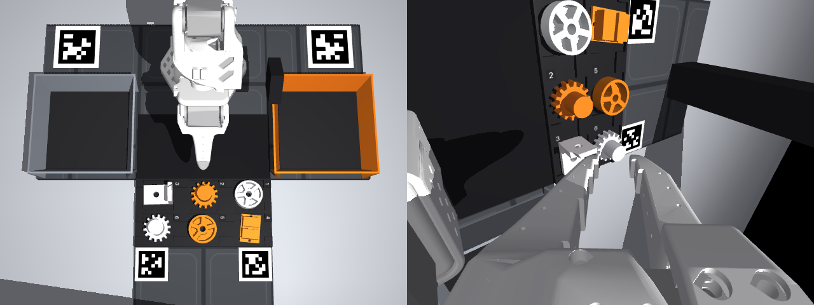
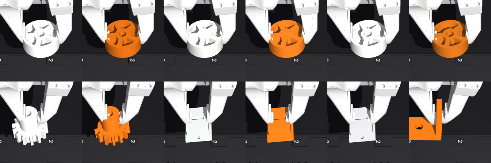

# MuJoCo simulation

The MuJoCo scene for the reference task: end-of-line quality control at an automotive supplier. The arm picks a part (wheel rim, gear,
brake pad, bracket) from the tray, shows it to the top camera, and drops it into the OK bin if it matches the work order, or into the
reject bin if it does not. Why the part set and attempts are set up this way: [experiment-design.md](experiment-design.md).
It is for trying out the layout, camera angles and part set before the real setup is printed, and then for generating synthetic data
for the verifier and the policy. All dimensions come from [`hardware/params.yaml`](../hardware/params.yaml).



## Running

```bash
cd python
uv sync
uv run flywheel-sim build      # params.yaml -> scene + 76-part catalogue
uv run flywheel-sim view       # interactive viewer
uv run flywheel-sim episode --part J-T-06     # single episode: mp4 + json + npz
uv run flywheel-sim plan       # balanced recording plan: every part goes to both bins
uv run flywheel-sim batch      # runs the plan in sim, success table (Wilson CI)
uv run flywheel-cad build      # numbered print plates: hardware/print
uv run pytest
```

Outputs are written under `outputs/sim/<run_id>/`. Example episode: [media/sim-episode.mp4](media/sim-episode.mp4).

## What is in the scene

| Item | Sim equivalent | Source |
| --- | --- | --- |
| SO-101 | Official MJCF (STS3215 parameters, 6 position-controlled joints) | `assets/so101/` |
| Gridfinity baseplate | 42 mm grid, T-shaped, 4 tiles (420 × 420 mm at its widest) | `grid` |
| Input tray | Black ESD tray, 2 × 3 numbered pockets, with finger slots | `tray` |
| OK / reject bins | KLT type; OK metal grey, reject orange. Low outward-flared wall, ribbed liner | `bins` |
| Inspection backdrop | Matte black plate (2 × 4 tiles), between the arm base and the tray | `inspection` |
| Top camera | Logitech C310, in the hinged cradle on top of a single printed mast, tilted 12.5°, 660 mm up | `cameras.top`, `mast` |
| Wrist camera | On the gripper body, sees both jaws | `cameras.wrist` |
| AprilTag | 36h11, IDs 0-3: 48 mm on either side of the arm, 32 mm beyond the tray; in reality white PLA inlay in the tile | `tags` |
| Light | A single fixed lamp | `light` |
| QC parts | Wheel rim, gear, brake pad, bracket; two colours × (sound, missing hole, broken): 60 training + 16 held-out | `parts` |

Coordinate system: the origin is where the shoulder_pan axis meets the baseplate, +x is the direction the arm faces, +y is the arm's left.
In the top camera image the arm is at the top, the OK bin on the left and the reject bin on the right.

Part IDs carry no label: `J-W-03` is wheel rim, white, number 3 (`J` rim, `D` gear, `B` brake pad, `L` bracket; `W` white,
`T` orange; the letters come from the Turkish names). Whether a part is OK or REJECT depends on the work order (`--order W` or `T`).

## Inspection image

The arm holds the part between the top camera and the matte black backdrop plate. `QCSortSim.inspection_crop()`
returns this frame cropped to the part; this is the input to the inspection classifier.



*Top row, wheel rim: white sound, orange sound, white without hub hole, orange without hub hole, white with snapped spoke, orange
with snapped spoke. Bottom row: white gear, orange gear with missing teeth, white brake pad, orange brake pad without ear holes, white brake pad
with broken corner, orange bracket. The defects exist in both colours.*

## Ground truth

At the end of an episode, `QCSortSim.outcome()` produces the same labels as the failure taxonomy in the PRD: `grasp_fail`, `drop`,
`wrong_bin`, `misclassification`, `out_of_bin`, `timeout`. Because this label is exact in sim, the VLM verifier's
accuracy (agreement, false positive) can be measured before moving to the real arm.

In reversed-command attempts (`probe`) the only criterion is following the command: the attempt succeeds if the part is in the commanded bin.
`Part.attributes()` gives the exact values of the attributes the inspection classifier will predict (type, variant, missing hole, broken).

## Scripted expert

`flywheel/sim/scripted.py` reads the part pose from the sim state and plays a pick → show → drop episode with IK. On the balanced
recording plan (120 episodes: 60 correct + 60 reversed command) it succeeds 360/360 over three runs with both work orders, and on the
held-out plan (32 episodes) 64/64 over two runs (`flywheel-sim batch`). This is not a policy;
it is proof that the scene works and a tool for generating demos in sim.

## What the sim showed

Findings that came up while building the scene and that affect the real setup:

- **The tray needs finger slots.** On low parts like the wheel rim and brake pad, the pocket wall keeps the jaws from reaching
  the floor; the pad only grips a few mm and the part drops while lifting. Cutting an 18 mm slot on both sides of the pocket
  fixes it (`tray.finger_slot`).
- **The closing axis must be parallel to the tray's long edge.** The pockets are spaced 42 mm apart in x; if the jaws close
  in x they hit the neighbouring part. That is why the bracket is placed in its pocket rotated 90°.
- **The arm sags 5-7 mm under gravity.** The servos are P-controlled only; on cylindrical surfaces like the gear hub, a few mm
  of offset is enough for the part to get squeezed between the pads and shoot out.
- **Parts dropped at the same point stack into a tower.** After the third part it rises above the bin's edge; the drop point should
  be spread out inside the bin.
- **The inspection pose is limited by kinematics.** Because of the wrist_flex limit, a part held at a 20-25° tilt cannot be lifted
  higher than 14-16 cm; that is why the top camera stands beyond the tray, looking back.

- **The bins cannot sit level with the tray.** The bin wall hits the body of the jaw going down into the edge pockets; so the bins
  sit one tile behind the tray (x 0..3u).
- **The jaw tips are not level.** The moving jaw's tip is about 2 mm lower than the fixed jaw; when gripping the gear by
  the hub, if this margin is not left the tip presses on the teeth and tips the part over.
- **The bin wall hides the tag in the corner.** The two near tags were moved 12 mm outward within their tiles.

Every fixture in the scene fits the Gridfinity tiles exactly; the same `params.yaml` also generates the print files
([hardware/README.md](../hardware/README.md)).

## Limitations

- The `measured` values in `params.yaml` were measured from the MJCF model, not the real arm. They should be measured and
  updated once the arm is set up.
- Jaw collision is modelled with stepped boxes instead of the mesh; the jaw friction (1.5) is an assumption, not measured on the
  current gripper.
- Breaks are visual only and do not change the collision geometry. The engraved ID under the part does not exist in sim.
- Camera fields of view were not measured. For the top camera the narrow end of the C310 (32° vertical) was used; if the real angle is wider
  the mast gets lower. The wrist camera was assumed to be 70° vertical.
- The feeder, emptying ramp, e-stop and cable clips are not in the scene.
- Recording is `npz` + `mp4` for now; export to the LeRobot dataset format is Phase 1 work.
