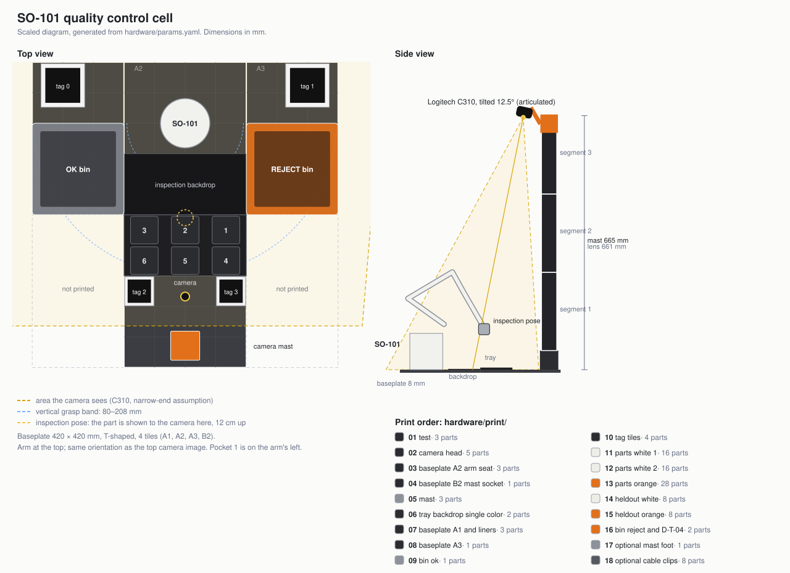
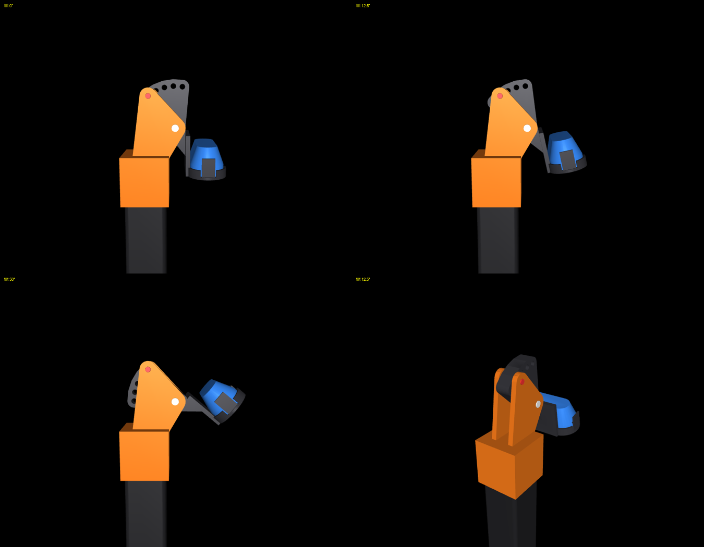

# Print files

Design rules, mistakes made and the pre-send checklist: [3DPRINT.md](3DPRINT.md).

Everything to print for the automotive-supplier end-of-line quality control cell is in the [`print/`](print/) folder. Each file
is a single print job: parts of the same filament laid out on the plate. The number is the print order. What is in which file:
[`print/contents.md`](print/contents.md).



All PLA. No screws, inserts or off-the-shelf profiles; everything is printed and fits together. Works with the stock gripper.

```bash
cd python
uv run flywheel-cad build    # regenerates print/, cell.svg and preview.png from params.yaml
```

## Order

Printed with four filaments: black, metal grey, white, orange. White is only for the QC parts; the tags are printed
on paper and glued on.

The order follows the path that gets the arm working earliest: first the risky fits and the camera head, then the tiles the arm and the mast
sit on, then the tray; bins and parts last.

| File | Filament | What to check at the end |
| --- | --- | --- |
| `01_test` | Any | Does the camera seat in the cradle, is the mast fit tight. If it doesn't fit, say so; only that part is regenerated |
| `02_camera_head` | Black | Head, hinged cradle, pins. Fit it onto the tube piece from `01` and try: does it hold the camera, does the angle lock |
| `03_baseplate_A2_arm_seat` | Black | Does the arm sit in the seat, is the clamp's opening enough for the 8 mm baseplate. The two fit gauges are here too: if they seat into the pockets underneath, the neighbouring tiles' tongues will seat too |
| `04_baseplate_B2_mast_socket` | Black | Do its tongues seat into the pockets under A2. Printed rotated 90 degrees on the plate |
| `05_mast` | Metal grey | Three mast pieces (each with two cable clamps). Mount the camera: are the tray and both bin positions in frame |
| `06_tray_backdrop_single_color` | Black | Does the arm reach down into the bottom pocket too (by hand or via teleop). Single colour; numbers embossed |
| `07_baseplate_A1_and_liners`, `08_baseplate_A3` | Black | Bin tiles; the two bin liners are in `07` |
| `09_bin_ok` | Metal grey | |
| `10_tag_tiles` | Black + white | Four tiles, two colours: body black, tag a 1 mm white inlay. Black is filament 1, white filament 2 (two separate nozzles). On the two large tiles the white number faces the bin; on the two small ones the number is engraved underneath |
| `11`, `12` | White | 32 training parts |
| `13` | Orange | 28 training parts |
| `14`, `15` | White, orange | 16 held-out parts. Keep them in a separate box so they never enter the training data |
| `16_bin_reject_and_D-T-04` | Orange | Printed after the orange parts; if there isn't enough left on the spool, print in another colour |
| `17_optional_mast_foot` | Metal grey | Only if you will use the mast outside this cell |
| `18_optional_cable_clips` | Any | Not needed; clips and a USB strain relief for fixing cables to the baseplate. Tape or zip ties do the same job |

Approximate filament needed (excluding `01` and `17`; the slicer gives the exact figure):

| Filament | Estimate | If printed fully solid |
| --- | --- | --- |
| Black | 700-800 g | 1.2 kg |
| Metal grey | 250-300 g | 0.45 kg |
| White | 250-300 g | 0.45 kg |
| Orange | 280-330 g | 0.5 kg |

The estimate assumes plastic use of 55-65 percent of the part volume; for `01` the slicer gave 94 percent of the volume,
because those parts are thin-walled. The safest approach is to slice the files and add up the grams before you start printing.

All QC parts of one colour (held-out included) must come from the same spool; a shade difference breaks the held-out measurement. That is why
the orange spool goes to `13` and `15` first, and the reject bin is left for last.

What the colours are for: the black ground (baseplate, tray, backdrop) makes the parts stand out; white and orange are the two part
variants and are clearly distinct from each other. Metal grey is only on the mast and the OK bin; if it is glossy you get light reflections
in the camera image, so hold the lamp to the side rather than straight at the part.

## What was done to shorten print time

- The baseplate went from 6 tiles to 4. The two far corner tiles only carried two tags; the tags were shrunk (32 mm) and moved onto the
  mast's tile, and those two tiles are not printed.
- The mast tube wall went from 2.4 mm to 1.6 mm.
- The tiles fit together without a separate locking piece: A1, A3 and B2 have tongues on their lower edge, A2 has pockets underneath.
  Lay out the neighbouring tiles first and lower A2 onto them last; once the arm is clamped to A2, everything stays in place.

In the slicer: the baseplate, mast and bins need neither looks nor dimensional accuracy; 0.28 mm layers, 2 walls and
10-15% infill are enough. Keep the tray, cradle and parts at 0.2 mm.

## Camera field of view

Not measured; the narrowest case for the C310 (32° vertical) was used. Even with this assumption, at the 12.5° step the camera sees
everything from 120 mm behind the arm to the foot of the mast; if the angle is wider, only the margin grows. So the mast length does not
depend on a measurement. Still, if you measure it once and write it to `cameras.top.fovy`, the sim image gets closer to reality: put an
A4 sheet on the table, point the camera straight down, and note the height at which the long edge exactly fills the 640 × 480 frame.

## Camera mast and head



*Orange: head. Dark grey: cradle and its fan plate. Blue: placeholder camera. White: axis pin. Red: locking pin.*

A single mast, 40 × 40 mm square tube, three pieces; 665 mm in total. The lens sits 65-66 cm above the baseplate; the same height as
in the XOX layout.

The head works like a tripod head, but in steps: the cradle rotates around an axis pin, and the locking pin goes into one of five
holes. The steps are 0°, 12.5°, 25°, 37.5° and 50°; each hole has its angle written next to it.

- **0°:** the camera looks straight down (XOX layout).
- **12.5°:** this cell. The camera is tilted slightly towards the arm; it sees the top face of the held part without the jaw covering it.

The reason for the steps is repeatability: if the camera angle drifts, recordings no longer match each other. If the pin is in a hole,
the angle is the same every time.

The cradle is the seat for the C310's oval body ([image of the test piece](../docs/media/camera-cradle-howto.png)): the camera is
pressed in face down, and spring tabs at both ends lock it. The clip does not come off.

Assembly:

1. Press the first mast piece into the socket on `baseplate_B2`, tapered end down; slide the other two on top of it.
2. Slide the head onto the top of the mast; its cheeks should face the arm.
3. Put the cradle's hub between the cheeks and push in the axis pin.
4. Turn the cradle to the step you want and push in the locking pin.
5. Press the camera face down into the cradle.

Each mast piece has two cable clamps on one face (six in total): press the camera cable in through the narrow opening at the front and run it
down along the mast. The channel takes two thin cables. When fitting the pieces, turn the clamp faces to the same side, away from
the arm. About 70 cm of the cable's 1.5 metres runs along the mast; the rest goes from the table to the computer; tape it down if you like.

The mast is removable: pull it out of the socket and the pieces come apart too. To use it on another table,
print `17_optional_mast_foot`; a free-standing 170 mm foot, fixed to the table with tape or a clamp.
If the fits loosen over time a drop of glue is enough, but then it no longer comes apart.

## Know before you print

The files were derived not from real hardware, but from the SO-101's CAD meshes, Logitech's published dimensions and the sim.

| Assumption | `params.yaml` | If `01_test` or `02` doesn't fit |
| --- | --- | --- |
| Camera body is a 71.15 × 31.3 mm oval (outer dimensions from Logitech, oval shape from product images; not measured) | `cameras.top.webcam.body` | Measure the body and write it in; only the cradle changes |
| Mast fit clearance is 0.1 mm | `mast.fit` | Decrease if loose, increase if it won't go in |
| Hinge pins fit with 0.15-0.3 mm clearance | in `fixtures.py` | Say so if a pin won't go in or is loose in `02` |
| The arm can be clamped to the table on top of the 8 mm baseplate | `grid.thickness` | If not enough, let me know and I'll change the arm seat |
| Cable diameter is 5 mm | `clips.cable_d` | Measure, write it in |

## Slicer

- Jobs are laid out on the part of the plate both nozzles can reach (x 22-234 mm); they print whichever nozzle the filament is in.
  Don't move parts left into the "Left nozzle only area" strip in the slicer.
- Baseplate, mast, bins: 0.28 mm layers, 2 walls, 10-15% infill. Elephant foot compensation on for the baseplate.
- Tray, backdrop, tag tiles, cradle, parts: 0.2 mm layers.
- The mast pieces are 250 mm tall: add a brim.
- `02_camera_head` and `01_test` print without supports: if the slicer adds supports, turn them off. The pins lie on their side, flat
  faces on the plate.
- The cradle's spring tabs are thin for PLA (1.5 mm). Press the camera in and out without forcing the tab; if it breaks,
  only the cradle is reprinted.
- Parts: print `11` at 0.16 and `12` at 0.20 mm layers; that gives texture differences even among sound parts of the same colour.
- Don't put the cell somewhere sunny or warm; PLA softens at 55-60 °C.
- The bin liner is a rigid ribbed sheet: it stops round parts from rolling but does not absorb bouncing. If parts
  bounce out of the bin (`out_of_bin`), laying 2 mm felt on top of the liner is enough.

## Gripper

Works with the standard SO-101 jaw; no extra parts needed. Based on the official SO-101 model:

| Part | Gripped width | Jaw angle on approach | Jaw contact height | Mass |
| --- | --- | --- | --- | --- |
| Wheel rim | 34 mm | 24° | 12 mm | 3.8 g |
| Gear (by the hub) | 18 mm | 11° | 13 mm | 4.2 g |
| Brake pad | 20 mm | 13° | 7 mm | 3.2 g |
| Bracket | 5 mm | 1° | 19 mm | 3.0 g |

The jaw's travel in the model is 110°, 128° in your arm's calibration; the widest part uses a quarter of that.
The pockets are 147-197 mm from the arm's axis, and top-down grasp reach is 80-260 mm. The hard part is height, not width: the brake pad
and wheel rim are low, so the jaw tip has to go down to 2 mm above the pocket floor. That is what the finger slots in the tray are for.

## Part set

Four types, 15 training + 4 held-out per type. The ID is engraved under the part and carries no label: `J-W-03` is wheel rim, white,
number 3. Why: [docs/experiment-design.md](../docs/experiment-design.md).

| Type | Prefix | Missing hole | Broken |
| --- | --- | --- | --- |
| Wheel rim | `J` | Hub hole not machined | One spoke snapped |
| Gear | `D` | Shaft hole not machined | Two adjacent teeth missing |
| Brake pad | `B` | No ear holes in the backing plate | Corner break on the friction block |
| Mounting bracket | `L` | One of the two holes missing | Corner break |

| | White (`W`) | Orange (`T`) |
| --- | --- | --- |
| Sound | 01-04 | 01-03 |
| Missing hole | 05-06 | 04-05 |
| Broken | 07-08 | 06-07 |
| Held-out | 09-10 | 08-09 |

## Layout

Tile units (42 mm), origin at the arm's rotation axis, +x forward, +y the arm's left. Four tiles: `A1`, `A2`, `A3` are the row near the arm
(right, middle, left), `B2` continues from the middle one. The label is engraved under each tile.

| Part | x | y |
| --- | --- | --- |
| Arm seat | -2 … 1 | -2 … 2 |
| Inspection backdrop | 1 … 3 | -2 … 2 |
| Input tray | 3 … 5 | -2 … 2 |
| OK bin | 0 … 3 | -5 … -2 |
| Reject bin | 0 … 3 | 2 … 5 |
| Tag 0, 1 (48 mm) | -2 … 0 | -5 … -3, 3 … 5 |
| Tag 2, 3 (32 mm) | 5 … 6 | -2 … -1, 1 … 2 |
| Camera mast | 6 … 8 | -1 … 1 |

## Not in this set

- **E-stop box:** the button has not been chosen yet (open question in the PRD).
- **Gravity feeder and emptying ramp:** Phase 4 work.
- **Body panel:** being considered as a showcase piece; since a thin panel cannot be gripped directly with this jaw, it will be
  designed separately together with a carrier block.
